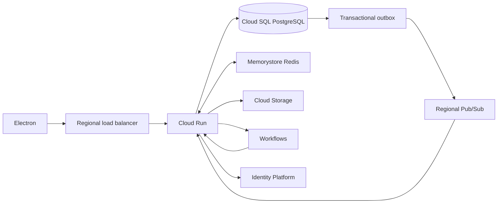

# GCP candidate brief

## 1. The stack, named exactly

GCP has no Durable-Object analogue worth imitating. A Work Stream is relational state plus locks and leases in [Cloud SQL for PostgreSQL 17 Enterprise Plus](https://cloud.google.com/sql/pricing); native FTS and `pgvector` add no service. [Cloud Run](https://cloud.google.com/run/pricing) runs the Hono API, WebSocket gateway, queue/outbox workers, and agent actions. [Memorystore for Redis Standard Tier](https://cloud.google.com/memorystore/docs/redis/pricing) carries lossy live fan-out; regional [Pub/Sub](https://cloud.google.com/pubsub/pricing) queues work; [Workflows](https://cloud.google.com/workflows/pricing) durably drives loops. Blobs use dual-region [Cloud Storage](https://cloud.google.com/storage/pricing). [Identity Platform](https://cloud.google.com/identity-platform/pricing), with [multi-tenancy](https://cloud.google.com/identity-platform/docs/multi-tenancy), supplies auth. A [regional external Application Load Balancer](https://cloud.google.com/vpc/pricing#load-balancing) fronts each plane. [Google Cloud Observability](https://cloud.google.com/products/observability/pricing), [Secret Manager](https://cloud.google.com/secret-manager/pricing), and [Cloud KMS](https://cloud.google.com/kms/pricing) supply operations and security.

## 2. Hard constraints

| # | Constraint | Mechanism and failure boundary |
|---:|---|---|
| 1 | Ordering and atomicity | Every command starts a PostgreSQL transaction and locks its `workstreams` row `FOR UPDATE`; it increments `next_event_seq` and writes transcript, card, sparse inbox rows, event deltas, and outbox together. This deliberately chooses lock contention over sequence late-commit gaps; the lock covers only allocation/inserts, never network I/O. PostgreSQL documents row-lock behavior [here](https://www.postgresql.org/docs/current/explicit-locking.html#LOCKING-ROWS). |
| 2 | Durable cursor | `stream_events(workstream_id, seq, created_month, delta)` is append-only and monthly range-partitioned from day one. The entity row is the sequence authority. Deltas seal into the final message; 30-day event partitions expire, while a client behind retention receives a snapshot plus an attested scanned-through sequence. No growing buffer is rewritten. |
| 3 | Revocation | The primary stance is bounded-staleness content push. A membership/scope transaction increments one authorization revision and publishes a Redis close hint; gateways close affected sockets with `1008` and batch-recheck revisions every 5 seconds. Redis Pub/Sub is explicitly [at-most-once](https://redis.io/docs/latest/develop/pubsub/), so the database recheck bounds notification loss. The strict-immediate stance and price are in §3. |
| 4 | Durable execution | One Workflow execution may live [one year](https://cloud.google.com/workflows/quotas); each authenticated HTTP action may run [1,800 seconds](https://cloud.google.com/workflows/docs/http-requests), and Cloud Run permits [3,600-second requests](https://cloud.google.com/run/docs/configuring/request-timeout). Thus a ~10-minute non-resumable inference fits whole. One active run lease exists per Work Stream; duplicate executions race on `(run_id, epoch)`, only the lease winner may act, and every commit fences on its token. A turn exceeding 30 minutes is aborted and restarted, visibly resetting provisional text. |
| 5 | At-least-once queue | State and an outbox row commit atomically. Competing relays claim with `SKIP LOCKED`, publish the `outbox_id` as idempotency key, then mark delivery; a sweeper repairs ambiguous/crashed publishes. Pub/Sub defaults to [at-least-once delivery](https://cloud.google.com/pubsub/docs/subscription-overview), so consumers record receipts and converge on unique business keys. |
| 6 | Residency | Launch is `us-central1`; EU is a separate project and `europe-west1` plane, with region-specific keys, endpoints, database, Redis, logs, workflows, Pub/Sub, and buckets. A region-only Pub/Sub message-storage policy with `enforceInTransit=true` rejects requests outside the allowed region ([policy docs](https://cloud.google.com/pubsub/docs/resource-location-restriction)). Content-bearing chosen services are on Google's contractual [data-residency list](https://cloud.google.com/terms/data-residency). Shared-provider webhooks terminate in EU or are unavailable to strict-EU tenants. Identity Platform remains the workspace-content-free global identity plane; all-PII EU residency is an explicit risk in §8. |
| 7 | Tenant authorization/search | The app uses a non-owner, non-`BYPASSRLS` role; each transaction sets workspace/user context and PostgreSQL RLS denies missing scope. Managed pooling must use session mode because transaction mode does not support `SET`/`RESET` ([limitations](https://cloud.google.com/sql/docs/postgres/managed-connection-pooling)). FTS and `pgvector` execute in those same RLS-protected tables; Cloud SQL documents the [`pgvector` extension](https://cloud.google.com/sql/docs/postgres/generate-manage-vector-embeddings), and PostgreSQL documents [RLS default-deny](https://www.postgresql.org/docs/current/ddl-rowsecurity.html). Clients never reach SQL; Cloud Run also applies Redis token buckets per principal plus size and statement limits. |
| 8 | Blob backup/DR | Database rows contain immutable object generation and SHA-256. Dual-region Cloud Storage automatically serves a replicated copy through regional failure; default replication targets 99.9% within one hour, not zero RPO ([durability docs](https://cloud.google.com/storage/docs/availability-durability)). Soft delete protects operator deletion. Cloud SQL has 14-day PITR, HA, and a cross-region DR replica; replica promotion is asynchronous and intentional ([DR docs](https://cloud.google.com/sql/docs/postgres/replication/cross-region-replicas)). Quarterly restores test both stores. |
| 9 | D1/R2 migration | Freeze one writer; export each [D1](https://developers.cloudflare.com/d1/platform/pricing/) using the documented [`wrangler d1 export`](https://developers.cloudflare.com/d1/wrangler-commands/), transform/import in one PostgreSQL transaction, and copy [R2](https://developers.cloudflare.com/r2/pricing/) through its [S3-compatible API](https://developers.cloudflare.com/r2/api/s3/api/) while checking stored SHA-256, counts, FKs, and object generations. Details are in §5. |

## 3. UX proxies

**1 — Streaming cadence.** The action appends and publishes one delta every 250 ms (4 Hz ceiling; modeled 3 Hz). Normal worst case is 500 ms: one missed flush plus delivery. At S=300, per-stream locks remain independent; when lock/commit p95 exceeds 100 ms the gateway degrades deliberately to 500 ms, then 1 second, rather than building an unbounded queue.

**2 — Time-to-first-token.** After commit, the API starts Workflows immediately; the outbox/Pub/Sub path is repair, not the fast path. One warm action instance removes the normal cold start. Target driver overhead is p95 under 1 second within the 1–5-second product target. **UNKNOWN — a regional benchmark of commit→Workflow start→first Cloud Run byte; Google publishes no dispatch-latency SLA.**

**3 — Interaction/coherence.** Send, transcript row, sidebar card, overlays, cursor, and outbox commit once; the 202 response carries the committed cursor. Socket bundles use that cursor, so sidebar and transcript cannot represent different commits. Typical visible acknowledgement target is 250 ms; a lost live hint leaves stale UI only until cursor catch-up.

**4 — Visible consistency artifacts.** Clients deduplicate `(workstream,seq)` and `(turn,epoch,delta_seq)`. Reconnect reads durable events after its cursor; a gap older than retention gets one snapshot/resync. A crashed inference creates a new epoch and one explicit reset, so provisional text retracts rather than duplicating or silently splicing.

**5 — Steering responsiveness.** `workstreams.steering_revision` is the sole CAS authority. The action watches the Redis hint and independently polls that row every second while inference streams; commit also fences on the captured revision. With the hint lost, generation is aborted and visibly halted within 2 seconds worst case. No second interrupt table exists.

**6 — Reconnect/wake.** Sockets renew before Cloud Run's 60-minute limit; equal-jitter retry ranges from 250 ms to 30 seconds. A current cursor normally catches up in under one second. First/mid-stream join gets the sealed transcript plus active append-only prefix, then crosses its scanned-through watermark into live delivery.

**7 — At the limit.** Cloud Run allows [1,000 concurrent requests per instance](https://cloud.google.com/run/docs/about-concurrency) and autoscaling; Redis allows [65,000 clients](https://cloud.google.com/memorystore/docs/redis/quotas). Queue dispatch and run admission are capped before SQL overload. Redis failover can lose hints, but PostgreSQL catch-up recovers; clients see slower cadence/resync, not false durable state. There is no published Redis Pub/Sub message-rate ceiling; §8 makes the load test a gate.

The primary stance is bounded-staleness content push: a revoked connection can receive text for at most 5 seconds. The strict-immediate alternative sends only invalidations over sockets and requires one live RLS content fetch per viewer/update: `3 × 2 × S` = 120 QPS at S≈20 or 1,800 QPS at S=300. Estimated incremental capacity is **$659/$2,743 monthly**, respectively: double primary/DR SQL compute and add 2/10 Cloud Run instance-equivalents. **UNKNOWN — load tests would replace that sizing.**

## 4. Cost

On-demand list-price estimate for the bounded-staleness stance: **$961/month at 10k users (S≈20)** and **$4,793/month at S=300**. Strict-immediate totals are **$1,620/$7,536**. This excludes model/provider spend and taxes. Demand is unchanged: 3 updates/s, two viewers, 176 observed hours, 15-minute loops, 40 driver steps. That is 180 logical send+deliveries/s (114M/month) at S=20 and 2,700/s (1.71B/month) at S=300; neither Redis nor Cloud Run has a per-message/receiver charge. Active WebSockets do keep Cloud Run instances billable ([WebSocket docs](https://cloud.google.com/run/docs/triggering/websockets)); the instance estimates include them.

| Line item and cited rate | S≈20 | S=300 |
|---|---:|---:|
| Cloud SQL E+ HA primary + non-HA DR replica compute; 100/500 GiB SSD, backup, cross-region WAL. E+ N2 is $0.0537/vCPU-h + $0.0091/GiB-h, doubled for HA; SSD $0.17/GiB-month, HA $0.34, backup $0.08 ([pricing](https://cloud.google.com/sql/pricing)) | $625 | $2,631 |
| Memorystore Standard: 1 GiB M1 at $0.064/GiB-h; 5 GiB M2 at $0.054/GiB-h ([pricing](https://cloud.google.com/memorystore/docs/redis/pricing)) | $47 | $197 |
| Cloud Run: 3/10 average 1-vCPU+1-GiB instance-equivalents at $0.000018/vCPU-s + $0.000002/GiB-s ([pricing](https://cloud.google.com/run/pricing)); fan-out messages included | $158 | $526 |
| Workflows: 6,667/100,000 loops × 40 external steps, first 2,000 free, then $0.025/1,000 ([pricing](https://cloud.google.com/workflows/pricing)) | $7 | $100 |
| Pub/Sub: first 10 GiB/month throughput free, then $40/TiB; retained backlog is $0.27/GiB-month ([pricing](https://cloud.google.com/pubsub/pricing)) | $0 | $0 |
| Dual-region Cloud Storage and operations: $0.044/GiB-month; Class A $0.01/1,000, B $0.0004/1,000 ([pricing](https://cloud.google.com/storage/pricing)) | $6 | $60 |
| Identity Platform Tier-1: first 50k MAU free; next 50k $0.0055, next tier $0.0046 ([pricing](https://cloud.google.com/identity-platform/pricing)) | $0 | $965 |
| Regional load balancer: $0.025/h + $0.008/GiB processed ([pricing](https://cloud.google.com/vpc/pricing#load-balancing)) | $19 | $26 |
| Public egress: first GiB free, then $0.12/GiB to 1 TiB ([pricing](https://cloud.google.com/vpc/network-pricing#internet-data-transfer-rates)) | $12 | $123 |
| Logging: first 50 GiB/project free, then $0.50/GiB ([pricing](https://cloud.google.com/products/observability/pricing)); Secret Manager/KMS ([rates](https://cloud.google.com/secret-manager/pricing), [rates](https://cloud.google.com/kms/pricing)) | $2 | $80 |
| Fixed isolated staging environment | $85 | $85 |
| **Total** | **$961** | **$4,793** |

No base license or support negotiation is included. Workflows above 100M steps becomes contact-sales and is not approached. Tier-2 SAML/OIDC is $0.015/MAU above 50: 1k/25k federated MAU adds about $14/$374 to the two columns.

## 5. Migration plan

**Estimate: 14 product-weeks (two engineers, about seven calendar weeks), range 12–18.**

Keep `packages/contracts`, business services, the Bind adapter, Electron UI, and Hono route shapes. Port Hono to its Node adapter on Cloud Run. Rewrite D1 repositories for PostgreSQL transactions/RLS; replace R2 bindings, queue/driver bindings, `WorkstreamRoom`, `WorkspaceScheduler`, Worker RPC bridges, secrets, and auth adapters. `WorkstreamRoom` is not canonical today, so PostgreSQL events + Cloud Run/Redis replace coordination rather than migrate room storage. A SQL due-row poller plus Pub/Sub replaces workspace alarms. Identity Platform takes provider identity; regional SQL still owns workspace membership/session policy.

The existing Hono Worker API is **not** a permanent edge tier. It becomes a read-only upgrade/redirect shim for two desktop release windows, then is deleted. Electron retains typed HTTPS, one regional base URL, short-lived socket tickets, durable cursors, custom-protocol login, and reconnect logic; only allowed origins, auth token exchange, and API/WebSocket hosts change. This avoids a renderer rewrite.

Build and soak the GCP plane first. Rehearse each regional conversion from D1 export and R2 S3 copy. At cutover: reject new writes/runs, drain current queues/workflows and active rooms, take final exports, import in one SQL transaction, copy changed objects, validate counts/FKs/hashes, invalidate sessions, and switch the regional endpoint. Keep frozen D1/R2 for rollback; never dual-write. At ~zero users this is hours, not online CDC. Existing EU data follows the same isolated procedure even though EU is deferred for launch.

The estimate assumes two engineers familiar with TypeScript/PostgreSQL: 3 weeks repositories/schema, 2 auth/API runtime, 3 realtime/concurrency, 2 execution/scheduling, 2 IaC/migration, 2 failure testing. It excludes unrelated feature work and external identity/provider review lead time.

## 6. Operations at team-size-small

Pages are: Cloud Run 5xx/latency or socket reconnect surge; SQL CPU/storage, lock wait, replication lag, or failed backup; oldest outbox/Pub/Sub age; failed/old Workflow; Redis failover/memory; cursor lag; and restore-check failure. Alerts and correlated IDs land in Google Cloud Observability; product audit rows and `pgAudit` remain SQL-queryable ([Cloud SQL auditing](https://cloud.google.com/sql/docs/postgres/pg-audit)).

An engineer must understand seven runtime products (SQL/PostgreSQL, Cloud Run, Redis, Pub/Sub, Workflows, Storage, Identity) plus load balancing and the shared observability/secrets/key facilities. Canonical state, leases, receipts, outbox, audit, and history are inspectable with ordinary SQL; Redis can be discarded without losing truth. Exit cost is moderate: Hono, SQL, and data formats are portable; Workflows, Identity, and service wiring are GCP-specific rewrites.

Quarterly DR is a 2–4 engineer-hour runbook: restore PITR into an isolated instance, promote/test the DR replica, recover a soft-deleted object, run invariants/checksums, then destroy the drill resources. Regional failover is deliberate because Cloud SQL replication is asynchronous; the write endpoint and regional API are switched only after lag inspection.

## 7. Infrastructure as code & deployment

| Component | IaC | Dashboard/support-only or non-declarative residue |
|---|---|---|
| Cloud SQL + flags/pool/DR | `hashicorp/google`: `google_sql_database_instance`; checked-in SQL runner | Resizes are declarative; storage cannot shrink. Emergency promotion is runbook/API. |
| Cloud Run | `google_cloud_run_v2_service` | Regional CPU quota increases use quota console/support. |
| Memorystore | `google_redis_instance` | Service-tier upgrade is unsupported; replacement is required. |
| Pub/Sub | `google_pubsub_topic`, `google_pubsub_subscription` | Quota increase request if published regional quota is exceeded. |
| Workflows | `google_workflows_workflow` | Concurrent-execution quota increase request. |
| Cloud Storage | `google_storage_bucket` | None. |
| Identity Platform | `google_identity_platform_config`, `google_identity_platform_tenant`, tenant OIDC/SAML resources | Google OAuth brand/consent verification and each customer's IdP exchange require external/dashboard action. |
| Regional load balancer | `google_compute_region_network_endpoint_group`, `google_compute_region_url_map`, `google_compute_region_target_https_proxy`, `google_compute_forwarding_rule` | None. |
| Observability | `google_monitoring_alert_policy`, `google_monitoring_dashboard`, `google_logging_project_bucket_config` | Incident acknowledgement. |
| Secret Manager / KMS | `google_secret_manager_secret`, `google_kms_key_ring`, `google_kms_crypto_key`; payload injected by CI | Secret values never enter Terraform state. |

Separate prod/staging projects use the same modules; staging's smaller zonal SQL/Basic Redis floor is the $85 cost above. Preview Cloud Run revisions scale to zero and use isolated databases on staging, adding negligible idle cost and no production data.

Migrations are immutable checked-in SQL under a global PostgreSQL advisory lock. Every change is expand/backfill/deploy/contract: the expand phase accepts old and new code, so an old Cloud Run revision cannot write an incompatible new shape. Destructive contraction waits two releases. One regional schema version means dormant Work Streams never wake on old schemas. This closes today's migrate-before-code hazard window. Rollback sends traffic to the prior revision while additive schema remains. Terraform plan detects drift; Secret Manager supplies runtime secrets and KMS supplies regional CMEKs. A normal deploy target is 10–20 minutes with per-service revision blast radius. Enterprise Plus advertises sub-second planned operations, but enabling managed pooling initially restarts the database ([limitations](https://cloud.google.com/sql/docs/postgres/managed-connection-pooling)).

## 8. Top three risks

**Driver latency (30% probability, launch-wide UX).** Google gives Workflows duration/throughput limits but no start-latency SLA. Forty actions do not all affect TTFT, yet cold starts or a slow first dispatch could miss five seconds. Gate launch on a 10k-sample same-region benchmark with p95 driver overhead under one second; keep one Cloud Run action instance warm. Failure delays launch, not correctness.

**Redis Pub/Sub capacity (20%, live UX at S=300).** Memorystore publishes 10-Gbps tiers and client limits, but no messages/second ceiling for Pub/Sub. Delivery is intentionally lossy. Gate on 2× S=300 (5,400 logical deliveries/s), failover, and reconnect tests; durable SQL cursors contain blast radius to cadence/resync. Passing may require a larger Redis tier (money); failure even at M3 reopens architecture.

**Identity residency (40% that a strict prospect asks; EU-customer blocker).** Identity Platform is absent from Google's contractual configurable-location list. This design keeps workspace content and connector credentials out of it, matching Avalon's global-identity boundary, but cannot promise EU-only identity PII. **UNKNOWN — a Google contractual commitment or signed customer interpretation that global identity is outside the required boundary.** Without it, those customers cannot launch on this auth choice.

There is no private-beta or unpublished quota dependency at launch and no planned contact-sales limit raise.

## 9. What breaks first

The first likely binding constraint is the single PostgreSQL writer, not fan-out billing: at S=300 it must absorb 600–1,200 delta writes/s plus commands, search, outbox, WAL, and revocation checks. The proposed 8-vCPU/64-GiB size is a hypothesis. Up to roughly S=300–700, raising Cloud SQL to 16/32 vCPU, shortening retention, and isolating read/search load is money/configuration. Sustained p95 row-lock wait or WAL saturation after that means architecture: shard workspaces across Cloud SQL instances while keeping each workspace single-home. At S=2,000, 4,000–8,000 delta writes/s makes that redesign likely. Redis first scales from 1 to 5+ GiB; its unpublished throughput is a prior load-test gate, not a claimed ceiling.

## 10. Tripwires

- Reopen if commit p95 exceeds 100 ms, per-stream lock wait p95 exceeds 50 ms, or primary CPU remains above 65% at S<300.
- Reopen if Workflow dispatch overhead p95 exceeds 1 second or end-to-end TTFT p95 exceeds 5 seconds.
- Reopen if Redis publish p99 exceeds 50 ms, failover creates gaps in more than 0.1% of watched sessions, or M3 fails the 2× S=300 test.
- Reopen if platform cost exceeds $2,000/month at S≈20 or Tier-2 identity exceeds $500/month before material enterprise revenue.
- Reopen 90 days before EU launch if identity residency is unresolved or a restore drill misses the contractual RPO/RTO.

## 11. Assumptions register

| Assumption, not vendor fact | Value used / resolution |
|---|---|
| Demand inherited verbatim | 3 visible Hz, V=2, 176 h/month, 15-minute average loop, 40 steps; S=20 is the 10k-user point. |
| Growth workload | S=300 uses 100k loops/month and 250k Tier-1 MAU; S=20 linearly uses 6,667 loops. Pub/Sub assumes at most one sub-1-KiB repair message per loop, below its free throughput. Federated-MAU sensitivity uses 1k/25k. |
| SQL sizing/data | S=20: 2 vCPU/16 GiB, 100 GiB SSD/backup and 100 GiB cross-region WAL; S=300: 8/64, 500 GiB and 1 TiB WAL. Both DR replicas are priced at Iowa rates. Benchmark resolves adequacy. |
| Cloud Run | 3 and 10 average 1-vCPU/1-GiB instance-equivalents, including one warm action instance. |
| Storage/network/logs | 100 GiB vs 1 TiB blobs/public egress; 20 vs 200 GiB logs; stated operation counts produce rounded $6/$60 storage lines. |
| Live timing | 250-ms batch, 500-ms normal worst case, 5-second revocation check, 1-second steering poll/2-second stop, 250-ms–30-second reconnect. Strict-immediate sizing doubles primary/DR SQL compute and adds 2/10 Cloud Run equivalents. |
| Retention/defaults | Event partitions retain 30 days. A missing per-user inbox row means no unread/mention/needs-input; positive rows are upserted atomically and queried by `(workspace_id,user_id,state,updated_at)`. New members begin at their join watermark. |
| Operations/migration | $85 staging, 10–20-minute deploy, 2–4-hour quarterly drill, 14 product-weeks central migration estimate. |
| Risk judgments | Driver 30%, Redis 20%, strict identity-residency request 40%; PostgreSQL money-to-sharding range S≈300–700. Load tests and customer discovery replace these estimates. |
