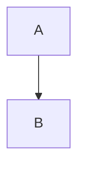

Intro paragraph with **bold**, _italic_, ~~strike~~, `code`, a [link home](../index.md), an autolink www.example.com and https://rallywith.ai, and <kbd>⌘</kbd> + <kbd>K</kbd>. A footnote.[^1]

# A body H1

## Tables

| Left | Center | Right |
| :--- | :----: | ----: |
| a    |   b    |     c |

### Task list

- [x] done
- [ ] not done

> [!NOTE]
> Useful information.

> [!WARNING]
> Careful now.

> A plain quote.

```ts
const greet = (name: string): string => `hi ${name}`; // comment
```



<details><summary>More</summary>

Hidden **content**.

</details>


<script>alert(1)</script>

[^1]: The footnote text.
