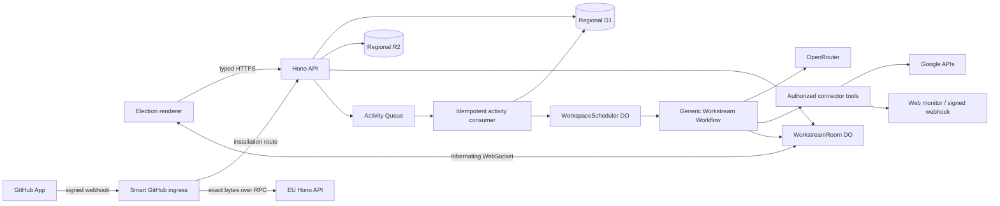

# Architecture

## System summary

Avalon is a pnpm TypeScript monorepo with three deployment surfaces:

1. `apps/desktop` is the Electron application. Its main process owns main and Settings window lifecycle, custom-protocol login completion, encrypted session storage, file selection, and a minimal validated IPC bridge. Both sandboxed React surfaces use a packaged CommonJS preload and talk only to the configured regional API. The macOS application menu opens the singleton Settings window with **Command-,**.
2. `apps/api` is a Hono application deployed as the same Cloudflare Worker code in Global and EU environments. It owns authentication, authorization, REST endpoints, WebSocket upgrades, D1 repositories, R2 objects, Queue production/consumption, Workflows, scheduling, connector execution, and the OpenRouter harness.
3. Shared packages contain runtime-validated contracts, database schema/repositories, connector adapters, agent-loop code, UI primitives, and test fixtures. Business rules live here or in services, never in route handlers.

## Request and event flow



Canonical product state lives in D1. Large activity payloads, uploads, snapshots, and artifacts live in R2 with relational metadata in D1. Durable Objects coordinate ordering, presence, sockets, and alarms but are not canonical stores.

## Region boundary

Google sign-in has one platform endpoint: the Global control plane at `api.with-avalon.com`. It creates a short-lived, identity-only bootstrap session and then discovers the user's existing workspace memberships and pending invitations in both regions. Only users with neither receive the post-auth workspace-region selector. Existing members activate their workspace directly, while invited users can accept or decline the invitation in its issuing region without a second Google sign-in.

Global reaches the EU deployment only through named Cloudflare Worker RPC service bindings; there is no public internal-bridge HTTP route. `RegionalIdentityBridge` carries minimal onboarding operations. `GitHubRegionalBridge` carries verified setup operations and exact signed GitHub webhook bytes for installations connected in EU. A successful activate, create, or accept operation mints a session in the workspace's owning region, commits the Global opaque workspace binding, and revokes the bootstrap session. The desktop then pins that regional API base URL. Both deployments retain separate D1, R2, Durable Object namespaces, session-signing and credential-encryption keys, and Worker secrets. Cross-region workspace-content access is not implemented.

This is a logical and storage boundary for the prototype, not a claim that all subprocessors provide complete EU-only processing. The Global identity control plane transiently handles onboarding summaries for EU workspaces and stores an opaque EU workspace locator; EU workspace content remains in the EU deployment.

## Identity and secrets

- Google sign-in uses server-side authorization code + PKCE against the single Global `/auth/google/start` endpoint. The Electron main process also creates a separate high-entropy verifier for each native attempt and exposes only its opaque attempt ID and S256 challenge to the renderer. The provider callback redirects through `https://with-avalon.com/auth/desktop/#target=…`; that page accepts only an exact `avalon://auth/complete` target, removes the fragment from history, and opens the app with a short-lived login ticket bound to the attempt. Ticket redemption is one-time and requires the verifier retained only in main-process memory. Workspace choice and invitations are resolved after identity authentication through authenticated onboarding APIs rather than being carried through provider state.
- Connector authorization is separate and incrementally requests only the capabilities in the selected **Google Mail + Calendar** or **Google Drive + Docs + Sheets** preset. These are presentation and authorization bundles over the same `google` adapter, not separate connector types. Each authorization still produces an independently scoped connection record.
- Desktop refresh material is stored through Electron `safeStorage`; access tokens remain in memory where practical.
- Connector refresh tokens are AES-GCM encrypted with a regional Worker secret.
- OpenRouter, Google, session-signing, webhook, and encryption keys are server-only values loaded from local `.env.local` during development and Cloudflare secrets in hosted environments.
- Every API operation resolves a session, workspace, role, execution principal, connection scope, and requested capability server-side.

## Work streams and live updates

REST/D1 remains canonical. Within each regional workspace, every work stream maps deterministically to exactly one WorkstreamRoom Durable Object named from region, workspace ID, and work-stream ID. EU calls resolve the namespace through `jurisdiction("eu")`. The room coordinates ordering and ephemeral presence; it does not duplicate the canonical transcript.

The room accepts sockets with Cloudflare's hibernation API and stores connection identity in serialized attachments. After opening, the client sends `subscribe` with its last applied `afterSequence`. Sequence zero receives a snapshot; a reconnect within the bounded in-memory event window receives only newer events. If hibernation discarded that window, the cursor is ahead, or the gap cannot be proved complete, the server sends `resync_required` and the client invalidates its canonical REST queries. The replay cache is intentionally memory-only and bounded to 256 events or 512 KB to avoid per-token Durable Object storage writes.

Stream deltas are batched before broadcast. Cloudflare's WebSocket auto-response answers exact text `ping` frames with `pong` without waking a hibernated object. The desktop sends jittered keepalives, closes an unresponsive socket, and reconnects with equal-jitter exponential backoff capped at 30 seconds; it pauses retry while offline and resumes with the last sequence cursor.

Viewing is presence only. Participant persistence occurs only through explicit addition or an authored work-stream action.

## Agent harness

A lightweight structured classifier decides whether a human message is `agent_action`, `human_only`, `both`, or `uncertain`. Eligible messages start one generic Cloudflare Workflow instance parameterized by opaque IDs.

The bounded loop assembles authorized context, streams an OpenRouter response, validates tool calls with Zod, runs independent reads concurrently, serializes writes, persists tool state before side effects, reuses completed results on retries, and stops for structured elicitation or configured limits. An ambiguous write is never blindly retried; the work stream becomes `needs_input`.

## Automations and scheduling

Natural-language automation creation compiles into a validated draft. A versioned template holds reusable behavior; a subscription pins a version and owns scope, execution principal, connector bindings, overrides, and schedule state.

One WorkspaceScheduler Durable Object per workspace maintains one alarm for the earliest due item. D1 uniqueness constraints are authoritative under repeated alarms. It starts generic workflow instances rather than deploying per-automation code. A planned run and its work stream are reused when the scheduled instant arrives.

## Connectors and ingestion

Connector adapters expose typed authorization, polling, webhook normalization, hydration, tools, watches, and health checks. V1 ships complete paths for:

- One Google connector family presented as Mail + Calendar and Drive + Docs + Sheets presets, with incremental OAuth scopes, refresh handling, native Docs/Sheets APIs, and bounded read/write tools.
- One public GitHub App with installation tokens, expiring user authorization, a signature-verifying smart ingress, regional fanout, resource discovery, and normalized repository activity.
- Public Linear and Notion integrations with regional OAuth callbacks and signed regional webhook ingestion.
- Signed generic webhooks with HMAC, timestamp, replay, schema, and deduplication checks.
- Web monitoring with conditional requests, bounded fetches, content hashing, readable text extraction, and R2 snapshots.

Google ingestion uses provider cursors rather than push delivery: Gmail history IDs, Calendar sync/completion cursors, and Drive change page tokens. Drive changes are MIME-classified into Drive, Docs, or Sheets resources, so the same Drive poll produces `drive.file_changed`, `docs.document_changed`, or `sheets.spreadsheet_changed`. There is no Google webhook or push-channel implementation; Avalon watches operate after a polled activity has been normalized.

Normalized activities store compact metadata in D1 and opaque payload references to R2. Provider objects discovered from events are upserted as durable regional resources; attaching one to a work stream does not copy provider content, and hydration remains capability-checked through its originating connection. Queue messages contain only IDs and routing metadata. Deterministic trigger/watch checks precede any LLM classification.

## Repository map

```text
apps/
  desktop/                 Electron main, preload, React renderer, packaging
  api/                     Hono Worker, routes, services, DOs, Workflows, Queue
packages/
  contracts/               Zod API, WebSocket, agent, connector contracts
  db/                      D1 migrations, repositories, region-aware queries
  agent-harness/           Classifiers, context, OpenRouter loop, tools
  connectors/              Core adapter, Google, webhook, web monitor
docs/                      Product, architecture, security, setup, runbooks
```

## Security boundaries

The Electron renderer never receives provider credentials, native PKCE verifiers, OpenRouter keys, Cloudflare administration keys, raw IPC, Node integration, or arbitrary navigation. Main validates every exposed IPC call against a live Avalon window and its pinned renderer origin. API logs redact tokens, codes, bodies, file contents, model context, and unnecessary personal information. External actions and authorization decisions create audit records with structured correlation IDs.
