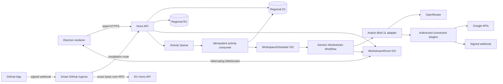

# Architecture

## System summary

Avalon is a pnpm TypeScript monorepo with three deployment surfaces:

1. `apps/desktop` is the Electron application. Its main process owns main and Settings window lifecycle, custom-protocol login completion, encrypted session storage, file selection, and a minimal validated IPC bridge. Both sandboxed React surfaces use a packaged CommonJS preload and talk only to the configured regional API. The macOS application menu opens the singleton Settings window with **Command-,**.
2. `apps/api` is a Hono application deployed as the same Cloudflare Worker code in Global and EU environments. It owns authentication, authorization, REST endpoints, WebSocket upgrades, D1 repositories, R2 objects, Queue production/consumption, Workflows, scheduling, connector execution, and the OpenRouter harness.
3. Shared packages contain runtime-validated contracts, database schema/repositories, connector adapters, agent-loop code, UI primitives, and test fixtures. Business rules live here or in services, never in route handlers.

## Request and event flow



Canonical product state lives in D1. Large activity payloads, uploads, snapshots, and artifacts live in R2 with relational metadata in D1. Durable Objects coordinate ordering, presence, sockets, and alarms but are not canonical stores.

Users and workspaces each own a validated IANA timezone. The desktop detects the local system timezone during native authentication, while browser or unavailable detection falls back to `America/Los_Angeles`. Workspace defaults are `America/Los_Angeles` in Global and `Europe/London` in EU. Automation compilation preserves explicit trigger timezones and otherwise resolves personal or workspace defaults according to scope before final schema validation.

## Region boundary

Google sign-in has one platform endpoint: the Global control plane at `api.with-avalon.com`. It creates a short-lived, identity-only bootstrap session and then discovers the user's existing workspace memberships and pending invitations in both regions. Only users with neither receive the post-auth workspace-region selector. Existing members activate their workspace directly, while invited users can accept or decline the invitation in its issuing region without a second Google sign-in.

Global reaches the EU deployment only through named Cloudflare Worker RPC service bindings; there is no public internal-bridge HTTP route. `RegionalIdentityBridge` carries minimal onboarding operations. `GitHubRegionalBridge` carries verified setup operations and exact signed GitHub webhook bytes for installations connected in EU. `WorkstreamEmailRoutingBridge` reserves globally unique, immutable friendly addresses, while `InboundEmailRegionalBridge` passes only one verified Resend event to the owning data plane so the body is fetched and stored there. A successful activate, create, or accept operation mints a session in the workspace's owning region, commits the Global opaque workspace binding, and revokes the bootstrap session. The desktop then pins that regional API base URL. Both deployments retain separate D1, R2, Durable Object namespaces, session-signing and credential-encryption keys, and Worker secrets. Cross-region workspace-content access is not implemented.

This is a logical and storage boundary for the prototype, not a claim that all subprocessors provide complete EU-only processing. The Global identity control plane transiently handles onboarding summaries for EU workspaces and stores an opaque EU workspace locator; EU workspace content remains in the EU deployment.

## Identity and secrets

- Google sign-in uses server-side authorization code + PKCE against the single Global `/auth/google/start` endpoint. The Electron main process also creates a separate high-entropy verifier for each native attempt and exposes only its opaque attempt ID and S256 challenge to the renderer. The provider callback redirects through `https://with-avalon.com/auth/desktop/#target=…`; that page accepts only an exact `avalon://auth/complete` target, removes the fragment from history, and opens the app with a short-lived login ticket bound to the attempt. Ticket redemption is one-time and requires the verifier retained only in main-process memory. Workspace choice and invitations are resolved after identity authentication through authenticated onboarding APIs rather than being carried through provider state.
- Connector authorization is separate and incrementally requests only the selected capabilities. Each regional API persists an opaque connector-attempt record before returning the provider URL, completes the provider callback and credential persistence in-region, records a terminal result, and then redirects through the same hosted HTTPS-to-desktop handoff. The custom-protocol launch is a fast notification; Settings also polls the authenticated regional attempt endpoint, so the server record remains authoritative when a browser blocks or loses the launch. Google Mail + Calendar and Google Drive + Docs + Sheets remain presentation and authorization bundles over the same `google` adapter, not separate connector types.
- Desktop refresh material uses a versioned authenticated-encryption envelope. The default envelope uses an application-wide embedded key for update portability; Application → **Lockdown mode** uses Electron `safeStorage` and the operating-system keystore instead. Toggling the mode in-app migrates the auth credential, disposable profile cache, and any legacy session file under the serialized session-mutation boundary. The plaintext `userData/application-settings.json` preference is not authority to unwrap a Lockdown envelope by itself: an off preference paired with a new Lockdown envelope at startup removes only credential-bearing files and forces sign-in. If the keystore becomes unavailable, Avalon automatically applies the same off-and-relogin fallback. Access tokens remain in memory where practical.
- Connector refresh tokens are AES-GCM encrypted with a regional Worker secret.
- OpenRouter, Google, session-signing, webhook, and encryption keys are server-only values loaded from local `.env.local` during development and Cloudflare secrets in hosted environments.
- Azure OpenAI realtime dictation also keeps its endpoint and API key in the regional Worker. The desktop receives a one-minute, single-use Avalon socket ticket; Cloudflare consumes its JTI, reserves a bounded regional session, opens the authenticated Azure WebSocket, and admits only rate- and size-limited audio-buffer events from the client. Connections are capped at five minutes and raw microphone audio and transcripts are not persisted by this bridge.
- Every API operation resolves a session, workspace, role, execution principal, connection scope, and requested capability server-side.

## Work streams and live updates

REST/D1 remains canonical. Within each regional workspace, every work stream maps deterministically to exactly one WorkstreamRoom Durable Object named from region, workspace ID, and work-stream ID. EU calls resolve the namespace through `jurisdiction("eu")`. The room coordinates ordering and ephemeral presence; it does not duplicate the canonical transcript.

The room accepts sockets with Cloudflare's hibernation API and stores connection identity in serialized attachments. After opening, the client sends `subscribe` with its last applied `afterSequence`. Sequence zero receives a snapshot; a reconnect within the bounded in-memory event window receives only newer events. If hibernation discarded that window, the cursor is ahead, or the gap cannot be proved complete, the server sends `resync_required` and the client invalidates its canonical REST queries. The replay cache is intentionally memory-only and bounded to 256 events or 512 KB to avoid per-token Durable Object storage writes.

Room `sequence` orders replayable socket events. Model streaming has a second cursor domain: stable `turnId`, retry `epoch`, and per-epoch `streamSeq`; `reset` replaces only the active turn's partial text from an abandoned route, preserving completed text from earlier tool turns. Deltas are batched without crossing turn/epoch boundaries, and reset frames are emitted alone. The desktop retains stream cursors across reconnects, drops duplicate or stale frames, and still treats the final D1 message and REST snapshot as canonical.

The desktop holds a work stream's harness status in two caches: the detail query behind the open work stream's header, and the list query behind every sidebar row. A `harness_status_changed` frame writes both in one update rather than writing the detail and invalidating the list, so the header and the sidebar dot cannot disagree across a refetch that is still in flight. Polling the list remains the backstop, and is the only refresh for a work stream whose room this client holds no socket to; when a poll returns a status the detail cache was written before, the detail is re-read from REST. Nothing else refreshes it on a timer, so without that a frame lost while connected would strand the header pulsing "Running" over a sidebar row that had already moved on.

Cloudflare's WebSocket auto-response answers exact text `ping` frames with `pong` without waking a hibernated object. The desktop sends jittered keepalives, closes an unresponsive socket, and reconnects with equal-jitter exponential backoff capped at 30 seconds; it pauses retry while offline and resumes with the last room-sequence cursor.

Viewing is presence only. Participant persistence occurs only through explicit addition or an authored work-stream action.

## Agent harness

A lightweight structured classifier decides whether a human message is `agent_action`, `human_only`, `both`, or `uncertain`. Eligible messages start one generic Cloudflare Workflow instance parameterized by opaque IDs.

The production entry point adapts `@juno-ai/bind` 11.0.0 to Avalon's OpenRouter transport and durable ports. Bind owns transcript healing, plugin and skill activation, turn/tool iteration, completion-defect recovery, epoch-aware streaming, and classified route traversal. Avalon owns authorization, regional persistence, admission, accounting, and terminal state.

Each Workflow attempt holds a renewable D1 lease; run-scope, plugin-activation, tool receipt-plan/completion, checkpoint, and terminal commits are fenced by attempt and lease ownership. The run freezes its principal, eligible connections/capabilities, trigger policy, routing/prompt versions, tool-surface hash, and limits. The host revalidates principal and work-stream state, automation subscription and pinned template version, trigger evidence, connection ownership/grants, and health at admission, before credential decryption and tools, and between model turns. Later checks may revoke authority but cannot add a new connection or grant. Expired attempts are compare-and-swap reaped, and completion commits only after the final agent message is durable.

Each run creates a fresh Bind registry. Stable always-active plugins separate discovery, time, scoped prose memory, scoped structured tables, work-stream operations, and automation architecture; the run registers only the bundles applicable to that agent. Each eligible installed connection becomes a credential-scoped Bind plugin built from static adapter metadata and narrowed to frozen grants. Bound or attached connections can preload; other eligible plugins are progressively loaded from the catalog, with activation persisted before exposure. Active plugins are reauthorized before inference and again at tool execution. The loop overlaps safe reads, serializes writes, records execution plans and results, replays completed receipts, and stops rather than repeating an ambiguous external write.

The run also enforces context, token, cost, iteration, tool-call, wall-clock, and streaming-watchdog limits. Classified provider attempts append to an immutable inference ledger. Cancellation is a durable request observed by the lease owner, which alone commits the final `stopped` transition.

Durable memory is scoped to an ad-hoc work stream, an installed automation subscription, a user inside a workspace, or the workspace itself. The host—not the model—derives the searchable scope union from the frozen execution principal and run origin. D1 FTS5 and the regional Vectorize index are searched concurrently, merged with reciprocal-rank fusion, and rechecked against canonical D1 authorization, revision, expiry, and invalidation state. Admission freezes recalled items and their context hash for retries. Memory writes use receipt replay, revision compare-and-swap, append-only mutation records, and a transactional indexing outbox; lexical search remains available while embeddings catch up.

## Automations and scheduling

Natural-language automation creation compiles into a validated draft. A versioned template holds reusable behavior; a subscription pins a version and owns scope, execution principal, connector bindings, overrides, and schedule state.

One WorkspaceScheduler Durable Object per workspace maintains one alarm for the earliest due item. D1 uniqueness constraints are authoritative under repeated alarms. It starts generic workflow instances rather than deploying per-automation code. A planned run and its work stream are reused when the scheduled instant arrives.

The alarm has three target kinds: due `schedules`, due `resource_watches`, and due `workstream_wakeups`. A `schedules` row names exactly one of an automation subscription, a connector connection, or a digest schedule. A Durable Object holds one alarm at a time, so the object arms for the earliest target across all three and drains every target due at that instant before re-arming, with per-target exponential backoff held in Durable Object storage. Workspaces never contend: each has its own object and its own alarm.

A person's scheduled digest is one `schedules` row per delivery time, because a single RRULE multiplies `BYHOUR` by `BYMINUTE` and so cannot carry an arbitrary list of times. When one fires, the scheduler freezes a window over the first-party `activity_events` log, claims the occurrence, and starts an ordinary run in a hidden `system_kind` work stream; what the run writes is then delivered by email or by any connector declaring a personal delivery surface. See [`DIGESTS.md`](DIGESTS.md).

A work stream can schedule its own wake-up through `workstream_schedule_wakeup`, giving a relative duration or an exact ISO-8601 instant plus the prompt to act on. When it fires, the scheduler claims the row, re-checks the execution principal that scheduled it against current membership, writes a system row into the transcript, and starts an ordinary work-stream run whose trigger is the stored prompt.

## Connectors and ingestion

Connector adapters expose typed authorization, polling, webhook normalization, hydration, tools, watches, health checks, and a static agent-plugin descriptor. Runtime plugins are instantiated per eligible connection; provider content and connection labels cannot contribute trusted plugin instructions. V1 ships complete paths for:

- One Google connector family presented as Mail + Calendar and Drive + Docs + Sheets presets, with incremental OAuth scopes, refresh handling, native Docs/Sheets APIs, and bounded read/write tools.
- One public GitHub App with installation tokens, expiring user authorization, a signature-verifying smart ingress, regional fanout, resource discovery, and normalized repository activity.
- One public Linear app with Global and EU OAuth callbacks, app-actor attribution, a signature-verifying smart ingress, regional fanout, a first-class resource surface, and a feature-gated `protocol_only` native-agent surface; plus a separate public Notion integration with regional callbacks and signed regional webhook ingestion.
- Signed generic webhooks with HMAC, timestamp, replay, schema, and deduplication checks.

Google ingestion uses provider cursors rather than push delivery: Gmail history IDs, Calendar sync/completion cursors, and Drive change page tokens. Drive changes are MIME-classified into Drive, Docs, or Sheets resources, so the same Drive poll produces `drive.file_changed`, `docs.document_changed`, or `sheets.spreadsheet_changed`. There is no Google webhook or push-channel implementation; Avalon watches operate after a polled activity has been normalized.

Normalized activities store compact metadata in D1 and opaque payload references to R2. Provider objects discovered from events are upserted as durable regional resources; attaching one to a work stream does not copy provider content, and hydration remains capability-checked through its originating connection. Queue messages contain only IDs and routing metadata. Deterministic trigger/watch checks precede any LLM classification.

## Repository map

```text
apps/
  desktop/                 Electron main, preload, React renderer, packaging
  api/                     Hono Worker, routes, services, DOs, Workflows, Queue
packages/
  contracts/               Zod API, WebSocket, agent, connector contracts
  db/                      D1 migrations, repositories, region-aware queries
  agent-harness/           Bind 11/OpenRouter adapter, prompts, skills, classifiers, tools
  connectors/              Core adapters and credential-plugin descriptors
docs/                      Product, architecture, security, setup, runbooks
```

## Security boundaries

The Electron renderer never receives provider credentials, native PKCE verifiers, OpenRouter keys, Cloudflare administration keys, raw IPC, Node integration, or arbitrary navigation. Main validates every exposed IPC call against a live Avalon window and its pinned renderer origin. API logs redact tokens, codes, bodies, file contents, model context, and unnecessary personal information. External actions and authorization decisions create audit records with structured correlation IDs. Immutable run scopes and live connection reauthorization ensure progressive plugin activation can narrow, but never widen, a run's original authority.
