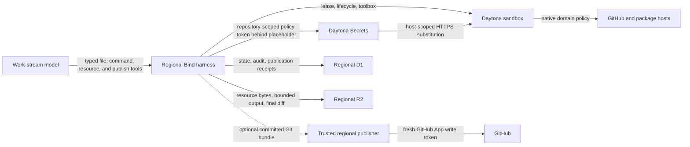

# Daytona terminal plugin and repository workspace design

> Supporting design for [`prd.md`](./prd.md). This describes the proposed
> protocol; subsystem documents and code become authoritative when the PRD ships.

## Boundaries



The model may choose root-relative paths, command text, a bounded timeout,
resource metadata, and one exact GitHub repository from connector-authorized
discovery. With full repository access it may use standard `git` and `gh`
commands. It cannot choose sandbox identity or lifecycle, snapshot, network
policy, provider repository identity, credential permissions, retention, or
resource limits. Rally prepares the intended branch and the prompt directs the
model to stay on it; GitHub does not technically scope the token to that ref.

## Plugin activation and prompt

The plugin descriptor is registered for every workspace when the principal may
participate in the work stream and the workspace is in a supported region with a
configured Daytona deployment. Availability does not depend on a workspace,
user, or server-side feature flag. Bind's normal plugin selection loads the
descriptor for requests that call for bounded sandbox work; selection does not
change the tool family or start a sandbox.

A regional emergency circuit breaker is checked when Rally acquires a new
sandbox lease or starts publication, not when Bind registers or selects the
plugin. A blocked call returns `sandbox_unavailable` with an optional operator
retry delay; the complete tool family remains visible.

Its canonical plugin ID is `avalon:terminal`, model ID is `avalon_terminal`,
short wire name is `terminal`, and canonical tools are the unprefixed names in
this document. Bind exposes `terminal_read_file`, `terminal_run_command`, and
the other `terminal_*` wire names to the model
while receipts and policy retain the local canonical name.

Bind exposes every canonical tool in this document whenever the plugin loads; it
does not construct scratch, repository, or publication subsets. Scratch code
needs no GitHub connection. `checkout_repository` lets the model select an exact
authorized repository and exposes its effective remote access; before a change
replaces retained filesystem state, the harness stores a verified recovery
resource. Repository calls revalidate an active App installation, immutable
repository ID, and connector policy. `read_only` and `full_access` determine the
permissions of the mounted repository token. The always-visible typed
publication tool is an optional convenience rather than a second
participant-intent gate.

The plugin contributes the exact, contract-tested system-prompt block in the
PRD's [language support section](./prd.md#explicit-language-and-package-support),
not merely tool descriptions. That section is the single owner so prompt text
and its golden assertion cannot drift between design documents.

Prompt evaluation covers positive code-use cases and ordinary connector/prose
requests where the sandbox should remain absent.

## Tool contracts

The model receives production-harness-shaped primitives, not Daytona APIs:

| Tool | Arguments | Result and limits | Bind policy and replay |
| --- | --- | --- | --- |
| `read_file` | `filePath`, `offset?`, `limit?` | Exact bounded text page and line range | `read` / `safe` |
| `edit_file` | `filePath`, `oldString`, `newString`, `replaceAll?` | Exact-match count and diff summary | `write` / `record_before_execute`; reconcile internal content hashes and resulting content |
| `write_file` | `filePath`, `content` | Created/replaced state, bytes, and diff summary | `write` / `record_before_execute`; reconcile internal content hashes and resulting content |
| `apply_patch` | `patch` | Atomic per-file operation and diff summary | `write` / `record_before_execute`; reconcile internal content hashes and resulting content |
| `import_resource` | automatic: `resourceId`; explicit: `resourceId`, `destinationPath`, `overwrite?` | Authorized original at a sandbox path with source hash | `write` / `record_before_execute`; reconcile resource visibility, destination hash, and source hash |
| `run_command` | `command`, `cwd?`, `timeoutMs?`, `description?` | One final exit result; Bind may suspend while it runs | `write` / `record_before_execute`; reconcile stable Daytona task |
| `checkout_repository` | `repositoryFullName`, `requiredRemoteAccess?` | Immutable repository identity, fixed refs, effective remote access, and optional recovery resource | `write` / `record_before_execute`; reconcile completed receipt and recovery resource before sandbox replacement |
| `publish_resource` | `filePath`, `displayName?`, `description?` | Attached Rally resource identity, classification, hash, and canonical address | `write` / `provider_key`; stable receipt-derived resource ID and current visibility check |
| `publish_branch_and_pr` | `title`, `body` | Published commit, PR number, canonical URL | `write` / `record_before_execute`; reconcile exact ref and head/base PR |

Paths and `cwd` are relative to the repository root or scratch root and are
resolved after symlinks. An explicit import destination follows the same rule;
automatic imports use host-managed `.avalon/resources/`. The publication path is
relative to a separate host-owned resource output directory. All input, output,
file, match, duration, and concurrency limits are server-clamped and included in
the tool descriptions.

The PRD's **Model-facing tool contracts** section owns the complete argument,
success, and failure schemas. This table is only the architectural summary; an
implementation or generated schema must not add an argument absent from that
contract.

These contracts follow the tool conventions shipped on main by PR #144: strict
Zod parsing behind strict JSON Schema, camel-case fields, direct model-visible
`output` inside Bind's existing `{success, data}` wire result, host-only
`summary`, canonical names local to the plugin, and
allowlisted structured recovery inside Bind's failed-tool result. The terminal
plugin does not introduce a second result envelope or leak remediation only
through transcript prose.

There is no model-facing PTY, background flag, task-output poll, task input,
sandbox lifecycle, network policy, or raw Daytona tool. Cancellation remains a
participant and host operation, not an LLM strategy.

Every call uses Bind's existing `tool_invocations` receipt path, as main requires;
this feature adds no generic receipt ledger. Internal before/after hashes and
resulting content let the owner reconcile file writes, `sandbox_tasks` reconciles
commands, receipt-derived resource identity makes resource publication
provider-keyed, and `repository_publications` reconciles GitHub state. A timeout
that none of those owner checks can resolve remains `ambiguous_external_write`
and is never blindly repeated.

## File concurrency and model sequencing

The model receives no filesystem concurrency revisions or hashes, directory
cursors, or stat tool. It uses `ls`, `find`, `rg --files`, and `rg` through
`run_command` for discovery and search. Deliberate text changes use
`read_file` followed by an exact `edit_file` or context-bearing `apply_patch`;
`write_file` is an intentional complete replacement. An explicit
`import_resource` destination is create-only unless the model sets
`overwrite: true`.

The first sandbox-dependent call gives its Terminal run an exclusive work-stream
mutation lease through run completion, separate from provider lifecycle leases.
Another run cannot interleave filesystem or command calls. Within the owning
run, typed mutations and commands serialize under an operation lock. Exact
matching, patch-context validation, path checks, and the final atomic replace
happen in the same operation. The host records internal before/after hashes in
reconciliation state but does not expose them as model preconditions.

A lost response is reconciled from the durable invocation receipt, internal
hashes, and resulting content. If the owner cannot prove that the intended state
is present or absent, it returns `ambiguous_external_write` and does not blindly
repeat the mutation. This does not claim per-command compare-and-swap protection
for arbitrary Bash beyond the run mutation lease and operation lock.

The PRD's [model-visible failure catalog](./prd.md#model-visible-failures-and-loop-recovery)
is part of the contract. Each failure has a stable code, a short model-visible
message that includes the shortest safe next action, PR #144-allowlisted
structured context, an actionable
`details.reason`, and an explicit retry or stop rule. Contract tests verify that
remediation is present in the failed result's `data.details`, never only in the
human `summary`.
Medium-model evaluations cover
create, replace, repeated edit, multi-file patch, automatic and placed import,
exact-match recovery, nonzero command exit, and publication repair.

## Snapshot contract and package behavior

The managed `daytona-small` snapshot plus Rally's idempotent compatibility bootstrap contains:

- Bash, POSIX `sh`, and standard Unix utilities;
- Daytona's current Python 3 with `venv`, `pip`, and `uv`;
- Daytona's current Node.js, `npm`, and `pnpm`;
- `typescript` and `tsx`;
- SQLite 3;
- `git`, `gh`, `rg`, and `jq`; and
- the managed `apt`/`dpkg` path and signed base-image sources.

The provider records and probes the effective runtime and manager versions,
compatible trusted-target manifest version, and smoke-fixture IDs. First
creation installs only missing SQLite/`gh`/pnpm/`tsx` capabilities, then runs one
execute/revise/pass fixture for each language and one install fixture for each
manager path. A breaking Daytona update fails closed instead of silently
changing the advertised contract.

Model-requested installs stay within the repository, virtual environment, task
root, or current sandbox. The model cannot self-update a global manager or
runtime. Passwordless sudo is available for the managed system package manager.

There is no host-side manager resolver or tool activator. The model inspects the
repository and uses a supported lockfile or JavaScript `packageManager`
declaration. Supported examples include `requirements.txt`/`pyproject.toml` with
`pip`, `uv.lock` with `uv`, `package-lock.json` with npm, and `pnpm-lock.yaml`
with pnpm. Conflicting or unsupported evidence returns
`unsupported_package_manager`; the model does not convert the repository.
Validation uses locked/frozen modes where native CLIs provide them.

## Workspace lifecycle

```mermaid
stateDiagram-v2
    [*] --> absent
    absent --> starting: first sandbox-dependent tool
    starting --> running: identity and policy verified
    starting --> failed: stable startup failure
    running --> stopping: five-minute idle grace or cancellation
    stopping --> stopped: filesystem retained
    stopped --> starting: later tool explicitly starts sandbox
    stopped --> archived: 60 minutes inactive
    archived --> starting: later tool restores archive
    archived --> expired: 30 days inactive; durable outputs captured and sandbox deleted
    expired --> starting: later tool creates a fresh sandbox
    failed --> starting: retryable later tool
```



The regional coordinator serializes state transitions by work-stream ID and uses
an optimistic row version around remote calls. Creation uses a stable sandbox
name and reserve/create/finalize protocol; after an ambiguous create response it
looks up the stable name before trying again.

Lifecycle deadlines live in D1, not an in-memory timer. The existing regional
`WorkspaceScheduler` alarm includes the nearest Terminal warm-stop, archive, or
expiry deadline when it computes its next wake. On alarm it claims each due
transition by `(workspace_id, workstream_id, version)`, performs the provider
action, records the result, and refreshes the next alarm. Duplicate alarms and a
Worker restart therefore repeat only the claim/read-back sequence, not an
unverified provider mutation. A network-policy transaction writes the same due
reconciliation state for every affected sandbox before returning to Settings.

Every sandbox-dependent tool obtains a lease through its deadline plus cleanup
margin. The host owns the five-minute warm timer; Daytona's 15-minute auto-stop
is a backstop. The model cannot renew a lease.

Before admitting a tool, the coordinator compares the sandbox's applied network
revision with current workspace policy. A mismatch means no command runs: active
work is cancelled, the sandbox is stopped, the provider setting is applied and
verified, and the next tool explicitly starts the sandbox. If the provider cannot
confirm the policy, the sandbox remains stopped with `network_policy_unavailable`.

At 30-day expiry Rally persists bounded inline command output and publishes any
complete retained log or non-empty final diff through the existing generated-
resource path, alongside other published resources, publication receipts, and
visible activity. It then deletes the sandbox and per-sandbox secrets. It does
not create a cold filesystem, untracked-file archive, or reconstruction bundle.
A later call makes a fresh task root or reclones the repository. The retained
patch is participant-visible but is never auto-applied.

## Command execution and Bind auto-resume

The command adapter validates the root-relative working directory, environment,
timeout, and input size, rejects known PTY/daemon/service patterns, creates a
stable `sandbox_tasks` row, and submits one non-interactive Daytona session
command. Pattern rejection is early guidance, not the containment boundary: the
adapter starts every command in a provider/OS process group with no detached
session or inherited listener, and teardown kills the whole descendant group on
exit, nonzero exit, timeout, cancellation, output overflow, stream loss, and
adapter failure. It verifies that no descendant or listener remains before
releasing the operation lock; failed verification stops the sandbox and returns
`sandbox_unavailable` for later work.

Bind persists its tool receipt and a stable `sandbox_tasks` row before provider
submission. The Daytona adapter submits one asynchronous command in a session
named from that receipt and observes it with bounded backoff until exit. The
session is deliberately retained until the terminal D1 result is durable, then
deleted. This closes the response-loss window between command exit and receipt
persistence.

If the Worker is interrupted, the regional harness Workflow retries the same
Bind call. Bind makes two narrow exceptions to its normal incomplete-write rule.
An exact, policy-matching Terminal `run_command` receipt re-enters the frozen
tool executor: the runtime verifies the original command hash and sandbox
generation, while the provider loads the named session and its sole command
instead of submitting another. The convergent `publish_branch_and_pr` executor
may also re-enter because its durable grant, repository/ref target, expected old
SHA, publication row, and single PR identity are revalidated before a repeated
provider action. A missing or mismatched identity remains
`ambiguous_external_write`; it is never guessed safe.

This is **workflow auto-resume**, not implicit sandbox auto-start and not model
polling. A stopped sandbox still starts only because a tool was called. The
model receives one final result and no task identifier. A separate command
Workflow, continuation table, and model-visible status protocol were rejected:
the existing harness Workflow plus Daytona's named session already provide the
durable retry boundary without a second orchestration subsystem.

The adapter stores a bounded head and tail inline. The complete bounded result
may live in the internal regional receipt object, which is not a user download.
When Rally exposes a complete participant-facing log and returns
`outputResourceId`, it publishes a generated text resource through the PR #144
path below instead of leaking that receipt reference. Output over the total cap
kills the task with `output_limit_exceeded`. ANSI/control sequences, token
formats, known host secrets, and Daytona placeholders are scrubbed before
persistence and display.

A submitted command is not generally replay-safe: it may have changed files or a
permitted public service. If the result is lost, Bind reconciles the recorded
Daytona task and observable repository state. It does not infer safety from a
generic receipt label and does not launch a second command automatically.

## Coding-harness precedents

This section preserves the source-level tool-design research that informed the
contracts above. It is intentionally more detailed than the launch surface: the
point is to retain production lessons even when Rally chooses not to expose the
same primitive.

The evidence was refreshed on 2026-08-12. “Documented” means first-party product
documentation or public first-party source; “observed” means a schema present in
the Codex host used for this work and is not asserted to be a stable public API.
Source comparisons use Grok Build commit
[`e5fd4816`](https://github.com/xai-org/grok-build/tree/e5fd4816d43260c15ba785f103990c1ed6cea230c)
and OpenCode commit
[`cc4b4561`](https://github.com/anomalyco/opencode/tree/cc4b45612974f735ddec46009ede07729511fba4).

| Harness | Shell geometry | File geometry | Git and GitHub | Enforcement lesson |
| --- | --- | --- | --- | --- |
| Codex | Non-interactive command plus timeout/output bounds; a host may return a live session handle | Patch is separate from shell; the observed host usually searches and reads with CLI tools | Ordinary `git` and `gh`; worktree and GitHub review flows sit above the shell | OS sandbox and approval policy are separate, and spawned commands inherit the sandbox |
| Claude Code | `Bash` with command, description, timeout, and optional background execution | Dedicated ranged read, exact edit, full write, glob, grep, and notebook tools | Ordinary Git through Bash; `gh` locally and a GitHub App/control plane in cloud sessions | Bash sandboxing does not automatically cover built-in file tools, so both policy paths must be enforced |
| Grok Build | `run_terminal_cmd` with foreground/background result variants, streamed deltas, output files, task status, and kill | Dedicated read, exact replace, list, grep, patch, OpenCode-compatible, and experimental hash-line variants | Ordinary `git`/`gh`; worktrees, PR observation, and MCP live above the command tool | Whole-process sandbox and permissions are distinct; background completion should notify rather than encourage polling |
| OpenCode | `bash` with command, timeout, and workdir; no stdin; bounded tail plus saved full output | Dedicated read, exact edit, write, glob, grep, and marker-format patch | Its current prompt explicitly directs GitHub work to `gh` and keeps Git/PR safety rules in the shell prompt | Current permission rules are approvals, not an OS sandbox; typed file path checks are stronger than shell-text inference |

#### Shell commands

OpenAI's public Responses API shell contract uses paired `shell_call` and
`shell_call_output` items. The model-visible action is approximately:

```ts
type ShellCallAction = {
  commands: string[];
  timeout_ms?: number;
  max_output_length?: number;
};
```

The host executes every requested command, captures stdout, stderr, and its exit
outcome, and returns the paired output item. The public guidance says execution
is non-interactive, non-zero output must be preserved, and a timeout response
should retain partial output. The same call shape can target an OpenAI-hosted
container or a local executor supplied by the application
([shell guide](https://developers.openai.com/api/docs/guides/tools-shell)).

The Codex desktop host used for this research exposes a different application
adapter. Its observed schema is:

```ts
type ExecCommandInput = {
  cmd: string;
  workdir?: string;
  yield_time_ms?: number;
  max_output_tokens?: number;
  shell?: string;
  tty?: boolean;
};

type ExecCommandOutput = {
  output: string;
  exit_code?: number;
  session_id?: number;
  wall_time_seconds: number;
};

type WriteStdinInput = {
  session_id: number;
  chars?: string;
  yield_time_ms?: number;
  max_output_tokens?: number;
};
```

A short command returns an exit code. A command still running when the wait
budget expires returns `session_id`; `write_stdin` can then send input or fetch
later output from that exact process. This is useful evidence about model
familiarity with a small command envelope and an explicit continuation handle,
but it is not copied into Rally as a public session protocol.

#### File discovery and edits

The observed host exposes `apply_patch` separately from shell execution and
normally uses familiar read-only CLI operations such as `rg --files`, `rg`, and
bounded `sed` output for discovery and text inspection. Images have a separate
viewer. The patch adapter accepts a free-form marker patch rather than a JSON
object, using `*** Begin Patch`, per-file add/update/delete sections, and
`*** End Patch`. This keeps mutation structured without multiplying basic Unix
lookup tools.

OpenAI's public `apply_patch` tool is more structured than that host adapter. It
emits one or more operations:

```ts
type ApplyPatchOperation =
  | { type: "create_file"; path: string; diff: string }
  | { type: "update_file"; path: string; diff: string }
  | { type: "delete_file"; path: string };

type ApplyPatchResult = {
  status: "completed" | "failed";
  output?: string;
};
```

The caller implements path validation and the actual V4A diff application and
returns exactly one result per call. The official guidance explicitly calls out
directory traversal, scratch copies/backups, informative errors, and choosing
per-file versus all-or-nothing atomicity
([apply-patch guide](https://developers.openai.com/api/docs/guides/tools-apply-patch)).

#### Git and GitHub

Codex performs local Git through the command surface rather than one custom
tool per Git verb. The desktop integrated terminal documentation calls out
`git status` and `git pull --rebase`, and worktree sessions are real Git
worktrees created above the agent tool loop. Each worktree has independent
files while sharing repository metadata; desktop handoff owns the Git operations
needed to move work safely
([integrated terminal](https://learn.chatgpt.com/docs/integrated-terminal),
[worktrees](https://learn.chatgpt.com/docs/environments/git-worktrees)).

In the host observed here, `gh` is likewise invoked through the shell for PR,
issue, check, and release work when a higher-level GitHub connector does not own
the operation. Codex also has a separate GitHub App-backed review product that
responds to `@codex review`; that is a control-plane integration, not evidence of
a hidden `git_commit` or `github_create_pr` model tool
([GitHub review integration](https://learn.chatgpt.com/docs/third-party/github)).

#### Other sandbox-related commands and controls

Codex distinguishes the technical sandbox from approvals. Local commands run
under platform-native enforcement: Seatbelt on macOS, bubblewrap on Linux/WSL,
and the native Windows sandbox. The boundary applies to child processes such as
Git, package managers, and test runners, not just built-in file operations.
Defaults generally restrict writes to the active workspace and disable network
access; approval policy decides when an attempted boundary crossing may proceed
([sandbox](https://learn.chatgpt.com/docs/sandboxing),
[approvals and security](https://learn.chatgpt.com/docs/agent-approvals-security)).

Codex cloud separates a networked setup phase from an offline-by-default agent
phase. Agent internet access can be off, unrestricted, or constrained by domain
and HTTP method, with a common-dependency preset. This separation is a direct
precedent for Rally's managed snapshot compatibility contract plus workspace network policy
([internet access](https://learn.chatgpt.com/docs/cloud/internet-access)).

#### Rally decision

Rally keeps the small non-interactive command envelope, explicit working
directory, structured edit surface, ordinary Git/GitHub CLIs, OS isolation, and
separate approval/authority layer. It does not expose `session_id`,
`write_stdin`, or a PTY at launch. Bind owns continuation and returns one final
command result after Daytona signals completion.

#### Bash commands

Claude Code's hook and Agent SDK documentation exposes this input shape:

```ts
type BashInput = {
  command: string;
  description?: string;
  timeout?: number; // milliseconds
  run_in_background?: boolean;
};

type BashOutput = {
  output: string;
  exitCode: number;
  killed?: boolean;
  shellId?: string;
};
```

Each call runs in a separate process. A main-session `cd` can carry into later
calls only while it remains inside the project or an explicitly added
directory; subagents do not inherit that behavior. Environment exports do not
persist between calls. Claude Code defaults to a two-minute command timeout and
normally caps a model-requested timeout at ten minutes. It streams output to a
working file, kills output beyond 5 GB, and gives the model a bounded inline
window; a valid oversized result arrives with a saved file path and preview
rather than silently losing the remainder
([tools reference](https://code.claude.com/docs/en/tools-reference),
[hook input schemas](https://code.claude.com/docs/en/hooks)).

For a dev server or watch build, the model can set `run_in_background: true`.
Claude Code exposes task UI to list or stop those commands, and its newer
`Monitor` tool can turn each stdout line from a selective script into an event.
Those local-session affordances explain why its model may understand background
task IDs; they do not require Rally to expose polling.

#### File discovery and edits

Claude Code keeps common file operations out of Bash:

```ts
type ReadInput = {
  file_path: string;
  offset?: number;
  limit?: number;
};

type WriteInput = {
  file_path: string;
  content: string;
};

type EditInput = {
  file_path: string;
  old_string: string;
  new_string: string;
  replace_all?: boolean;
};

type GlobInput = {
  pattern: string;
  path?: string;
};
```

`Grep` adds content search and `NotebookEdit` provides notebook-aware mutation.
`Read` returns line-number-prefixed text, and its range inputs prevent a large
file from consuming the context window. `Edit` is exact-string replacement: it
requires a prior read, the file must remain unchanged, and the match must be
unique unless `replace_all` is true. `Write` is the explicit full-file
create/overwrite primitive. That distinction gives a model a recoverable error
instead of letting a broad shell rewrite silently hit the wrong text.

#### Git and GitHub

Claude Code's local harness performs Git through Bash. Its documented
read-only-command recognizer admits safe forms of `git status`, `git diff`,
`git log`, and related inspection without a prompt, while patterns can allow
`Bash(git commit *)` and deny `Bash(git push *)`. `EnterWorktree` and
`ExitWorktree` are separate orchestration tools for isolated Git checkouts; they
are not replacements for ordinary Git commands
([permissions](https://code.claude.com/docs/en/permissions),
[tools reference](https://code.claude.com/docs/en/tools-reference)).

Local GitHub operations use the existing `gh` CLI through Bash when installed;
Claude Code formerly exposed `/pr-comments` as a command backed by `gh` and now
instructs users to ask directly. Cloud sessions instead clone through the Claude
GitHub App, work on a session branch, and expose a control-plane Create PR action.
The product can import a locally authenticated `gh` token during `/web-setup`,
but that onboarding behavior should not be confused with a dedicated model
tool
([commands](https://code.claude.com/docs/en/commands),
[cloud GitHub workflow](https://code.claude.com/docs/en/web-quickstart)).

#### Other sandbox-related commands and controls

Claude Code has `allow`, `ask`, and `deny` rules for Bash, file tools, web tools,
MCP, and agents, plus `PreToolUse` hooks that can allow, ask, or block a proposed
call. Bash rules are string patterns and the documentation warns that they are
fragile for URL enforcement. A `Read(.env)` or `Edit(...)` denial applies to
built-in file tools; it does not stop `cat` or `sed` inside Bash.

The Bash sandbox closes that gap for subprocesses with Seatbelt on macOS and
bubblewrap on Linux/WSL. It restricts filesystem access and routes child network
access through a hostname allow-list proxy. The proxy does not terminate TLS,
so broad allowed hosts still leave domain-fronting risk; custom TLS inspection
is required for stronger guarantees. Built-in Read/Edit/Write do not run inside
that Bash sandbox and remain governed by their file permissions. Claude Code
also exposes Agent, LSP, plan mode, task scheduling, MCP, skills, hooks, and
worktree controls above this core
([sandboxing](https://code.claude.com/docs/en/sandboxing)).

#### Rally decision

Rally adopts ranged reads, exact-match edits, explicit full writes, bounded
output with a recoverable complete form, and the separation between worktree
orchestration and Git commands. It relies on a single active mutating Terminal
run, atomic exact-match/context checks, and internal reconciliation hashes rather
than model-visible revisions. It also applies Daytona's isolation to every
process and keeps GitHub write authority out of the general command path.

#### Terminal commands

Grok Build's first-party Rust source names the command tool
`run_terminal_cmd` and exposes:

```ts
type GrokBuildTerminalInput = {
  command: string;
  timeout?: number; // milliseconds
  description: string;
  is_background?: boolean; // default false
};

type GrokBuildTerminalOutput =
  | {
      type: "Foreground";
      output: Uint8Array;
      output_for_prompt: string;
      exit_code: number;
      command: string;
      truncated: boolean;
      signal?: string;
      timed_out: boolean;
      current_dir: string;
      output_file: string;
      total_bytes: number;
    }
  | {
      type: "Background";
      task_id: string;
      task_type: string;
      output_file: string;
      status: "running";
      command: string;
      summary: string;
      pid?: number;
    };
```

The implementation streams incremental output with a 16 KiB maximum delta,
keeps ANSI-stripped/soft-wrapped prompt output, stores the complete output in a
session file, and preserves a total byte count even after truncation. The schema
advertises a 120-second foreground default and a five-minute default ceiling,
while a production host may configure a much longer ceiling. Backend choice
determines whether shell state persists
([terminal source](https://github.com/xai-org/grok-build/blob/e5fd4816d43260c15ba785f103990c1ed6cea230c/crates/codegen/xai-grok-tools/src/implementations/grok_build/bash/mod.rs),
[output types](https://github.com/xai-org/grok-build/blob/e5fd4816d43260c15ba785f103990c1ed6cea230c/crates/codegen/xai-grok-tools/src/types/output.rs)).

Background work is a real typed protocol. `get_terminal_command_output` accepts
`task_ids: string[]` and optional `timeout_ms`; zero or omission is a snapshot,
while a positive value waits up to a host ceiling. Its result includes task ID,
command, status, exit code, timestamps, duration, output, output file,
truncation, and raw output bytes. `kill_terminal_command({task_id})` returns
`killed` or `already_exited`. The wire parser deliberately also accepts a
singular `task_id`, bare string, or numeric ID because production soak sessions
showed models mirroring the kill tool's singular field and abandoning the
workflow after strict deserialization failed
([task types](https://github.com/xai-org/grok-build/blob/e5fd4816d43260c15ba785f103990c1ed6cea230c/crates/common/xai-tool-types/src/task.rs)).

Grok Build notifies the model when a background command completes and explicitly
tells it not to sleep-poll. Its tasks pane and `Ctrl+B` affordance also let a
person demote a running foreground process. Monitors are separate: every output
line becomes a conversation event, suitable for selective CI/log/port watchers
([background tasks](https://docs.x.ai/build/features/background-tasks)).

#### File discovery and edits

The default Grok Build file surface includes:

```ts
type ReadFileInput = {
  target_file: string;
  offset?: number;
  limit?: number;
  pages?: string;
  format?: string;
};

type SearchReplaceInput = {
  file_path: string;
  old_string: string;
  new_string: string;
  replace_all?: boolean; // default false
};

type ListDirInput = {
  target_directory: string;
};

type GrepInput = {
  pattern: string;
  path?: string;
  glob?: string;
  "-B"?: number;
  "-A"?: number;
  "-C"?: number;
  "-i"?: boolean; // default false
  type?: string;
  head_limit?: number;
  multiline?: boolean; // default false
};

type ApplyPatchInput = {
  patch: string;
};
```

`read_file` supports text plus images, PDFs, PowerPoint, and notebooks; text uses
sparse line anchors that are display metadata rather than file bytes.
`search_replace` defaults to one exact match, supports replace-all, detects
stale user edits, and has optional Unicode-confusable fallback. `list_dir` uses
a bounded breadth-first tree, respects `.gitignore`, and summarizes very large
directories. `grep` wraps ripgrep with explicit context and result ceilings.
The repository also ships Codex-compatible read/patch/list tools,
OpenCode-compatible read/edit/write/glob/grep tools, and an experimental
hash-line mutation family. These ports are strong evidence that models benefit
from familiar schemas more than from a novel vocabulary
([read source](https://github.com/xai-org/grok-build/blob/e5fd4816d43260c15ba785f103990c1ed6cea230c/crates/codegen/xai-grok-tools/src/implementations/grok_build/read_file/mod.rs),
[edit source](https://github.com/xai-org/grok-build/blob/e5fd4816d43260c15ba785f103990c1ed6cea230c/crates/codegen/xai-grok-tools/src/implementations/grok_build/search_replace/mod.rs),
[grep source](https://github.com/xai-org/grok-build/blob/e5fd4816d43260c15ba785f103990c1ed6cea230c/crates/codegen/xai-grok-tools/src/implementations/grok_build/grep/mod.rs),
[Codex patch port](https://github.com/xai-org/grok-build/blob/e5fd4816d43260c15ba785f103990c1ed6cea230c/crates/codegen/xai-grok-tools/src/implementations/codex/apply_patch/tool.rs)).

#### Git and GitHub

Grok Build performs Git through the terminal command. Its permission guide marks
read-only Git commands such as `status`, `branch`, `log`, `diff`, `show`, and
`rev-parse` as safe and re-evaluates chained commands piece by piece. `git push`
remains a dangerous pattern even after a remembered grant unless an explicit
rule allows it. Worktree sessions are real detached Git checkouts above the tool
loop, persist after session end, and are landed with ordinary Git
([permissions](https://docs.x.ai/build/features/permissions),
[worktrees](https://docs.x.ai/build/features/worktrees)).

The public runtime recognizes `gh pr create` executed through Bash, records PR
creation signals, and can also observe an MCP `create_pull_request` operation.
Its enterprise example explicitly permits `Bash(gh *)`; no dedicated core
GitHub tool appears in the built-in registry at the pinned source snapshot.
GitHub operations are therefore either familiar `gh` commands or integration
tools, not a replacement Git language
([enterprise example](https://docs.x.ai/build/enterprise),
[Git operation detector](https://github.com/xai-org/grok-build/blob/e5fd4816d43260c15ba785f103990c1ed6cea230c/crates/codegen/xai-grok-tools/src/util/git_detect.rs)).

#### Other sandbox-related commands and controls

Grok Build separates permissions from its sandbox. Permissions decide whether a
tool call runs; the sandbox limits what an approved call and its children can
do. The sandbox is off by default and, when selected, applies to the entire Grok
process: in-process file tools and child shell processes share Landlock on Linux
or Seatbelt on macOS. Linux can also block child-process network through
seccomp; the corresponding read-only/strict network restriction is a no-op on
macOS. Custom profiles add read-only, read-write, and deny paths
([sandbox](https://docs.x.ai/build/features/sandbox)).

Its broader built-in surface includes plan mode, todos, subagents, task output,
kill, monitors, a scheduler, LSP, skills, memory, web fetch/search, workflows,
and image/video generation. Plan mode gates edit tools but not Bash redirection,
an explicit warning that mode-level file restrictions are not a security
boundary unless shell writes are constrained too
([plan mode](https://docs.x.ai/build/features/plan-mode)).

#### Rally decision

Rally's `run_command` fields deliberately align with Grok Build without
producing the redundant wire name `terminal_run_terminal_cmd`. Rally keeps the
streamed provider implementation, output accounting,
task cancellation, and completion notification on the host side. It rejects a
model-visible background flag, task IDs, polling, and monitors at launch because
Bind can suspend and auto-resume the same tool call. The task-input failure is
still preserved as a warning: related tool schemas must not disagree on singular
versus plural identity fields.

#### Bash commands

At the pinned source snapshot, OpenCode exposes this exact shell schema:

```ts
type OpenCodeShellInput = {
  command: string;
  timeout?: number; // positive integer, milliseconds
  workdir?: string;
};
```

The public tool ID remains `bash` for compatibility with existing plugins and
saved V1 permissions; OpenCode's V2 policy vocabulary renames the corresponding
permission action to `shell`.

Its prompt tells the model to use `workdir` rather than `cd`, use dedicated file
tools instead of `cat`/`sed`/redirection, parallelize independent calls, and join
dependent commands with the shell's success operator. The executor chooses an
acceptable host shell, parses Bash or PowerShell to derive command permission
patterns and likely external directories, ignores stdin, starts a detached
process group where supported, and kills it on timeout or abort. Inline output
is a bounded tail; if truncated, the full output is saved and the result returns
`truncated` plus `outputPath`
([schema and prompt](https://github.com/anomalyco/opencode/blob/cc4b45612974f735ddec46009ede07729511fba4/packages/opencode/src/tool/shell/prompt.ts),
[executor](https://github.com/anomalyco/opencode/blob/cc4b45612974f735ddec46009ede07729511fba4/packages/opencode/src/tool/shell.ts)).

OpenCode does not expose a background-process/task-poll protocol in this shell
contract. A long command occupies the tool call until exit, timeout, or abort.
That simpler model is closer to Rally's final-result contract than a local TUI
task manager.

#### File discovery and edits

OpenCode's dedicated schemas are:

```ts
type ReadInput = {
  filePath: string;
  offset?: number; // 1-indexed
  limit?: number; // default 2,000 lines
};

type WriteInput = {
  filePath: string;
  content: string;
};

type EditInput = {
  filePath: string;
  oldString: string;
  newString: string;
  replaceAll?: boolean;
};

type GlobInput = {
  pattern: string;
  path?: string;
};

type GrepInput = {
  pattern: string;
  path?: string;
  include?: string;
};

type ApplyPatchInput = {
  patchText: string;
};
```

`read` can also list a directory and attach an image or PDF. Text is line-number
prefixed and long lines are bounded. `edit` requires a prior read, rejects equal
old/new strings, requires a unique exact match unless `replaceAll` is true, and
serializes edits to the same file. `write` explicitly creates or overwrites.
`apply_patch` accepts a Codex-style `*** Begin Patch` envelope with add, update,
move, and delete sections and validates all changes before applying them. All
three mutations share the `edit` permission
([tools](https://opencode.ai/docs/tools/),
[read source](https://github.com/anomalyco/opencode/blob/cc4b45612974f735ddec46009ede07729511fba4/packages/opencode/src/tool/read.ts),
[edit source](https://github.com/anomalyco/opencode/blob/cc4b45612974f735ddec46009ede07729511fba4/packages/opencode/src/tool/edit.ts),
[patch source](https://github.com/anomalyco/opencode/blob/cc4b45612974f735ddec46009ede07729511fba4/packages/opencode/src/tool/apply_patch.ts)).

#### Git and GitHub

OpenCode's current shell prompt has an explicit Git and GitHub section. It tells
the model to commit, amend, push, or create a PR only when requested; inspect
status, diff, and recent log before committing; avoid Git configuration changes,
hook skipping, interactive flags, force pushes, and empty commits; review the
entire base-branch diff before a PR; and use `gh` for PRs, issues, checks, and
releases. Git and GitHub remain ordinary shell commands
([shell prompt](https://github.com/anomalyco/opencode/blob/cc4b45612974f735ddec46009ede07729511fba4/packages/opencode/src/tool/shell/shell.txt)).

Permission patterns can allow `git diff` and `git log*`, ask for `git push`, or
deny `git commit` while leaving inspection available. The command parser derives
separate patterns for chained subcommands rather than approving the entire text
only from its first token. This is useful UX policy, not proof that arbitrary
shell text can be made safe by string matching
([permissions](https://opencode.ai/docs/permissions)).

#### Other sandbox-related commands and controls

OpenCode exposes allow/ask/deny policy for reads, edits, shell, web, tasks,
skills, MCP, and external directories. Typed file tools canonicalize explicit
external paths and reject relative or symlink escapes. Current V2 documentation
is equally explicit about the limit: shell commands run with the host user's
filesystem, process, and network authority; only the shell working directory is
strongly checked, while paths embedded in arbitrary command text receive
best-effort inference. The pinned compatibility implementation parses Bash and
PowerShell to improve prompts, but that parser is not an OS boundary. A
deployment must supply its own OS/container sandbox
([V2 permissions](https://opencode.ai/v2/docs/permissions)).

The remaining built-ins include LSP, task/subagent, plan transitions, questions,
skills, todos, web fetch/search, and MCP/custom tools. A `doom_loop` permission
fires after the same tool call repeats three times, reflecting another common
production failure: a model can mistake an unchanged error or truncated preview
for progress.

#### Rally decision

Rally adopts `command`/`workdir`/timeout geometry, explicit dedicated file
tools, exact editing, saved complete output, ordinary `git`/`gh`, and clear
prompt instructions about Git side effects. It does not adopt permissive host
execution or treat shell-pattern approval as the authorization boundary.
Daytona supplies the process boundary; Bind supplies current capability,
receipt, replay, and external-write policy.

### Cross-harness decisions retained for Rally

The repeated structures are more important than any single vendor's spelling:

1. **One general non-interactive command tool.** Models already know Bash,
   package-manager, Git, and GitHub CLI syntax. `command`, explicit `cwd`, a
   clamped timeout, and a short description are enough at launch.
2. **Dedicated mutation primitives, shell-native discovery.** Ranged reads,
   exact edits, full writes, and multi-file patches avoid common quoting failures.
   Models use `ls`, `find`, and `rg` for discovery and search; internal hashes and
   diffs remain visible to the host without entering model schemas.
3. **Truncation must be recoverable.** Inline output is bounded, but the system
   retains a complete bounded form and tells the model how to reach it. Silent
   truncation causes retries and duplicated side effects.
4. **Git stays a CLI; authority does not.** Local branches, commits, diffs,
   rebases, and bundles use ordinary Git. Read-only GitHub inspection may use
   `gh`. Remote branch/PR publication remains Rally's typed, host-side action.
5. **Process completion is a host concern.** Local coding harnesses benefit from
   background IDs, PTYs, and polling because a person is attached. Rally uses a
   Daytona task plus Bind suspension and one completion wake; the model sees one
   final result.
6. **Permissions and isolation are different layers.** Command-pattern prompts
   help with intent and UX, but Daytona network/filesystem enforcement and
   short-lived host credentials remain the security boundary.
7. **Tool families must agree exactly.** Schemas shown to the model, runtime
   validation, continuation identity, output paths, and error recovery must be
   tested together. Lenient hidden aliases may improve compatibility, but the
   advertised canonical shape stays singular and strict.
8. **Higher-level orchestration stays above shell.** Worktrees, plans, resources,
   subagents, schedules, monitors, and PR review are separate harness concerns.
   Rally exposes only those that fit a shared durable work stream rather than
   cloning an entire coding IDE.

## Repository bootstrap and read authorization

Bootstrap performs:

1. revalidate the regional GitHub connection, App installation, exact repository,
   base ref, and current base SHA;
2. mint a one-hour installation token narrowed to the repository and the
   connector's current `read_only` or `full_access` contents/PR permissions;
3. encode `x-access-token:<token>` outside the sandbox and store it as a
   per-sandbox Daytona secret allowed only for `github.com`;
4. configure only the exact canonical repository URL with a URL-scoped
   `Authorization: Basic <placeholder>` extra header;
5. clone/fetch without a token in the URL, environment, command, credential
   helper, or Git config; and
6. reuse Rally's adjective-adjective-adjective-noun naming scheme, record the
   branch, restore its remote head when present or create it at the recorded base
   for full access, set its upstream, and check it out before returning control.

Daytona substitutes literal placeholders in HTTPS headers. Git normally
base64-encodes Basic credentials, which would hide the placeholder. Pre-encoding
the real Basic value outside the sandbox and placing the placeholder directly in
the header preserves substitution without revealing plaintext.

`gh` receives the same repository-scoped token through a Daytona
secret allowed only for `api.github.com`, exposed as the placeholder value of
`GH_TOKEN`; `GH_REPO`, `AVALON_GIT_BRANCH`, `AVALON_GIT_BASE_BRANCH`, and
`AVALON_REMOTE_ACCESS` describe the prepared environment. Secrets rotate before expiry, after connector-policy
changes, and disappear on revocation or deletion. Read-only token permissions
reject remote writes. Full access deliberately supports normal `git push` and
`gh pr` commands; the plugin prompt tells the model to push only the prepared
branch and target the prepared base.

If direct private clone is unavailable, a trusted regional service may create a
bounded Git bundle and let bootstrap download it from a host-scoped regional
endpoint. It never copies a server working directory, hooks, config, sockets, or
caches into the sandbox.

## Optional host-side branch and PR publication

`publish_branch_and_pr({title, body})` remains an optional convergent write
surface alongside native CLI use. It is always exposed with the other Terminal
tools, then executes as follows:

1. Revalidate the run/principal provenance, current participation, connection,
   installation, repository, recorded base/head refs, and current known remote
   head. Provenance is not a single-action or prose-derived gate.
2. Ask the sandbox for `git status --porcelain`, current branch and `HEAD`, base
   ancestry, changed paths, and a bounded Git bundle containing the committed
   branch. Reject a dirty tree, wrong branch, missing ancestry, size limit, or
   `.github/workflows/` change.
3. Download the bundle through the Daytona file API. Do not grant the sandbox an
   upload URL or bridge capability; its ordinary repository credential is not
   used by this typed path.
4. In the trusted regional publisher, verify the bundle in an isolated bare Git
   directory with hooks and ambient Git configuration disabled. Confirm every
   object/ref/commit against the frozen plan and expected old SHA.
5. Mint a fresh, single-repository GitHub App installation token with the minimum
   contents-write and pull-request-write permissions. Fast-forward the exact
   deterministic head ref; reject default/protected refs, deletion,
   non-fast-forward, force semantics, and any caller-supplied ref.
6. Find the PR by exact repository/head/base. Create it if absent or update the
   existing title/body if one exists. Verify its head SHA, persist the result, and
   return the canonical URL.

Before step 4, Rally creates a durable publication record keyed by tool
invocation and canonical request. Repository/head/base uniqueness converges all
publications on one PR while allowing a later authorized invocation to update its
title or body. A lost response resumes from provider state: matching remote
branch/PR resolves success, absence resumes the remaining steps, and contradictory
state returns a stable conflict. The model cannot create duplicate PRs by retrying.
An existing open PR may be updated. An existing closed or merged PR returns
`publication_target_closed`; a new invocation does not reopen it, invent another
branch, or create a second PR. A completed receipt still replays its original
successful result after later PR closure because that receipt answers what its
own invocation did.

This design intentionally avoids a smart-HTTP receive-pack proxy. Native CLI
calls use the mounted repository token. When the optional typed path is chosen,
the sandbox creates a local bundle and a bounded host operation performs and
records that write.

## Workspace network policy

The launch design directly maps product modes to Daytona:

- `trusted_only`: set native `domainAllowList` to the reviewed baseline expansion
  plus normalized workspace exact/wildcard domains;
- `full_internet`: clear the sandbox domain allow-list, subject to Daytona
  organization-level restrictions.

Rally does not set `networkAllowList`, `outboundProxyUrl`, or a combined custom
gateway. Domain and CIDR lists are mutually exclusive in Daytona; CIDR is deferred
instead of emulating their union.

The immutable target manifest is an internal provider detail. Its names, target
count, and exact expansion are absent from participant UI, model context, and
workspace downloads. The manifest excludes management and publishing endpoints.
A version change follows the same stop/apply/next-start flow as a workspace
domain change.

The policy compiler canonicalizes domains, rejects schemes/paths/credentials and
public-suffix wildcards, de-duplicates baseline and custom values, and fails before
the provider call if the expansion exceeds Daytona's current 20-entry maximum.
Settings reports only the remaining capacity for workspace-approved domains.

Daytona describes GitHub, npm, PyPI, and system repositories as essential
services, but their exact interaction with `domainAllowList` is a provider release
gate rather than an assumption hidden in code. The checked-in automated probe
covers baseline reachability, package installation, an unlisted domain, direct
IP, redirects, metadata, private destinations, lifecycle, and confirmed deletion.
The activation record separately carries controlled provider evidence for DNS
rebinding and alternate-host secret substitution. A failure in either set leaves
Trusted-only unavailable; it does not route around Daytona.
The compiler compares the provider-read effective policy with its requested
manifest. A Daytona-required destination is allowed only when named in the
reviewed immutable manifest; an undocumented or non-suppressible extra target
fails verification without disclosing the manifest in Settings.

Controlled release evidence resolves an allowed hostname repeatedly across TTL
changes and redirects it to private and special-use address classes. Native
enforcement must re-check the resolved address for every connection and redirect,
not just the original hostname string. Failure disables Trusted only and custom
domains for that provider version rather than introducing a launch proxy.

Policy writes are owner/admin compare-and-swap operations against a regional
revision. The save endpoint first returns an affected-work summary; a second
confirmed request with the same revision records the mutation and activity,
cancels active commands, and stops affected sandboxes. The D1 row remains
`pending` until provider read-back matches the compiled policy. Conflict or
provider failure returns the authoritative last verified revision and affected
stop results so Settings can preserve the proposed value without pretending it
applied. Once verified, only a subsequent tool call starts work. A running
sandbox never gains a widened policy; the policy change stops it first.

Full internet changes destination reach, not connector authority. Daytona still
substitutes each placeholder only on its configured HTTPS host. A full-access
repository token can write through native `git`/`gh`; read-only remains enforced
by token permissions. The UI warning states that non-secret sandbox data can
nevertheless be exfiltrated.

## Resource import and publication

`import_resource` first reauthorizes the resource through the current execution
principal and its `workstream_resources` relationship. The host selects the
original source object, enforces source and destination limits, and streams the
bytes from regional R2 into Daytona. The sandbox receives no R2 credential,
object key, or signed URL. The host verifies the byte count and source hash
before returning the imported file metadata.

An automatic import uses a deterministic collision-resistant path beneath
`.avalon/resources/<resource-id>/` and is excluded from repository Git through
`.git/info/exclude`. It is create-or-reuse: an existing destination succeeds only
when its resource identity, size, and source hash match. An explicit
`destinationPath` is create-only unless the model sets `overwrite: true`. Import
receipt reconciliation checks resource visibility, path, destination content
hash, and source hash before a provider retry.

Each command receives `AVALON_RESOURCE_DIR` outside the Git tree.
`publish_resource` resolves the requested path after symlinks, requires a stable
regular file within per-file, count, and run-byte caps, detects media type,
computes the content hash, and publishes through the resource subsystem merged
by PR #144.

The host derives a stable resource ID from the tool receipt and uses provider
`avalon_generated` and type `generated_file`. It pre-registers a generation-
unique object key in `resource_object_deletion_outbox`, writes the original,
atomically inserts `resources` and an `attachment` row in
`workstream_resources`, then cancels the winning cleanup record. MIME
verification and the shared attachment classifier set the natural kind, content
mode, and initial derivative state. The relationship insert advances PR #144's
inventory revision automatically.

The resource records only hash, bytes, verified media type, originating command
or file-write invocation, work-stream ID, timestamp, and optional repository
commit. A replay of the same invocation returns the persisted resource only
while it remains visible at the exact source hash. A later invocation with the
same bytes may create another intentionally named resource; hash equality is not
resource identity. Files still changing, escaping the directory, devices or
sockets, and over-limit outputs are rejected.

The resulting resource is immediately subject to the shared current-principal
visibility loader, sidebar/list inventory, compaction rediscovery, derivative
read/search/view/summary tools, receipt-dependency invalidation, and object
cleanup. Detachment revokes a relationship; deletion owns byte cleanup. Resource
bytes do not pass through model context and are not added to Git without a
separate repository edit.

The source-file limit never exceeds the existing resource upload limit. PR
#144's MIME-specific source, expanded Office, PDF-page, image-pixel, and
derivative-character ceilings remain authoritative during hydration. A safe
download-only archive or unknown binary publishes as kind `other` and content
mode `unsupported`; lack of a model derivative is not publication failure.

## External references

- [`agent-attachments.md`](../../agent-attachments.md) — PR #144's authoritative
  resource identity, visibility, derivative, compaction, replay, and object-
  cleanup boundary reused by generated resources.
- [`agent-tools.md`](../../agent-tools.md) — strict schema, naming, recovery,
  idempotency, and direct-output conventions followed by the terminal plugin.
- [`agent-harness.md`](../../agent-harness.md) — Bind wire-name prefixing,
  host-only summaries, failed-tool projection, durable receipts, and current-
  authority replay checks.
- [Daytona Secrets](https://www.daytona.io/docs/en/secrets/) — opaque placeholders,
  host-scoped HTTPS-header substitution, scrubbing, updates, and Basic-auth
  encoding behavior.
- [Daytona sandboxes](https://www.daytona.io/docs/en/sandboxes/) — explicit start,
  stop, auto-stop, and archive lifecycle.
- [Daytona persistence](https://www.daytona.io/docs/en/persistence/) — filesystem
  behavior across stop/start and archive/restore.
- [Daytona network limits](https://www.daytona.io/docs/en/network-limits/) — native
  domain and CIDR allow-lists, mutual exclusivity, entry limits, tiers, and
  essential dependency services.
- [Daytona log streaming](https://www.daytona.io/docs/en/log-streaming/) —
  WebSocket streaming for session commands and snapshot log retrieval.
- [Daytona filesystem SDK](https://www.daytona.io/docs/en/typescript-sdk/file-system/) —
  streaming resource import and publication without buffering complete files.
- [Daytona webhooks](https://www.daytona.io/docs/en/webhooks/) — sandbox lifecycle
  events; command completion is not currently a webhook event.
- [GitHub installation access tokens](https://docs.github.com/en/apps/creating-github-apps/authenticating-with-a-github-app/generating-an-installation-access-token-for-a-github-app)
  — repository/permission narrowing and one-hour expiry.
- [GitHub App permission changes](https://docs.github.com/en/apps/maintaining-github-apps/modifying-a-github-app-registration)
  — installation-owner approval for new permissions.
- [GitHub CLI environment](https://cli.github.com/manual/gh_help_environment) —
  `GH_TOKEN` and `GH_REPO` behavior.
