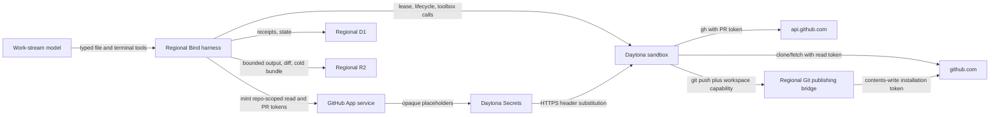

# Daytona repository workspace design

> Supporting design for [`prd.md`](./prd.md). This document describes the
> proposed protocol; the subsystem documents and code become authoritative when
> the PRD ships.

## Boundaries

The model can influence file paths, command text, working directory, PTY choice,
and bounded task input. It cannot influence sandbox identity, snapshot, user,
network profile, GitHub repository, base ref outside the selected request,
publication scope, branch name, secret names, secret hosts, lifecycle thresholds,
or output limits.

## Plugin activation

The plugin descriptor is available only after all of these checks:

1. `agent-repository-workspace` resolves to at least `read_edit` for this run;
2. the principal may participate in the work stream;
3. an active GitHub connection and App installation resolve the exact repository;
4. the selected repository belongs to the connection's frozen resource scope; and
5. the selected workspace region has an enabled Daytona deployment.

`publish` mode makes publication *eligible*. The run additionally needs explicit
publish intent and current `repository:publish` authorization. The plugin body can
describe publication even when only `repository:work` is frozen, but the tools
return `publication_not_authorized` with the exact recovery action.

## Tool contracts

The names and argument shapes deliberately resemble mature coding harnesses. The
model gets small composable primitives, not Daytona's SDK.

| Tool | Arguments | Result and limits | Idempotency |
| --- | --- | --- | --- |
| `list_dir` | `path`, `depth?` | Sorted entries, types, revisions; hard entry cap | `safe` |
| `glob` | `pattern`, `path?` | Sorted repository-relative paths; hard match cap | `safe` |
| `grep` | `query`, `path?`, `glob?`, `case_sensitive?`, `max_results?` | Bounded matches with path, line, snippet, truncation | `safe` |
| `read_file` | `file_path`, `offset?`, `limit?` | Numbered text plus revision, total lines, next offset | `safe` |
| `edit_file` | `file_path`, `old_string`, `new_string`, `replace_all?`, `expected_revision` | New revision and concise diff summary | `record_before_execute` |
| `write_file` | `file_path`, `content`, `expected_revision?` | New revision and byte count; hard input cap | `record_before_execute` |
| `apply_patch` | `patch`, `expected_revisions?` | Per-file revisions and diff summary; rejects partial application | `record_before_execute` |
| `run_terminal_cmd` | `command`, `cwd?`, `timeout_ms?`, `description?`, `is_background?`, `pty?` | Completed result or stable task ID | `record_before_execute` |
| `get_task_output` | `task_id`, `cursor?`, `wait_ms?`, `max_bytes?` | Incremental stdout/stderr, next cursor, state, exit code | `safe` |
| `send_task_input` | `task_id`, `input` | Accepted byte count and task state; PTY only | `record_before_execute` |
| `kill_task` | `task_id` | Terminal state and final output cursor | `provider_key` using the stable task ID |

`cwd` and every file path are repository-relative. `timeout_ms`, `wait_ms`,
output, input, file size, match count, patch size, and concurrent tasks are
clamped by server policy and their effective limits are included in the tool
description. `pty: true` creates a Daytona PTY with a fixed terminal type and
size. `is_background: true` is not detachment: it creates a registered bounded
task whose process ID, PTY ID, deadline, and lease remain host-owned.

`run_terminal_cmd` is conservatively a write because arbitrary shell can mutate
the filesystem or an allowed remote service. Before execution, Bind persists the
canonical arguments, plan hash, frozen grants, repository revision, and task ID.
If the Worker loses the result, the retry returns the recorded task or
`ambiguous_external_write`; it never launches a second process merely because the
first response was lost.

## Workspace lifecycle

The logical state machine is:

```mermaid
stateDiagram-v2
    [*] --> absent
    absent --> starting: first sandbox-dependent tool
    starting --> running: snapshot and repo verified
    starting --> failed: stable startup failure
    running --> running: active lease or task
    running --> stopping: idle grace or cancellation
    stopping --> stopped: filesystem preserved
    stopped --> starting: later tool call
    stopped --> archived: 60 minutes inactive
    archived --> starting: restore on later tool call
    archived --> cold: 30 days inactive; bundle persisted and sandbox deleted
    cold --> starting: reconstruct on later tool call
    failed --> starting: retryable later call
```

The regional workspace coordinator serializes transitions by work-stream ID and
uses an optimistic row version around remote calls. Creation follows
reserve/create/attach/finalize: reserve the row and stable sandbox name, call
Daytona, then finalize the provider ID. A retry lists by stable name before
creating, preventing an orphaned duplicate after an ambiguous response.

Every toolbox operation acquires a lease. Foreground leases expire at the command
deadline plus cleanup margin. Background leases require a live `sandbox_tasks`
row and periodic coordinator renewal; they cannot be renewed past the task's
wall-clock deadline. The coordinator owns the five-minute warm timer. Daytona
auto-stop remains a 15-minute idle backstop, but is disabled for the bounded span
of an actively monitored background task because Daytona documents that an
unmonitored internal process does not reset the inactivity timer.

## Repository bootstrap

The pinned snapshot starts empty at `/workspace/repo`. Bootstrap performs:

1. revalidate connection, installation, repository, base ref, and current base
   SHA in the owning region;
2. mint a one-hour installation token narrowed to this repository and contents
   read;
3. outside the sandbox, encode `x-access-token:<token>` for HTTP Basic auth and
   store the encoded value as a per-workspace Daytona secret allowed only for
   `github.com`;
4. mount its placeholder as `AVALON_GIT_BASIC`, then configure only the exact
   canonical repository URL with
   `http.<url>.extraHeader=Authorization: Basic $AVALON_GIT_BASIC`;
5. clone or fetch the canonical HTTPS remote without embedding a credential in
   the URL, environment, credential store, or command arguments;
6. record the base ref/SHA and check out the server-derived Avalon branch; and
7. set `origin.pushurl` to the regional publishing bridge, install a URL-scoped
   `Authorization` extra header containing only the bridge-capability placeholder,
   and leave the fetch URL pointed at GitHub.

Daytona documents that its proxy substitutes literal placeholders only in HTTPS
headers. Git's normal Basic-auth flow would base64-encode the placeholder and
make it unrecognizable. Pre-encoding the real credential outside the sandbox and
placing the placeholder directly in the `Authorization` header preserves literal
substitution.

If direct clone is unavailable, a trusted regional service may create a Git bundle
and upload it to regional R2. Bootstrap may clone that bundle and then install the
same fetch and push URLs. Recursive copying of a server-side working directory is
not allowed: it risks copying hooks, credential configuration, sockets, caches,
and platform-specific filesystem metadata that are not repository content.

## GitHub CLI authorization

For a read/edit run, `gh` receives a single-repository token narrowed to metadata,
contents-read, checks-read, actions-read, issues as already granted, and
pull-request read. For a publish-authorized run, the replacement token additionally
has pull-request write. It is mounted as `GH_TOKEN` through a Daytona secret whose
only host is `api.github.com`; the GitHub CLI documents `GH_TOKEN` as its
non-interactive token source.

The token is not attached until bootstrap knows the repository. Before every
resume and publication run, Avalon updates the Daytona secret with a newly minted
token and waits for the provider's documented propagation window before verifying
an authenticated API call. If a sandbox was originally created with no secrets,
the coordinator follows Daytona's required attach/restart sequence rather than
assuming the placeholder is live.

## Publication bridge

The bridge exposes only Git smart-HTTP discovery and receive-pack endpoints under
an opaque workspace route. Its Daytona-mounted capability is allowed only for the
bridge hostname and binds:

- workspace, work stream, run and tool-invocation IDs;
- GitHub connection, installation and repository IDs;
- exact base ref and exact Avalon head ref;
- expected remote head SHA;
- expiry and one publication operation; and
- the regional control-plane issuer.

Before accepting a pack, the bridge revalidates the signed capability and current
connection state. It rejects any ref command except the exact head, a zero new SHA,
an unexpected old SHA, a protected/default ref, a non-fast-forward update, or a
commit range that changes `.github/workflows/`. It then mints a one-repository
contents-write installation token and streams the receive-pack exchange to GitHub.
The token never passes through Daytona. GitHub's lack of Workflows permission is
an independent backstop for workflow-file updates. The bridge persists the receive
result and remote SHA under the owning tool receipt before returning it.

The first implementation must prove that policy can be enforced without buffering
an unbounded Git pack in a Worker. If the regional Worker runtime cannot safely
validate and stream the protocol, the bridge runs as a minimal regional service
behind the same issuer and records to the regional API. Falling back to a direct
contents-write token in the sandbox is not an acceptable shortcut.

## Pull-request convergence

Before `gh pr create`, the agent has a successful push receipt. The environment
fixes `GH_REPO`, while the prompt and plugin instructions require the recorded
head/base. After the command, Bind verifies through the GitHub service that exactly
one open PR matches repository, head and base and that its head SHA equals the push
receipt. The PR number and URL are persisted.

If the command times out or its response is lost, the invocation becomes
ambiguous. Reconciliation queries the head/base tuple. Zero matches permits a
deliberate retry against the same receipt plan, one match resolves success, and
multiple matches is a stable conflict for human inspection. This is verification,
not blind replay.

## Persistence and cold reconstruction

Daytona stop/start is the short-idle mechanism. Daytona archive is the medium-idle
mechanism because it moves a stopped container filesystem to provider object
storage and frees disk quota while retaining native restore semantics. Regional R2
is used immediately for receipts and bounded artifacts, not as a second live
filesystem copy.

Before deleting a 30-day cold sandbox, Avalon creates and verifies:

- a Git bundle containing the recorded base and unpublished Avalon branch tip;
- a binary-safe patch for uncommitted tracked changes and a bounded archive plus
  manifest for untracked files;
- repository/base/branch/SHA metadata;
- the final status and diff summaries;
- references to command outputs and publication receipts; and
- a hash manifest for every object.

Cold reconstruction clones the current authorized GitHub repository or the bundle,
restores the recorded branch and patch, verifies hashes and `git status`, and only
then marks the workspace running. Failure leaves the cold artifacts intact and
reports `workspace_restore_failed`. If every tracked and untracked change cannot be
captured and verified within the artifact limits, cold deletion is skipped and the
sandbox stays archived.

## Network profiles

All profiles begin with block-all and add exact domains. The initial `github`
profile permits only `github.com`, `api.github.com`, and the regional publishing
bridge. DNS, link-local, private, metadata, raw-IP, redirect-to-unlisted-host, and
inbound public access remain blocked.

A package-registry profile is not a wildcard “internet” switch. Each ecosystem
adds exact download and metadata hosts, maximum transfer and command duration,
redirect tests, and a documented lifecycle-script policy. Registry credentials are
not in scope. A repository that needs a custom Git dependency or package host gets
`network_policy_denied` until a later policy explicitly admits it.

## Output and terminal safety

The terminal adapter separates stdout and stderr, strips unsafe control sequences,
normalizes line endings, and tracks byte cursors. It retains a small head and tail
inline and streams the full bounded result to regional R2. A command that exceeds
the maximum total output is killed with `output_limit_exceeded`; truncation is
explicit in every model-visible result.

The adapter redacts GitHub token formats, Daytona placeholders, known Avalon
secret forms, and exact secrets known to the regional host before persistence.
Command text receives the same scan. A command containing a suspected plaintext
secret is rejected rather than logged and run. Redaction is defense in depth; the
credential architecture must prevent plaintext from entering the sandbox at all.

## External references

- [Daytona Secrets](https://www.daytona.io/docs/en/secrets/) — opaque placeholders,
  HTTPS-header substitution, response scrubbing, host allowlists, secret update,
  and Basic-auth encoding behavior.
- [Daytona sandboxes](https://www.daytona.io/docs/en/sandboxes/) — lifecycle,
  auto-stop and archive behavior.
- [Daytona persistence](https://www.daytona.io/docs/en/persistence/) — filesystem
  behavior across stop/start and archive/restore.
- [Daytona PTY](https://www.daytona.io/docs/en/pty/) — PTY creation, input,
  observation, resize, wait, and kill primitives.
- [GitHub installation access
  tokens](https://docs.github.com/en/apps/creating-github-apps/authenticating-with-a-github-app/generating-an-installation-access-token-for-a-github-app)
  — repository and permission narrowing and one-hour expiry.
- [GitHub App permission
  changes](https://docs.github.com/en/apps/maintaining-github-apps/modifying-a-github-app-registration)
  — installation-owner approval for new permissions.
- [GitHub CLI environment](https://cli.github.com/manual/gh_help_environment) —
  `GH_TOKEN` and `GH_REPO` behavior.
