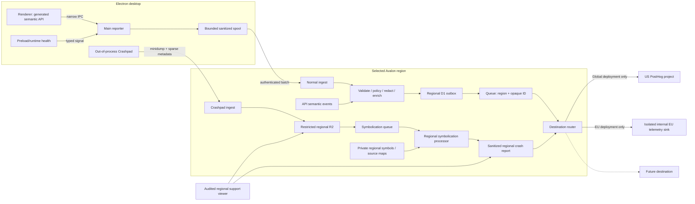

# Design: regional product telemetry and crash reporting

> Status: proposed; product decisions in [prd.md](prd.md#open-product-decisions) remain unresolved
>
> Related: [research](research.md), [implementation plan](plan.md)

## Design principles

1. The regional Avalon API is the collection boundary; vendors are destinations.
2. The event contract is an allowlist. Unknown data is rejected, not forwarded and scrubbed later.
3. Main owns Electron telemetry. Renderer code can express semantics but cannot own policy or transport.
4. A native dump is potentially customer content, even if most dumps do not contain readable content.
5. Client intent and server truth are distinct events joined by an operation identifier.
6. Accepted telemetry is durable before acknowledgement; telemetry never blocks the product action it describes.
7. Region, consent, identity, retention, and deletion are end-to-end properties.
8. PostHog-specific concepts stop at the destination adapter.

## System topology



The Global and EU deployments instantiate the regional box independently. They do not share outbox rows, queues, dumps, symbols, destination credentials, or support queries. Global sends approved destination payloads to the current US PostHog project. EU has no PostHog credentials or route: its product events and crash summaries terminate in isolated Cloudflare-backed internal primitives. Aggregate service operations that already use Cloudflare Analytics Engine remain separate and content-free; the shared Analytics Engine dataset is not used as the EU product-telemetry sink because it does not provide the required jurisdiction guarantee.

## Canonical event envelope

The illustrative TypeScript shape below is a design contract, not a request to commit this exact implementation before the tracking-plan spike:

```ts
type TelemetryEnvelope<V extends number, N extends EventName> = {
  schema: "com.avalon.telemetry.event";
  schemaVersion: V;
  eventId: string;
  name: N;
  source: "desktop-main" | "desktop-renderer" | "desktop-preload" | "api" | "site";
  category: "essential" | "product" | "diagnostic";
  originalTimestamp: string;
  sentAt: string;
  context: {
    environment: "development" | "staging" | "production";
    region: "global" | "eu";
    release: string;
    buildId: string;
    platform?: "darwin" | "win32" | "linux";
    arch?: string;
    channel?: string;
    launchId?: string;
    sessionId?: string;
    operationId?: string;
    requestId?: string;
    traceId?: string;
    spanId?: string;
  };
  properties: EventProperties[N];
};
```

The server adds, in a separate trusted record:

- `received_at` and normalized `timestamp`;
- clock-skew magnitude and normalization status;
- analytics person/workspace/installation identifiers where permitted;
- authenticated entitlement and workspace context from server state;
- ingress policy version, schema-registry version, and redaction version;
- payload hash, delivery state, destination adapter version, and attempt metadata.

The client cannot choose its trusted region, authenticated identity, entitlement, or server outcome.

### Event ID and duplicate semantics

The producer creates a UUIDv7 `event_id` once and persists it with the local envelope. Retries, regional outbox processing, destination retry, and operator replay preserve it. The ingest database has a unique regional event key. A duplicate with an identical payload is acknowledged as duplicate; a reused ID with a different payload is rejected and alerted as an integrity violation.

This provides deterministic deduplication inside Avalon. The Global PostHog adapter also passes a stable destination UUID where supported. Because provider deduplication windows and behavior can change, the public guarantee remains at-least-once.

### Time semantics

The producer records `original_timestamp` when the action occurred and `sent_at` immediately before each batch leaves the desktop. The regional API records `received_at` and computes a normalized timestamp using the Segment-style offset between original, sent, and received times. It clamps events outside the allowed replay horizon and records a clock-skew flag. Server-native events use server time for all applicable fields.

Product queries use normalized time. Delivery dashboards use received and delivered time. A client cannot backdate an event to escape retention or overwrite a server outcome.

## Tracking plan and generated interfaces

The repository contains one declarative tracking plan. Each event entry has:

- stable name and schema version;
- plain-language definition and product question it answers;
- owner and review group;
- allowed sources and one authoritative source;
- category and legal purpose;
- property names, primitive types, enums, bounds, optionality, and classification;
- allowed identity scopes;
- sampling policy and priority;
- local, regional, internal crash, and destination retention classes;
- destination mappings;
- compatibility and deprecation status.

A generator produces:

- renderer preload method signatures with exact arguments;
- main and API event constructors;
- runtime validators;
- redaction/allowlist tables;
- destination mapping types;
- Markdown data dictionary;
- golden valid/invalid/privacy fixtures.

CI fails on unregistered event names, arbitrary properties, incompatible changes without a version bump, missing owners, prohibited property classifications, or a destination transform that emits a field absent from its allowed mapping. A new optional property may be compatible; semantic meaning changes require a new event or schema version.

## Electron design

### Main-process authority

`TelemetryReporter` starts before normal windows, after the installation and currently configured regional endpoint can be read. It owns:

- compiled policy defaults and effective remote restriction;
- installation, launch, and session identifiers;
- authenticated identity state supplied after session validation;
- typed breadcrumb ring;
- local event validation;
- bounded persistent spool and batch scheduler;
- explicit flush on background/shutdown where time allows;
- crash reporter configuration and pending-upload policy;
- safe diagnostic logging and development inspector state.

The product must not wait for telemetry initialization to render or complete an action. If initialization fails, the reporter becomes a no-op with an aggregate local warning.

### Renderer and preload

The preload exposes methods such as `telemetry.screenViewed({ screen })` or `telemetry.runRequested({ operationId, entrypoint })` generated from the tracking plan. It does not expose `capture`, `track`, `identify`, a property dictionary, or a transport. The method validates again in main because the renderer is untrusted.

Router instrumentation emits screen enums rather than paths or page titles. Component instrumentation represents product semantics rather than clicks. Error boundaries send a normalized error candidate; main applies message/stack scrubbing and policy before spooling it.

### Local spool

The normal spool is an append-only or transactional queue under Avalon's application-data directory. Requirements:

- validated serialized envelope only;
- no provider payload and no raw pre-redaction input;
- maximum age, row count, and byte size;
- priority-aware eviction: product events before essential reliability;
- per-event attempt count and next-attempt time;
- single-writer main ownership and crash-safe commit;
- batch deletion only after regional acknowledgement;
- logout purge for queued authenticated product events;
- policy-change purge for newly prohibited categories;
- corruption recovery that quarantines the file locally without uploading it;
- safe file permissions and no secret material.

Encryption at rest can be added if the selected local database technology and OS key store provide a meaningful boundary. It is not used to justify storing sensitive payloads; data minimization remains primary.

### Desktop sessions

A `launch_id` begins when the process starts. A `session_id` begins when the application becomes interactive and renews after the approved background interval. The same definition supplies both product denominators and crash-free session health. Launch and session events have high delivery priority because missing denominators bias stability scores.

An unclean-exit marker is fsynced before the app becomes ready and cleared only during graceful shutdown. The next launch emits the prior release/build, last known phase, and whether it was in the launch window. It does not claim “native crash” without a dump or OS signal.

## Normal regional ingest

The normal endpoint accepts compressed batches with strict limits on compressed bytes, expanded bytes, item count, nesting, string length, and total properties. Authentication is the existing regional desktop session. The handler:

1. authenticates and binds the request to one region;
2. resolves effective user/workspace policy;
3. parses with resource limits;
4. validates schema, source, category, timestamps, and properties;
5. rejects prohibited keys and values;
6. derives scoped analytics identities;
7. adds trusted context;
8. stores accepted rows and deduplication state transactionally;
9. creates regional outbox work;
10. returns per-event accepted, duplicate, or rejected status.

The queue payload contains region and opaque accepted-row ID only. The destination worker retrieves the row from the same regional database. This keeps sensitive schema changes from silently expanding queue payloads and aligns with Avalon's current regional queue rule.

For an API action already in progress, server telemetry is inserted through a best-effort service that cannot change the product transaction outcome. Where atomicity with a product state transition is required for an authoritative analytic, an outbox row may be committed in the same D1 transaction. Otherwise `waitUntil` can defer only the attempt to create the durable row; it cannot be treated as durable destination delivery.

## Identity design

The server computes identifiers as versioned keyed hashes over environment, region, entity type, and stable platform identifier. Example logical input:

```text
HMAC(key_v3, "production\0eu\0person\0" + platform_user_id)
```

Person, workspace, and installation use separate labels. Development, staging, Global, and EU identifiers cannot be joined. The result includes a non-secret prefix and key version for operational handling. Key rotation retains a restricted mapping of active versions long enough to execute deletion, then retires it according to policy.

For Global events, the PostHog `distinct_id` is the derived person ID when authenticated product analysis permits it, otherwise the derived or random installation ID. The EU internal sink uses the same scoped identity semantics without exporting them. Workspace ID is a group/property only if group analytics has been approved. No direct profile fields are sent by default.

## Client/server correlation pattern

For a state-changing workflow:

1. Renderer creates an `operation_id` and emits a client-intent event.
2. Main sends the operation ID in the product API request through the existing typed transport.
3. API validates the ID format and attaches it to operational trace context and semantic server events.
4. The state-changing service emits an authoritative completion or failure event after the outcome is known.
5. The allowed analytics destination receives both names with the same opaque operation ID and derived identity: US PostHog for Global, or the internal EU sink for EU.

The server event never copies arbitrary client properties. It reconstructs its properties from trusted state. If retries repeat the product request, the domain's idempotency key and telemetry event IDs remain distinct: the first controls the product effect; the second controls analytics delivery.

## Crash pipeline

### Crash classes

| Class | Detection | Payload | Delivery path |
| --- | --- | --- | --- |
| Handled JS error | Explicit catch/report | Sanitized exception + typed breadcrumbs | Normal spool |
| Unhandled JS error/rejection | Process/global handlers | Sanitized exception + typed breadcrumbs | Normal spool, urgent flush |
| Renderer gone | Electron main listener | Reason/exit class/process/release | Normal spool |
| Unresponsive renderer | Electron main listener/watchdog | Transition/duration/recovery | Normal spool |
| Unclean exit | Next-launch marker | Prior phase/release | Normal spool next launch |
| Native crash | Crashpad out-of-process handler | Minidump + sparse static metadata | Crash endpoint |

### Crashpad authentication and abuse control

Crashpad cannot assume a fresh user token or arbitrary custom request behavior. A packaged prototype must determine the exact endpoint, header, multipart, retry, and pending-upload capabilities on supported Electron versions. The final endpoint uses the narrowest feasible region-bound capability, rotated per installation or release and revocable without exposing a general API credential.

Regardless of mechanism, the endpoint enforces:

- region encoded by the hostname/configuration, never a trusted form field;
- allowed release/build/channel/platform combinations;
- short capability lifetime or server-side revocation;
- per-capability, IP-edge, release, and global rate limits without persisting raw IP in product analytics;
- strict multipart parts, minidump magic/type, and byte limits;
- decompression and parser resource limits;
- malware-safe storage disposition and no executable handling;
- one opaque crash ID returned or recorded;
- no synchronous symbolication on the upload request.

If Crashpad's native transport cannot meet the authentication boundary, Avalon keeps dumps in the local Crashpad database and adds a minimal main-process uploader on the next launch. That loses immediate fatal upload but permits authenticated regional transport. The spike chooses explicitly between those tradeoffs.

### Artifact and symbol lifecycle

The release pipeline generates an immutable telemetry release manifest containing application version, build ID, Electron/Chromium version, process bundle IDs, platform, architecture, JavaScript debug IDs, native module debug identifiers, commit, channel, and artifact checksums.

Before a release is published, CI uploads:

- main/preload/renderer source maps and matching bundles needed for mapping;
- macOS dSYM, Windows PDB, Linux breakpad/debug symbols as applicable;
- native-module symbols;
- the signed release manifest.

Uploads go to separate Global and EU private symbol stores. EU artifacts stay in Avalon's Cloudflare-backed EU path and are never read by the Global symbolication service. Release publication fails when a supported target's required artifacts are absent. Symbols outlive the longest crash-report retention for that release.

The symbolication processor is region-local and reads only the dump and matching artifacts. It outputs a scrubbed normalized stack, owned top frame, system frame summary, crash signature, and parser status. If Cloudflare Workers cannot safely run the required native tooling, the implementation provisions a regional job/compute service; it does not ship unsymbolicated dumps to an unapproved global service as a shortcut.

### Fingerprinting and issue state

Default fingerprints include exception/crash type, process, owned top frames, and stable normalized frame tokens. Dynamic messages, addresses, offsets, local paths, line numbers in generated bundles, and user content are excluded. The schema permits a reviewed explicit fingerprint for known wrapper errors.

Avalon's crash report store tracks first seen, last seen, event count, affected installations, affected sessions, releases, regression state, and resolution annotations. Global PostHog receives enough data for release/funnel analysis, not raw report management. EU crash summaries remain in the internal regional sink. The private support viewer can resolve an opaque `crash_id` only for an authorized role in the matching region.

### Source and stack privacy

JavaScript stacks are parsed before destination delivery. Paths are reduced to application-relative module identifiers, user home directories are tokenized, query strings/fragments are removed, messages are mapped to a stable safe code where possible, and source context lines are not sent to either product analytics destination. Native frames expose module and symbol names only after a denylist/allowlist pass. Raw dumps and full internal frames retain the stricter diagnostic policy.

## Destination adapters

### Global PostHog adapter

The PostHog adapter is deployed and configured only in Global. It has no access to the inbound HTTP request and therefore cannot forward IP accidentally. It receives an accepted internal event plus destination policy. It:

- maps names and properties from a compile-time table;
- uses the US PostHog base URL from Global-only server configuration;
- sets normalized timestamp and stable event UUID;
- sets `distinct_id` and optional group only from derived identities;
- disables GeoIP/profile processing according to the event plan;
- adds `$lib: "avalon-regional-telemetry"`, adapter version, release, and environment;
- emits external-flag experiment properties only on planned events;
- maps sanctioned JS exceptions via the verified SDK/API path;
- records provider response class, latency, retryability, and request ID without logging payloads;
- never includes PostHog personal properties that are not explicitly declared.

Batching respects PostHog's documented payload limit with a substantially lower Avalon cap. 4xx schema/config failures become terminal and alert; 408/429/5xx/network failures retry with exponential backoff and `Retry-After`. A circuit breaker protects the regional consumer during a provider incident.

Provider configuration is treated as code where API coverage permits. A scheduled drift check verifies project region, IP capture, retention, authorized users, session replay/autocapture state, product/model-development opt-out, and deletion integration. A material privacy drift pauses forwarding and pages an operator; forwarding resumes only after remediation is verified.

### EU internal adapter

EU has no PostHog project token, personal API key, provider hostname, or adapter route. An allowlist test rejects external analytics hosts from the EU deployment. The internal adapter writes the accepted projection to Cloudflare-backed primitives owned by Avalon and isolated from Global. Selection follows this order:

1. use a primitive with documented EU domicile when it meets reliability, volume, query, deletion, and retention requirements;
2. otherwise provision a dedicated EU-only primitive, binding, dataset, keyspace, and access role that no Global telemetry uses;
3. record the locality limitation in regional and customer-facing documentation rather than claiming a stronger guarantee.

The EU sink supports the same schema versions, correlation, deletion, retention, loss accounting, and sanitized crash-summary contract as Global. It does not use the existing shared Analytics Engine dataset. A future EU-specific PostHog instance is a new adapter rollout requiring a recorded architecture/privacy decision, credentials provisioned only in EU, and migration/replay rules that do not send historical EU data without approval.

## Consent and policy resolution

The effective setting for a category is the intersection of:

```text
compiled product ceiling
AND local user preference
AND authenticated workspace policy
AND regional/legal policy
AND event-specific rollout
```

No feature flag can widen the compiled ceiling. A remote response is signed/authenticated through the normal API session and cached with version and expiry. The compiled and local default enables product analytics and crash reporting; an authenticated workspace policy may only reduce that ceiling. Essential reliability continues within the compiled content-free allowlist.

The per-user `productAnalyticsEnabled` setting defaults to `true`. When a user turns it off, main immediately stops creating semantic product events, prevents native dump upload, purges queued product events, and removes pending Crashpad artifacts. Essential reliability remains active. Because Electron Crashpad cannot be stopped after it starts, fully preventing local dump generation takes effect after the desktop restarts; the settings UI discloses this and offers a restart. Any dump generated during the remainder of the current process is never uploaded and is removed on the next safe startup. When the setting is already off at launch, Avalon does not start native crash reporting.

When a category changes from allowed to disallowed, main stops collection immediately and purges queued events in that category. The API rejects stale clients that continue sending them. Previously delivered provider data follows the approved deletion/retention policy; the UI distinguishes “stopped future collection” from “requested deletion.”

## Security threats and controls

| Threat | Control |
| --- | --- |
| Compromised renderer sends secrets | Narrow generated IPC; main runtime schema; server schema and prohibited-key scan |
| Outdated client ignores policy | API-authoritative effective policy and schema versions |
| Telemetry endpoint becomes data exfiltration path | Allowlisted enums/bounds, no arbitrary strings, strict sizes, authenticated normal ingest |
| Crash endpoint is abused for storage or parser attacks | Region-bound capability, rate limits, type/size validation, asynchronous sandboxed parsing |
| PostHog credential leaks or reaches EU | Global-server-only secret; EU has no PostHog binding/host; no renderer SDK or key dependency |
| Cross-region routing | Separate hostnames, bindings, queues, stores, secrets, tests, and support roles |
| Duplicate/replayed events bias analysis | Unique event ID, payload-hash conflict detection, bounded replay, stable destination UUID |
| Stack/dump leaks content | Pre-forward stack scrub; user analytics control; separate dump store/access/retention; no raw dump in PostHog |
| Schema drift expands collection | Tracking plan in CI; destination golden fixtures; unknown fields reject |
| Provider settings drift | Configuration-as-code where possible; scheduled drift audit; forwarding pause on material drift |
| Deletion misses rotated identities | Versioned ID derivation and deletion index across active/historical key versions |
| Telemetry failure harms product | Non-blocking reporter and server service; bounded resources; isolation/circuit breakers |

## Operational surfaces

At minimum operators need:

- accepted, duplicate, rejected, sampled, evicted, and delivered event counts by region/source/schema/release;
- oldest outbox age, retry counts, dead-letter rows, destination latency/error class;
- local spool drop reports by reason and release;
- crash upload accepted/rejected, dump age, symbolication backlog/failure class, missing artifacts;
- crash-free launches/sessions with delivered and lost denominators;
- provider configuration drift and deletion job state;
- strict alerts without event property or crash content in log messages.

Runbooks cover provider outage, outbox backlog, schema rejection spike, crash-upload abuse, missing symbols, accidental prohibited-data detection, cross-region test failure, consent-policy incident, and deletion failure.

## Alternatives considered

### Direct PostHog SDK in renderer

Rejected for the core product because it makes region, consent, schemas, identity, offline retry, and provider-specific features client concerns. The Electron-compatible build solves bundling, not Avalon's trust boundary.

### Direct desktop-to-PostHog proxy

Rejected because a thin reverse proxy does not validate semantics, derive identity, persist durably, join server outcomes, support multiple destinations, or own deletion. The regional API must be a collector, not only a URL mask.

### Segment or RudderStack as the collector

Deferred. They solve routing and governance well, but add another data processor and regional contract for a system with one initial destination. The adapter boundary keeps this option open if destination count grows.

### Sentry or Bugsnag for crashes

Viable fallback for Global. They dramatically reduce symbolication and issue-management work. They remain deferred because the requested design calls for regional Avalon ingress and PostHog summary analysis, and the current EU decision prohibits sending EU crash data to an external US service. The native-crash spike must compare custom total cost and residency against these vendors before full build commitment.

### PostHog-only error tracking

Rejected as complete crash coverage. It covers JavaScript exceptions but is not the raw Crashpad dump, symbol, access, and native support system required here.

### Automatic DOM and network capture

Rejected. Avalon displays customer work content, and generic UI/network mechanisms cannot reliably distinguish semantics from secrets. Explicit events are more private and more analytically stable.
