# Design: regional product telemetry and crash reporting

> Created 2026-08-12.
>
> Related: [research](research.md), [implementation plan](plan.md)

## Design principles

1. Rally's authenticated identity and regional APIs are the collection boundary; vendors are destinations.
2. The event contract is an allowlist. Unknown data is rejected, not forwarded and scrubbed later.
3. Main owns Electron telemetry. Renderer code can express semantics but cannot own policy or transport.
4. A native dump is potentially customer content, even if most dumps do not contain readable content.
5. Client intent and server truth are distinct events joined by an operation identifier.
6. Accepted telemetry is durable before acknowledgement; telemetry never blocks the product action it describes.
7. Region, consent, identity, retention, and deletion are end-to-end properties.
8. PostHog-specific concepts stop at the destination adapter.

## System topology

```mermaid
flowchart LR
  subgraph Desktop["Electron desktop"]
    Renderer["Renderer: typed semantic API"] -->|"narrow IPC"| Main["Main reporter"]
    Preload["Preload/runtime health"] -->|"typed signal"| Main
    Main --> Spool["Bounded sanitized spool"]
    Main --> CrashGate["Crash start gate"]
    CrashGate -->|"allowed route"| Crashpad["Out-of-process Crashpad"]
    Crashpad --> CrashDatabase["Active route-final Crashpad database"]
    CrashDatabase -->|"next launch: rotate while inactive"| CrashUploadSpool["Bounded route-final upload spool"]
    CrashUploadSpool --> CrashUploader["Main-process authenticated uploader"]
    CrashGate -->|"pre-region EU"| NoDump["Crashpad stopped / no dump"]
  end

  subgraph Identity["Global identity control plane"]
    IdentityIngest["Anonymous-capability / identity-authenticated onboarding ingest"] --> ProvisionalRoute["Explicit binding or coarse Cloudflare route"]
    IdentitySignals["Onboarding coordinator events"] --> ProvisionalRoute
  end

  subgraph Region["Routed Global or EU pipeline"]
    Ingest["Normal ingest"] --> Validate["Validate / policy / redact / enrich"]
    Validate --> Outbox["Regional D1 outbox"]
    Outbox --> Queue["Queue: region + opaque ID"]
    Queue --> EventProcessor["Policy recheck / transform"]
    EventProcessor -->|"normal event"| Router["Destination router"]
    EventProcessor -->|"JavaScript exception"| JSSymbolicate["Regional JS symbolication"]
    JSArtifacts["Private source maps / bundles"] --> JSSymbolicate
    JSSymbolicate --> Router
    ApiSignals["API semantic events"] --> Validate

    CrashIngest["Authenticated crash ingest"] --> Dumps["Restricted regional R2"]
    Dumps --> CrashQueue["Symbolication queue"]
    CrashQueue --> Symbolicate["Regional symbolication processor"]
    Symbols["Private regional symbols / source maps"] --> Symbolicate
    Symbolicate --> CrashReports["Sanitized regional crash report"]
    CrashReports --> Router
  end

  Spool -->|"bootstrap session batch"| IdentityIngest
  Spool -->|"authenticated batch"| Ingest
  ProvisionalRoute -->|"Global: immediate"| Validate
  ProvisionalRoute -->|"EU: immediate named RPC"| Validate
  ProvisionalRoute -.-> CrashGate
  CrashUploader -->|"header-authenticated minidump + sidecar"| CrashIngest
  Preference["Canonical account preference (Global identity control plane)"] -.-> IdentityIngest
  Preference -.->|"named RPC: opaque subject + boolean + version"| Validate
  Router -->|"Global deployment only"| PostHog["US PostHog project"]
  Router -->|"EU deployment only"| EUInternal["Isolated internal EU telemetry sink"]
  Router -.-> Future["Future destination"]
  Support["Audited regional support viewer"] --> CrashReports
  Support --> Dumps
```



The Global and EU deployments instantiate the regional box independently. They do not share outbox rows, queues, dumps, symbols, destination credentials, or support queries. Global sends approved destination payloads, including complete sanitized structured crash reports, to the current US PostHog project. EU has no PostHog credentials or route: its product events and equivalent full structured crash reports terminate in isolated Cloudflare-backed internal primitives. Two narrow named cross-region bindings exist. The Global-to-EU telemetry binding carries an already-validated onboarding or authoritative outcome projection when an explicit binding or coarse Cloudflare result chooses EU; it never carries a raw platform identifier, Global destination identity, IP address, or geolocation field. The EU-to-Global control binding has separate strictly parsed methods: account-preference mutation carries only the random region-bound `preference_subject_handle`, boolean, expected version, and operation ID, while journey authorization/closure carries only the route-bound capability and expected EU route. The capability signing key remains Global-only; the response reveals only the fixed route, anonymous epoch, and closed state, never the key, an event/dump payload, or a destination identity. The route-final local crash upload spool is not a region-resolution holding area: every generation has already been assigned Global or EU at capture and can only upload to that destination. Aggregate service operations that already use Cloudflare Analytics Engine remain separate and content-free. V1 creates no Analytics Engine dataset or binding for EU telemetry; neither the shared dataset nor a duplicate EU-labelled dataset is a product-event, crash, or derived-metrics destination.

## Canonical event envelope

The illustrative TypeScript shape below is a design contract, not a request to commit this exact implementation before the tracking-plan spike:

```ts
type TelemetryEnvelope<V extends number, N extends EventName> = {
  schema: "com.avalon.telemetry.event";
  schemaVersion: V;
  eventId: string;
  name: N;
  source: "desktop-main" | "desktop-renderer" | "desktop-preload" | "api";
  category: "essential" | "product" | "diagnostic";
  identityScope: "installation" | "anonymous-epoch" | "platform-user" | "workspace-user" | "workspace";
  originalTimestamp: string;
  sentAt: string;
  context: {
    environment: "development" | "staging" | "production";
    region?: "global" | "eu";
    release: string;
    buildId: string;
    platform?: "darwin" | "win32" | "linux";
    arch?: string;
    channel?: string;
    launchId?: string;
    sessionId?: string;
    onboardingJourneyId?: string;
    operationId?: string;
    requestId?: string;
    traceId?: string;
    spanId?: string;
  };
  properties: EventProperties[N];
};
```

The client omits `region` for pre-region onboarding events. The identity ingest accepts that state only from a valid Global anonymous-epoch capability or identity bootstrap session and adds a trusted `global` or `eu` route before durable acceptance. Anonymous-epoch semantic events use the same edge-derived provisional route. Pre-region native crashes use a separate start gate: inferred EU creates no dump, while non-EU, unknown, and geolocation failure use a Global-designated local Crashpad database.

The server adds, in a separate trusted record:

- `received_at` and normalized `timestamp`;
- clock-skew magnitude and normalization status;
- analytics person/workspace/installation/anonymous-epoch identifiers where permitted;
- authenticated entitlement and workspace context from server state;
- trusted route (`global` or `eu`) and routing basis (`explicit_binding`, `explicit_selection`, `ip_geolocation`, or `geolocation_fallback`);
- ingress policy version, schema-registry version, and redaction version;
- payload hash, delivery state, destination adapter version, and attempt metadata.

The client cannot choose its trusted region, authenticated identity, entitlement, or server outcome.

### Event ID and duplicate semantics

The producer creates a UUIDv7 `event_id` once and persists it with the local envelope. Retries, regional outbox processing, destination retry, and operator replay preserve it. The ingest database has a unique regional event key. A duplicate with an identical payload is acknowledged as duplicate; a reused ID with a different payload is rejected and alerted as an integrity violation.

This provides deterministic deduplication inside Rally. The Global PostHog adapter also passes a stable destination UUID where supported. Because provider deduplication windows and behavior can change, the public guarantee remains at-least-once.

### Time semantics

The producer records `original_timestamp` when the action occurred and `sent_at` immediately before each batch leaves the desktop. The regional API records `received_at` and computes a normalized timestamp using the Segment-style offset between original, sent, and received times. It clamps events outside the allowed replay horizon and records a clock-skew flag. Server-native events use server time for all applicable fields.

Product queries use normalized time. Delivery dashboards use received and delivered time. A client cannot backdate an event to escape retention or overwrite a server outcome.

## Tracking plan registry and typed interfaces

The repository contains one checked-in TypeScript tracking registry built from discriminated unions and runtime schemas. Each event entry has:

- stable name and schema version;
- plain-language definition and product question it answers;
- owner and review group;
- allowed sources and one authoritative source;
- category and legal purpose;
- property names, primitive types, enums, bounds, optionality, and classification;
- allowed identity scopes;
- sampling policy and priority;
- local, regional, internal crash, and destination retention classes;
- destination mappings;
- compatibility and deprecation status.

The narrow renderer facade, main/API constructors, and PostHog mapping are handwritten against registry-derived TypeScript types. Compile-time exhaustiveness requires every registered event to have an explicit source and destination treatment. Runtime schemas, redaction rules, and golden valid/invalid/privacy fixtures live beside the relevant registry entry. V1 does not add a code generator or generated documentation pipeline; the registry is the data dictionary, and automation can be added later only if manual drift becomes measurable.

CI fails on unregistered event names, arbitrary properties, incompatible changes without a version bump, missing owners, prohibited property classifications, or a destination transform that emits a field absent from its allowed mapping. An additive diagnostic or breadcrumb field may remain in the same schema version only when it is optional, bounded, classified, and covered by privacy fixtures. A required field, removal, type change, broadened meaning, or changed privacy classification requires a version bump and migration/deprecation note; a semantic meaning change requires a new event or schema version.

## Electron design

### Main-process authority

`TelemetryReporter` starts before normal windows, after the installation identity and current routing state can be read. It owns:

- compiled policy defaults, the durable local user choice, the last acknowledged canonical preference version, and effective remote restrictions;
- installation, anonymous-epoch, launch, and session identifiers;
- authenticated identity state supplied after session validation;
- the server-bound onboarding journey and provisional/explicit routing state;
- typed breadcrumb ring;
- local event validation;
- bounded persistent spool and batch scheduler;
- explicit flush on background/shutdown where time allows;
- crash reporter configuration and pending-upload policy;
- safe diagnostic logging and development inspector state.

Normal telemetry initialization never delays rendering or a product action. The sole exception is the pre-region native-crash gate: before creating the first renderer, main waits for an explicit route, an affirmative coarse EU result, or a fixed engineering deadline whose timeout selects the approved Global fallback. This bounded gate is necessary because Electron can cover only renderers created after Crashpad starts, while an EU-country launch must create no dump at all. The startup budget and fallback are verified in packaged tests. Failure after the gate makes normal telemetry a no-op with an aggregate local warning and never delays later product actions.

### Renderer and preload

The preload exposes explicit methods such as `telemetry.screenViewed({ screen })` or `telemetry.runRequested({ operationId, entrypoint })`, typed against the registry. It does not expose `capture`, `track`, `identify`, a property dictionary, or a transport. The method validates again in main because the renderer is untrusted.

Router instrumentation emits screen enums rather than paths or page titles. Component instrumentation represents product semantics rather than clicks. Error boundaries send a normalized error candidate; main applies message/stack scrubbing and policy before spooling it.

### Local spool

The normal spool is an append-only or transactional queue under Rally's application-data directory. Requirements:

- validated serialized envelope only;
- no provider payload and no raw pre-redaction input;
- delivery eligibility ends 14 days after creation, with independent row-count and byte-size ceilings; the running process purges expired rows on schedule and startup purges them before any delivery attempt, so a dormant device cannot make an expired row eligible again;
- priority-aware eviction: product events before essential reliability;
- per-event attempt count and next-attempt time;
- single-writer main ownership and crash-safe commit;
- batch deletion only after regional acknowledgement;
- deletion only after the identity or regional API acknowledges durable receipt;
- logout purge for queued authenticated product events and rotation of the anonymous epoch before another account can authenticate;
- policy-change purge for product events and detailed diagnostics that become prohibited;
- corruption recovery that never uploads quarantined material; each independently replaceable spool generation has a main-owned creation time and absolute deletion deadline stored outside its payload, quarantine inherits that deadline and a separate byte ceiling, startup/maintenance purges it, and a missing or invalid deadline causes immediate deletion rather than inferred retention;
- safe file permissions and no secret material.

Encryption at rest can be added if the selected local database technology and OS key store provide a meaningful boundary. It is not used to justify storing sensitive payloads; data minimization remains primary.

### Desktop sessions

A `launch_id` begins when the process starts. A `session_id` begins when the application becomes interactive and renews after the approved background interval. The same definition supplies both total-usage denominators and crash-free session health. Each launch and session records whether detailed crash reporting was continuously eligible from its start. A preference change in either direction makes the current launch/session ineligible; only the next launch/session may establish the new state. Crash-free calculations use eligible denominators, while essential launch/session events measure total use and expose eligibility coverage. Launch and session events have high delivery priority because missing denominators bias stability scores.

An unclean-exit marker is fsynced before the app becomes ready and cleared only during graceful shutdown. The next launch emits the prior release/build, last known phase, and whether it was in the launch window. It does not claim “native crash” without a dump or OS signal.

## Identity onboarding ingest

Before Google authentication, main creates a random anonymous epoch and requests a short-lived bootstrap capability from the Global edge. The edge binds the capability to that epoch, the registered logged-out onboarding schema subset, the coarse provisional route, expiry, and abuse limits. It is not an account credential and cannot call normal product, identity, or workspace APIs; only the bounded anonymous telemetry routes can consume it, including Global crash ingest after a second route/journey check. Main owns it; the renderer receives only typed semantic methods.

Google authentication upgrades the journey to an identity-only Global bootstrap session before Rally knows whether the user will activate an existing Global or EU workspace, accept an invitation, or create a new workspace. This is an authenticated `platform-user` scope, not anonymous traffic and not a Global workspace session.

The bootstrap session carries the canonical Product analytics boolean and preference version plus a server-created `onboarding_journey_id`. The journey ID is opaque, non-authorizing, and bound to that bootstrap session. An existing opt-out is effective before identity-scoped product events are accepted. A new account uses the approved default-on policy; the settings control is not shown during onboarding.

Each event uses this routing precedence:

1. an existing explicit platform workspace binding;
2. an explicit region selection already made during the journey;
3. otherwise the journey's provisional route, fixed on its first eligible edge request as `eu` only when Cloudflare reports `isEUCountry` affirmatively and as `global` for a non-EU, unavailable, malformed, timed-out, or failed geolocation result.

The service persists only the coarse provisional route and `routing_basis`, never the source IP, country, city, continent, coordinates, postal code, timezone, ASN, or raw Cloudflare request metadata. Fixing the provisional route prevents a VPN or network change from splitting the pre-selection portion of one onboarding funnel. A later explicit choice applies prospectively; accepted history is not migrated, linked across regions, or duplicated.

The Global ingest has two disjoint modes. Logged-out mode accepts only registered anonymous-epoch schemas under the route-bound capability. Identity mode accepts only registered platform-user onboarding schemas while the authenticated session has no workspace; it resolves the platform subject from the session, validates the journey binding, and applies the canonical account preference. Both modes validate each event before routing:

- **Global route:** commit immediately to the Global accepted-event outbox and use the anonymous epoch or resolve the stored Global platform-user analytics ID there.
- **EU route:** call a named Worker RPC with the exact validated projection. Anonymous events carry the random epoch. Authenticated platform-user events carry a Global-issued, EU-scoped telemetry subject handle that is opaque, versioned for deletion, stored only as restricted identity-control metadata in Global, never used as a Global destination identity, and never exposed to the client. The EU handler uses that handle as its pseudonymous destination identity, commits to the EU internal outbox/sink, and returns per-event durable acknowledgement. The payload contains no raw platform identifier, Global destination identity, or location field.

For EU-routed onboarding events, Global keeps no event holding or replay payload. Global-routed onboarding events use the normal Global accepted-event outbox and replay lifecycle. Minimal journey route and content-free delivery/deduplication receipts receive immutable deletion deadlines no later than 90 days after creation. When an epoch is successfully linked, the ordinary regional identity-link row remains only as long as attributable internal data may remain: at most 90 days in Global and 13 months in EU. Unlinked epochs have no person mapping and expire only through their event and receipt deadlines. Active preference handles are account configuration: they rotate with region/account bindings and are deleted with the account rather than becoming telemetry history. Retries preserve `event_id`, and a reused identifier with another payload is rejected. Region-derived discovery data cannot escape through a rejection record, log, property, or PostHog payload.

The renderer reports only presentation and intent: fixed screen enums, selected-region intent after the user acts, and requests to create, activate, accept, or decline. The coordinator and regional services report authoritative state and outcomes. A safe operation identifier correlates each intent with its result; it remains distinct from authentication credentials and from any domain idempotency key.

Native dumps never use the identity event ingest. If no explicit region is available, main resolves the bounded coarse-route gate before creating the first renderer. An affirmative EU-country route leaves Crashpad stopped and creates no local artifact; non-EU, unknown, timeout, network failure, and unusable responses start a Global-designated local Crashpad database. There is no pending region-resolution queue: the dump generation's capture route is final. At the next launch, after rotating the inactive database into the separate upload spool, Rally authenticates upload in a request header using the regional session or a refreshed main-only Global bootstrap capability and never puts a credential in the Crashpad URL. Once a regional workspace session exists, a subsequent launch configures Crashpad for that workspace region. The identity ingest accepts neither minidumps nor arbitrary diagnostic attachments.

## Normal regional ingest

The normal endpoint accepts compressed batches with strict limits on compressed bytes, expanded bytes, item count, nesting, string length, and total properties. Authentication is the existing regional desktop session. The handler:

1. authenticates and binds the request to one region;
2. resolves the persisted regional projection of the canonical account preference;
3. parses with resource limits;
4. validates schema, source, category, timestamps, and properties;
5. rejects prohibited keys and values;
6. resolves or allocates scoped analytics identities;
7. adds trusted context;
8. stores accepted rows and deduplication state transactionally;
9. creates regional outbox work;
10. returns per-event accepted, duplicate, or rejected status.

The queue payload contains region and an opaque outbox-work-item ID only. The destination worker retrieves the work item from the same regional database. A Global work item is either an accepted semantic-event reference or a provider-native identify/group-identify job with the exact PII allowlist defined below; both use the same ordered queue, delivery state, access controls, and immutable deadline. EU stores the equivalent pseudonymous identity link directly and has no profile job. This keeps sensitive schema changes from silently expanding queue payloads, avoids a second replay subsystem, and aligns with Rally's current regional queue rule.

At regional acceptance, every accepted row and its validated, sanitized replay projection receive an immutable deletion deadline 90 days later. Success, retry, terminal failure, and operator replay do not restart or extend that clock. The replay store never contains the raw client candidate, rejected payload fragments, raw minidumps, or private symbolication artifacts. A deletion request suppresses replay and removes an attributable row before the 90-day ceiling.

A terminal delivery failure enters a regional dead-letter state under the original acceptance deadline. Retry stops and the row is deleted when that deadline arrives, even if no attempt ever reached a terminal response. Operator replay preserves `event_id`, rechecks the current preference, and cannot resurrect an event suppressed by opt-out, deletion, or expiry.

The server rechecks the current preference version before destination delivery. A change to disabled suppresses already queued product events and detailed diagnostics for that person. API-native and asynchronous emitters perform the same check before creating an event. If the projection is unavailable or its version cannot be established, those emitters and the destination worker allow only the essential content-free schema set.

Rejection handling never persists or logs an unvalidated client string. It records a fixed violation code, a registered event/schema/source/field identifier or a fixed `unknown` sentinel, server-derived release identity, and an aggregate count. Unknown event names, schema strings, client release values, property keys, and path segments are neither echoed nor hashed for inspection because even a key can carry a secret. Development validation can point to a registered field identifier, but it also replaces unknown values with the sentinel. This content-free rejection metadata is stored as time-bucketed contributions. Each observation contribution expires 90 days after it was recorded, and aggregate counts are recomputed from surviving buckets, so a later rejection cannot renew earlier observations. It cannot be used to retain or reconstruct a rejected value.

For an API action already in progress, server telemetry is inserted through a best-effort service that cannot change the product transaction outcome. Where atomicity with a product state transition is required for an authoritative analytic, an outbox row may be committed in the same D1 transaction. Otherwise `waitUntil` can defer only the attempt to create the durable row; it cannot be treated as durable destination delivery.

## Identity design

Signals use five non-overlapping identity scopes:

| Scope | Server knowledge | Destination identity |
| --- | --- | --- |
| `installation` | Device-level reliability without an authenticated person | Random installation identifier; never linked to a person |
| `anonymous-epoch` | One bounded logged-out product journey | Random epoch identifier; automatically linked after authentication when its fixed route and account preference permit |
| `platform-user` | Canonical Global platform identity, no explicit workspace route | Immutable random Global analytics person ID or dedicated opaque EU telemetry subject handle |
| `workspace-user` | Authenticated regional user and workspace | Immutable random regional person ID and workspace group ID |
| `workspace` | Unattended regional workspace execution with no responsible person | Immutable random workspace analytics ID as a personless distinct ID and workspace group ID |

The desktop's session user ID is not the cross-region analytics join key: a regional user row may differ from the canonical Global row. The authoritative identity/workspace record stores one cryptographically random analytics ID per environment, region, and entity. Person and workspace IDs are immutable for that subject's lifetime, are never rotated, and are deleted with the subject; recreating a subject mints a new ID. Global, EU, staging, and production therefore cannot be joined, while one region's funnels and PostHog people/groups remain stable. The raw `platform_user_id` and raw account/user/workspace-identity database IDs never enter PostHog, a client event, or the Global-to-EU telemetry handoff. Closed product schemas may carry opaque work-stream, message, note, automation, run, or invocation UUIDs as correlation properties without accompanying content. Before an EU regional user exists, the Global identity plane creates a random EU-scoped telemetry subject handle; after activation, EU links that handle to its independently minted regional analytics person without exporting either identity.

For Global events, PostHog `distinct_id` is the immutable Global analytics person ID for authenticated activity, the random anonymous-epoch ID before authentication, the random installation ID only for schemas registered for device-level reliability, or the immutable workspace analytics ID for personless workspace execution. Anonymous-epoch, installation-only, and workspace-only captures set `$process_person_profile: false`. Eligible Global workspace events attach the immutable Global workspace analytics ID under the `workspace` group type. The authenticated desktop ingest rejects the workspace-only scope; only the regional runtime can create it. EU uses independently minted regional IDs only inside the internal sink.

Direct contact fields use PostHog's native identity and group-profile paths rather than semantic event enrichment. After verified authentication on an eligible Global route and account-preference enforcement, the existing ordered Global outbox receives an epoch-transition identify job containing the destination person ID, the anonymous epoch as `$anon_distinct_id`, and exactly the verified primary `email` and current display `name`. This includes the approved provisional Global fallback so the authenticated onboarding funnel remains identifiable. The transition cannot be superseded while unresolved; a later verified email/name change may coalesce into its `$set` values only while preserving the anonymous epoch. Once the transition acknowledges or terminally fails, later verified changes use coalescible person-profile identify jobs without `$anon_distinct_id`. After an explicit Global workspace is active and the user preference permits analytics, the outbox may also receive a coalescible group-identify job containing the destination workspace ID and current workspace `name`. All use the outbox's normal immutable 90-day deadline and are removed sooner after acknowledgement, opt-out, subject deletion, or eligible supersession. V1 adds no profile-specific lookup handle, mapping service, replay store, or retention engine. EU has no direct-profile job, and the three values never appear in semantic captures, exceptions, breadcrumbs, or crash reports.

Authentication creates an identity transition inside the onboarding journey's already fixed route. EU first presents the opaque capability and expected route to the Global-only verifier over `GLOBAL_TELEMETRY_CONTROL`; the response contains only the fixed route, anonymous epoch, and closed state. EU then links that epoch to its independently minted regional person locally and asks the same control surface to close the Global journey. A Global transition verifies and closes locally. Both paths are idempotent and proceed only after session validation, canonical-preference resolution, and verification that the epoch has not already closed or linked. For Global PostHog, the adapter emits the browser contract's `$identify` event with `distinct_id` set to the stable person ID, `$anon_distinct_id` set to the epoch, and `$set` containing verified primary `email` and current display `name`. It prioritizes that job ahead of later accepted person captures. A terminal transition failure leaves the histories separate and alerts without blocking product behavior or unrelated telemetry. For EU, the sink records the equivalent pseudonymous internal link without direct profile fields. Renderer and preload never call `identify`, `$identify`, or `alias`. Logout, account switching, and abandonment close the epoch and create a fresh epoch before another login journey; the installation ID never participates.

Platform-user onboarding events created after authentication use the stable person identity for the fixed route and are not replayed through another transition. If that route differs from the later workspace region, the link, profile, and earlier activity remain in the original route, the workspace person begins prospectively in the explicit region, and no identifier, mapping, event, profile, export, or import bridges the histories. A profile acknowledged under provisional Global fallback remains Global and is never copied to EU; disclosures state this consequence of immediate routing.

## Client/server correlation pattern

For a state-changing workflow:

1. Renderer creates an `operation_id` and emits a client-intent event.
2. Main sends the operation ID in the product API request through the existing typed transport.
3. API validates the ID format and attaches it to operational trace context and semantic server events.
4. The state-changing service emits an authoritative completion or failure event after the outcome is known.
5. The allowed analytics destination receives both names with the same opaque operation ID and stable regional analytics identity: US PostHog for Global, or the internal EU sink for EU.

The server event never copies arbitrary client properties. It reconstructs its properties from trusted state. If retries repeat the product request, the domain's idempotency key and telemetry event IDs remain distinct: the first controls the product effect; the second controls analytics delivery.

## Crash pipeline

### Crash classes

| Class | Detection | Payload | Delivery path |
| --- | --- | --- | --- |
| Handled JS error | Explicit catch/report | Sanitized exception + typed breadcrumbs | Normal spool |
| Unhandled JS error/rejection | Process/global handlers | Sanitized exception + typed breadcrumbs | Normal spool, urgent flush |
| Renderer gone | Electron main listener | Reason/exit class/process/release | Normal spool |
| Unresponsive renderer | Electron main listener/watchdog | Transition/duration/recovery | Normal spool |
| Unclean exit | Next-launch marker | Prior phase/release | Normal spool next launch |
| Native crash | Crashpad out-of-process handler | Local minidump + sparse static metadata + optional sanitized sidecar | Next-launch database rotation, then main uploader |

### Crashpad authentication and abuse control

Electron Crashpad's supported start surface does not provide Rally's required authenticated-header boundary. Rally therefore does not configure native network submission and never embeds a token or capability in `submitURL`, query parameters, form metadata, or another URL-bearing field. Crashpad writes completed reports to a route-final database generation created for that launch. A packaged prototype must verify database location, completion semantics, process coverage, generation rotation, and pre-start purge behavior on every supported Electron version.

Rally never opens or mutates the database while its Crashpad handler is active. At the next launch, before starting a new handler, main atomically rotates the entire inactive prior database plus its launch manifest and crash sidecar into Rally's route-final upload spool. It validates the capture route, generation eligibility, age, completion state, and integrity, deletes ineligible/incomplete material, and starts a fresh Crashpad database before rendering. Upload proceeds asynchronously from the separate spool and therefore never races Crashpad. Multipart requests use the normal regional session or a short-lived, route-bound, main-only bootstrap capability in an authorization header. The capability authorizes only one regional crash-ingest shape, is refreshed rather than persisted in a URL, and cannot call product APIs. A capture route can never be changed by a later network or workspace selection.

Local reports and sidecars become permanently ineligible for upload 14 days after creation. While Rally is running, the separate rotated upload spool is actively deleted at that deadline, and independent byte/count ceilings may evict it sooner with only a content-free aggregate loss counter. No process can delete either a rotated spool or an unrotated report while the device is dormant, and Rally cannot safely delete an active Crashpad database. At the next launch, before any upload attempt or Crashpad restart, main checks original creation time and deletes every expired rotated or unrotated report, manifest, invalidation record, and sidecar. A later launch, authentication, route change, or retry cannot restore eligibility. User-facing privacy material describes this next-launch physical-deletion limit rather than promising background deletion while Rally is not running.

Regardless of mechanism, the endpoint enforces:

- region encoded by the hostname/configuration, never a trusted form field;
- allowed release/build/channel/platform combinations;
- authenticated regional session or short capability lifetime and server-side revocation;
- per-capability, IP-edge, release, and global rate limits without persisting raw IP in product analytics;
- strict multipart parts, minidump magic/type, and byte limits;
- decompression and parser resource limits;
- malware-safe storage disposition and no executable handling;
- one opaque crash ID returned or recorded;
- no synchronous symbolication on the upload request.

An inferred-EU pre-region launch never starts Crashpad and therefore creates neither a dump nor a crash sidecar. Every native dump waits until the next launch for custom upload, including renderer and child-process dumps. Crash-free dashboards expose awaiting-restart, rotated, expired-local, policy-invalidated, rejected, and uploaded counts so delayed delivery cannot silently improve the apparent rate.

At the next successful launch, prior-generation rotation and eligibility validation finish before the first renderer is created. The uploader schedules every eligible prior-generation native report ahead of normal telemetry and begins its first attempt as soon as route-appropriate authentication and network are available. Rally makes no wall-clock delivery promise while the app is closed or offline. If the new launch crashes before the prior report uploads, the independent rotated spool preserves that prior report for a later attempt and the new crash remains in the fresh active generation for the following launch; neither event can renew the other's absolute deadline.

Disabling Product analytics stops Rally's upload-spool worker immediately, marks any bootstrap capability for revocation, and fsyncs an invalidation record for the active Crashpad generation before acknowledging the local change. A telemetry-region change performs the same generation invalidation before changing product state. Rally does not open, mutate, or delete the active Crashpad database. On the next launch, the rotation step recognizes the invalidation and purges the entire generation and sidecars rather than uploading any report from it; Crashpad then remains stopped for opt-out or starts a fresh generation under the new effective route/policy. This deliberately discards even an earlier dump from an invalidated launch to avoid relying on racy per-report timing. Packaged tests cover database locks, crashes before and after invalidation, region changes, an upload already in flight from an older rotated generation, and a failed purge. An upload accepted before the server acknowledges the opt-out cannot be recalled synchronously and follows its normal regional retention or a separate account-deletion workflow; the UI does not claim otherwise.

### Crash-surviving breadcrumbs

The typed breadcrumb ring is bounded, already sanitized, and mirrored by main to an atomic per-launch sidecar with restrictive permissions. Each checkpoint records launch/process identity, sequence, and freshness time; it contains no arbitrary strings. The uploader attaches the matching sidecar to the multipart request and deletes it with the local dump. A renderer crash may use the latest main-owned checkpoint. A fatal main crash can lose recent in-memory transitions, so the structured report includes `breadcrumb_status: "available" | "stale" | "unavailable"` and never treats breadcrumbs as mandatory. Sidecars obey the dump's opt-out, route, local age, and deletion rules and are never uploaded independently.

### Artifact and symbol lifecycle

The release pipeline generates an immutable telemetry release manifest containing application version, build ID, Electron/Chromium version, process bundle IDs, platform, architecture, JavaScript debug IDs, native module debug identifiers, commit, channel, and artifact checksums.

Before a release is published, CI uploads:

- main/preload/renderer source maps and matching bundles needed for mapping;
- macOS dSYM, Windows PDB, Linux breakpad/debug symbols as applicable;
- native-module symbols;
- the signed release manifest.

Uploads go to separate Global and EU private symbol stores. EU artifacts stay in Rally's Cloudflare-backed EU path and are never read by the Global symbolication service. Release publication fails when a supported target's required artifacts are absent. Symbols outlive the longest crash-report retention for that release.

JavaScript and native symbolication are separate regional processors:

- **JavaScript exceptions** retain only release/build/debug identity plus bundle-relative generated frame identifiers and line/column coordinates until symbolication. The processor reads the matching private bundle and source map, resolves main, preload, and renderer frames, and emits original application-relative module/function/line information without source context. Generated frames and maps are deleted on their declared schedules. Global PostHog receives the already-symbolicated sanitized exception; source maps and bundles are not uploaded to PostHog. EU uses the same processor entirely inside its isolated Cloudflare-backed deployment.
- **Native dumps** are read with matching platform debug symbols and produce a scrubbed normalized stack, owned top frame, system-frame summary, crash signature, and parser status. Global uses a dedicated Rally-operated Cloudflare Container behind a Worker-owned private work boundary. Scoped outbound binding handlers expose only the named regional dump and matching private symbols to the container; it receives no general bucket credential or public ingress. EU symbolication may run only in Rally-owned, isolated Cloudflare compute and storage allocated to EU. Until the same container boundary is proven with EU-isolated placement and bindings, the EU report remains explicitly `unsymbolicated` and the dump expires on schedule; adding external compute or egress requires a new recorded architecture and privacy decision.

Neither processor places source excerpts, absolute paths, dumps, maps, bundles, or unsanitized stack text into destination payloads. Forced-error release tests prove artifact matching for all JavaScript bundles and native targets before publication.

Each raw minidump has a server-derived deletion deadline 90 days after receipt. Global and EU object stores enforce the same lifecycle independently, while an audited reconciliation job proves that expired objects and their raw-artifact indexes are gone. Extending the deadline is a product/privacy decision rather than an operator override.

### Fingerprinting and issue state

Default fingerprints include exception/crash type, process, owned top frames, and stable normalized frame tokens. Dynamic messages, addresses, offsets, local paths, line numbers in generated bundles, and user content are excluded. The schema permits a reviewed explicit fingerprint for known wrapper errors.

Global PostHog receives the complete approved structured report and owns grouping, issue triage, regression, release-health, and investigation workflow after delivery. It still receives no raw artifact or private symbolication asset. EU stores flat full structured crash occurrences and exposes individual reports through a restricted internal query. It also stores one minimized contribution row per occurrence containing only fingerprint, occurrence time, and release so the query can compute first/last seen, count, and affected releases with `GROUP BY fingerprint`. V1 does not persist EU issue rows, regression/resolution state, annotations, materialized issue aggregates, or a bespoke issue-management UI. In either region, an authorized support role may resolve an opaque `crash_id` to the restricted raw artifact only inside Rally.

Rally-held full structured reports retain for 90 days from occurrence. That applies to the EU internal sink and any Global pre-forward or replay copy, but not to the PostHog copy after destination acknowledgement. Each minimized EU fingerprint contribution expires independently 13 months after its occurrence. Queries operate only on surviving rows, so expiry needs no issue-state recomputation and a recurrence cannot renew an older contribution.

PostHog-side retention, deletion, profile behavior, and issue-workflow configuration are administered separately after delivery and do not gate Rally's internal collector, outbox, replay, crash-store, or EU lifecycle. Internal reconciliation verifies only Rally-controlled storage and never treats destination acknowledgement as permission to extend an internal deadline.

### Source and stack privacy

JavaScript stacks are parsed before destination delivery. Paths are reduced to application-relative module identifiers, user home directories are tokenized, query strings/fragments are removed, messages are mapped to a stable safe code where possible, and source context lines are not sent to either product analytics destination. Native frames expose module and symbol names only after a denylist/allowlist pass. Raw dumps and full internal frames retain the stricter diagnostic policy.

## Destination adapters

### Global PostHog adapter

The PostHog adapter is deployed and configured only in Global. It has no access to the inbound HTTP request and therefore cannot forward IP accidentally. It receives an accepted internal event plus destination policy. It:

- maps names and properties from a compile-time table;
- uses the US PostHog base URL from Global-only server configuration;
- sets normalized timestamp and stable event UUID;
- sets `distinct_id` and `workspace` group only from immutable regional analytics identities;
- disables GeoIP on every capture, permits normal person processing for authenticated Global events, and sets `$process_person_profile: false` only for scopes that must remain anonymous or device-only;
- sends anonymous-epoch and installation-only events with `$process_person_profile: false`;
- performs an epoch claim through an ordered `$identify` transition with `distinct_id` equal to the stable person ID, `$anon_distinct_id` equal to the existing anonymous epoch, and `$set` containing exactly verified primary `email` and current display `name` for an eligible Global route;
- processes later identify jobs for an eligible authenticated Global subject through the same exact property allowlist;
- processes a group-profile job only for an eligible explicit Global workspace, setting exactly current `name` on the stable `workspace` group;
- rechecks fixed route, account preference, subject existence, job version, and immutable deadline and deletes or suppresses an ineligible or stale job;
- adds `$lib: "avalon-regional-telemetry"`, adapter version, release, and environment;
- emits external-flag experiment properties only on planned events;
- maps already-symbolicated, sanitized JavaScript exceptions via the verified SDK/API path;
- maps the complete allowlisted native crash report, including sanitized symbolicated frames, typed breadcrumbs when recovered, breadcrumb availability/freshness status, issue fingerprint, release/build/process context, parser state, and affected launch/session correlation;
- records provider response class, latency, retryability, and request ID without logging payloads;
- never copies profile values into semantic event, exception, or crash fields and never includes a PostHog person or group property that is not explicitly declared.

“Complete” means every approved structured field needed to investigate the issue, not every byte collected by Crashpad. The adapter cannot access or emit minidumps, memory fragments, private source maps or symbols, source excerpts, absolute paths, unsanitized messages or frames, authentication material, or arbitrary metadata. Golden fixtures define both the required full-report fields and prohibited negative space.

Batching respects PostHog's documented payload limit with a substantially lower Rally cap. 4xx schema/config failures become terminal and alert; 408/429/5xx/network failures retry with exponential backoff and `Retry-After`. A circuit breaker protects the regional consumer during a provider incident.

PostHog project retention, deletion, access, profile, and issue-workflow configuration are owned through a separate provider-administration process. This adapter design ends at privacy-transform validation, successful destination acknowledgement, and internal delivery-receipt handling; it does not mirror PostHog lifecycle state back into Rally's retention engine.

### EU internal adapter

EU has no PostHog project token, personal API key, provider hostname, or adapter route. An allowlist test rejects external analytics hosts from the EU deployment. The internal adapter writes the accepted projection to Cloudflare-backed primitives owned by Rally and isolated from Global. Selection follows this order:

1. use a primitive with documented EU domicile when it meets reliability, volume, query, deletion, and retention requirements;
2. otherwise provision a dedicated EU-only primitive, binding, dataset, keyspace, and access role that no Global telemetry uses;
3. record the locality limitation in regional and customer-facing documentation rather than claiming a stronger guarantee.

The EU sink supports the same schema versions, correlation, deletion, loss accounting, and structured crash-report contract as the Rally-controlled Global pipeline, with its own destination-retention role because EU does not forward to PostHog. At acceptance, each EU semantic event receives an immutable deadline 13 months after occurrence, each full structured crash report receives an immutable deadline 90 days after occurrence, and each minimized fingerprint contribution receives an immutable deadline 13 months after occurrence. Secondary indexes and correlations inherit the source record's deadline or an explicitly shorter class. A regional lifecycle job deletes expired rows and is verified by an audited reconciliation job; no materialized issue state needs recomputation. V1 creates no Analytics Engine dataset or binding for this data because its sampling, three-month retention, and locality limits make it neither an exact sink nor a useful duplicate. A future EU-specific PostHog instance is a new adapter rollout requiring a recorded architecture/privacy decision, credentials provisioned only in EU, and migration/replay rules that do not send historical EU data without approval.

## Public website

V1 leaves the public website unchanged and adds no behavioral analytics source, identifier, endpoint, SDK, or destination configuration. Any future site measurement requires a separate PRD that re-evaluates notice, consent, regional routing, identity, events, and destinations at that time.

## Consent and policy resolution

The effective setting for a category is the intersection of:

```text
compiled product ceiling
AND local user preference
AND regional/legal policy
AND event-specific rollout
```

No feature flag can widen the compiled ceiling. A remote response is signed/authenticated through the normal API session and cached with version and expiry. The compiled and local default enables product analytics and crash reporting. The account-scoped user setting is the only V1 nonessential telemetry control. Essential reliability continues within the compiled content-free allowlist.

During an identity-only bootstrap session, the effective policy is the compiled ceiling, canonical account preference, identity-onboarding legal policy for the provisional route, and event rollout. The same account preference continues after workspace activation.

Logged-out mode uses the compiled ceiling, durable local Product analytics choice, provisional-route legal policy, and event rollout. Logout does not reset a known local opt-out. A fresh installation uses the approved default-on value because no account is known. When authentication resolves an existing canonical opt-out, main closes the epoch, deletes unsent local nonessential rows for it, emits no identity/profile job, and keeps further nonessential collection off. Already accepted records remain unlinked and anonymous in their original route until their immutable retention deadline; V1 does not build a cross-store retrospective purge for data collected before the account was knowable. An explicit account-deletion request remains a separate deletion workflow for attributable internal records.

The per-user `productAnalyticsEnabled` setting defaults to `true` and has a monotonic `preferenceVersion`. The Global identity control plane is canonical because the choice is account-scoped and a person signs in once there. This is minimal identity/account metadata, not product telemetry. During regional activation, Global creates or resolves a random, region-bound `preference_subject_handle` and the regional service maps it to that regional user. Preference read/write RPCs carry only this handle, the boolean, expected/current version, and authenticated operation metadata. The handle has no meaning to analytics adapters, never appears in an event, and cannot authorize another account operation. Workspace activation includes the current canonical version so a move or future activation cannot silently reset the choice.

Preference writes use privacy-safe ordering and optimistic concurrency:

1. Main persists a local opt-out and applies it before making a request. It sends preference mutations through a control queue that is independent of and higher priority than telemetry delivery.
2. For disable, the regional API first writes a disabled local projection selected by its mapped preference handle, then compares-and-sets the canonical control-plane value through the same handle, and finally records the acknowledged version. For enable, collection remains disabled until both canonical and regional state contain the new enabled version. Any missing handle, mapping failure, partial write, or conflicting state resolves to disabled.
3. The API returns the acknowledged version. Main cannot resume nonessential collection without it. A stale write refetches instead of overwriting a newer version.
4. Other installations receive the current version at session bootstrap and refresh when the API reports a newer version. API-native and asynchronous emitters read the regional projection at creation; the destination worker rechecks it before delivery. Queued product, diagnostic, identify, and group-identify rows for a disabled person are suppressed and deleted according to policy.

An offline opt-out immediately stops semantic events and every detailed diagnostic payload locally. It stops the main-process crash uploader and queues the preference change ahead of telemetry for reconnect. Opt-in while offline remains pending and does not start collection. If the regional projection is unavailable, expired, or inconsistent with a known higher canonical version, only essential reliability is permitted.

When enabled changes to disabled, main purges queued product events, JavaScript exception stacks, breadcrumbs, and any separate route-final crash-upload spool; it also fsyncs invalidation of the active Crashpad generation. It follows the restart-safe Crashpad procedure above rather than modifying the live database. The API rejects stale client product/diagnostic events, suppresses and deletes attributable undelivered product, diagnostic, identify, and group-identify rows, and revokes any bootstrap crash-upload capability once it acknowledges the change. Already delivered records and accepted unlinked anonymous records are not synchronously recalled by this preference change; they follow normal internal retention or, where attributable, a separate account-deletion workflow. The UI distinguishes “stopped future collection” from “requested deletion.”

V1 has no workspace-admin telemetry setting and no independent crash-reporting toggle. Product analytics remains the only user-facing nonessential telemetry control.

## Security threats and controls

| Threat | Control |
| --- | --- |
| Compromised renderer sends secrets | Narrow typed IPC; main runtime schema; server schema and prohibited-key scan |
| Outdated client ignores policy | Canonical account preference, durable regional projection, checks at creation and delivery, and schema versions |
| Telemetry endpoint or rejection log becomes a data exfiltration path | Allowlisted enums/bounds, no arbitrary strings, fixed rejection sentinels/codes, strict sizes, authenticated normal ingest |
| Crash endpoint is abused for storage or parser attacks | Region-bound capability, rate limits, type/size validation, asynchronous sandboxed parsing |
| PostHog credential leaks or reaches EU | Global-server-only secret; EU has no PostHog binding/host; no renderer SDK or key dependency |
| Cross-region routing | Separate hostnames, bindings, queues, stores, secrets, tests, and support roles |
| Duplicate/replayed events bias analysis | Unique event ID, payload-hash conflict detection, bounded replay, stable destination UUID |
| Stack/dump/source map leaks content | Regional symbolication, pre-forward stack scrub, user analytics control, separate artifact stores/access/retention, and no raw diagnostic artifact in PostHog |
| Contact fields leak into semantic event, crash, or EU paths | Fixed-route gate, exact identify/group job schemas, normal outbox access and 90-day ceiling, preference recheck, and golden negative fixtures |
| Schema drift expands collection | Tracking plan in CI; destination golden fixtures; unknown fields reject |
| Account deletion misses analytics identities | Immutable regional analytics IDs stored on the authoritative subject and included in internal deletion indexes |
| Telemetry failure harms product | Non-blocking reporter and server service; bounded resources; isolation/circuit breakers |

## Operational surfaces

At minimum operators need:

- accepted, duplicate, rejected, sampled, evicted, and delivered event counts by region/source/schema/release;
- oldest outbox age, retry counts, dead-letter rows, destination latency/error class;
- local spool drop reports by reason and release;
- crash upload accepted/rejected, dump age, symbolication backlog/failure class, missing artifacts;
- crash-free launches/sessions with eligible, ineligible, delivered, and lost denominators;
- internal retention reconciliation and deletion-job completion percentage, expected-versus-processed rows, and oldest surviving age by region and retention class;
- strict alerts without event property or crash content in log messages.

Deletion alerts fire when a lifecycle or reconciliation job misses its deadline or any Rally-controlled row, object, index, contribution, or correlation survives its immutable ceiling; an EU semantic event or minimized fingerprint contribution older than 13 months is always an alert rather than an accepted backlog.

Runbooks cover provider outage, outbox backlog, schema rejection spike, crash-upload abuse, missing symbols, accidental prohibited-data detection, cross-region test failure, consent-policy incident, and deletion failure.

## Alternatives considered

### Direct PostHog SDK in renderer

Rejected for the core product because it makes region, consent, schemas, identity, offline retry, and provider-specific features client concerns. The Electron-compatible build solves bundling, not Rally's trust boundary.

### Direct desktop-to-PostHog proxy

Rejected because a thin reverse proxy does not validate semantics, resolve identity, persist durably, join server outcomes, support multiple destinations, or own deletion. The regional API must be a collector, not only a URL mask.

### Segment or RudderStack as the collector

Deferred. They solve routing and governance well, but add another data processor and regional contract for a system with one initial destination. The adapter boundary keeps this option open if destination count grows.

### Sentry or Bugsnag for crashes

Viable fallback for Global. They dramatically reduce symbolication and issue-management work. They remain deferred because the requested design calls for regional Rally ingress and PostHog summary analysis, and the current EU decision prohibits sending EU crash data to an external US service. The native-crash spike must compare custom total cost and residency against these vendors before full build commitment.

### PostHog-only error tracking

Rejected as complete crash coverage. It covers JavaScript exceptions but is not the raw Crashpad dump, symbol, access, and native support system required here.

### Automatic DOM and network capture

Rejected. Rally displays customer work content, and generic UI/network mechanisms cannot reliably distinguish semantics from secrets. Explicit events are more private and more analytically stable.
