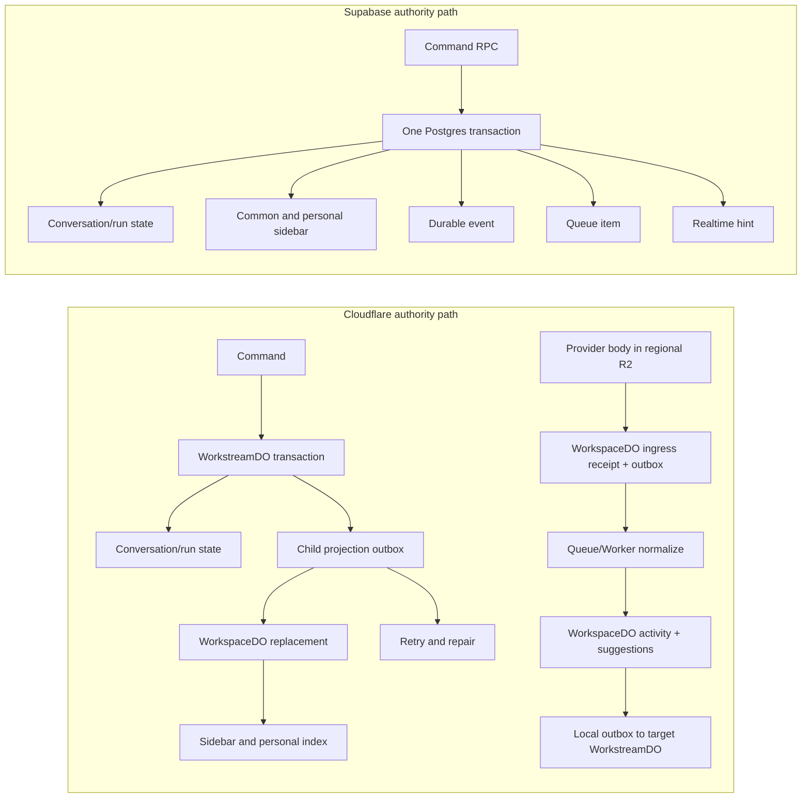

# Cloudflare Durable Objects versus Supabase for Avalon work streams

> Created 2026-08-15.
>
> This document compares the architecture in
> [`../2026-08-15_durable-workspace-workstream-conversations/prd.md`](../2026-08-15_durable-workspace-workstream-conversations/prd.md)
> with the architecture in [`prd.md`](prd.md). It compares the complete designs,
> not isolated database products. Public prices and limits were rechecked on
> 2026-08-16 and must be refreshed against Avalon's contracts before approval.

## Decision summary

If Avalon had to choose today, the provisional recommendation is the
**Supabase global routing database and regional data shards with Cloudflare
Workers for compute and one data-minimal Workflow per full agent loop**. This is
not because Postgres is universally better than
actors. It is because Avalon's product transaction commonly crosses the exact
boundaries that the Durable Object design separates: a conversation change also
changes work-stream state, common sidebar metadata, a person's unread or
mention overlay, a durable event, and often a queue item. Supabase can commit
those facts together. The Cloudflare design must deliver and repair a
`WorkstreamDO`-to-`WorkspaceDO` projection. Connector activity no longer adds a
second D1 product authority: because each event belongs to one workspace, its
activity log, digests, opportunities, and suggestion sets live in that
`WorkspaceDO`. Supabase still removes the child/parent boundary and offers a
more elastic relational query plane, but the Cloudflare design is no longer a
deliberately hybrid product-data architecture.

Cloudflare is the better technical choice if Avalon's dominant pressure becomes
very large numbers of mostly dormant work streams, strong per-work-stream
failure isolation, or high-volume WebSocket fan-out. Hibernating Durable Objects
have no idle-duration charge, outgoing WebSocket messages are not charged as
requests, and unrelated work streams do not contend on one database primary.
Its direct platform bill is likely to be lower over a broad range of loads.

Supabase is the better product-development choice if the dominant pressure is
transactional sidebar correctness, workspace-wide queries, connector activity,
suggestion ranking, full-text/vector retrieval, conventional migrations, and
the ability to inspect and repair data with SQL. Its fixed regional compute
floor and Realtime/egress charges are higher, and a regional primary creates a
shared contention and failure domain, but it removes several distributed
protocols from Avalon's application code.

The recommendation is gated. Do not select Supabase for production until tests
or contracts close global-to-shard routing/identity, already-joined Realtime
revocation, Queue throughput/retention, Worker/Workflow EU processing, and
shared-primary capacity questions. Do not select Cloudflare until tests close cross-object
authorization revocation, sidebar convergence, very large workspace hot spots,
fleet migration, restore, and regional background-execution questions. Neither
vendor's region selector alone proves Avalon's end-to-end EU obligations.

## Scope and comparison rules

The two PRDs preserve the same product behavior:

- one shared work-stream conversation plus explicit private/fork/agent-child
  substreams;
- one work-stream-wide arrival sequence and provider-valid logical turns;
- durable queued messages and interrupting steering messages;
- compaction of a fenced complete-turn prefix while new messages continue;
- one generic driver for a **full** agent loop, normally 2–30 minutes and rarely
  2+ hours;
- realistic 1–5 second time to first token, seconds-long tools, and Daytona
  Terminal calls with p95 under a minute and a 3–5 minute or longer tail;
- workspace collections, common metadata, and sparse person-specific interest
  state;
- connector ingress, activity, digests, suggested work streams, and suggested
  actions;
- a global identity/routing/control database and regional product-data
  authorities;
  and
- Daytona remaining the Terminal plugin provider.

The comparison therefore does not award either design points for product
semantics both must implement. It evaluates where those semantics are
authoritative, how failure is repaired, how the system scales, and what Avalon
must pay vendors and engineers to operate it.

The economic model separates three categories:

1. **Differentiating platform cost:** Cloudflare storage/compute/operations or
   Supabase projects/compute/Realtime/egress.
2. **Shared compute/orchestration cost:** Cloudflare Workers and Workflow are
   the application compute plane in the Supabase design and are already core
   primitives in the Durable Object design.
3. **Common workload cost:** model inference, embedding generation, Daytona,
   connector vendors, email/SMS, and end-user support are excluded because the
   architectural choice does not remove them.

The Cloudflare subtotal also excludes the current identity provider because the
Durable Object PRD deliberately preserves the existing thin identity plane.
The Supabase subtotal shows Supabase Auth MAU separately so that this difference
is visible rather than pretending the invoices are directly comparable.

## Architecture at a glance

| Concern | Cloudflare Durable Object design | Supabase design | Consequence |
| --- | --- | --- | --- |
| Global routing/control | Thin existing identity plane plus global D1 route/fleet metadata | Required global Supabase DB with identity/invitations/billing, shard directory, workspace routes/epochs, command outbox/receipts | Both have one non-product global router; Supabase adds a dedicated always-on project floor and relational control schema |
| Product authority | One `WorkspaceDO` per workspace and one `WorkstreamDO` per work stream | One regional Postgres authority; workspaces and work streams are row-scoped aggregates | Cloudflare aligns process ownership with entity concurrency; Supabase aligns the transaction with relational product behavior |
| Work-stream serialization | One object's input gate and SQLite transaction | Short Postgres transaction locking the work-stream row and allocating sequence | Both can provide one ordered stream; Cloudflare isolates contention, Supabase exposes conventional lock contention |
| Sidebar update | Child outbox and monotonic replacement delivered to `WorkspaceDO` | Same transaction updates work stream, common projection, personal projection, event, and queue | Supabase eliminates the most important cross-owner repair protocol |
| Membership | `WorkspaceDO` authority plus short-lived child capability and revocation fan-out | Regional membership rows, command RPC checks, indexed RLS, and authz epochs | Cloudflare has explicit distributed revocation; Supabase has centralized policy but an unresolved live-channel revocation window |
| Conversation storage | `substreams` and `parts` in each `WorkstreamDO` SQLite database | `substreams` and `conversation_parts` in regional Postgres | The logical model is intentionally equivalent |
| Active agent run | `WorkstreamDO` owns run/control state; one Workflow drives the full loop | Postgres owns run/control state; one opaque Workflow normally drives the full loop | Cloudflare has a natural live actor endpoint; Supabase has easier durable inspection and generic querying |
| Realtime | Hibernating `WorkspaceDO` and foreground `WorkstreamDO` WebSockets | One regional Supabase Realtime socket with private workspace/foreground channels | Cloudflare is more efficient for long idle sockets; Supabase is easier to multiplex but bills connections/messages/egress |
| Two-stream focus switch | Ready-before-close handoff between two child sockets, then return to one foreground child | Keep both logical work-stream channels on the existing regional socket while both runs are active | Supabase gives the simpler instant switch; both recover committed state from snapshots and durable cursors |
| Token path | Workflow/executor to `WorkstreamDO`, bounded mutable chunks, direct client frames up to 30 fps | 500 ms deltas into 16 KiB chunks, REST hint, offset RLS fetch, then local 10/20/30 fps animation; network body frames require a revocable lease | Both avoid token writes; Supabase trades about one checkpoint of display lag and extra reads for much lower transport volume, while Cloudflare's owner can stream directly |
| Activity and suggestions | Owning `WorkspaceDO` SQLite authority plus regional R2, Queues/Workers/Workflows, and local child delivery | Regional Postgres authority plus Supabase Queues/Cron and Cloudflare Worker/Workflow compute | Both use one product authority per event; Cloudflare favors workspace isolation/locality, Supabase favors elastic SQL/vector queries |
| Large content | Regional R2 plus opaque references | Regional Supabase Storage plus `content_refs` | Both are workable; R2 has free egress, while Supabase provides integrated RLS metadata and CDN behavior |
| Exact and semantic search | WorkspaceDO exact indexes plus regional Vectorize/derived cross-workspace indexes | Postgres FTS plus pgvector | Supabase keeps regional authorization joins and source rows together; Cloudflare's vector service is cheaper and more isolated but derived |
| Fleet schema evolution | Lazy per-object DDL plus a dedicated DO/D1/Queue/R2/Workflow migration control plane | Regional SQL migrations plus campaign/job tables for large backfills/imports | Supabase is materially simpler for ordinary schema work |
| Failure domain | Per work stream and per workspace, plus product-free regional fleet services | Regional database/project, with bounded row-lock domains inside it | Cloudflare limits blast radius; Supabase reduces coordination surfaces but enlarges infrastructure blast radius |
| Dormant scale | Product objects hibernate; product-free migration D1 is serverless | Global control DB and every regional shard have always-on compute | Cloudflare wins sparse, low-duty-cycle fleets |
| Cross-entity query | Local SQL inside one workspace; explicit derived index/export/fan-out across workspaces | Indexed SQL within one regional shard; explicit aggregation across shards | Supabase wins shard-local discovery/reporting/support; Cloudflare keeps workspace data isolated |

The core write paths make the trade-off concrete:



## Technical comparison

### Global routing and regional shards

Both designs now have one non-product global control authority. Cloudflare uses
the existing global identity plane plus D1 for workspace route/epoch and fleet
metadata. Supabase uses one required global project for identity, invitations,
billing/entitlements, `regional_shards`, `workspace_routes`, routing-command
outbox/attempts/receipts, and no work-stream metadata. Its private global
application schema includes accounts, organizations, account/billing roles,
invitations, and entitlements; those facts do not themselves authorize regional
content. The Supabase client gets a signed expiring shard route, then talks
directly to that product shard under live shard-local membership and RLS.

| Cross-plane property | Cloudflare | Supabase | Safety/economic result |
| --- | --- | --- | --- |
| Global route store | Serverless D1 metadata | Always-on global Postgres project | Supabase offers richer relational control/auth joins; Cloudflare has the lower dormant floor |
| Regional unit | WorkspaceDO/WorkstreamDO jurisdictions and regional services | Coarse Supabase project shard, initially `eu-1` and `global-us-1` | Supabase can add a project shard for capacity, but every shard adds compute/ops cost |
| Global-to-regional command | Opaque command plus regional receipt/retry | Global outbox delivered by Worker/Workflow to shard-local gate/receipt | Same distributed-systems rule: acknowledgement requires a matching regional receipt |
| Authority move | Source-local closure receipt, destination activation, then global route convergence | Source-shard closure cursor/hash, destination gate activation, then global `workspace_routes` update | Tie for safety if the source closure is the only linearization point; global route cannot be treated as an atomic move |
| Wrong/stale route | Regional authority rejects old epoch and returns non-content correction | Shard Worker/RPC requires matching `workspace_route_gate` and epoch | Tie; neither creates a missing workspace on demand |

The required global Supabase database does not restore cross-shard SQL
transactions or global product queries. It is a routing metadata control plane.
Product titles, descriptions, activity, sidebar overlays, messages, vectors, and
suggestions stay in one assigned shard. Adding `eu-2` improves capacity
isolation only after Avalon implements placement, move, session, backup,
deployment, and support operations for another always-on project.

### Consistency and concurrency

The Cloudflare design has the cleaner answer inside one work stream. A
`WorkstreamDO` is the single serialized authority for sequence allocation,
message admission, run-control revisions, tool-effect admission, active output,
and compaction publication. A noisy work stream does not take locks needed by a
different work stream. The price is that the workspace sidebar and membership
authority live in another serialized object. A child commit and parent update
cannot share a transaction, so the protocol needs a monotonic child outbox,
idempotent replacement, retry, replay, and reconciliation.

The Supabase design has the cleaner answer for the complete user-visible
transaction. A short function can lock one work-stream row, append parts,
advance state, update common and sparse personal sidebar rows, append durable
events, and enqueue derived work in one transaction. Failed transactions expose
none of the intermediate state. The price is shared Postgres resources: hot
indexes, WAL, vacuum, connection pools, vector indexes, ingestion bursts, and
interactive writes all meet on one regional primary unless deliberately
partitioned or moved.

Both designs still need idempotency and receipts around external model, tool,
connector, and Daytona effects. A database transaction cannot make an external
write exactly once, and a Durable Object's serial execution cannot make an
ambiguous provider response safe.

### Workspace sidebar and work streams of interest

This is the strongest Supabase advantage. `Work Streams`, `In Progress`,
`Completed`, `Error`, recency, `You Are Mentioned`, `Unread`, `Assigned`, and
`Needs Your Input` are relational projections over common facts and sparse
person-specific facts. Supabase can update them with the originating command
and query them with indexes and keyset pagination.

The Durable Object design avoids waking every work stream by maintaining the
same information in `WorkspaceDO`. That is the correct actor design, but it
creates two costs:

- every child change that affects the card is a cross-object delivery with
  convergence and repair state; and
- one very large or very active workspace can make its `WorkspaceDO` a storage
  and serialized-throughput hot spot even though its work streams are isolated.

Cloudflare's projection remains safe because the child sends versioned
replacement state rather than UI-section deltas. It is nevertheless more
application machinery than a same-transaction relational projection.

### Conversation arrays, substreams, queued input, and compaction

Neither platform has a material semantic advantage here. Both PRDs use a
normalized ordered-part model that deterministically materializes the message
array required by Bind and providers. Both keep substreams as semantic context
lanes rather than shards, tabs, jobs, runs, or permission containers. Both
preserve tool-call/result pairs, immutable sealed parts, audience-sensitive
inheritance, and fenced compaction with a raw tail accepted during summarization.

Cloudflare localizes materialization to one small SQLite database and one
owner, which makes per-stream reads and revision checks direct. Supabase can use
set-oriented SQL, joins, and ordinary indexes, which makes support tooling,
cross-stream audits, retention, export, and search easier. Supabase must be
disciplined about row locks, RLS predicates, query plans, and avoiding one
unbounded transcript query. Cloudflare must be disciplined about object size,
per-object indexes, hydration, and any operation that needs more than one
object.

Messages arriving during compaction work equally in both designs: freeze a
complete-turn source fence, summarize that immutable prefix, and publish only
if its authorization/materializer key remains valid. Later messages remain a
raw tail. The platform changes the transaction mechanism, not the algorithm.

### Full agent loops and steering

The run primitive should not decide this data-plane choice. Both architectures
use one Cloudflare Workflow for one full loop, not one turn and not one long
Worker request. Workflow steps perform bounded model, tool, reconciliation,
compaction, and event-wait actions. Waiting does not consume Workflow CPU time,
and Workflow persists only opaque identifiers, revisions, cursors, enums, and
hashes. In the Supabase design all action compute is a shard-configured
Cloudflare Worker fetch handler; Supabase Edge Functions are not deployed.

The domain owner differs:

- With Cloudflare, the `WorkstreamDO` commits queue/steer input, owns the
  revision fence, and can hold the server half of a run-control WebSocket for a
  low-latency abort signal.
- With Supabase, Postgres commits the input and revision fence, Realtime or a
  callback accelerates cancellation, and the executor rechecks the database
  before output publication and irreversible tool admission.

The durable revision is the correctness mechanism in both. A socket or
Workflow event can be delayed or lost. Neither design should claim that an
uncancellable provider/tool operation vanishes when a person steers; it must be
recorded, reconciled, discarded from the current attempt when appropriate, and
prevented from authorizing a later stale effect.

The Supabase architecture deliberately has no Queue/Cron lease-engine fallback.
The Workflow calls the shard execution Worker by service binding in the normal
Global/US path; service bindings run on the same Cloudflare server by default,
and an explicit placement hint puts database-heavy fetch execution near the
Supabase backend. For EU content, Workflow calls an EU Regional Services HTTPS
hostname because Smart Placement does not apply to Workflow named entrypoints
and Regional Services does not cover Workflow/Queue/Cron triggers or outgoing
subrequests. Workflow sees opaque status; the regionalized Worker loads content,
calls approved providers, and commits the EU shard. If that path is not
contractually approved, those features fail closed rather than switching
compute implementations. See [Worker placement](https://developers.cloudflare.com/workers/configuration/placement/),
[service bindings](https://developers.cloudflare.com/workers/runtime-apis/bindings/service-bindings/),
and [Data Localization for Workers](https://developers.cloudflare.com/data-localization/how-to/workers/).

Daytona is unchanged in both designs. The `avalon:terminal` adapter starts an
addressable Daytona operation, records its provider reference, and later polls,
receives a callback, reconciles, or attempts cancellation. Neither a Durable
Object nor a Cloudflare Worker executes coding commands itself.

### Realtime and background clients

Cloudflare provides the more natural realtime primitive for this product. A
client can keep one hibernating workspace socket and one foreground work-stream
socket. Hibernating sockets do not incur Durable Object duration while event
handlers are idle. Outgoing WebSocket messages are not charged as requests, and
incoming messages receive a 20:1 request-billing ratio. The object wakes where
the ordered state lives, replays from its durable cursor, and can return to
hibernation. An active outbound connection from the object can prevent
hibernation and incur duration, so inference/tool calls belong in bounded
Workflow/executor operations rather than an indefinitely open object fetch.

Supabase Realtime has no equivalent hibernating application actor. One regional
socket can efficiently multiplex an active workspace and foreground work-stream
channels, but an idle socket remains a peak connection and sends protocol
traffic. Broadcast billing counts the send and each receiver. The correct
product policy is therefore not periodic 2–3 minute churn and not an immortal
background socket: keep it while interactive or observing a run, leave
foreground channels after a grace period, close the regional socket when truly
background-idle, and recover from durable cursors on focus.

Supabase also has a security caveat absent from the direct owner path: RLS is
checked when a private channel joins, and immediate reauthorization of an
already-joined, uncooperative subscriber is not established. The launch-safe
design Broadcasts body-free output coordinates and fetches generated text
through live RLS. That adds database/API/egress load and can be less fluid than
direct DO frames. Token bodies can move to Realtime only after a server-rotated,
revocable stream lease passes the removal tests.

#### Token-write amplification: 100 tokens/second for 10,000 tokens

This workload lasts 100 seconds. The correct unit is a nonempty checkpoint, not
a model token or a visual frame. With a 500 ms observed checkpoint default and
a four-UTF-8-bytes/token planning assumption, each checkpoint carries about 50
tokens/200 bytes, the answer is about 40 KiB, and the Supabase representation
uses roughly three 16 KiB chunks.

| Strategy for one run | Postgres/SQLite content writes | Realtime/transport sends | One-receiver delivered visual behavior | Verdict |
| --- | ---: | ---: | --- | --- |
| Row and Broadcast per token | 10,000 | 10,000 | Low latency but extreme amplification | Reject on both platforms |
| 500 ms checkpoint that rewrites one growing text row | 200 | 200 | Can be animated smoothly, but repeatedly copies the accumulated prefix | Reject; logical write count hides WAL/TOAST/egress amplification |
| Supabase bounded-tail launch path | At most 200 checkpoint transactions plus about two chunk boundary insert/seals and one final transaction | 200 body-free REST hints | Client offset-fetches each batch and drains it locally at 10/20/30 fps | Accept subject to regional load gate |
| Supabase direct 30 fps body path | Same 200 durable checkpoints | Up to 3,000 body sends | Native 30 fps, but only behind revocable lease | 15 times the launch-path message volume without added durability |
| Cloudflare bounded-tail plus direct frames | About 200 durable SQLite checkpoints plus boundaries/finalization | Up to 3,000 owner-to-client frames, or fewer with local animation | Direct low-latency frames; client animation is still available | Technically safer at high fan-out because outgoing DO frames are not message-metered, but active-object duration and incoming executor delivery still matter |

For Supabase, one continuously observing client produces 200 REST sends plus
200 deliveries, or 400 billed Realtime messages. Visual cadence is independent:
the client spreads each approximately 50-token batch across the next half
second—about 10 tokens/frame at 10 fps, five at 20 fps, or 3–4 at 30 fps. It
uses a bounded-lag controller to catch up after jitter and reconciles to the
sealed part. This introduces roughly one checkpoint plus network of display lag
after provider generation but does not create additional database writes,
Realtime messages, or full-prefix reads.

A single stream comfortably fits the proposed Supabase protocol. Concurrency is
the real gate. With `A` continuously observed streams at 500 ms, the primary
sees roughly `2A` checkpoint transactions/second and Realtime sees
`2A * (1 + average_receivers)` messages/second. One hundred streams with one
receiver mean about 200 checkpoint transactions and 400 Realtime
messages/second. One thousand mean about 2,000 and 4,000 respectively; 4,000 is
above Supabase's currently documented default 2,500 messages/second for Pro
without Spend Cap/Team. That requires an approved limit increase, a longer
cadence or smaller observer set, or more regional partitioning. The Realtime
limit is not a database-capacity proof: WAL bytes/checkpoint, TOAST/vacuum,
IOPS, CPU, pool pressure, and offset-read latency must be load-tested on the
selected compute/disk tier.

The economic difference becomes visible at scale. At 100,000 such runs/month
with one receiver, the Supabase launch path creates about 20 million checkpoint
transactions and 40 million Realtime messages. If those were the only Realtime
messages, 35 million above the Pro five-million inclusion would be about $87.50
at the current $2.50/million public overage price. Direct 30 fps delivery would
create 600 million messages and about $1,487.50 of overage under the same narrow
assumption. Supabase has no public per-row-write fee, but the 20 million
transactions consume shared compute/WAL/IO and can force a higher tier. Durable
Objects explicitly meter SQL row writes, but isolate each work stream and do not
charge for outgoing WebSocket frames. Local animation is therefore mandatory
for the launch-safe Supabase design and remains an optional efficiency win for
Cloudflare.

Sources for the Supabase mechanics and current public inputs: [Broadcast
paths](https://supabase.com/docs/guides/realtime/broadcast), [Realtime
limits](https://supabase.com/docs/guides/realtime/limits), [Realtime message
usage](https://supabase.com/docs/guides/platform/manage-your-usage/realtime-messages),
and [compute and disk](https://supabase.com/docs/guides/platform/compute-and-disk).

Cloudflare still needs explicit capability epochs and child-socket revocation;
an object ID or stale parent grant cannot be authority. Its advantage is that
the owner receiving the removal can stop emitting bodies on that socket without
depending on a separately cached channel policy.

#### Safety when switching between two active streams

The comparison scenario is one desktop rapidly switching A-to-B-to-A while both
agent loops continue producing output. “Restart streaming” means resuming the
desktop's observation, never restarting either inference loop. Both designs are
safe for accepted input, immutable parts, terminal state, and durably
checkpointed provisional bytes. Neither promises that an incomplete
nondeterministic model attempt survives executor/provider loss; both fence a
replacement attempt and may retract that attempt's provisional output.

| Safety property | Cloudflare Durable Objects | Supabase | Assessment |
| --- | --- | --- | --- |
| Normal switch with both streams active | Open B's child socket, hydrate/replay, mark ready, then close A after a bounded overlap; the process keeps separate A/B caches | Keep A and B logical channels joined on one regional socket and switch the selected cache | Supabase is operationally simpler and normally instant; Cloudflare requires a two-socket handoff but no cross-object transaction |
| Notification lost during switch | `WorkstreamDO` replays `workstream_events` after the snapshot watermark or sends an explicit snapshot reset | A body-free Broadcast is only a hint; snapshot plus `events_after`/`active_output_after` repairs the gap from attempt/chunks | Tie for committed state when both protocols are implemented; neither trusts transport delivery |
| Snapshot/live race | One owner serializes its snapshot watermark and later child events; same-socket order plus cursor replay closes disconnect gaps | Client must subscribe and buffer before a one-statement snapshot, then discard hints at/below its attested watermark | Cloudflare has the smaller race surface; Supabase is correct but depends on more explicit client/database choreography |
| Active-to-final race | One local SQLite transaction seals immutable parts, terminal cursor, and active-row deletion | One Postgres transaction seals the part, terminal state, projections/events, and active-row deletion | Tie inside one work stream; Supabase can additionally update relational sidebar state in the same transaction |
| Stale attempt frames | `attempt_epoch` fences socket frames and cached provisional text | `attempt_id`, revision, offset, and hash fence hints and fetched bytes | Tie; neither may splice attempts |
| Just-rendered uncheckpointed text | Direct owner frames can be smoother, but process-local text newer than the owner checkpoint is provisional and may rewind on failed attempt recovery | Launch-safe UI fetches only committed checkpoint bytes; local 10/20/30 fps animation makes batches continuous but trails generation by about the 500 ms default plus network, or up to one second unobserved | Supabase is more conservative about what it displays; Cloudflare has lower first-byte/live latency but a larger explicitly provisional visible tail |
| Membership removed mid-stream | Owner capability epoch and targeted child-socket eviction can stop later body delivery | Already-joined channel reauthorization is not a sufficient launch guarantee, so hints contain no bodies and every body fetch uses live RLS | Cloudflare leads for prompt stream revocation; Supabase's body-free path preserves confidentiality at added read/latency cost |
| Process or network restart | Reopen the selected child with capability, cache cursor, snapshot, and replay; old child sockets hibernate or expire independently | Recreate one regional socket, join needed topics, then subscribe-buffer-snapshot each visible stream | Tie for correctness; Supabase rejoins logical channels on one connection, while Cloudflare reconnects independently to each selected object |
| Regional authority failure | Failure is normally isolated to the affected work-stream object; A and B fail independently unless a shared regional dependency is down | A and B share the regional Postgres/Realtime failure domain | Cloudflare has stronger per-work-stream blast-radius isolation |

The strict safety verdict is therefore narrower than “one platform cannot lose
tokens.” Both prevent transport switching from losing committed output. The
Cloudflare owner has stronger serialization, isolation, and live revocation,
while Supabase has the cleaner two-channel desktop handoff and a deliberately
safer launch rule that displays only checkpointed bodies. Supabase's advantage
disappears if Avalon sends token bodies optimistically over Broadcast without a
durable offset/lease protocol; Cloudflare's advantage disappears if the client
closes A before B reports a reconciled ready state. The bake-off must inject
both failures rather than test only a healthy focus change.

### Connectors, activity, digests, and suggestions

This trade-off is now closer. Both designs place each connector event in one
product authority: regional Postgres for Supabase and the one owning
`WorkspaceDO` for Cloudflare. Both keep large exact bodies in object storage,
use queues as at-least-once wakes rather than authority, and execute provider/
model work outside the authoritative transaction. Cloudflare acknowledges a
webhook only after R2 and the parent ingress receipt/Queue-outbox intent commit;
Supabase can commit its receipt and queue message in one Postgres transaction
after Storage succeeds.

Cloudflare gains a strong locality property. The parent can transactionally
deduplicate ingress, append its activity log, update opportunity evidence,
invalidate a person's stored suggestion set, and enqueue a child delivery
without a D1-to-object projection. Workspace membership, work-stream directory,
encrypted connector envelopes, normalized resource ACL snapshots, source deny
epochs, digest cursors, and suggestions are co-located. A distinct legacy D1
`connector_authority` plus target connector-domain generation gate permits
D1-to-parent migration after membership/sidebar is already live without
reusing the already-cut-over workspace route or exposing shadow activity. One
workspace's connector storm cannot consume another workspace's database lock or
storage authority. The cost is a hard per-workspace serialized/storage envelope:
connector bursts now contend with that workspace's membership, sidebar, and
socket calls, and every webhook still needs one synchronous parent receipt
transaction before acknowledgement; downstream Queue batching cannot remove
that admission bottleneck. The design also needs application-level ciphertext
RPC/rotation leases and selector/principal tables rather than relying on a
shared relational authorization plane. Queries
that truly cross workspaces require a content-minimized derived index, export,
or explicit operator fan-out.

Supabase remains more idiomatic for flexible relational and semantic analysis.
Postgres can join activity, audience, opportunities, FTS, pgvector, queues, and
current authorization in one transaction/query; connection credential envelopes
can remain rows beside their workspace/source authority under the same regional
backup and migration regime, while application secrets remain outside those
rows. Partitions, indexes, SQL inspection, and repair are familiar. It has no
one-workspace 10 GB database ceiling and can
support new regional discovery/reporting access patterns without inventing an
object projection. The trade is a shared regional primary/WAL/IO/failure domain:
bursty ingestion, queue consumers, ranking, Realtime, and interactive
transactions must be isolated by pools, quotas, statement timeouts, partitions,
and admission controls.

The functional verdict depends on scale shape. Cloudflare is safer when events
are workspace-local, workspace skew is bounded, and noisy-neighbor isolation
matters most. Supabase is safer when single workspaces can have an activity
corpus or query rate beyond the published parent envelope, or when product and
support regularly need evolving cross-workspace SQL/vector queries. The bake-off
must include a connector burst against the largest workspace while measuring
sidebar/membership latency, plus a regional analytical query under concurrent
ingestion.

### Search, inspection, support, and analytics

Supabase has the clear operational advantage. Postgres full-text search and
pgvector can join current authorization and source rows in one query. Support
and repair tools can inspect a regional workspace transactionally. Ad hoc
product questions do not require a new projection for every access pattern.

Cloudflare Vectorize is inexpensive and independently scalable, but it is a
derived index and must not grant access. Exact/source authorization remains in
the owning object. Cross-work-stream inspection inside one workspace can use the
parent's local SQLite indexes; cross-workspace inspection requires a
content-minimized derived index, object RPC fan-out, export, or a newly built
operator view. This is reasonable when access paths are known and bounded; it
becomes costly when product and support teams regularly need new regional
relational views.

### Isolation, hot spots, and scale shape

| Scale shape | Better fit | Reason |
| --- | --- | --- |
| Millions of stored, rarely opened work streams | Cloudflare | Dormant objects have no duration charge and no shared active-primary requirement |
| Many simultaneously active independent work streams | Cloudflare, unless each transaction is tiny and the regional DB is well sized | Per-object serialization scales horizontally instead of meeting at one primary |
| One extremely hot work stream | Depends | Cloudflare gives one isolated serial gate but cannot scale one object horizontally; Postgres can use more compute but the row remains a serialization point |
| One workspace with enormous sidebar/member cardinality | Supabase initially | Indexed tables and pagination are more elastic than one workspace object; both need explicit fan-out/cardinality limits |
| High-frequency common-to-personal projection changes | Supabase | One transaction updates common and affected sparse personal rows |
| High fan-out token streaming | Cloudflare | Hibernating sockets and free outgoing messages avoid Supabase per-recipient message and egress multipliers |
| Bursty connectors and ranking jobs | Depends on workspace skew | Supabase has the more elastic query model; Cloudflare isolates workspaces but makes each parent share its serial envelope with that workspace's ingestion |
| New cross-workspace report or repair query | Supabase | It is already relational and region-scoped |
| Strict per-work-stream noisy-neighbor containment | Cloudflare | Each object is a separate serialized runtime/storage authority |

Dormant Durable Objects are not literally free. Cloudflare documents an empty
SQLite database at approximately 12 KB, with metadata retained until
`deleteAll()`. At that minimum, one million created objects imply roughly 12 GB
before product rows and indexes, ten million imply roughly 120 GB, and one
hundred million imply roughly 1.2 TB. At the current $0.20/GB-month SQL storage
rate, the approximate empty-object storage component is still small—about
$1.40, $23, and $239 per month after the 5 GB inclusion—but it is a reason not
to pre-create or eagerly migrate objects that have never been used.

Supabase stores entities more densely, but indexes, event retention, personal
overlays, vectors, and MVCC/WAL overhead dominate before raw row count does. Its
cost inflection is usually the compute/IO tier needed to meet latency, not the
number of dormant rows alone.

### Regional architecture and enterprise requirements

Both designs preserve one Global/US and one EU product-data plane plus a thin
global identity/routing plane. Neither should store titles, descriptions,
messages, activity, suggestions, embeddings, or personal sidebar state in that
global plane.

Cloudflare can pin product authorities with Durable Object jurisdiction and
use separate regional services, queues, Workflows, R2 buckets, indexes, and
product-free D1 fleet ledgers. The design must still verify background-trigger placement,
subrequests, logs, analytics, backups, support access, and subprocessors.
Jurisdiction on a `WorkstreamDO` does not automatically constrain every service
that calls it.

Supabase can put the product authority in separate EU and Global/US projects,
but Auth sessions are project-local and a supported federation/revocation model
must be proven. Realtime, Edge execution, Queues, Storage, logs, backups,
support, and the optional Cloudflare Workflow each need contractual review.

Public plan badges are not the enterprise decision. Supabase Team is publicly
listed from $599/month and adds SOC 2/ISO features and longer retention, while
an uptime SLA is listed under Enterprise. Cloudflare enterprise controls and
pricing are contractual. Avalon must compare negotiated data-processing terms,
SLA, support, incident notification, subprocessors, and export/deletion—not
infer regulatory sufficiency from the public unit-price tables.

### Schema migration, backfill, and restore

Supabase has a substantial simplicity advantage for ordinary change. Additive
columns/tables/indexes use versioned regional SQL migrations. Large transforms
use expand/backfill/contract with campaign, job, receipt, and exception tables,
Queue/Cron wakes, and bounded workers. The unit of deployment is a small number
of regional databases.

That surface is managed, not arbitrary Postgres. Supabase's current changelog
says the `realtime` schema is locked against object changes while supported RLS
policies on `realtime.messages` remain available, and explicit extension version
pinning is ignored in favor of the platform default. Migration CI must test the
hosted default extension set and keep Realtime customization on supported
surfaces. See [Realtime schema
lockdown](https://supabase.com/changelog/realtime-schema-locked-down-against-modification)
and [extension version pinning
deprecation](https://supabase.com/changelog/extension-version-pinning-ignored).

Cloudflare additive object schema changes can run lazily on first access, which
is excellent for a sparse fleet. Any required eager transform, invariant scan,
parent/child protocol change, or database-to-object import must discover and
coordinate a fleet that may contain millions of independently dormant SQLite
databases. The companion control plane—fleet/regional/shard DOs, D1 inventory
and jobs, Queue wakes, R2 manifests, Workflow campaigns, drained pause barriers,
and per-object receipts—is justified, but it is a real subsystem.

The restore models differ similarly. A Supabase database restore is familiar
but has a large regional blast radius, does not restore Storage objects, and
cannot undo external effects. A `WorkspaceDO`/`WorkstreamDO`/R2 restore is more
granular in authority but must reconstruct parent projections, revocation
floors, alarms, routes, effect receipts, and product-free fleet evidence across
independent stores. Neither PITR mechanism is an application rollback.

### Operability and lock-in

Cloudflare-specific application machinery includes:

- object identity/routing and jurisdiction selection;
- parent-to-child capabilities and revocation fan-out;
- child-to-parent projection outboxes and repair;
- per-object local schema ledgers;
- the fleet migration control plane;
- cross-DO restore and deletion protocols;
- per-workspace activity hot-spot/backpressure and legacy DO/D1 cutover
  boundaries; and
- multi-object debugging without arbitrary SQL joins.

Supabase-specific application machinery includes:

- a required global identity/shard-directory/workspace-route database with
  routing-command outbox/attempt/receipt and shard-local admission gates;
- a complete RLS and grants matrix with indexed policy predicates;
- safe command RPCs and deterministic lock order;
- connection-pool, statement-timeout, WAL/vacuum, index, IOPS, and partition
  operations;
- Realtime snapshot/subscription and live-channel revocation protocols;
- global-to-shard Auth federation, routing-command convergence, and revocation;
- regional project deployment and schema discipline; and
- Cloudflare Worker placement/Regional Services plus Workflow-to-shard adapter
  deployment and residency verification.

Postgres schemas, SQL migrations, `pgmq`, full-text indexes, and pgvector are
more portable than Durable Object identities, per-object SQLite ownership,
hibernating WebSocket attachments, alarms, and jurisdiction routing. Supabase's
hosted Auth, Realtime, Storage policies, and control plane plus Cloudflare
Worker/Workflow execution still create vendor coupling; “it is Postgres” is not
a complete exit plan.

Cloudflare's smaller failure domains can improve incident containment, but the
number of protocols increases the ways an incident can present as stale or
partially converged state. Supabase has fewer data-authority protocols, but a
regional primary incident can affect many otherwise unrelated work streams at
once. Operational preference depends on whether Avalon is better equipped to
debug distributed convergence or shared-database saturation.

## Economic comparison

### Current public price inputs

All amounts are USD public list prices checked on 2026-08-16. Included quotas
are generally account/organization monthly allowances, not an allowance to
multiply freely by every logical tenant. Billing-unit rounding, negotiated
enterprise terms, taxes, regions, and plan configuration can change the result.

#### Cloudflare paid-plan inputs

| Primitive | Included | Public overage used in this model |
| --- | --- | --- |
| Workers | $5/month account minimum; 10 million requests; 30 million CPU ms | $0.30/million requests; $0.02/million CPU ms |
| Durable Object compute | 1 million requests; 400,000 GB-s | $0.15/million requests; $12.50/million GB-s, rounded to billable units |
| Durable Object SQLite | 25 billion row reads; 50 million row writes; 5 GB-month | $0.001/million reads; $1/million writes; $0.20/GB-month |
| D1 | 25 billion row reads; 50 million row writes; 5 GB-month | $0.001/million reads; $1/million writes; $0.75/GB-month |
| Queues | 1 million operations | $0.40/million operations; a normal delivery is commonly write + read + delete |
| Workflows | 10 million requests; 30 million CPU ms; 500,000 steps; 1 GB-month state | $0.30/million requests; $0.02/million CPU ms; $0.80/100,000 steps; $0.20/GB-month |
| R2 Standard | 10 GB-month; 1 million Class A; 10 million Class B | $0.015/GB-month; $4.50/million Class A; $0.36/million Class B; Internet egress free |
| Vectorize | 50 million queried dimensions; 10 million stored dimensions | $0.01/million queried dimensions; $0.05/100 million stored dimensions |

Sources: [Workers pricing](https://developers.cloudflare.com/workers/platform/pricing/),
[Durable Objects pricing](https://developers.cloudflare.com/durable-objects/platform/pricing/),
[D1 pricing](https://developers.cloudflare.com/d1/platform/pricing/),
[Queues pricing](https://developers.cloudflare.com/queues/platform/pricing/),
[Workflows pricing](https://developers.cloudflare.com/workflows/reference/pricing/),
[R2 pricing](https://developers.cloudflare.com/r2/pricing/), and
[Vectorize pricing](https://developers.cloudflare.com/vectorize/platform/pricing/).

Cloudflare does not charge Workers, D1, Queues, R2, or Vectorize Internet
egress in the cited public schedules. Durable Object duration is wall time while
active and not eligible to hibernate, billed as 128 MB allocated per object.
These two facts make socket lifecycle and outbound inference connections more
economically important than raw request count.

#### Supabase Pro inputs

| Primitive | Included/public base | Public overage used in this model |
| --- | --- | --- |
| Plan and projects | Pro from $25/month; $10/month compute credit; each project has dedicated compute | Compute is hourly; Micro $10, Small $15, Medium $60, Large $110, XL $210, 2XL $410, with larger tiers listed publicly |
| Database disk | 8 GB per project; 3,000 IOPS and 125 MB/s on General Purpose | $0.125/GB; $0.024/provisioned IOPS; $0.095/provisioned MB/s above included levels |
| Auth | 100,000 MAU | $0.00325/MAU |
| File Storage | 100 GB | $0.0213/GB |
| Uncached egress | 250 GB | $0.09/GB |
| Cached egress | 250 GB | $0.03/GB |
| Realtime | 500 peak connections; 5 million messages | $10/1,000 peak connections; $2.50/million messages |
| PITR | Not in the Pro base | Starts at $100/month per seven days of retention |
| Log Drain | Not in the Pro base | $60/drain/project/month plus event and egress usage |

Sources: [Supabase pricing](https://supabase.com/pricing),
[compute and disk](https://supabase.com/docs/guides/platform/compute-and-disk),
[billing FAQ](https://supabase.com/docs/guides/platform/billing-faq),
[egress accounting](https://supabase.com/docs/guides/platform/manage-your-usage/egress),
[Realtime message usage](https://supabase.com/docs/guides/platform/manage-your-usage/realtime-messages),
[Realtime peak connections](https://supabase.com/docs/guides/platform/manage-your-usage/realtime-peak-connections),
and [cost control](https://supabase.com/docs/guides/platform/cost-control).

Supabase Queues and Cron consume the project's Postgres/storage/compute rather
than appearing as a public per-message line in this model. That makes database
capacity the hidden queue price. Spend Cap does not cap every fixed or add-on
dimension; compute, replicas, PITR, Log Drains, and some disk/IO costs require
separate controls.

### Cost equations to instrument

The production calculator should consume metered values rather than entity
count alone. At minimum it needs these equations:

```text
CF_DO_duration_GB_s = active_non_hibernatable_object_seconds * 0.128
CF_DO_request_units = fetch_or_RPC_invocations
                      + incoming_websocket_messages / 20 + alarms
CF_queue_operations = sum(ceil(message_bytes / 64_000)
                          * (write + reads/retries + delete/DLQ writes))
CF_workflow_steps = full_loops * executed_steps_per_loop

SB_realtime_messages = sends + deliveries_to_each_receiver
SB_peak_connections = max_simultaneous_regional_client_sockets
SB_database_cost = project_compute + provisioned_disk + IOPS + throughput
SB_egress = API + Auth + Storage + Realtime + Edge + database/pooler egress
SB_stream_checkpoint_tx = sum(ceil(generation_seconds / checkpoint_interval))
SB_stream_content_mutations ~= checkpoint_tx + chunk_boundary_mutations
                               + finalization_transactions
SB_stream_delta_reads <= sum(checkpoint_sends * active_receivers)

Total_monthly_cost = fixed_plan_and_project_cost
                   + usage_overages
                   + contracted_enterprise_add_ons
                   + common_model_Daytona_connector_costs
```

`fetch_or_RPC_invocations` is one mutually exclusive total: it already includes
HTTP requests that open WebSockets, connector receipt calls, normalization
completion calls, and every other DO `fetch`/RPC session. Those named classes
remain telemetry dimensions but must not be added again. For Cloudflare, track
row writes after index amplification and distinguish DO SQL from D1 because
their storage rates differ. Track active object seconds
around model/tool I/O; an outbound connection that prevents hibernation can cost
more than the requests. For Supabase, track Realtime receivers rather than only
frames produced, and load-test WAL, bounded-chunk checkpoint updates/inserts,
offset RLS reads, queue polling, and pgvector before choosing compute and IOPS.

### Minimum production floor

With one required global routing/control project and two regional product shards,
all at Micro,
Supabase Pro has an approximate public floor of:

```text
$25 plan + (3 * $10 Micro compute) - $10 compute credit = $45/month
```

Two regional PITR add-ons and two regional Log Drains would raise that example
to approximately $365/month before usage, drain events/egress, staging,
branches, replicas, or a larger compute tier. A persistent staging topology adds
another always-on project compute floor; persistent branches are also billed.

Cloudflare's public paid-plan minimum is $5/month when all relevant usage stays
inside its product allowances. Regional services and large numbers of dormant
objects do not create one always-on compute charge per region or object. The
comparison is incomplete until the cost of Avalon's existing identity service
and any enterprise contract is added.

### Illustrative growth workload

This scenario exists to expose cost drivers; it is **not** an Avalon forecast or
a vendor quote. Replace every input with production telemetry before using it
for budgeting.

| Input | Illustrative monthly value |
| --- | ---: |
| Supabase projects | 2 regional product shards plus one global routing/control database |
| MAU / peak Realtime connections | 250,000 / 5,000 |
| Stored work streams | 1,000,000 |
| Full agent loops / Workflow steps | 100,000 / 4,000,000 |
| Streaming profile | 100 tokens/s × 10,000 tokens; 500 ms checkpoints; one receiver |
| Supabase active-output checkpoint transactions | 20 million, before chunk boundaries/finalization |
| Worker requests / CPU, including Workflow invocation/CPU | 100 million / 500 million ms |
| DO billed requests / active object time | 60 million / 10 million object-seconds |
| DO SQLite reads / writes / stored data | 15 billion / 175 million / 500 GB |
| Product-free D1 reads / writes / stored data | 1 billion / 5 million / 5 GB |
| Queue messages | 10 million under 64 KB, three normal operations each |
| Workflow state | 10 GB-month |
| Realtime messages | 50 million; 40 million come from the streaming profile |
| File/object storage / uncached egress | 2,048 GB / 2,048 GB |
| R2 operations | 5 million Class A / 50 million Class B |
| Vector workload | 500,000 vectors at 1,536 dimensions / 1 million queries |
| Supabase compute | two XL regional shards and one Micro global control database |
| Production add-ons | PITR and one Log Drain in each product region |

The 60 million DO request input is the inclusive metered total defined above;
connector ingress, normalization completion, and WebSocket-opening requests are
subcategories of it, not additional terms.

The storage inputs place the full 500 GB Cloudflare product corpus in DO SQLite;
the residual 5 GB D1 allocation is only fleet/migration inventory and
product-free operations. Supabase keeps the corresponding 500 GB product corpus
in Postgres. The values do not claim that physical index/WAL overhead is
identical. The disk line
assumes 250 GB in each regional Supabase shard and a global control database that stays
inside its 8 GB allowance; unused global allowance cannot offset regional
overage. The Supabase compute choice is provisional; pgvector, RLS, WAL, queue,
and ingestion load may require a larger tier or provisioned IOPS. Conversely,
good batching and a smaller corpus may fit a lower tier.

#### Illustrative Cloudflare subtotal

| Line | Approximate monthly cost |
| --- | ---: |
| Workers paid minimum | $5.00 |
| Worker request overage | $27.00 |
| Worker CPU overage | $9.40 |
| Durable Object request overage | $8.85 |
| Durable Object duration overage after unit rounding | $12.50 |
| Durable Object SQLite write overage | $125.00 |
| Durable Object SQLite storage overage | $99.00 |
| D1 reads/writes/storage within included allocations | $0.00 |
| Queue operations | $11.60 |
| Workflow step overage | $28.00 |
| Workflow state storage | $1.80 |
| R2 storage | $30.57 |
| R2 Class A and B operations | $32.40 |
| Vectorize XL example after the paid-plan dimension allowances | $22.92 |
| **Cloudflare platform subtotal** | **$414.04/month** |

Rows read remain inside the illustrated included allocations. Workflow
invocation and CPU usage are already part of the Worker totals rather than a
second line. The subtotal excludes the existing identity provider, enterprise
contract/support, logs beyond included facilities, model/embedding APIs,
Daytona, and connector vendors.

#### Illustrative Supabase-hybrid subtotal

| Line | Approximate monthly cost |
| --- | ---: |
| Supabase Pro plan | $25.00 |
| Two XL + one Micro compute, net of $10 credit | $420.00 |
| Two regional PITR add-ons | $200.00 |
| Database disk above each regional shard's 8 GB allowance | $60.50 |
| File Storage above 100 GB | $41.49 |
| Realtime message overage | $112.50 |
| Realtime peak-connection overage, rounded to five 1,000-connection packages | $50.00 |
| Uncached egress overage | $161.82 |
| Two regional Log Drains, before events/egress | $120.00 |
| Cloudflare Workers paid minimum for compute/Workflow | $5.00 |
| Cloudflare Worker request overage | $27.00 |
| Cloudflare Worker CPU overage | $9.40 |
| Cloudflare Workflow step overage | $28.00 |
| Cloudflare Workflow state storage | $1.80 |
| **Supabase-hybrid platform subtotal before Auth MAU** | **$1,262.51/month** |
| Supabase Auth MAU overage | $487.50 |
| **Supabase-hybrid subtotal including Auth MAU** | **$1,750.01/month** |

This model assumes no Supabase provisioned IOPS/throughput overage, replicas,
branching, cached egress, drain event/egress charge, custom domains, Team or
Enterprise uplift, or queue-specific negotiated charge. It also assumes the
safe body-free Realtime design; repeated live-RLS token-body fetches contribute
to database and egress load even though API request count itself is not billed.
The 50-million-message input already includes the 40 million sends/deliveries
from 100,000 worked streaming runs, so the subtotal does not add them twice.
The assumed two XL primaries are provisional: 20 million checkpoint
transactions plus chunk boundaries, finalizations, offset reads, queue and
interactive traffic must pass production-shaped WAL/IO/CPU/pool tests.

The direct public-price difference in this deliberately demanding example is
about $1,336/month before adding Cloudflare's existing identity cost or any
different enterprise contracts. That is meaningful but should not dominate an
architecture decision without engineering cost. A modest change in Supabase
compute tier, realtime receivers, egress, IOPS, Auth choice, or Cloudflare
active-object duration can move it substantially.

### Sensitivity and break-even behavior

| Variable grows | Cloudflare effect | Supabase effect | Likely economic winner |
| --- | --- | --- | --- |
| Stored but dormant work streams | DO SQL bytes; almost no duration | Disk plus unchanged always-on compute | Cloudflare |
| Active independent work streams | Requests, row writes, active duration scale with use | May require stepwise compute/IO tier increases | Cloudflare until its distributed-operation volume dominates |
| Workspace sidebar/card mutations | Child write + projection delivery/repair + parent write | Same-transaction rows/WAL | Supabase may use fewer application operations even if compute is fixed |
| Token checkpoints, frames, and observers | SQLite row writes follow checkpoint cadence; outgoing DO frames are free, while active handling still has duration | Shared-primary checkpoint/WAL/offset-read load plus messages per transport send and receiver; local 10/20/30 fps animation is free of platform traffic | Cloudflare at high fan-out; both should batch persistence |
| Background idle users | Hibernating sockets avoid duration | Peak connection and heartbeat/egress until closed | Cloudflare, or close Supabase sockets and recover by cursor |
| Connector/activity volume | WorkspaceDO row writes/storage/active time, Queue ops, Worker CPU; a hot workspace approaches one object's envelope | Primary/WAL/IO, Queue tables, and Cloudflare Worker/Workflow compute across a regional shard | Cloudflare for bounded per-workspace skew/isolation; Supabase for very large workspaces or flexible regional queries |
| File egress | R2 Internet egress is free | Cached/uncached egress overage | Cloudflare |
| New relational features/reports | New parent-local index for one workspace or derived cross-workspace index/fan-out path | SQL/index/RLS change | Supabase after engineering cost, especially across workspaces |
| Number of product shards/environments | No per-region compute floor in public serverless pricing | One always-on project/compute floor per global DB, shard, and environment | Cloudflare |
| Single-region peak load | More independent objects wake horizontally | Resize primary/provision IO; possible stepwise cost jump | Cloudflare for highly parallel entity-local work |

The most important unmeasured variable is database compute. Supabase does not
auto-upgrade compute, and resizing can introduce downtime. XL-to-2XL adds
$200/month **per regional shard** at current list prices; two launch shards would
add $400/month. Conversely, the Cloudflare bill is sensitive to object time
that cannot hibernate. Ten million object-seconds cost little in the example,
but one hundred million seconds consume 12.8 million GB-s before the inclusion
and therefore move duration into the low hundreds of dollars.

Realtime cadence is another major lever. Supabase counts a Broadcast once when
sent and again for every receiver. The launch design checkpoints and sends a
body-free REST hint every 500 ms while observed, then animates each fetched
batch locally at the selected 10/20/30 fps. That render rate is a product/CPU
choice, not a database or Realtime rate. A 250 ms checkpoint tier and any direct
30 fps body path require separate capacity/security/economic gates.

### Engineering and operational economics

Vendor spend is only one component of total cost. The Durable Object design
requires more custom distributed-systems code; the Supabase design requires
more conventional database/platform operations and several serious integration
spikes. The team should estimate these work packages independently rather than
assigning a blanket “serverless is simpler” or “Postgres is simpler” factor.

| Work package | Cloudflare effort | Supabase effort |
| --- | --- | --- |
| Ordered conversation/materializer/compaction | Shared | Shared |
| Run driver, effect receipts, steering, Daytona | Shared Workflow core; DO control channel | Shared Workflow core; Postgres revision/callback integration |
| Common + personal sidebar | Cross-object projection/outbox/repair | Transactional schema/RPC/index/RLS |
| Membership revocation | Parent capability epochs and child fan-out | Membership/RLS/authz epochs plus already-joined channel solution |
| Connector/activity/suggestions | WorkspaceDO connector-domain gate + encrypted credential/ACL tables + R2 + Queue/Worker/Workflow + normalization watchdog + local child outbox | Postgres credential/source/ACL/activity tables + Supabase Queue/Cron state + Cloudflare Worker/Workflow compute |
| Search | WorkspaceDO exact indexes plus authorization-filtered Vectorize/derived cross-workspace indexes | FTS/pgvector query/index/RLS tuning |
| Fleet/schema migration | Dedicated multi-primitive control plane | Conventional regional migrations and bounded backfill campaigns |
| Capacity operations | Per-object limits, hot parent, cross-service quotas | Compute/IO/pool/WAL/vacuum/index/partition tuning |
| Token streaming | Owner-frame/coalescing and bounded SQLite checkpoints | Bounded chunks/CAS, REST hints, RLS offset reads, local animation/backlog controller, and shared-primary load gates |
| Restore and repair | Cross-object/WorkspaceDO/R2 reconstruction plus product-free fleet ledger | Regional database restore plus Storage/effect reconciliation |
| Regional identity | Existing global routing/capability integration | Global/regional Supabase Auth federation spike |

Use this break-even equation:

```text
engineering_break_even_months =
  additional_build_and_operating_engineer_months * fully_loaded_cost_per_month
  / monthly_vendor_savings
```

For scale only, if the replaceable planning assumption is $25,000 per
fully-loaded engineer-month and Cloudflare saves the illustrative $1,317 per
month, **one** extra engineer-month takes about 19 months of vendor savings to
recover. Four extra engineer-months take about 76 months. Ongoing operational
load matters even more: 0.1 engineer-month every month is $2,500/month under
that assumption, already larger than the illustrated platform delta. These are
not estimates of either implementation; they show why the team must size the
work packages before treating lower unit prices as lower total cost.

The reverse also matters. If Avalon already has deep Durable Object tooling,
fleet migration infrastructure, convergence observability, and on-call
expertise, Cloudflare's incremental engineering premium may be small. If
Supabase requires Enterprise pricing, multiple replicas, high-performance disk,
or extra regional shards/Worker localization controls, its platform and engineering advantage may
disappear.

### Cost risks the public calculator cannot settle

Before approval, obtain or measure:

- negotiated Cloudflare and Supabase Enterprise pricing, SLA, support, log,
  backup, and data-localization terms;
- current identity-provider cost for the Cloudflare design versus Supabase Auth
  and any third-party MAU path;
- message fan-out, protocol egress, background socket population, and live-RLS
  output-fetch behavior;
- active non-hibernatable DO seconds during model/tool streaming;
- actual row/index write amplification in DO SQLite and product-free D1;
- Supabase database CPU, memory, connections, WAL, IOPS, throughput, vacuum, and
  pgvector index residency under interactive plus connector load;
- Queue retry/DLQ amplification in both designs;
- Storage/R2 body size, retention, retrieval, and export patterns;
- observability volume and retention; and
- staging, preview, regional, DR, and migration-overlap environments.

## Risk-adjusted decision matrix

| Decision criterion | Cloudflare position | Supabase position | Current lead |
| --- | --- | --- | --- |
| Entity-local ordering | Native actor serialization | Explicit row lock/transaction | Cloudflare, narrowly |
| Whole product transaction | Cross-owner convergence | One transaction | Supabase |
| Dormant-fleet efficiency | Scale-to-zero duration | Always-on regional compute | Cloudflare |
| Per-work-stream isolation | Strong | Logical row isolation on shared primary | Cloudflare |
| Sidebar/interest correctness | Correct but distributed | Native relational transaction/query | Supabase |
| Connector/activity/suggestion fit | Workspace-local actor/SQLite plane with a published hotspot/storage envelope | Native regional relational/queue plane | Depends: Cloudflare for isolation/locality, Supabase for elastic SQL/vector queries and extreme workspace skew |
| Realtime efficiency | Hibernating owner sockets | Metered multiplexed Realtime | Cloudflare |
| Immediate stream revocation | Explicit owner/capability protocol | Unresolved for joined Realtime channel | Cloudflare |
| Search and ad hoc querying | Derived services/projections | FTS/pgvector/SQL | Supabase |
| Ordinary schema evolution | Per-object lazy plus fleet concerns | Regional SQL migrations | Supabase |
| Very large backfill | Powerful but custom fleet control | Conventional campaign tables/queues | Supabase |
| Regional blast radius | Small entity authorities | Regional project/primary | Cloudflare |
| Number of correctness protocols | Higher | Lower for product data | Supabase |
| Direct public infrastructure cost | Lower and usage-shaped | Higher fixed floor and usage multipliers | Cloudflare |
| Expected engineering cost | Higher unless actor infrastructure already exists | Lower if launch gates pass | Supabase |
| Portability | High Cloudflare coupling | Postgres core is more portable; hosted services still couple | Supabase |
| Full-loop primitive | Native Cloudflare Workflow | Same Workflow, with Worker actions and Supabase ledger; no Edge fallback | Tie |
| EU readiness | Requires end-to-end service verification | Requires shard/Auth/Realtime plus Worker/Workflow/Regional Services/subrequest verification | Unresolved |

## Recommendation and reversal triggers

Proceed with the Supabase-hybrid architecture as the implementation candidate,
while preserving a portable `RunDriver` and the platform-neutral conversation,
effect-receipt, substream, admission, and compaction contracts. This avoids
recreating actor protocols inside Postgres and keeps full-loop orchestration
separate from the data authority.

This recommendation assumes:

1. the required global Supabase database can issue routes and converge control
   outbox/receipts with shard-local gates without sharing unsafe signing
   authority or treating cross-database writes as atomic;
2. a removed member can be prevented from receiving generated bodies within the
   required bound, initially through live-RLS fetches or a proven revocable
   stream lease;
3. the selected Supabase and Cloudflare contracts cover required EU processing,
   Workflow state/logs, Regional Services Worker execution, and provider
   subrequests;
4. Queue throughput/retention and bounded Worker/Workflow actions pass the
   connector/run failure harness;
5. the regional primary meets interactive latency under combined Realtime,
   queue, connector, vector, and checkpoint load at an acceptable tier; and
6. source D1 or a source Supabase shard can close at one verifiable local gate
   before destination activation and global route publication.

Reverse the decision toward the Cloudflare hierarchy if any of the following is
true after the bake-off:

- Supabase cannot meet immediate content revocation or regional identity
  requirements without a permanent custom gateway that removes its simplicity
  advantage;
- the regional primary cannot meet SLOs without expensive sharding or
  overprovisioning, especially when many independent work streams are active;
- measured Realtime receiver/egress or file-egress cost dominates the bill;
- per-work-stream fault/noisy-neighbor isolation becomes a contractual product
  requirement;
- Avalon already possesses enough generic parent/child projection, capability,
  migration, restore, and observability infrastructure that the Cloudflare
  engineering premium is small; or
- production telemetry shows a vast dormant-to-active ratio and mostly
  entity-local access, with few new cross-stream queries, and the largest
  workspace passes the combined connector/sidebar/membership capacity envelope.

Do not reverse merely because Cloudflare's illustrative public invoice is
lower. Reverse when the measured vendor savings plus isolation value exceed the
measured build, migration, and operating premium.

## Required bake-off before the final ADR

Run one instrumented vertical slice on both architectures using the same
conversation materializer and `RunDriver` test vectors.

1. **Correctness:** queue and steer while model output, a seconds-long tool, and
   a Daytona tail operation are active; inject crashes before/after every
   durable boundary; compact while messages and authorization changes arrive.
2. **Sidebar:** mutate state, mention, unread/seen, and membership at high rate;
   prove Supabase transaction visibility and Cloudflare projection convergence,
   deduplication, repair, and deny-first revocation.
3. **Realtime:** test foreground and background lifecycle, one-to-many token
   fan-out, reconnect gaps, socket churn, and immediate removal with an
   intentionally uncooperative client. Include 100 tokens/second for 10,000
   tokens at 250/500/1,000 ms checkpoints, 10/20/30 fps local rendering, one
   and many receivers, and 100/1,000 concurrent streams. Measure checkpoint
   transactions, logical/physical row mutations, WAL/TOAST/vacuum, offset-read
   latency/egress, Realtime messages, displayed lag/backlog, and final hash.
4. **Mixed load:** run interactive work streams alongside connector bursts,
   suggestion ranking, digest derivation, full-text/vector queries, and
   migrations. For Cloudflare, direct the worst allowed connector/digest burst
   at the same `WorkspaceDO` whose sidebar, membership, and socket SLOs are being
   measured; averaging across many quiet parents is not a passing result.
5. **Scale shape:** test many dormant entities, many independent active
   entities, one hot work stream, and one very large workspace. Measure p50,
   p95, p99, backlog age, lock/object wait, database/DO duration, and repair lag.
6. **Migration and restore:** import a hot D1 workspace under a finite source
   write hold and move a hot workspace between two same-region Supabase shards;
   crash before/after source closure, destination activation, global route
   update, command delivery, and acknowledgement; restore into quarantine and
   prove authorization floors/effect receipts before reopening.
7. **Economics:** export one normalized month of Workers, DO, D1, Queue,
   Workflow, R2, Vectorize, Supabase global/shard compute/disk/IO, Realtime, Storage,
   egress, Auth, and operator-time metrics into the equations above.
8. **Enterprise review:** obtain written answers for residency, subprocessors,
   backups, logs, support access, incident response, SLA, limits, and negotiated
   pricing.

The final architecture decision record should include the raw benchmark
configuration and cost workbook, not only totals. It should explicitly state
which launch gates were proven, waived, or moved behind a product limit.

## Bottom line

Cloudflare is the more elastic and isolated runtime: it matches one authority
to one work stream, hibernates dormant sockets and objects, fans out realtime
cheaply, and avoids an always-on regional database floor. Its economic weakness
is not primarily its vendor bill; it is the distributed application machinery
needed whenever Avalon crosses a work-stream boundary.

Supabase is the more cohesive product-data system: it makes conversation,
sidebar, unread/mention, activity, suggestions, queues, files, and search part
of one regional relational authority. Its economic weakness is the always-on
compute and the stepwise cost of database capacity, Realtime receivers, egress,
Auth, and production add-ons. Its technical weakness is the larger regional
failure domain and the launch-gating behavior that hosted Auth/Realtime/Queues
must prove.

For Avalon's current feature mix, reducing cross-authority protocols is likely
worth more than the illustrative platform-price premium. That makes Supabase
plus a data-minimal Cloudflare Workflow the better starting point—not an
irreversible commitment, and only after the named security, residency, queue,
and load gates pass.
