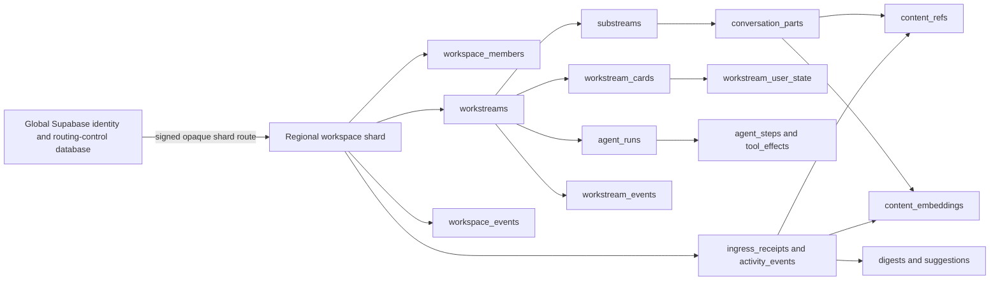

# Supabase workspace and work-stream conversations

> Created 2026-08-15.
>
> Avalon stores workspace, work-stream, conversation, activity, suggestion, and
> agent-run state in regional Supabase project shards. Regional Postgres is the
> authority; private Realtime Broadcast accelerates delivery; Supabase Queues,
> Cron, Storage, and pgvector provide durable scheduling, object, and search
> services. Cloudflare Workers provide all application compute, and one data-
> minimal Cloudflare Workflow drives every inference run: one full loop or one
> bounded one-shot inference.
> Companions: [`state.md`](state.md), [`flows.md`](flows.md), the underlying
> [`research.md`](research.md), and the technical/economic
> [`comparison.md`](comparison.md). The newer full three-way comparison,
> including the hybrid design, is
> [`here`](../2026-08-16_hybrid-workstream-do-supabase/comparison.md).

## Summary

Avalon should not reproduce a Durable Object hierarchy inside Supabase. The
idiomatic Supabase architecture is one shared Postgres authority per product-
data region. Every workspace and work stream is a row-scoped aggregate inside
that authority. Short database transactions serialize writes to a work stream,
allocate its one conversation sequence, update common and person-specific
sidebar state, append replay events, and enqueue follow-up work atomically. The
database can therefore make a work-stream update visible in **Work Streams**,
**In Progress**, **Completed**, **You Are Mentioned**, **Unread**, and **Needs
Your Input** without delivering a fallible child-to-parent projection.

The initial topology is exactly one EU Supabase product shard, one Global/US
product shard, and one required global Supabase control database. A shard is a
whole Supabase project and residency/capacity unit. Additional regional shards
remain a production-driven Supabase scaling option, but this version neither
creates nor prelaunch load-tests them. The global database owns stable identity
bindings, billing references, invitations,
the regional-shard directory, workspace route/epoch, and idempotent routing-
control outbox/receipts. It stores no work-stream title, description, message,
activity, suggestion, embedding, or person-specific sidebar state. Every
product transaction stays inside the workspace's assigned regional shard. The
existing Avalon identity provider remains the authentication authority. Its
asymmetrically signed JWTs are accepted directly through Supabase Third-Party
Auth in the global and regional projects by `iss`/`sub` through OIDC discovery
and JWKS; Avalon, not Supabase Auth, owns refresh, logout, and account sessions.

Conversation storage follows how language models consume context without
turning the whole transcript into one mutable JSON document. `substreams`
describes explicit context lanes and inheritance. `conversation_parts` holds
one work-stream-wide order of user, assistant, tool, attachment, compaction,
terminal, and control parts. A deterministic materializer selects an authorized
fence and produces a provider-valid message array. The same model supports the
shared feed, private contextual chats, human forks, and bounded sub-agent work.
Substreams are semantic context boundaries, not database shards, tabs, per-turn
buckets, or independent security domains.

User messages are committed before acknowledgement. A normal queued message is
eligible at the next admission boundary and does not invalidate current work. A
steering message commits the same durable user part but also increments the run
control revision and requests interruption. Realtime can notify an active
executor immediately, while database revision checks before output commit and
before irreversible effects are the safety mechanism when notification is late
or lost.

A full agent loop—not merely one model turn—usually lasts 2–30 minutes and can
rarely exceed two hours during coding. Daytona remains the Terminal plugin's
execution provider. One Terminal call is usually seconds, p95 is under a minute,
and the tail may take 3–5 minutes or longer. One Cloudflare Workflow represents
the full loop, and every bounded one-shot inference has its own Workflow run;
bounded Cloudflare Worker fetch handlers perform model, tool,
connector, compaction, suggestion, embedding, migration, and reconciliation
actions. Workflow state contains only opaque IDs, revisions, cursors, enums,
timing, and hashes while all product state remains in Supabase. There is no
Supabase Edge Function or home-grown Queue/Cron workflow-engine fallback. EU
residency in this PRD is a durable-data promise: EU Database, Storage, vectors,
and backups remain in the approved EU shard. Transient Realtime, CDN, log,
Worker, Workflow, model-provider, and Daytona processing may be global under
the applicable DPA. Configuration and continuous controls—not a separate
contractual Cloudflare regional-processing guarantee—provide execution-path
assurance.

Private Supabase Realtime Broadcast provides low-latency invalidations,
committed control hints, and active-output revision/offset hints. It is not the
event log and, by default, does not carry generated text bodies because an
already-joined channel is not proven to reauthorize immediately after removal.
Durable `workspace_events` and `workstream_events` carry monotonically ordered
replay cursors. The launch path appends deltas to a bounded 16 KiB active-output
chunk at most every 500 ms while observed and every second while unobserved. The
executor then sends a body-free REST Broadcast hint, avoiding both row-per-token
storage and a `realtime.messages` insert for every checkpoint. Clients fetch only bytes after
their durable offset through live RLS, and final output seals as one immutable
conversation part. The desktop animates committed batches at 20 frames per
second by default; reduced-motion clients show each batch without animation.
Reconnect always recovers from the database. One regional Realtime WebSocket
multiplexes an active workspace and a small set of foreground work-stream
topics. When an active run or completion obligation exists, a background app
retains one body-free user-level socket per regional shard containing active
work. With no active obligation it closes after a grace period and catches up
by cursor rather than consuming an idle connection forever or reconnecting
every few minutes.

Connector ingress, normalized activity, digests, suggested work streams, and
suggested actions also live in the assigned regional shard. Signed webhook receipts
and large raw bodies are stored once; logged Queues normalize and derive them;
Postgres records provenance, audience, source watermarks, lifecycle, and user
feedback. A suggestion is not a work stream until an acceptance transaction
creates one. Supabase Storage holds large immutable bodies behind authoritative
`content_refs`. Postgres full-text search and pgvector provide authorization-
aware hybrid retrieval. Supabase Vector Buckets remain a later, rebuildable
option because they are public alpha and do not yet match the transactional and
authorization needs of the launch path.

The Supabase design does not require a Durable Object fleet migration control
plane. Schema changes are regional Postgres deployments using expand/backfill/
contract. Large transformations and D1/R2 imports use regional campaign, job,
receipt, and exception tables processed in bounded queue-backed slices. The PRD
specifies that smaller control surface because it is required for safe rollout,
but it does not create a separate migration-control-plane companion. The D1/R2
authority cutover uses a scheduled read-only maintenance window of at most 15
minutes for the final copy, verification, source-closure receipt, and Supabase
activation; it does not dual-write.

## Motivation

The Durable Object design makes one process the serialized authority for each
workspace and work stream. That is useful on an actor platform, but an awkward
shape on a relational platform. Emulating it with one queue, schema, database,
or Realtime channel per entity would discard Postgres transactions while
retaining cross-owner delivery problems and fleet-management overhead.

Supabase changes the pressure. Work-stream state and workspace sidebar state can
commit in one regional transaction. A relational query can combine common
work-stream metadata with the current person's sparse overlay. Connector events,
digests, suggestions, and search already benefit from regional SQL. Supabase
also puts its durable queue in Postgres, allowing the job and its originating
state mutation to commit together.

The architecture still needs deliberate boundaries. A regional shard primary is
a shared contention and failure domain. Realtime is not durable history.
Supabase authorization, RLS, and Realtime connections are project-local even
when every project verifies the same Avalon IdP JWT. The global route database
and a shard cannot commit atomically. Cloudflare Workflow/Worker execution and
Supabase product state cannot commit atomically. Storage bytes are not recovered by
database PITR. External model, connector, and Daytona calls cannot be atomic
with Postgres. Treating those limitations as explicit contracts is safer than
hiding them behind one service name.

## Goals

1. For this version, make regional Postgres the only product-data authority for
   a workspace's metadata, work streams, conversations, sidebar projections,
   activity, suggestions, files, search metadata, and run state.
2. Serialize every canonical work-stream mutation with a short database lock
   and transaction, including common workspace collections, sparse per-person
   attention state, durable events, and required queue messages.
3. Store conversation content as ordered, typed, provider-neutral parts and
   explicit substreams that deterministically materialize into valid model
   message arrays at an authorization and context fence.
4. Support shared main conversations, private contextual chats, forks, and
   bounded sub-agent investigations without turning them into separate work
   streams or leaking their audiences through compaction, search, or previews.
5. Commit both queued and steering user messages before acknowledgement. Queue
   preserves the active attempt; steer invalidates stale work and prevents a
   later irreversible effect from starting against superseded context.
6. Run generic full agent loops lasting 2–30 minutes and rarely 2+ hours across
   work-stream and non-work-stream owners, with durable retries, event waits,
   deployment survival, usage telemetry, and uniform at-least-once effect
   retries under one stable Avalon operation ID.
7. Keep Daytona as the Terminal execution provider and reconcile long commands
   by provider reference rather than retrying them after an executor timeout.
8. Deliver human-realtime tokens and sidebar changes through private Realtime
   Broadcast while using durable database cursors for every reconnect, gap,
   authorization change, and terminal convergence.
9. Avoid row-per-token storage, per-work-stream sockets, unnecessary idle-
   background socket waste, high-frequency empty polling, and one Realtime fan-
   out message per database row while retaining a body-free regional user socket
   for active-run completion obligations.
10. Store connector ingress, activity, digests, suggested work streams, and
    suggested actions with durable provenance, deduplication, audience, expiry,
    feedback, and exactly-once promotion semantics.
11. Use private regional Storage and `content_refs` for large payloads, and use
    authorization-filtered Postgres FTS plus pgvector for exact and semantic
    retrieval without making a vector index authoritative.
12. Keep EU durable product data—Database, Storage, vectors, and backups—inside
    the approved EU regional shard and fail closed rather than failing durable
    data over across a residency boundary. Permit transient Realtime/CDN/log,
    Cloudflare Worker/Workflow, model-provider, and Daytona processing globally
    under the applicable DPA, with configuration-based assurance and continuous
    controls.
13. Migrate from D1/R2 and evolve the regional schema through observable,
    pausable, idempotent, bounded campaigns without waking or instantiating an
    entity fleet and without two long-lived write authorities.
14. Make cost grow with active users, useful stream frames, durable checkpoints,
    stored content, and bounded work—not historical work-stream count, idle
    sockets, row-per-token writes, or duplicate cross-service projections.
15. Keep every regional workspace table and its children classifiable and
    deterministically exportable by owning work stream as a dormant portability
    contingency. This version is Supabase-only and does not plan a WorkstreamDO
    migration; any such change requires a new approved architecture decision.
    Preserve the relational
    design: compatibility must not replace normalized foreign keys, joins, RLS,
    generated/search columns, triggers, or same-transaction workspace behavior
    with redundant columns or premature distributed protocols.
16. Continue using UUIDv7 for every newly generated Avalon-owned opaque UUID so
    distributed IDs retain temporal locality across Postgres, Workers,
    Workflows, clients, and a possible future export target. UUID order is only a
    temporal sorting/locality aid; explicit domain sequences and revisions
    remain the canonical ordering and fencing mechanism.

## Non-goals

1. This PRD does not create one Supabase project, database, schema, queue,
   function, or process per workspace or work stream.
2. The launch version does not create a synthetic workspace or work-stream
   actor. The database aggregate and command API preserve logical ownership
   without a resident process.
3. This PRD does not store regional product metadata in the global control database or create
   global search, global vectors, a global inbox, or cross-region product SQL.
4. This PRD does not silently fail an EU workspace over to a Global/US project.
5. This PRD does not assert that Supabase project selection alone satisfies
   GDPR or a customer's residency contract.
6. This PRD does not expose canonical tables for arbitrary client writes. The
   client uses RLS-protected views and narrow transactional RPCs.
7. This PRD does not use Realtime Broadcast, Broadcast Replay, Presence, logs,
   or a Cloudflare Workflow as canonical product state.
8. This PRD does not use Postgres Changes for token streaming or high-fan-out
   workspace feeds.
9. This PRD does not keep every background desktop client connected forever,
   nor force periodic two- or three-minute WebSocket reconnects.
10. This PRD does not store a database row per generated token or rendered
    frame, and it does not delay all output until the final assistant part.
11. This PRD does not make an entire full agent loop one Worker request,
    database transaction, queue visibility window, or retryable Workflow step.
12. This PRD does not make every agent loop a work stream. The run model is
    owner-neutral and domain state remains with its owner tables.
13. This PRD does not promise exactly-once external side effects. Every provider
    call is retried automatically under the same Avalon operation ID; providers
    that ignore idempotency may perform a duplicate effect.
14. Terminal remains on its existing Daytona provider under the separate
    Terminal subsystem contract; Cloudflare Workers and Workflows do not run
    shell commands.
15. This PRD does not use substreams as storage shards, UI tabs, one-per-turn
    containers, security boundaries, or substitutes for work streams.
16. This PRD does not delete source messages merely because compaction produced
    a summary.
17. This PRD does not treat a suggested work stream as a real work stream before
    an authorized acceptance transaction succeeds.
18. This PRD does not use Supabase Vector Buckets for launch-critical search or
    authorization while that product remains public alpha.
19. This PRD does not use Supabase Edge Functions or construct a second workflow
    engine from Queue/Cron leases. Cloudflare Workers/Workflows are the one
    application compute plane.
20. WorkstreamDO compatibility does not create a current scale gate, roadmap,
    pre-provisioned object, shadow writer, or alternate authority. Postgres
    remains the only authority unless a future superseding PRD explicitly
    chooses and governs a different architecture.

## Product behavior

### Workspace collections, sidebar, and work streams of interest

Opening a workspace calls one paginated regional snapshot RPC. It returns
common work-stream cards, the current user's sparse overlays, collection counts,
and a durable `workspace_seq` cursor. It never fans out to work-stream processes.

The render-complete common card contains the work-stream ID, title, short
description/objective, origin, created time, last people-visible activity time,
latest conversation sequence, exact run state and blocker/terminal reason,
lifecycle family, short preview, active-agent summary, needs-input flag,
compact participant/activity counts, completion/error timestamps, and common
revision. Full message bodies, the full description, participant lists, and
mention details are fetched only when their surface opens. Every exact state
maps to one family:

| Exact state/reason | Sidebar family |
| --- | --- |
| `scheduled`, `preparing_context`, `running`, `interrupting`, `waiting_capacity` | `in_progress` |
| `needs_input` with an ordinary question or missing choice | `in_progress` |
| `completed`, `cancelled_cleanly`, `archived` | `completed` |
| `failed` or `needs_input` with an operator intervention | `error` |
| `deleting`, `restoring` | hidden by the visibility gate |

**Work Streams** is every visible real work stream. **In Progress**,
**Completed**, and **Error** are indexed predicates over the common row. Date
groups use the same documented `last_activity_at` or `completed_at` field and
workspace timezone; they are not client guesses.

The render-complete person-specific overlay contains a monotonic seen waterline,
unread count and ordinals, mention ordinals, latest mention time,
`needs_your_input`, assignment state, pin, mute, dismiss, last opened, and per-
person revision. Only displayed collection/attention counts are cached; detailed
mention and participant data is refetched. **You Are Mentioned**, **Unread**,
**Needs Your Input**, and **Pinned** are indexed overlay predicates. **Of
Interest** on the main screen is the documented union of pin, mention, unread,
assignment/input need, accepted suggestion, and recently opened/active signals.
No opaque recommender silently changes this collection.

The system does not eagerly create one overlay row for every member and work
stream. It creates one when the person opens, is mentioned or assigned, needs
input, pins/mutes/dismisses, accepts a suggestion, or otherwise differs from the
default. A message may explicitly mention at most 250 people; affected sparse
overlays are created asynchronously in bounded batches from the committed
attention event. Group and workspace mentions always append one audience-
attention event and expand lazily rather than synchronously writing one row per
member.

Marking seen is a monotonic RPC. It advances only to a sequence or attention
ordinal the caller is authorized to see and never moves backward or into the
future. Rendering, Presence, and an open socket do not mark content seen.

The same transaction that changes a work-stream title, state, last activity,
message attention, mention, or assignment updates the common row, direct sparse
overlays, canonical attention/mention facts, appends workspace/work-stream
events, and queues required follow-up. Explicit mention overlays are the one
intentional asynchronous exception: at most 250 are materialized in bounded
batches, while snapshot/collection queries fold any pending authorized mention
event so **You Are Mentioned** never waits for the projection. There is no
cross-object delivery to repair. Realtime sends a small sequence hint after
commit; a lost hint is recovered from `workspace_events`.

### Activity ingestion, digests, and suggestions

A connector delivery enters the assigned shard through its regional Cloudflare
Worker HTTPS hostname. The Worker verifies the provider signature, timestamp,
replay window, installation, and size before accepting content. It records one
receipt keyed by installation and provider event ID, or by a documented semantic
hash/window when the provider has no stable ID. A repeated ID with the same body
returns the prior receipt; the same ID with different bytes is quarantined and
audited.

Large raw bodies go to private regional Supabase Storage through a pending-
then-ready `content_refs` lifecycle. The receipt and a logged
`connector_ingress` queue message commit atomically. A bounded worker creates
immutable normalized activity facts, version/tombstone records, resource links,
audiences, and reconciliation cursors. Raw receipts are evidence and replay
input; normalized activity is the product-facing authority; vectors and
Realtime are neither.

Digests freeze an authorized activity watermark, timezone, audience, source
revision, and model/prompt version. Late events enter the next digest or an
explicit revision. Model generation and delivery are separate, idempotent
effects. Revocation between selection and commit invalidates the artifact.

Opportunity workers create `suggestions` and their source links. A suggested
work stream is a proposal with provenance, score, explanation, target audience,
expiry, and lifecycle. It appears in **Suggested** or the appropriate personal
surface, never in real work-stream collections. Accepting it runs one
transaction that revalidates source access, creates the work stream and initial
parts, updates the sidebar, records the accepted ID, and emits events. A retry
returns the same work stream.

A suggested action targets an existing work stream or external object but does
not execute until a person approves it or a separately defined policy permits
autonomy. Acceptance records a generic run/effect intent with the same revision
and idempotency rules as any other agent action. Dismissal, expiry, feedback,
source deletion, and access revocation are durable and user/audience scoped.

### Main conversation and LLM message arrays

The main feed is the root `substream` of a work stream. Every accepted user,
assistant, tool, attachment, terminal, compaction, or control part receives one
monotonic `seq` under a short lock on the `workstreams` row. A logical turn has a
`turn_id`; provider-valid tool-call/result adjacency is captured by explicit
relations and materialized correctly even if a human message arrived while the
tool was running. Physical arrival order is retained, while the model projector
admits complete units according to the documented admission fence.

Specifically, a human part that arrives after a tool call but before its result
keeps its physical `seq` and is shown as queued while the tool exchange is open.
The tool turn receives the next `admission_ordinal` only when its result/error is
sealed; the queued human turn receives the following ordinal. Provider context
therefore orders assistant tool call, tool result/error, then user input. The UI
may show the user's wall-clock arrival between live tool statuses, but the
provider array never places a user role inside a required call/result pair. This
is an explicit projection rule, not a claim that physical and provider order are
always identical.

The projector is a deterministic, versioned database/application function over:

- the requested work stream and substream lineage;
- an inclusive work-stream sequence fence;
- a current authorization, resource-authorization, and context-scope epoch;
- complete, visible turns and tool-call/result pairs;
- applicable, still-valid compaction summaries;
- promoted child summaries and referenced content versions;
- a provider adapter that maps neutral roles and typed parts into its wire
  format.

It produces the same logical array on retry and records the materializer and
provider-adapter versions, source fence, hashes, audience epoch, and resource-
authorization revision on the run step. Compaction and redaction are applied at
that frozen fence. A promoted child contributes only its provenance-bearing
summary/reference. Provider wire payloads are not canonical history. Small text
may be inline; large bodies resolve from ready `content_refs`. Missing, corrupt,
unauthorized, or revised content fails materialization explicitly rather than
silently changing the prompt.

### Queued and steering messages

Every user input command supplies an idempotency key, expected work-stream
revision, and mode `queue` or `steer`. The append RPC authenticates live
membership, locks the work stream, commits the user part and attention/sidebar
effects, appends durable events, and advances run-control state before success.

A queued message does not increment the interrupting control revision. The
active attempt may finish, and the next admission boundary batches every
eligible queued input exactly once in canonical order. A sender can see that
the message is committed and waiting.

A steering message increments `control_revision`, sets
`interrupt_requested_at`, and records the requested boundary. It immediately
Broadcasts a private run-control hint. A cooperative active model request is
aborted when possible. An ordinary read-only tool may finish if stopping it is
unsafe or unsupported, but its result cannot be admitted against the stale
revision. No new irreversible effect may begin after the steering revision
commits: the effect-begin RPC checks the current revision in the same transaction
that records intent.

If the notification is lost, the executor learns at its next database fence.
If a provider cannot cancel, its late output is recorded as superseded diagnostic
state or discarded and never seals the winning assistant part. If an external
write already began, the system reconciles its idempotency/provider reference
and tells the user what happened; steering does not rewrite reality.

Multiple steering messages coalesce by revision into one deterministic next
admission batch. Queue/steer commands remain ordinary transcript history; a
control flag cannot exist without its durable user part.

### Chats, forks, sub-agents, and substreams

Supported substream kinds are deliberately finite:

| Kind | Purpose | Inheritance | Default audience |
| --- | --- | --- | --- |
| `main` | Shared work-stream history | none; it is the root | work-stream audience |
| `private_chat` | Private contextual exchange | frozen visible parent fence | explicit people/agent audience |
| `human_fork` | Explore from an exact completed past | frozen parent fence | creator-selected audience |
| `subagent_fresh` | Bounded independent investigation | explicit task packet only | owning agent and permitted viewers |
| `subagent_fork` | Investigation inheriting an exact parent context | frozen parent fence | owning agent and permitted viewers |
| `document_chat` | Focus on a versioned resource | frozen or explicit live version policy | resource-authorized audience |

Substreams should be used when content has a coherent model-context boundary
inside one work stream and its result may be summarized or promoted. They keep
private chat or tool chatter out of unrelated future prompts while preserving
one audit order.

Substreams should not be used for pagination, storage distribution, one model
turn, one tool call, one user, one UI tab, one socket, arbitrary tags, or access
control by identifier alone. A body of work needing its own title, sidebar card,
participants, lifecycle, retention, completion, or independent objective is a
work stream. A depth limit, explicit parent, base sequence, inheritance mode,
scope revision, lifecycle, and promotion relation prevent branch bombs and
ambiguous ancestry.

Every part retains the one work-stream-wide `seq`; substream-local order is
derived. RLS checks the work stream and part audience, not mere possession of a
substream ID. Promotion appends a provenance-bearing summary/reference into the
target substream; it does not retroactively widen the child audience.

### Active runs, streaming, and steering

A full loop starts when committed input is admitted and ends only at
`completed`, `waiting_user`, `failed`, `interrupted`, `cancelled`, or another
product terminal state. It can contain many model turns, tool calls, Daytona
commands, retries, compactions, and waits. It is not one inference request and
not one user/assistant turn.

`CloudflareWorkflowRunDriver` creates one Workflow instance per full loop. Its
persisted input/result contains only shard routing, owner/run IDs, revisions,
cursors, next-action enums, timing, and integrity hashes. Each Workflow step
invokes the shard's bounded Cloudflare execution Worker, which loads canonical
context from Supabase, begins one fenced step, performs one provider action, and
commits or recovers/retries its result. The model-token path is provider -> execution
Worker -> checkpoint RPC/REST Broadcast -> desktop; tokens never pass through
Workflow state. Prompts, messages, connector data, tokens, Terminal output,
provider secrets, and customer files never enter Workflow state. Supabase
remains authoritative if the Workflow is retried, lost, recreated, or replaced.

The one driver implements this contract:

1. load a run by opaque ID in its region;
2. atomically claim the next action against run, control, authorization, scope,
   and driver revisions;
3. make at most one externally meaningful model/tool/reconciliation action;
4. checkpoint provisional output independently of the durable action result;
5. commit through a compare-and-set RPC; on an uncertain response, recover the
   operation ID and automatically retry the same provider operation;
6. return `continue`, `wait_event`, `wait_until`, `terminal`, or `retry`;
7. record token, tool, cost, elapsed, idle, and step usage as telemetry without
   enforcing a product-level budget in this version.

An executor may listen to `run-control:<run_id>` while a model/tool request is
active to reduce interrupt latency. The socket is an optimization, not a lease
or authority. Every irreversible effect starts through a database RPC after a
fresh control/authorization check. The race between that check and the external
call is resolved by the committed effect intent and stable Avalon operation ID.
The driver automatically retries that operation. A provider that honors the ID
deduplicates it; a provider that does not may execute a duplicate, which is an
explicit at-least-once product risk rather than a claim of atomicity.

### Token streaming and realtime socket lifecycle

Time to first token is normally 1–5 seconds. Provider token cadence, provisional
UI frame cadence, durable checkpoint cadence, and final semantic-part cadence
are four separate clocks. **No token causes a database write.** The executor
buffers deltas and, at launch, calls `checkpoint_active_output` at most every
500 ms while observed, every one second while unobserved, when the open 16 KiB
chunk would fill, or immediately at a semantic/final boundary. It sends no
checkpoint when no new bytes arrived.

The checkpoint RPC sends only bytes after the last durable offset plus expected
run/attempt/control revisions, frame range, provider cursor, and hash. After
first-chunk creation it uses the open tail as the recurring CAS/lock gate,
rejects stale/gapped input, and mutates only that bounded
`active_output_chunks` row; crossing 16 KiB seals the chunk and inserts the next
in the same transaction. Sealed chunks are immutable. It does **not**
rewrite the complete accumulated response, update the sidebar/work-stream/run
row, append a durable event, or insert into `realtime.messages` on every
checkpoint. The executor permits one checkpoint RPC in flight and retains the
unacknowledged delta, so a lost response retries the same expected offset/hash
instead of creating a receipt row per checkpoint.

After commit, the trusted executor sends a small private, body-free Broadcast
through Supabase Realtime's REST Broadcast API containing only run, attempt,
part, checkpoint revision, frame sequence, byte offset, and content hash. This
path is deliberately outside the database: Supabase documents that database
Broadcast inserts into `realtime.messages` and is read from WAL, whereas REST
Broadcast goes directly through the Realtime service. A lost hint is harmless;
the next hint, hydration, or final semantic event reads canonical chunks.
Clients call an RLS-protected `active_output_after(attempt_id, byte_offset)` RPC
that returns only newly durable bytes, never the full accumulated prefix. The
Electron main process allows one fetch in flight per attempt and coalesces newer
hints, bounding reads and avoiding quadratic egress.

Transport cadence and visual cadence are independent. The desktop queues each
fetched delta and drains it via `requestAnimationFrame` at 20 visual frames per
second by default. It allocates available tokens or characters across the
frames until the next expected batch; it does not assume one model token per
frame. At 100 tokens/second and 500 ms checkpoints, each batch is about 50
tokens, so 20 fps renders about five tokens per frame over the next half second.
This is continuous visual motion while the transport remains near 2 Hz. A
reduced-motion client displays the fetched batch immediately without per-token
animation. A bounded-lag controller
accelerates when a late batch arrives, pauses rather than inventing content if
the buffer empties, never renders beyond the committed byte offset, and flushes
or reconciles to the sealed final part on completion. Switching work streams
preserves a separate animation queue and committed/displayed offset for each.
Realtime messages carry coordinates only. Clients reject old attempts,
duplicates, gaps, and offsets below the last sealed or checkpointed byte.

`active_output_attempts` holds stable attempt identity and lifecycle;
`active_output_chunks` holds the bounded mutable tail and immutable earlier
chunks. Checkpoint revision, byte offset, frame sequence, token estimate,
provider cursor, and hash advance only in the transaction that stores all bytes
they describe. Approximate token-usage progress rides the chunk checkpoint and
the exact run counter settles at the model-step boundary; there is no separate
per-token counter update. For output at or below 256 KiB, completion locks the
attempt, verifies the ordered chunk hash/offset, inserts one inline sealed
assistant part, updates semantic run/work-stream state and durable events, and
marks the attempt sealed in one transaction. Larger output first uploads one
immutable private-Storage object through the pending/verified `content_refs`
protocol; the active chunks remain recoverable until a later terminal
transaction inserts the part by ready content reference and seals the attempt.
Chunk deletion is bounded asynchronous cleanup after the recovery window rather
than a large finalization transaction. Advancing a durable cursor without its
bytes is forbidden.

#### Checkpoint write model

For token rate `R`, total tokens `N`, and checkpoint interval `I` seconds, a
continuous observed generation lasts `N/R` seconds and produces approximately
`ceil((N/R)/I)` checkpoint transactions—not `N` transactions. Chunk-boundary
row inserts are `O(output_bytes / 16 KiB)`. Actual physical WAL, TOAST, index,
vacuum, PITR, and disk I/O can exceed logical row mutations and must be measured
on the chosen compute/disk tier.

For the required worked case—100 tokens/second, 10,000 tokens, 500 ms observed
checkpoints, and an explicit planning assumption of four UTF-8 bytes/token:

| Quantity | Result |
| --- | ---: |
| Generation duration | 100 seconds |
| Tokens / estimated bytes per checkpoint | 50 / about 200 bytes |
| Durable checkpoint transactions | 200 |
| Bounded 16 KiB chunks for about 40 KiB output | 3 |
| Streaming content-row mutations | About 200 updates plus two boundary insert/seal operations |
| Final semantic transaction | 1 |
| REST Broadcast sends | 200 |
| Billed Realtime messages with one receiver | 400: 200 sends + 200 deliveries |
| Incremental body returned to one continuously observing client | About 40 KiB plus request/protocol overhead |
| Desktop visual cadence | 20 fps by default from the same 2 Hz batches; reduced motion shows each batch immediately |
| Tokens rendered per visual frame at 20 fps | About 5 while draining each batch |

At one second the same run has about 100 checkpoints and 200 Realtime messages
for one receiver. A naive token-write design
would issue 10,000 streaming transactions—50 times the 500 ms design—and is
rejected. A single such run is well inside the architecture; fleet safety is a
concurrency question. With `A` continuously observed streams at 500 ms, the
regional primary receives roughly `2A` checkpoint transactions/second and
Realtime sees `2A * (1 + average_receivers)` messages/second. For example, 100
streams with one receiver mean about 200 checkpoint transactions and 400
Realtime messages/second, before other traffic. One thousand mean about 2,000
and 4,000 respectively, above Supabase's currently documented default 2,500
messages/second for Pro without Spend Cap/Team and therefore require a vendor
limit increase, lower cadence/fan-out, vertical scaling, or an additional
regional Supabase shard. Database capacity is governed from production
WAL/IO/CPU telemetry; Supabase has no public per-row-write price that proves it
from arithmetic alone.

The checkpoint guarantees client reconnect to the latest durable provisional
bytes; it does not promise that a crashed model executor can continue a
nondeterministic generation. If the provider supplies a verified resumable
cursor/event spool, the same attempt may resume and later seal. Otherwise the
entire incomplete attempt is marked superseded, the client may visibly retract
its provisional text, and a new attempt starts from the original model fence.
Two attempts are never spliced, and only one complete attempt can seal.

The Electron main process owns at most one physical Realtime WebSocket per
regional session. It joins the active workspace common/personal topics and only
foreground work-stream common/personal topics; Supabase multiplexes them on that
socket. The client subscribes first, buffers hints, loads a snapshot and durable
cursor, applies newer hints, then continues live. Sequence gaps fetch durable
events. Broadcast Replay's 72-hour/25-message bound is never the recovery
contract.

The app keeps the socket while foreground interaction, a visible active stream,
or a promised live completion requires it. It leaves stale work-stream channels
after a grace period but retains one body-free user-level topic on one socket
per regional shard that still contains the user's active work. That topic
delivers completion/needs-input coordinates without generated bodies. When fully
backgrounded with no active-run or completion obligation, the shard socket
closes and catches up on focus. This avoids both repeated reconnect churn and
indefinitely billing a user with no active work. Presence is limited to online/
typing hints at human cadence.

### Switching between two streaming work streams

Suppose work streams A and B are both running and emitting assistant output.
Selecting either work stream changes observation only: neither full agent loop,
Workflow/queue driver, provider request, tool, nor Daytona command is restarted
or cancelled. The Electron main process keeps independent per-work-stream
caches keyed by `workstream_id`, with the current `run_id`, `attempt_id`,
checkpoint revision, byte offset, content hash, durable event cursor, and active
text. The renderer never reuses one global streaming buffer for both work
streams.

While both runs are active, the preferred path keeps A and B's private logical
work-stream topics joined on the existing regional Realtime WebSocket. Switching
then changes only the selected cache and is immediate; it creates neither a new
physical connection nor a new inference request. This remains a small
foreground/running set, not a subscription to every pinned, unread, mentioned,
or background work stream. Supabase's paid-plan limit of 100 channels per
connection leaves ample protocol headroom for this two-stream case. Avalon
observes channel use in production; this version does not require a prelaunch
capacity/load test.

If B's topic was evicted, the client joins it first and buffers hints before
fetching an authorized hydration RPC. One SQL statement snapshot returns the
visible immutable `conversation_parts` page, current `active_output_attempts`
root and ordered `active_output_chunks` if any, attempt/revision/offset/hash,
and an authorized durable `scanned_through` watermark. The client installs that
snapshot, discards buffered hints at or below its watermark/revision, applies
newer hints, and calls `events_after(cursor)` or
`active_output_after(attempt_id, byte_offset)` when it detects a sequence,
revision, or offset gap. Broadcast Replay is optional acceleration only; it is
not the recovery source.

A UI-only switch therefore loses no accepted message, immutable part, or
durably checkpointed provisional byte. The launch-safe path displays text
fetched through live RLS only after the checkpoint transaction has stored the
bytes and matching offset, so a lost or delayed Broadcast loses only a wake-up.
The newest executor bytes may be up to the 500 millisecond launch-default
observed checkpoint interval behind, or up to one second after observation
stops, but appear after the next commit. Completion atomically replaces
the active attempt with its immutable final part, so hydration sees a coherent
active or sealed state even when completion races the switch.

Hints and caches from an old `attempt_id` are discarded rather than spliced
into a replacement. If the executor/provider cannot resume a failed
nondeterministic attempt, either work stream may still perform the already
documented whole-attempt reset and visibly retract provisional output. That is
inference recovery, not loss caused by switching. Body-free coordinates plus
live-RLS fetch remain the required path, so every displayed offset is durably
recoverable.

### Compaction while messages continue

Compaction never rewrites the mutable conversation head. A transaction freezes
a complete-turn source range, content hashes, substream lineage, authorization
epoch, resource-authorization revision, context-scope revision, and compactor/
model version into a unique job.
Messages sent during compaction allocate higher work-stream sequences normally
and are not observed by the job.

The worker reads exactly the fence, performs one bounded compaction action, and
commits a derived summary only if every source, scope, and authorization input
still matches. The materializer then uses that summary for the fenced prefix and
ordinary parts above it. A retry returns the same summary by compaction key. A
permission, document-version, redaction, or lineage change invalidates the
result and schedules a new fence. Old parts remain under the retention/audit
policy; compaction alone is not deletion.

### Completion, errors, and offline recovery

Exactly one attempt wins each admitted input range. Unique constraints and
compare-and-set terminal RPCs reject late completions. A terminal transaction
seals output, updates the run and work-stream state, updates common/person
sidebar projections, appends both event streams, and enqueues any derived work.
The UI can therefore recover a coherent terminal card and transcript after any
lost Broadcast.

An error is classified as retryable, user-actionable, authorization
invalidation, infrastructure/capacity exhaustion, or permanent failure.
Uncertain provider responses are retried automatically under the original
operation ID; a provider without idempotency may duplicate an effect. The
sidebar maps terminal results deterministically. Operators can inspect opaque
IDs, revisions, timings, hashes, and error classes without routine content
access.

Offline writes carry idempotency and expected revision. Reconnect submits them
to the regional command API, receives the original result on duplicate, and
surfaces a conflict when semantics cannot be merged. Clients never infer
success from an optimistic row or Realtime echo.

## Impact on the product contract

This PRD changes infrastructure ownership, not the user-facing work-stream
model. The standing product contract gains explicit queue/steer semantics,
substream context rules, background socket lifecycle, durable event cursors,
suggestion provenance, and full-loop execution boundaries. Existing references
to a per-work-stream realtime coordinator or D1 as canonical conversation state
must be replaced by the regional Supabase command and event contracts.

The main intentional product differences are operationally positive:

- sidebar/common/personal state becomes transactionally current rather than an
  eventually delivered child projection;
- a client can query and paginate collections relationally without waking an
  entity fleet;
- all agent owners use one durable run interface while preserving their own
  domain tables;
- a disconnected client recovers from sequence-numbered database events rather
  than relying on socket retention;
- migration is a regional schema/data campaign rather than per-object wake-up.

The product must not expose implementation details such as queue visibility,
Realtime topic names, row locks, Worker invocation boundaries, or Workflow step
retries. It exposes committed, queued, steering, running,
waiting, terminal, and recovery states.

## Decision log

| Decision | Outcome | Reason |
| --- | --- | --- |
| Global control database | One required Supabase project with identity bindings, shard directory, workspace routes/epochs, invitations/billing, and routing-command outbox/receipts | Gives every client and global lifecycle command one non-product routing authority |
| Regional physical unit | Exactly one EU and one Global/US product shard initially; no prelaunch capacity/load test | Start simply and select tier, limits, vertical scale, or later shards from production usage and abuse observations |
| Authentication | Existing Avalon IdP JWTs directly through Supabase Third-Party Auth using asymmetric OIDC discovery/JWKS and `(iss, sub)` | Keeps Avalon in control of authentication, refresh, and logout without sharing signing secrets or requiring regional Supabase users |
| EU promise | EU durable data only: Database, Storage, vectors, and backups | Transient Realtime/CDN/log/Cloudflare/provider processing may be global under the DPA; configuration and controls provide assurance rather than a separate processing-location contract |
| Workspace/work-stream authority | Regional Postgres rows and functions; Supabase-only remains the selected architecture | Relational transactions solve sidebar projection and query needs directly; WorkstreamDO-compatible exportability is a dormant contingency, not a scale plan |
| Serialization | Short `workstreams` row lock in a database function | Clear order without a resident actor or connection-scoped lock |
| Client API | Narrow RLS-protected views/RPCs; canonical tables private | Prevents partial multi-request mutations and centralizes live auth checks |
| Realtime authorization | Private body-free Broadcast hints; one-hour Third-Party Auth JWT lease; no topic rotation | Commands/reads/Storage revoke immediately, while an already-joined private channel may retain stale hint access for up to one hour |
| Event replay | Durable event tables retain seven days; older cursors require `snapshot_required` | Provides a clear offline contract without making Broadcast Replay or unbounded events authoritative |
| Background notification | One user-level Realtime socket per regional shard while that user has active work | Preserves body-free completion/needs-input notification without retaining work-stream channels or billing users with no active obligation |
| Sidebar cards | Render-complete compact common and personal fields; refetch detailed bodies/lists | Makes list surfaces immediate without turning cards into transcript or membership replicas |
| Mention fan-out | At most 250 explicit people, asynchronously materialized in bounded batches; group/workspace mentions expand lazily | Avoids synchronous Cartesian writes while retaining sparse user attention rows |
| Context materialization | Deterministic versioned materializer at frozen sequence/audience/resource fences with pinned provider adapter | Retries produce provider-valid arrays without leaking compacted, redacted, or revoked content |
| Token persistence | Human/assistant text up to 256 KiB and structured bodies up to 64 KiB inline; larger/binary content in private Storage; 16 KiB mutable-tail chunks at 500 ms observed/1 s unobserved | Avoids row-per-token and ever-growing-row WAL/IO while bounding reconnect loss |
| Desktop stream rendering | Animate each 2 Hz committed batch at 20 fps by default; reduced motion displays batches immediately | Preserves perceived continuity without additional database or Realtime writes |
| Application compute | Cloudflare Worker fetch handlers for all bounded API/provider/background actions | One compute/runtime/tooling plane beside Workflow; Supabase stays the state platform |
| Async jobs | Logged Supabase Queues plus Cron/Cloudflare Worker consumers | Atomic enqueue with domain state; content is processed only after shard Worker admission |
| Queue policy | `pgmq.read` batches 32 with 60 s visibility, renew at 30 s using `pgmq.set_vt`, DLQ after 10 reads | Defines one pull-based at-least-once contract whose availability follows regional Postgres |
| Inference driver | Every inference uses durable `RunDriver`: one Workflow per full loop or per bounded one-shot inference | Gives work-stream and non-work-stream inference one implementation and durable recovery boundary |
| Product budgets | No product-level limits initially; record usage and observe production/abuse | Product policy will be chosen from evidence; unavoidable platform/provider hard ceilings still surface as infrastructure/capacity failures |
| External effects | Uniform automatic retry under the same Avalon operation ID | This is at least once; providers that ignore idempotency may duplicate effects, while Daytona reattaches safely by named session/command ID |
| Terminal | Existing Daytona plugin/provider | The provider remains separately governed; long commands reconcile by provider ID |
| Large content | Private Supabase Storage plus canonical `content_refs` | Separates bytes from relational state without making Storage metadata authoritative |
| Search | Postgres FTS + pgvector/HNSW | Supports authorization joins and transactional lifecycle |
| Vector Buckets | Defer launch use | Public alpha and weaker proof for transaction/RLS/residency semantics |
| Retention | PITR 14 d; independent Storage recovery 30 d; active-data/derivative deletion 24 h; backup expiry 30 d; ops logs 30 d; content-free security/audit 1 y; provider/Daytona artifacts <=30 d; exports 7 d; scoped legal holds override | Sets explicit lifecycle promises for every authority and derivative |
| Table partitioning | Never partition Postgres tables | Preserve ordinary relational tables/indexes and use bounded cleanup, vertical scaling, or later regional shards |
| Encryption | Platform encryption at rest/TLS/RLS for ordinary content; Vault for connector credentials; regional Worker secrets for model/Daytona credentials | Keeps searchable data searchable without duplicating key-management and query machinery |
| D1/R2 migration | Scheduled read-only maintenance window up to 15 minutes; final copy/verification/closure then activate Supabase; no dual writes | Simplifies authority transfer while retaining an independently verifiable source-closure receipt |
| WorkstreamDO contingency | Audited indexed ownership paths and deterministic export; no trigger, planned rollout, DO column, or object | Preserves relational features today; any future extraction requires a superseding architecture decision |

## Key design decisions

### Global database, regional shards, and routing control

The required global Supabase project is the sole global routing/control
database. A regional shard is one complete Supabase project with Database,
Third-Party Auth configuration, Realtime, Queues/Cron, Storage, and vectors. Launch has
`eu-1` and `global-us-1`; capacity may later add `eu-2` or `global-us-2` without
changing workspace IDs or creating one project per workspace. `region_key` is
immutable after workspace creation. `shard_id` may change only through the
fenced authority-transfer protocol, and every change increments `route_epoch`.

The desktop first calls the global routing Worker, which reads this database
and returns a signed, short-lived route envelope containing opaque workspace ID,
`region_key`, `shard_id`, regional API/Realtime origin identifiers, route epoch,
and expiry. It then creates the shard-local Supabase client with the same Avalon
IdP JWT. Ordinary product reads/writes never proxy through the global database.
Every shard command carries workspace ID, shard ID, route epoch, operation key,
and no product body; the shard-local admission row rejects an old shard/epoch.

The global database is limited to:

- account identity and sign-in configuration;
- opaque organization/workspace IDs, immutable selected region, assigned shard,
  route epoch, lifecycle, and non-content shard health/capacity class;
- invitations that must be discoverable before regional workspace membership
  exists;
- billing/customer/entitlement references and non-product lifecycle state;
- a routing-command outbox, delivery attempts, shard receipts, and convergence
  status for create/suspend/delete/move/invite/entitlement operations.

A global lifecycle transaction updates its canonical global fact and appends one
`routing_commands` row. A Cloudflare Workflow/Worker dispatcher delivers that
identifier-only command to the target shard's regional Worker. The shard
transaction checks epoch and operation hash, updates its local
`workspace_route_gates`/regional identity or invitation state, stores a receipt,
and returns only the receipt ID/state. The dispatcher writes the acknowledgement
back globally. Retry is expected; a command ID plus payload hash is idempotent.
No synchronous transaction spans databases, and global `delivered` never means
the regional transaction happened unless a matching shard receipt was observed.

The global directory is not the authority-transfer linearization point. A shard
move closes the source shard's local write gate at a final cursor/epoch, copies
and verifies the destination, activates the destination only from that immutable
closure receipt, and then updates the global route as a retryable derived
pointer. A crash may make the workspace temporarily unavailable; it cannot make
both shards writable. Globally initiated deletion/suspension is deny-first: the
global route stops issuing writable envelopes immediately, while shard command
delivery is retried to converge stored state.

The existing Avalon identity provider is the authentication authority for every
project. Supabase Third-Party Auth validates its asymmetric JWT directly through
the provider's OIDC discovery document and JWKS. The stable principal is the
pair `(iss, sub)`; `auth.uid()` and a Supabase-managed `auth.users` row are not
required for Avalon authorization. Avalon owns sign-in, refresh, logout,
one-hour access-token issuance, and account-session revocation. Supabase owns
JWT verification and maps claims into `auth.jwt()` for RLS. Shared symmetric
signing secrets, copied private keys, a regional session exchange, and client-
held service roles are rejected.

The Avalon issuer must expose HTTPS OIDC discovery/JWKS, sign asymmetrically,
and put `kid`, `iss`, stable `sub`, `aud`, one-hour `exp`, and a fixed low-
privilege Postgres `role` in every accepted token. The `role` is issuer policy,
not user metadata, and can only select the ordinary authenticated role. The
desktop supplies the current token through `supabase-js`'s `accessToken`
callback. Each project configures the same issuer independently and permits the
documented key-refresh delay during rotation. Before rollout, a hosted-project
integration test must prove that Avalon's issuer is accepted as the selected
custom Third-Party Auth provider across Data API, Storage, and Realtime; failure
blocks this implementation rather than falling back to a shared key or copied
Supabase user.

### Schemas, grants, and API boundary

Canonical application tables live in `avalon_private`; queue tables remain in
the managed `pgmq` schemas; Supabase-managed `auth`, `storage`, and `realtime`
schemas are not modified. An explicitly exposed `api` schema contains only
security-invoker views and command/query functions. New tables are not assumed
to be exposed by the Data API: migrations grant only required `SELECT`/function
execute rights and revoke default `PUBLIC` function execution.

RLS is enabled on every exposed relation. Canonical writes occur through
`SECURITY INVOKER` functions when possible. A necessary `SECURITY DEFINER`
function has `search_path = ''`, fully qualified identifiers, explicit live
authorization and tenant assertions, revoked public execution, and a narrow
grant. `service_role` and server Storage/S3 credentials stay only in trusted
regional execution.

Views use `security_invoker = true`. UPDATE policies include both `USING` and
`WITH CHECK`, and the required SELECT policy. Every membership/audience/RLS
predicate has a supporting index. User-editable Auth metadata never grants
access, and JWT workspace claims are not treated as fresh membership.

### WorkstreamDO-compatible exportability without a second authority

The regional schema keeps each work stream deterministically exportable to a
portable SQLite-shaped aggregate without moving its workspace or rewriting its
conversation model. Supabase-only is the chosen architecture; this is a dormant
portability contingency, not a scale plan or automatic trigger. No DO exists,
receives a shadow write, or becomes a fallback merely because a compatible row
was created. Invoking a WorkstreamDO requires a future superseding PRD and an
explicit new architecture decision.

Every workspace-scoped table must have one documented ownership classification:
workspace-retained, work-stream aggregate, Postgres read model, shared reference,
or derived/rebuildable. A work-stream aggregate row either stores
<code>workstream_id</code> or reaches it through a bounded, indexed, non-
polymorphic foreign-key path whose join and cardinality are tested. Leaf rows do
not copy <code>workspace_id</code> or <code>workstream_id</code> merely for future
portability when the normalized parent path is clearer and cheaper. Tables that
use a polymorphic owner must have a checked owner-kind mapping and a registry of
the exact export join for the work-stream case.

The compatibility contract also requires:

- globally stable UUIDv7 identities for newly generated Avalon-owned opaque
  UUIDs, preserving existing/imported/external IDs without re-keying; 64-bit
  sequences/revisions transported as decimal strings; timestamps transported as
  UTC RFC 3339; hashes as fixed base64url or hex; and canonical JSON with a
  schema version and byte cap;
- one work-stream-wide canonical sequence plus complete-turn/provider-order
  invariants that do not depend on physical row IDs or commit timestamps;
- a versioned extraction registry that names, for every table, its disposition,
  root key, ordered export query, dependency order, inclusion predicate,
  cardinality bound, and canonical checksum projection;
- portable materializer and invariant tests for conversation order, provider
  tool pairs, queued/steering admission, compaction, runs, effects, and active
  output. The target DO must match these semantics, not Postgres's physical
  schema;
- receipts and external provider references that can be selected through the
  registered work-stream ownership path while they remain retryable;
- Postgres-specific foreign keys, deferred constraints, triggers, generated
  columns, views, RLS, FTS, pgvector, arrays, JSON operators, and transactions
  remain allowed wherever they make the Supabase design safer or faster. The
  registry states whether each value is copied, recomputed, referenced, or
  deliberately left in Postgres;
- Postgres search, workspace collections, connector facts, user overlays, and
  other relational domains remain authoritative in Postgres after extraction.
  Compatibility never means copying a workspace into every DO.

The table-by-table disposition and hypothetical transfer protocol are
normative portability documentation in
[Appendix A](#appendix-a-non-planned-workstreamdo-extraction-contingency).
The portable representation never round-trips a Postgres `bigint` through a
JavaScript `number`: values outside the exact safe-integer range remain decimal
text in transit and are stored as SQLite text or another explicitly validated
lossless representation in a future DO.

### Command transaction and lock order

All canonical mutations use one database function or trusted direct-database
transaction. A chain of PostgREST requests is not an atomic command. The common
work-stream command order is:

1. resolve the regional principal to `platform_user_id` and validate the live
   workspace membership/session epoch;
2. insert or find `command_receipts` by `(workspace_id, actor_id,
   operation_key)`, rejecting reuse with a different request hash;
3. lock `workstreams` with `SELECT ... FOR UPDATE`;
4. lock narrower existing rows in a stable documented order when needed;
5. verify expected work-stream, run-control, context-scope, authorization, and
   driver revisions;
6. allocate `workstream_seq`/attention ordinals and mutate canonical rows;
7. update common and sparse user projections;
8. append `workstream_events` and `workspace_events`;
9. enqueue a logged `pgmq` message and/or transactionally call
   `realtime.send` for a small private semantic-change hint; token checkpoint
   hints instead use REST Broadcast after commit so they do not add a second
   database/WAL write;
10. finalize the command receipt and commit.

No transaction calls a model, connector, Daytona, Storage upload, external
HTTP endpoint, or waits for a user. `READ COMMITTED` plus explicit locks is the
default. `SERIALIZABLE` is used only for a measured invariant that cannot use a
known lock order, and callers retry SQLSTATE `40001`. `SKIP LOCKED` is for job
claims, never for user commands whose ordering must be explicit.

### Idempotency, outbox, and external effects

Idempotency is scoped to a real operation, never a global hash of tool name and
input. Repeating the same operation key with the same request returns its stored
result; reusing it with different bytes is an error. Queue deliveries have
semantic inbox receipts. Run effects use `(run_id, step_no, effect_kind,
effect_key)` so two intentionally repeated actions remain distinct.

An external side effect follows `planned -> started -> succeeded|failed`, with
an intermediate `response_uncertain` diagnostic state:

1. commit intent and its idempotency key;
2. call the provider outside the transaction;
3. commit the response/provider reference through a fenced RPC;
4. after a crash, timeout, or uncertain response, automatically retry the same
   provider call with the same Avalon operation ID.

This policy is uniform across model and tool providers. When a provider honors
idempotency, the repeated ID deduplicates the effect. When it ignores the ID and
offers no lookup, Avalon still retries and accepts that the external effect may
occur more than once. UI and audit surfaces disclose this at-least-once risk;
they do not invent an exactly-once guarantee or block waiting for a person.
Daytona is the safer special case because its deterministic named-session,
command ID, and log-offset protocol reattaches to the existing command rather
than launching another. An outbox is used only where a provider push/callback
cannot be part of the Postgres-native queue; it is drained with the same receipt
rules. Database Webhooks may accelerate an external notification but are not
the durable job bus.

### Supabase Queues/Cron with Cloudflare Worker consumers

Avalon uses a few logged Basic queues, not one queue per workspace/work stream:

| Logical queue | Contents | Consumer |
| --- | --- | --- |
| `agent_ready` | Run ID, expected revision, due time, driver hint | Run dispatcher/step adapter |
| `connector_ingress` | Ingress receipt ID and parser version | Normalizer |
| `sidebar_attention` | Attention event ID, bounded explicit-mention cursor, expected revision | Sparse overlay batch materializer |
| `derived_content` | Compaction, embedding, digest, suggestion job IDs | Typed bounded workers |
| `maintenance` | Export, deletion, orphan, migration job IDs | Typed maintenance workers |

Queue bodies contain identifiers and expected revisions, not canonical content
or secrets. Enqueue occurs in the originating database transaction. Delivery is
treated as at least once end to end despite visibility semantics. The consumer
creates/fetches a unique receipt, commits the authoritative outcome, then
deletes an ordinary successful delivery or archives the message when auditable
delivery history is required. Trusted Cloudflare Workers pull with
`pgmq.read(queue_name, 60, 32)`: a batch of at most 32 and a 60-second visibility
timeout. Work expected to continue renews visibility after 30 seconds with
`pgmq.set_vt`. A message enters the explicit dead-letter queue after ten reads.

Per-kind and per-workspace concurrency, fairness, oldest-visible age, `read_ct`,
next attempt, and DLQ count are observable. Queue availability follows the
regional Postgres primary. Public docs do not provide a hosted Queue SLA;
throughput and latency are observed in production rather than launch-certified.

A small number of regional Supabase Cron jobs may create due queue rows or send
an authenticated, identifier-only HTTP wake to the shard's regional Cloudflare
Worker hostname, potentially as often as every second when production telemetry
shows it is needed and safe.
Alternatively, a Cloudflare Cron Trigger may send the same opaque wake to that
hostname. Due state remains in Postgres; neither scheduler is one job per run or
an SLA. For EU, a Cron/Queue trigger does not itself process content because
Cloudflare Regional Services does not cover those trigger types. It only calls
the regionalized HTTPS fetch handler, which dequeues IDs and fetches product
bytes after in-region admission.

The Worker validates transport and its shard-scoped runner identity, calls a
transactional RPC, performs one bounded external or CPU-light action, and calls
a completion RPC. Workflow steps may await network I/O for a model stream, but
unavoidable Cloudflare CPU, subrequest, output, and wall-time ceilings still
apply. Avalon records product usage but sets no product-level token, tool, cost,
elapsed, idle, or step limit in this version. Large
transforms are divided into database-key ranges or addressable provider
operations. `waitUntil`, a client socket, or a queue visibility timeout is not
durability; Workflow and Supabase receipts are.

### Full-loop driver boundary

`RunDriver` is an internal control interface, not the product authority:

```text
start(region, owner_kind, owner_id, run_id)
signal(region, run_id, event_id, expected_revision)
reconcile(region, run_id)
cancel(region, run_id, expected_revision)
```

The database decides the next action. A driver may only request
`begin_next_step` and submit `complete_step`, `fail_step`, or
`reconcile_effect`. Each RPC is compare-and-set on run/attempt/revisions. A
driver event is only a wake-up; early events are persisted in `run_wait_events`
before a waiter exists, and a later wait consumes them exactly once.

The implementation is one Workflow instance per `agent_run`: a full loop uses
one Workflow for its entire loop, while a one-shot description, attachment
summary, classification, ranking, embedding, or other bounded inference uses
one Workflow for that single inference run. No inference bypasses `RunDriver`.
Workflow steps stay bounded and data-minimal. A long wait uses Workflow event or
duration waiting; it does not keep an executor or client socket active. A
Workflow calls the selected shard Worker explicitly. In Global/US, a service
binding normally keeps Workers on the same Cloudflare server and an explicit
placement hint places the execution fetch handler near the Supabase backend. In
EU, the documented path is an HTTPS call to a Regional Services hostname; Smart
Placement does not apply to Workflow named entrypoints, and Regional Services
does not cover Workflow/Queue/Cron triggers or outgoing subrequests. The
Workflow therefore receives only opaque status, while the regionalized Worker
loads prompts/content, calls approved providers, checkpoints the EU shard, and
returns an opaque next-action result. The contractual promise is EU durable-
data residency, not full EU processing: transient Cloudflare and provider
processing may be global under the applicable DPA. Deployment configuration,
redacted state/logging, and continuous controls provide assurance.

Run admission and driver creation are not one distributed transaction. The
admission transaction creates `agent_runs`/`driver_bindings(state='pending')`
and sends `agent_ready`. A bounded regional dispatcher creates the Workflow
with a deterministic instance ID derived from region and run ID, then calls a
fenced RPC to mark the binding active. A create retry attaches to the same
instance; a database-bind retry returns the existing binding. No provider/tool
effect can begin until the binding is active and `begin_next_step` claims it.
If creation repeatedly fails, the run remains visibly queued/capacity-limited
and a later dispatcher retries—it is never rolled back into an uncommitted user
message. There is no queue-backed alternative driver. If Workflow creation or
the Workflow service is unavailable, the run stays visibly queued/unsupported;
Avalon does not silently start a second orchestration implementation.

Cloudflare Workflow input and result must never include prompt text, generated
text, connector or Terminal content, file paths, personal sidebar metadata,
embeddings, access tokens, or provider credentials. A later audit should be able
to delete every Workflow instance without deleting product truth.

### Realtime protocols

Five logical private topic classes are sufficient for the active surface:

- `workspace:<opaque_workspace_id>`: common invalidations and durable cursor;
- `workspace-user:<workspace_id>:<user_id>`: personal overlay invalidations;
- `workstream:<opaque_workstream_id>`: foreground committed/checkpoint hints;
- `region-user:<user_id>`: body-free completion/needs-input coordinates while
  that user has active work in the regional shard;
- `run-control:<opaque_run_id>`: trusted executor acceleration.

The first three are multiplexed over one regional client connection. Topic RLS
queries live indexed membership and audience state. Topic names grant nothing.
Server control sends request acknowledgement where supported, but the durable
row/revision is authoritative.

“Common” means common to everyone currently allowed to list that work stream,
not necessarily every workspace member. A workspace Broadcast may include a
subject/card ID only when that subject is workspace-listable. A restricted
work-stream update uses its authorized work-stream/audience or affected personal
topic. If the product explicitly approves a body-free workspace cursor wake for
restricted activity, it contains no subject ID/kind/count; otherwise it sends no
common hint. The durable catch-up RPC applies audience RLS before returning
event rows, previews, or collection deltas.

Snapshot handshake is subscribe, buffer, fetch snapshot+cursor, discard events
at/below cursor, apply newer events, and then go live. Envelopes are small and
contain topic, durable sequence, entity ID, revision, kind, and optional
active-output frame coordinates. Gaps fetch `events_after(cursor)` using keyset
pagination. Postgres Changes is not used for high-fan-out domain streaming.

The snapshot and its visible event high watermark are produced by one SQL
statement/CTE under one statement snapshot; a sequence read performed before or
after separate card queries is not sufficient. Workspace sequences may contain
committed gaps and events addressed to other users. Catch-up therefore returns
the caller's authorized events plus an authorized `scanned_through` watermark;
the client advances through invisible/global sequence gaps only to that server-
attested watermark. It never treats every missing integer as a leaked event or
endless transport gap.

Membership removal increments authorization epochs and updates regional rows in
one transaction. New commands, catch-up queries, and Storage reads fail
immediately through live checks. Third-Party Auth access JWTs have a one-hour
standard lease. Supabase caches private-channel RLS for a joined connection;
refresh recalculates authorization and expiry disconnects the socket. Avalon
does not rotate topic names and accepts up to one hour of stale Broadcast access
on an already-authorized channel. Sensitive payloads therefore remain body-free
IDs/invalidation hints, and every content fetch performs live RLS. An eviction
hint accelerates cleanup but is not the security boundary.

### Storage and content references

Buckets are private and regional. Application code treats the managed `storage`
schema as read-only and uses the Storage API for bytes. A deterministic or
content-addressed path contains the workspace and a non-guessable object ID,
never authorization by path convention alone.

The database/Storage state machine is:

1. allocate a `pending` `content_refs` row with expected hash, size, audience,
   owner, and expiry;
2. upload with a user session or narrow server credential;
3. verify object size/hash and atomically mark `ready` with the domain link;
4. serve only `ready` references after a live authorization check;
5. reconcile expired pending/database-orphan/object-orphan states;
6. delete bytes through the Storage API, verify absence, then seal `deleted`.

Signed URLs are short lived and never stored in transcript, queue, Workflow,
Realtime, suggestion, or logs. Supabase Storage has no S3 versioning and its
bytes are not included in database backups, so customer backup/retention and DR
must cover them independently.

### Exact, semantic, and hybrid retrieval

Generated `tsvector` columns with GIN indexes serve exact/token-aware search.
Regional `content_embeddings` use pgvector HNSW and record model, dimension,
content hash, source revision, audience and scope epochs. Embedding generation
is queued and idempotent. Changed/deleted/revoked content invalidates its
embedding before it may be returned.

Every search function begins with an authorized regional candidate set and
joins FTS/vector rows inside the database. It may combine ranks with reciprocal-
rank fusion. It never retrieves cross-tenant vectors into application code and
filters them afterward. Vectors are derived and rebuildable; source content and
provenance remain canonical.

### Capacity, connection, and cost model

The regional primary is shared by interactive transactions, queues, semantic
Realtime database Broadcast, Auth metadata, activity, vectors, active-output
checkpoints, and offset reads. Token checkpoint hints use REST Broadcast, so
they do not add a `realtime.messages` row/WAL write, but their checkpoint RPCs
still consume the shared primary. This version starts with exactly one product
shard per region and performs no prelaunch capacity/load test. Production
telemetry observes workspace/card counts, active writers, connector burst,
token fan-out, checkpoint transactions and bytes, mutable-chunk inserts/updates,
WAL bytes/checkpoint, TOAST/vacuum, incremental RLS reads, queue backlog, vector
index memory, IOPS, and connection-pool demand together. Those observations
select Supabase tier, limits, vertical scaling, and any later additional shard.
Correctness, failover, restore, and failure-injection tests remain required.

Cloudflare Workers normally call narrow Supabase Data API/RPC endpoints over
HTTPS. Any measured direct-Postgres path uses Supavisor transaction pooling;
migrations use direct connections, and code does not rely on prepared statements
or session state in transaction mode. Interactive commands have bounded
statement timeouts. Large reads use keyset pagination, not deep `OFFSET`. All
foreign keys, RLS predicates, due-state claims, collection filters, and event
cursors have indexes.

Postgres table partitioning is not used in this architecture, even after a size
threshold. Ordinary indexed tables, bounded deletion/archive jobs, vertical
scaling, and—if production operations later require it—another regional project
are the supported responses. Read replicas may serve lag-tolerant historical/
analytics views; they never serve
read-your-write sidebar, authorization, active runs, Queues, Realtime, Auth, or
Storage correctness.

Realtime cost is transport send rate multiplied by receivers, not desktop
render rate. Only foreground work-stream subscribers receive active-output
coordinate hints; common invalidations are tiny. The client turns each 2 Hz
batch into 20 fps local animation by default without more network or database
work; reduced-motion clients display the batch immediately. Generated bodies
remain outside Realtime Broadcast.
Worker request/CPU and Workflow-step cost are controlled with due-state,
callbacks, and durable waits rather than hot polling. Storage holds large
immutable bodies; Postgres holds metadata and hot text. Idle sockets close
intentionally and recover from cursors.

## Data model

### Conventions

This section is normative at the logical-schema level. Migration authors may
split a payload into a child table or replace an enum with a lookup only when
the stated keys, authority, lifecycle, transaction boundary, and indexes remain
equivalent.

- Canonical tables live in `avalon_private`; names below omit that prefix.
- Every newly generated Avalon-owned opaque ID represented as `uuid` is UUIDv7.
  This includes workspace, work-stream, substream, turn, part, run, step,
  command, receipt, job, and operation identities created by Avalon. Trusted
  regional Workers generate canonical entity IDs; approved clients may generate
  idempotency/operation IDs, whose UUID version and shape are validated at the
  command boundary. Each runtime uses a pinned RFC 9562-compatible
  implementation before the mutation transaction. A reviewed database-native
  generator may replace it only when the deployed Supabase Postgres version and
  migration tests prove identical UUIDv7 semantics. Auth/provider IDs, retained
  import IDs, semantic composite keys, content hashes, and physical event rows
  using `bigint identity` are not rewritten into UUIDv7.
- UUIDv7's timestamp prefix provides approximate creation-time sorting and
  B-tree insert locality, not transcript order, event replay, causality, or a
  security timestamp. Product queries use explicit `created_at`, domain
  sequence/revision, and stable tie-breaker columns; they never rely on
  `ORDER BY id` for correctness. Clock skew or several IDs in one millisecond
  must not change observable behavior.
- Every timestamp is `timestamptz`; every regional product row includes or can
  reach `workspace_id` through an indexed foreign key. Every work-stream-owned
  row includes or reaches `workstream_id` through the bounded indexed ownership
  path registered for extraction.
- Human text is `text`, bounded at the command boundary. Arbitrary provider
  metadata is versioned `jsonb` with a size cap and a GIN index only for a
  measured query.
- Hashes are fixed `bytea` or constrained hex, and unique keys include their
  semantic scope. `NULL` never means both unknown and not applicable.
- Foreign-key delete behavior is explicit. Large destructive cascades are
  avoided in favor of deletion jobs and tombstones.
- Append-only tables have identity `bigint` primary keys plus the domain unique
  key used for cursor/order. Every foreign key is covered by an index whose
  leftmost columns support the FK lookup, unless an existing primary/unique
  index already does; Postgres does not create those indexes automatically.
  Composite and partial indexes follow current query/RLS/retention predicates,
  not hypothetical DO access patterns.
- Sealed conversation/event/audit rows are immutable to application roles.
  Corrections append a replacement/tombstone relation.
- Managed Supabase tables in `auth`, `storage`, `realtime`, `pgmq`, `cron`, and
  extension schemas are platform-owned and intentionally absent below.

Normalization remains the default. A shorthand child table may use only its
parent ID when that foreign key is indexed and the extraction registry supplies
the deterministic join back to the work-stream root. Redundant scope columns
are added only for current RLS, query, retention, or integrity needs established
by the Supabase design—not solely to imitate a future SQLite layout.

### Relationship overview



There is no cross-database relationship between a workspace and one of its
work streams: both rows are in the same regional primary. A command changing a
work stream locks it and updates `workstream_cards`, direct sparse user state,
`workstream_events`, and `workspace_events` before one commit. Realtime only
announces that commit. The only normal cross-system edges are global route/
command to a regional shard/gate, Postgres metadata to Storage bytes, Postgres run state to a
driver, and effect intent to an external provider. Each is resolved by epoch,
receipt, or pending/finalized state rather than a distributed transaction.

### Identity, workspace, and authorization tables

#### Global identity, organization, invitation, and entitlement tables

The existing Avalon identity provider remains the credential and session
authority. Supabase Third-Party Auth validates its JWTs; the global project
stores only the stable application mapping and lifecycle below. None is copied
into a regional product query or treated as sufficient to read workspace
content.

| Table | Required columns / constraints | Role |
| --- | --- | --- |
| `global_accounts` | `platform_user_id uuid primary key`, `issuer text not null`, `subject text not null`, `state` (`active`, `suspended`, `deleted`), `session_epoch bigint not null`, `created_at`, `updated_at`; unique `(issuer, subject)` | Stable global person identity and global-session revocation fence for an Avalon IdP subject |
| `organizations` | `organization_id uuid primary key`, `billing_owner_platform_user_id`, `state` (`active`, `suspended`, `closed`), `created_at`, `updated_at`, `closed_at` | Non-content tenant and billing scope |
| `organization_roles` | `organization_id`, `platform_user_id`, `role` reviewed enum, `state`, `revision bigint`, `created_at`, `updated_at`; primary key `(organization_id, platform_user_id)` | Global account/billing administration only; never a regional workspace-content grant |
| `workspace_invitations` | `invitation_id uuid primary key`, `workspace_id`, `organization_id`, `inviter_platform_user_id`, normalized destination or provider subject stored under the approved PII policy, `regional_role`, `route_epoch`, `state`, `expires_at`, `accepted_by_platform_user_id`, `created_at`, `updated_at`; unique active invite key | Pre-session invitation discovery and one-time acceptance intent; acceptance still converges to the shard before content access |
| `billing_entitlements` | `organization_id primary key`, opaque provider customer/subscription references, `plan_code`, bounded entitlement fields, `revision bigint`, `state`, `effective_at`, `updated_at` | Globally required commercial admission facts without usage/content replicas |

Foreign keys connect these tables within the global database:
`organization_roles` and `billing_entitlements` reference `organizations`;
people reference `global_accounts`; invitations reference an organization and
the opaque `workspace_routes` identity. A transaction changing an invitation,
entitlement, suspension, or deletion appends its matching `routing_commands`
row before commit. Regional access begins only after the target shard applies
that command and stores a matching `global_command_receipts` row. The same one-
hour Avalon IdP JWT is then validated directly by the regional project's Third-
Party Auth, while live regional membership permits the request. This deliberately
separates global discoverability and commercial control from regional content
authorization.

#### Global `regional_shards`

| Column | Type / constraints | Meaning |
| --- | --- | --- |
| `shard_id` | text primary key | Stable opaque shard identity such as `eu-1`; never a hostname credential |
| `region_key` | text not null | Residency boundary; immutable while any workspace is assigned |
| `lifecycle` | `provisioning`, `active`, `draining`, `read_only`, `unavailable`, `retired` | Routing/admission state |
| `capacity_class` | constrained text | Operator routing tier, not customer/product telemetry |
| `api_origin_id`, `realtime_origin_id` | opaque configuration references | Resolve through trusted config; do not store secret URLs/tokens |
| `min_schema_version`, `max_schema_version` | bigint not null | Compatibility gate for clients/commands |
| `route_public_key_id` | text not null | Key ID used to verify global route envelopes/commands |
| `created_at`, `updated_at`, `draining_at` | timestamps | Fleet lifecycle |

The shard directory is global fleet metadata. It contains no workspace count
derived from product activity, names, user lists, health payloads, credentials,
or customer content. Capacity admission may use coarse operator-maintained bands
and redacted aggregate counters, never a globally queryable product replica.

#### Global `workspace_routes`

| Column | Type / constraints | Meaning |
| --- | --- | --- |
| `workspace_id` | uuid primary key | Globally unique opaque workspace identity |
| `organization_id` | uuid not null, FK to global `organizations` | Global account/billing/invitation scope |
| `region_key` | text not null | Immutable selected residency boundary |
| `shard_id` | FK to `regional_shards` | Current destination shard |
| `route_epoch` | bigint not null, positive | Monotonic fence on every route/control command |
| `authority_state` | `creating`, `active`, `suspending`, `moving`, `deleting`, `closed` | Global routing lifecycle, not product status |
| `source_shard_id`, `destination_shard_id` | nullable shard FKs | Present only during a fenced move |
| `source_closure_receipt_id` | nullable opaque ID | Proof required before destination activation/global pointer change |
| `created_at`, `updated_at`, `closed_at` | timestamps | Lifecycle audit |

Unique `(workspace_id, route_epoch)` supports command references; indexes cover
`(shard_id, authority_state, workspace_id)` and organization discovery. This row
contains no title, description, last activity, work-stream count, member overlay,
or content-derived value. The global router returns it only through a signed,
expiring route envelope after global identity/invitation authorization.

#### Global `routing_commands`, `routing_command_attempts`, and receipts

| Table | Required columns / constraints | Role |
| --- | --- | --- |
| `routing_commands` | `command_id uuid primary key`, `workspace_id`, `route_epoch`, `target_shard_id`, `operation_kind` reviewed enum, `operation_key`, `payload_version`, bounded non-product `payload`, `payload_hash`, `state`, `not_before`, `attempt_count`, `created_at`, `acknowledged_at`; unique `(workspace_id, operation_key)` | Transactional global outbox and convergence state |
| `routing_command_attempts` | `command_id`, `attempt_no`, `dispatcher_workflow_id`, `started_at`, `finished_at`, `outcome`, `error_class`, `next_attempt_at`; primary key `(command_id, attempt_no)` | Redacted delivery/retry evidence, never command authority |
| `routing_command_receipts` | `command_id primary key`, `workspace_id`, `route_epoch`, `target_shard_id`, `regional_receipt_id`, `regional_state`, `response_hash`, `observed_at` | Global proof that a matching shard receipt was observed |

The payload allowlist covers create/suspend/delete/move/invitation/entitlement
identifiers and versions only. A transaction that changes a global account,
invitation, entitlement, or route also inserts the command. The dispatcher uses
a deterministic Workflow ID, retries by `command_id`, and cannot mark
acknowledged without a matching target, epoch, payload hash, and regional
receipt. A conflicting reuse quarantines the command.

#### Regional `workspace_route_gates` and `global_command_receipts`

| Table | Required columns / constraints | Role |
| --- | --- | --- |
| `workspace_route_gates` | `workspace_id primary key/FK`, `local_shard_id`, `region_key`, `route_epoch`, `authority_state` (`pending`, `writable`, `read_only`, `closed`), `source_closure_cursor`, `source_closure_hash`, `updated_at`; check local configured shard/region | Shard-local admission authority checked by every command |
| `global_command_receipts` | `command_id primary key`, `workspace_id`, `route_epoch`, `operation_kind`, `payload_hash`, `result_state`, `result_hash`, `applied_at`; unique `(workspace_id, operation_kind, command_id)` | Idempotent shard result returned to the global dispatcher |

The regional Worker calls one shard RPC that locks the gate, rejects the wrong
shard/epoch or a conflicting hash, changes only allowed regional control rows,
and inserts the receipt in the same transaction. Product writes check a
`writable` gate and current epoch. During movement, the source closure receipt—
not `workspace_routes`—changes the only writable authority; destination
activation requires its cursor/hash. This explicit cross-database protocol
replaces an impossible foreign key or distributed transaction.

#### `platform_identities`

Maps the Avalon IdP principal claims exposed by `auth.jwt()` to Avalon's stable
person ID. It is the regional bridge that RLS and commands use; no regional
Supabase-managed user or product membership in `auth.users` is required.

| Column | Type / constraints | Meaning |
| --- | --- | --- |
| `issuer`, `subject` | `text not null`, composite primary key | Exact Third-Party Auth `iss`/`sub` principal |
| `platform_user_id` | `uuid not null unique` | Stable Avalon person ID from the identity-provider subject |
| `session_epoch` | `bigint not null default 1` | Live revocation-sensitive epoch |
| `state` | enum `active`, `suspended`, `deleted` | Regional account usability |
| `created_at`, `updated_at` | `timestamptz not null` | Audit times |

Indexes: primary `(issuer, subject)` and `(platform_user_id, state)`. Mapping
changes are privileged and audited. RLS resolves
`(auth.jwt()->>'iss', auth.jwt()->>'sub')`; it never grants from mutable user
metadata or assumes `auth.uid()` exists.

#### `workspaces`

| Column | Type / constraints | Meaning |
| --- | --- | --- |
| `id` | `uuid primary key` | Globally unique opaque workspace ID |
| `region_key` | `text not null` | Must match this project; immutable after creation |
| `shard_id` | `text not null` | Must match this project and `workspace_route_gates.local_shard_id` |
| `route_epoch` | `bigint not null` | Rejects stale global/regional commands |
| `name` | `text not null` | Regional product metadata, never copied global |
| `state` | enum `active`, `suspended`, `deleting`, `deleted` | Admission gate |
| `timezone` | `text not null` | Date grouping/digest scheduling IANA zone |
| `authorization_epoch` | `bigint not null default 1` | Invalidates derived/audience-sensitive work |
| `retention_policy_id` | `uuid null` | Regional retention policy reference |
| `created_at`, `updated_at`, `deleting_at` | timestamps | Lifecycle |

Checks enforce a positive epoch and configured local region/shard. The gate and
workspace route epoch change in the same shard transaction; the gate is the
admission check and the workspace copy supports audit/query joins. Indexes cover
`(state, updated_at)` and operational deletion. The row is locked for workspace-
wide membership/lifecycle operations. At high write rates, workspace event
sequences use a regional database sequence with committed gaps rather than
making this row a common lock; order must remain total and monotonic, not gapless.

#### `retention_policies`

`retention_policies(id, workspace_id, version, state, conversation_days,
activity_days, raw_ingress_days, audit_days, export_days, terminal_artifact_days,
legal_hold_mode, created_by, created_at, superseded_at)` is immutable by version
and unique per workspace/version. Jobs store the applied policy version; a
policy change schedules explicit deletion/archive work and never silently
rewrites an active export or legal hold. The service contract fixes Database
PITR at 14 days, independent Storage object recovery at 30 days, generated
exports at seven days, operational logs at 30 days, and content-free security/
audit records at one year. Active-data deletion completes within 24 hours;
Database backup copies expire within 30 days; search/vector derivatives delete
within 24 hours and remain rebuildable; and Daytona/provider artifacts persist
no more than 30 days with zero-retention enabled where available. An explicit,
scoped legal hold may override the affected deletion/expiry fields and must be
audited; it never becomes an unscoped workspace-wide boolean by accident.

#### `workspace_members`

| Column | Type / constraints | Meaning |
| --- | --- | --- |
| `workspace_id`, `platform_user_id` | composite primary key | Live membership |
| `role` | enum / constrained text | Owner, admin, member, guest policy |
| `state` | `active`, `invited`, `suspended`, `removed` | Authorization state |
| `membership_epoch` | `bigint not null` | Increments on scope/role/revocation changes |
| `joined_at`, `removed_at`, `updated_at` | timestamps | Lifecycle |
| `invited_by` | `uuid null` | Audit principal |

Indexes: `(platform_user_id, state, workspace_id)`, `(workspace_id, state,
role)`. RLS predicates use this table with `platform_identities`. Removal also
increments `workspaces.authorization_epoch` and affected run/scope revisions.

#### `workspace_resource_grants`

Captures work-stream/resource audiences more precisely than workspace
membership when required.

| Column | Type / constraints | Meaning |
| --- | --- | --- |
| `id` | `uuid primary key` | Grant |
| `workspace_id` | FK not null | Tenant |
| `subject_kind`, `subject_id` | constrained kind + UUID | Person, group, or workspace role |
| `resource_kind`, `resource_id` | constrained kind + UUID | Work stream, connector resource, content reference, etc. |
| `capability` | constrained text | View, contribute, administer, execute |
| `grant_epoch` | `bigint not null` | Revision used by derived artifacts |
| `state`, `created_at`, `revoked_at` | lifecycle | Live/revoked grant |

Unique live semantic grant and indexes on both subject and resource directions
are required. Substreams do not replace this table.

#### `audiences` and `audience_members`

`audiences(id, workspace_id, kind, revision, state, created_at)` names a stable
content audience. `audience_members(audience_id, subject_kind, subject_id,
membership_epoch, created_at, revoked_at)` has a composite primary key over the
audience and subject. Content points to an audience revision; read functions
join current grants/membership. Updating membership increments the audience and
workspace authorization epochs so derived summaries, suggestions, and vectors
cannot reuse an older access set.

### Work-stream and sidebar tables

#### `workstreams`

The row is the serialization anchor and canonical common metadata.

| Column | Type / constraints | Meaning |
| --- | --- | --- |
| `id` | `uuid primary key` | Work-stream ID |
| `workspace_id` | FK not null | Owning workspace |
| `title`, `description` | bounded text | Common sidebar/main metadata |
| `origin_kind`, `origin_id` | constrained text, UUID nullable | Human, accepted suggestion, automation, import |
| `visibility` | enum / policy reference | Workspace or restricted audience |
| `state` | exact lifecycle enum | Product state, not only collection family |
| `state_reason` | constrained text nullable | Blocker/terminal detail |
| `next_seq` | `bigint not null default 1` | One conversation order allocator |
| `latest_seq` | `bigint not null default 0` | Highest committed part sequence |
| `attention_ordinal` | `bigint not null default 0` | People-visible attention order |
| `revision` | `bigint not null default 1` | Common compare-and-set revision |
| `control_revision` | `bigint not null default 0` | Latest steering/input-control revision |
| `context_scope_revision` | `bigint not null default 1` | Invalidates materializations/compactions |
| `authorization_epoch` | `bigint not null default 1` | Work-stream access revision |
| `active_run_id` | `uuid null unique` | Current admitted full loop, if any |
| `root_substream_id` | `uuid null unique` | Set during creation transaction |
| `created_by` | `uuid not null` | Platform user or system actor |
| `created_at`, `updated_at`, `last_activity_at` | timestamps | Common ordering/grouping |
| `completed_at`, `error_at`, `deleting_at` | timestamps nullable | Lifecycle |

Unique `(workspace_id, id)` supports composite tenant FKs. Indexes cover
workspace collection pagination: `(workspace_id, state, last_activity_at desc,
id)`, `(workspace_id, completed_at desc, id)`, and active-run/operational
states. Checks ensure `latest_seq < next_seq` and terminal timestamps match
state. Only command functions update this row. WorkstreamDO authority-routing
columns and projection tables are absent; only a future superseding PRD may
define and add them. Adding them to launch transactions is prohibited.

#### `workstream_cards`

A transactionally maintained read projection for common sidebar/home queries.
It is rebuildable from canonical tables but is updated synchronously so users do
not wait for a projector.

| Column | Type / constraints | Meaning |
| --- | --- | --- |
| `workstream_id` | primary/FK | Same identity as work stream |
| `workspace_id` | FK not null | Fast tenant filtering |
| `title`, `short_description`, `origin_kind` | denormalized bounded common fields | Render-complete compact card content; full description stays canonical on `workstreams` |
| `exact_state`, `state_reason`, `lifecycle_family` | constrained values | Collection placement |
| `last_activity_at`, `completed_at`, `error_at` | timestamps | Date/order groups |
| `latest_seq`, `attention_ordinal` | `bigint not null` | Catch-up/unread inputs |
| `preview_text`, `preview_content_ref_id` | bounded text or FK | Authorized common preview only |
| `active_run_summary` | bounded `jsonb` | Non-sensitive common status fields |
| `needs_input` | boolean | Common input requirement |
| `participant_count`, `activity_count` | nonnegative integer | Compact render-only counts, not participant/activity replicas |
| `common_revision` | `bigint not null` | Monotonic patch revision |
| `visibility_epoch` | `bigint not null` | Prevents stale read after ACL change |

The primary key prevents two common cards. Indexes match all supported common
collections and keyset order. A card never contains private substream text or a
person-specific mention.

#### `workstream_user_state`

Sparse overlay for one person.

| Column | Type / constraints | Meaning |
| --- | --- | --- |
| `workspace_id`, `workstream_id`, `platform_user_id` | composite primary/foreign keys | Scoped overlay |
| `seen_attention_ordinal` | `bigint not null default 0` | Monotonic waterline |
| `latest_unread_ordinal` | `bigint not null default 0` | Fast unread predicate |
| `unread_count` | `integer null` | Exact cached count only for displayed attention/collection surfaces |
| `latest_mention_ordinal` | `bigint not null default 0` | Mention predicate |
| `mentioned_at` | timestamp nullable | Ordering |
| `needs_your_input` | boolean not null | Targeted request |
| `assignment_state` | constrained nullable | Render-complete personal assignment state |
| `pinned`, `muted`, `dismissed` | booleans not null | Explicit preference |
| `interest_reason_bits` | `integer not null` | Documented derived union bits |
| `last_opened_at`, `last_interest_at` | timestamps nullable | Recent interest |
| `user_revision` | `bigint not null default 1` | Monotonic personal patch revision |
| `authorization_epoch` | `bigint not null` | Rejects stale overlay after access change |

Indexes cover the user's collection predicates with targeted composite or
partial indexes, not a separate index for every boolean. A removal can leave an
audited tombstone but RLS excludes it immediately.

#### `workstream_attention_events`

| Column | Type / constraints | Meaning |
| --- | --- | --- |
| `id` | `bigint identity primary key` | Physical row |
| `workspace_id`, `workstream_id` | FKs not null | Scope |
| `attention_ordinal` | `bigint not null` | Work-stream people-visible order |
| `part_id` | UUID nullable FK | Originating part when applicable |
| `kind` | mention, message, assignment, state, etc. | Attention semantics |
| `audience_id` | UUID FK not null | Who may count/see it |
| `created_at` | timestamp | Audit/order |

Unique `(workstream_id, attention_ordinal)`; indexes support audience-specific
range counts. Workspace-wide events do not eagerly materialize every user row.

`attention_materialization_jobs(attention_event_id primary key,
next_mentioned_user_id, processed_count, expected_count, state, attempts,
next_attempt_at, created_at, completed_at)` exists only for explicit-person
fan-out. `expected_count` is at most 250. Each `sidebar_attention` delivery locks
the job, upserts a bounded key-ordered batch into `workstream_user_state`,
advances the cursor, and re-enqueues or completes atomically. A group/workspace
audience never creates this job; authorized queries fold its audience event
lazily.

#### `part_mentions`

| Column | Type / constraints | Meaning |
| --- | --- | --- |
| `part_id`, `mentioned_user_id` | composite primary key | Canonical parsed mention |
| `workspace_id`, `workstream_id` | FKs not null | Tenant/query scope |
| `mention_ordinal` | `bigint not null` | Attention event linkage |
| `source_token` | bounded text | Canonical identity reference, not display-name auth |
| `created_at` | timestamp | Audit |

Indexes: `(workspace_id, mentioned_user_id, mention_ordinal desc)` and
`(workstream_id, part_id)`. At most 250 explicit people may be mentioned in one
part. The append transaction stores the canonical mentions and one attention
event; a logged queue job creates or updates sparse person overlays in bounded
batches. Group/workspace mentions store one audience event and expand lazily.

#### `workstream_participants` and `workstream_assignments`

`workstream_participants(workspace_id, workstream_id, platform_user_id,
participant_kind, first_contributed_seq, last_contributed_seq, state, joined_at,
left_at)` has primary key `(workstream_id, platform_user_id)` and records actual
contributors/explicit participants; opening or Presence never inserts it.
`workstream_assignments(workstream_id, platform_user_id, assignment_kind,
state, assignment_revision, assigned_by, assigned_at, completed_at)` has a
semantic composite primary key. Assignment commands update `needs_your_input`,
interest, card state, and durable events transactionally. Both tables remain
subject to current grants; participant status alone does not authorize access.

### Conversation tables

#### `substreams`

| Column | Type / constraints | Meaning |
| --- | --- | --- |
| `id` | `uuid primary key` | Context lane |
| `workspace_id`, `workstream_id` | composite tenant FK | Owner |
| `kind` | supported-kind enum | Main/private/fork/subagent/document semantics |
| `parent_substream_id` | self FK nullable | Explicit lineage; null only for main/fresh |
| `base_seq` | `bigint null` | Frozen parent fence when inherited |
| `inheritance_mode` | enum `none`, `frozen`, `document_version` | No ambiguous implicit live inheritance |
| `audience_id` | UUID/FK not null | Explicit audience policy |
| `resource_id`, `resource_revision` | UUID/bigint nullable | Versioned document/resource context |
| `scope_revision` | `bigint not null default 1` | Context invalidation fence |
| `depth` | smallint with check | Bounded ancestry, launch max four |
| `state` | `active`, `completed`, `abandoned`, `deleted` | Lifecycle |
| `created_by`, `created_at`, `completed_at` | identity/timestamps | Audit |

Unique root constraint permits exactly one `main` per work stream. Checks enforce
kind-specific parent/base/resource requirements and max depth. Indexes cover
`(workstream_id, parent_substream_id)` and audience/resource lookup. A recursive
cycle is rejected by the creation function, not merely trusted to the client.

#### `turns`

Tracks admission units separately from raw arrival so a late human message
cannot split a provider tool call/result pair.

| Column | Type / constraints | Meaning |
| --- | --- | --- |
| `id` | `uuid primary key` | Logical turn |
| `workspace_id`, `workstream_id`, `substream_id` | FKs not null | Scope |
| `kind` | user, agent, tool_exchange, control | Admission kind |
| `first_seq`, `last_seq` | bigint nullable | Complete canonical range |
| `admission_ordinal` | bigint nullable | Provider-unit order assigned only at safe completion/admission |
| `status` | `open`, `complete`, `superseded`, `redacted` | Materialization eligibility |
| `run_id`, `step_id` | UUID nullable | Producing run/step |
| `admission_batch_id` | UUID nullable | User input admission |
| `created_at`, `completed_at` | timestamps | Lifecycle |

Indexes cover work-stream/substream physical order, unique non-null
`(substream_id, admission_ordinal)`, and run lookup. `first_seq..last_seq` is an
audit extent and need not be a turn-exclusive contiguous range when other turns
arrive concurrently. A complete tool exchange includes both call and result (or
explicit error/cancellation) before the projector assigns/admits it.

#### `conversation_parts`

The canonical provider-neutral append log.

| Column | Type / constraints | Meaning |
| --- | --- | --- |
| `id` | `uuid primary key` | Stable part identity |
| `workspace_id`, `workstream_id`, `substream_id`, `turn_id` | FKs not null | Scope/context/admission |
| `seq` | `bigint not null` | One work-stream-wide order |
| `ordinal_in_turn` | smallint not null | Provider-valid local order |
| `role` | system, user, assistant, tool | Neutral message role |
| `kind` | text, tool_call, tool_result, attachment, terminal, summary, control, etc. | Typed content |
| `author_kind`, `author_id` | constrained identity | Human, inherent agent, subagent, connector/system |
| `inline_text` | text nullable with UTF-8 size cap `<= 262144` | Human/assistant text up to 256 KiB |
| `content_ref_id` | UUID nullable FK | Large/immutable content |
| `structured_payload` | versioned `jsonb` nullable with serialized size cap `<= 65536` | Tool/connector structured bodies up to 64 KiB |
| `provider_call_id` | text nullable | Tool pairing/provider reconciliation, not authority |
| `related_part_id` | UUID nullable FK | Tool result/replacement/promotion relation |
| `audience_id` | UUID/FK not null | Effective content audience |
| `authorization_epoch`, `resource_authorization_revision`, `scope_revision` | bigint not null | Projection fence inputs |
| `content_hash` | fixed hash not null | Deterministic materialization/audit |
| `source_operation_key` | text nullable | Scoped idempotency provenance |
| `created_at`, `sealed_at` | timestamps not null | Immutable lifecycle |
| `redacted_by_part_id` | UUID nullable | Append-only redaction linkage |

Unique `(workstream_id, seq)`, `(turn_id, ordinal_in_turn)`, and scoped provider/
operation keys where applicable. Indexes support substream ranges, run/turn,
audience, and keyset retrieval. Exactly one of inline content, content reference,
or a kind-valid structured payload is required. UPDATE/DELETE are denied to
normal application roles after seal.
Text above 256 KiB, structured bodies above 64 KiB, and every binary payload
must use a ready private-Storage `content_ref_id`; the database never silently
truncates them.

#### `input_admission_batches`

| Column | Type / constraints | Meaning |
| --- | --- | --- |
| `id` | `uuid primary key` | Exact input range admitted to one run/continuation |
| `workspace_id`, `workstream_id`, `substream_id` | FKs | Scope |
| `first_seq`, `last_seq` | bigint not null | Audit bounds enclosing the selected turns; not membership |
| `mode` | queue/steer/system | Admission source |
| `control_revision` | bigint not null | Revision the attempt must match |
| `run_id` | UUID nullable FK | Winning full loop/continuation; several batches may join one loop |
| `state` | `pending`, `admitted`, `superseded`, `cancelled` | Lifecycle |
| `created_at`, `admitted_at` | timestamps | Audit |

`input_admission_batch_turns(batch_id, turn_id, admission_ordinal)` has primary
key `(batch_id, admission_ordinal)` and unique `(batch_id, turn_id)`. The join
rows—not a possibly interleaved `first_seq..last_seq` interval—are authoritative
membership and order. A turn can belong to at most one winning batch unless an
explicit supersession/replay relation says otherwise. Each batch is admitted
once, while one full loop may consume its initial batch and later steering/
resumption batches. A queue part can be committed before its turn is assigned to
a batch.

#### `active_output_attempts`

| Column | Type / constraints | Meaning |
| --- | --- | --- |
| `run_id`, `attempt_id` | UUIDs, composite primary key; `run_id` FK | Stable identity for one nondeterministic generation attempt |
| `workspace_id`, `workstream_id`, `substream_id`, `turn_id` | required FKs with same-scope composite constraints | Destination and authorization scope |
| `part_id` | UUID unique not null | Identity reserved for the future sealed assistant part |
| `status` | `streaming`, `sealing`, `sealed`, `superseded` | Lifecycle; only `streaming` accepts checkpoints |
| `created_at`, `sealed_at`, `expires_at` | timestamps | Recovery, terminal state, and bounded cleanup |
| `final_checkpoint_revision`, `final_byte_offset` | bigint nullable, nonnegative | Terminal ordered extent; null while streaming |
| `final_content_hash` | fixed hash nullable | Terminal hash over the ordered chunk sequence |
| `terminal_content_ref_id` | UUID nullable FK | Verified ready private-Storage object for assistant text above 256 KiB |

A partial unique constraint permits only the winning nonterminal attempt for a
run/turn, while terminal attempts remain auditable. This root is locked on each
attempt's first-chunk creation and at finalization/supersession, but not on every
500 ms checkpoint. The open tail row is the recurring serialization/CAS gate.
All terminal transitions lock that open tail before changing the root, so a
checkpoint holding it can safely verify the root is still `streaming` without
creating a second hot-row mutation. The root connects the run fence to the
provisional chunks and eventual immutable `conversation_parts` row. A new
attempt gets a new `attempt_id` and `part_id`; bytes from two attempts are never
combined.

#### `active_output_chunks`

| Column | Type / constraints | Meaning |
| --- | --- | --- |
| `run_id`, `attempt_id`, `chunk_index` | composite primary key and composite FK to `active_output_attempts`; nonnegative index | Ordered bounded chunk identity |
| `byte_start`, `byte_end` | bigint not null, `0 <= byte_start <= byte_end` | Half-open byte range in the whole attempt |
| `checkpoint_revision` | bigint not null, nonnegative | Latest committed CAS revision represented by this chunk |
| `first_frame_seq`, `through_frame_seq` | bigint not null | Provider/UI frame range represented by committed bytes |
| `token_estimate_through` | bigint not null, nonnegative | Approximate usage telemetry; exact usage settles at model-step end |
| `text_buffer` | text not null with UTF-8 byte-length check `<= 16384` | Provisional bytes for this bounded chunk only |
| `chunk_hash`, `attempt_hash_through` | fixed hashes not null | Chunk integrity and ordered prefix integrity |
| `provider_cursor` | bounded encrypted/json reference nullable | Resume coordinate when the provider supports it |
| `status` | `open`, `sealed`, or `abandoned` | Only the tail chunk may mutate; failed attempts are never hydrated as winners |
| `checkpointed_at` | timestamp not null | Recovery and lag measurement |

The partial unique index `(run_id, attempt_id) WHERE status = 'open'` permits
one mutable tail. `(run_id, attempt_id, byte_start)` supports ordered hydration,
and the parent FK is indexed for cleanup. `checkpoint_active_output` receives
only the delta after the acknowledged offset and the expected attempt,
revision, byte offset, frame sequence, and prefix hash. After first-chunk
creation it locks only the open chunk, verifies the parent is still streaming,
returns success for an exact duplicate retry, rejects a stale revision, gap,
overlap, or hash mismatch, and mutates only that bounded row. Every code path
that seals, abandons, finalizes, or supersedes an attempt follows the same
open-chunk-then-root lock order. When a delta crosses 16 KiB, the same
transaction splits only at a valid UTF-8 boundary, seals the full chunk, and
inserts the remainder as the next open chunk. The executor keeps one RPC in
flight, so a timeout retries the same delta instead of allocating a receipt row.

`active_output_after(attempt_id, byte_offset)` live-authorizes the caller and
returns only chunk slices after that offset plus the latest revision, through-
frame sequence, total byte offset, and prefix hash. It never returns an
ever-growing prefix to a continuously watching client. Finalization locks the
attempt and open chunk, verifies contiguous byte ranges and the ordered hash,
inserts exactly one sealed `conversation_parts` row, applies semantic run/work-
stream/event changes, and marks the attempt sealed in one transaction. It does
not copy a growing row on every token checkpoint or append a durable event for
every checkpoint. If the assembled assistant text exceeds 256 KiB, a verified
ready `content_ref` must exist before that terminal transaction and the part
references it instead of using `inline_text`. Chunk cleanup happens
asynchronously after the recovery window. A provider-resumable attempt may continue from its verified cursor;
otherwise a crash supersedes the entire attempt and starts a new one.

#### `compaction_jobs` and `compaction_sources`

`compaction_jobs` freezes one derived-summary operation.

| Column | Type / constraints | Meaning |
| --- | --- | --- |
| `id` | `uuid primary key` | Job |
| `workspace_id`, `workstream_id`, `substream_id` | FKs | Scope |
| `first_seq`, `last_seq` | bigint not null | Complete-turn frozen range |
| `source_merkle_hash` | fixed hash not null | Ordered content/lineage digest |
| `authorization_epoch`, `resource_authorization_revision`, `scope_revision` | bigint not null | Leak/staleness fence |
| `format_version`, `model`, `model_version`, `prompt_version` | text not null | Reproducibility |
| `compaction_key` | text unique not null | Idempotent semantic identity |
| `state` | queued/running/ready/invalid/failed | Lifecycle |
| `summary_part_id` | UUID nullable unique/FK | Sealed derived result |
| `attempts`, `last_error`, `created_at`, `completed_at` | operational fields | Retry/audit |

`compaction_sources(job_id, part_id, seq, content_hash)` has composite primary
key `(job_id, seq)` and verifies exact lineage. A summary is usable only when the
job is ready and all stored epochs/hashes remain current. New tail messages do
not change the fence.

#### `substream_promotions`

| Column | Type / constraints | Meaning |
| --- | --- | --- |
| `id` | `uuid primary key` | Promotion |
| `workspace_id`, `workstream_id` | FKs | Scope |
| `source_substream_id`, `target_substream_id` | FKs | Explicit direction |
| `source_first_seq`, `source_last_seq` | bigint | Frozen source range |
| `source_scope_revision`, `authorization_epoch` | bigint | Validity fence |
| `promoted_part_id` | UUID unique FK | Summary/reference appended to target |
| `content_hash`, `created_by`, `created_at` | provenance | Audit |

The promotion function proves the promoter can read the source and write the
target, and that the promoted content is safe for the target audience. It does
not change source access.

### Durable event and command tables

#### `workspace_events`

| Column | Type / constraints | Meaning |
| --- | --- | --- |
| `id` | `bigint identity primary key` | Physical event |
| `workspace_id` | FK not null | Scope |
| `workspace_seq` | bigint not null | Durable replay cursor; monotonic, gaps allowed |
| `kind`, `subject_kind`, `subject_id` | constrained values | Patch/refetch meaning |
| `common_revision`, `user_revision` | bigint nullable | Deduplication/patch coordinates |
| `target_user_id` | UUID nullable | Null common, set personal |
| `audience_id` | UUID nullable FK | Required for restricted common-to-audience events |
| `authorization_epoch` | bigint not null | Visibility fence |
| `payload` | small versioned `jsonb` | IDs/count deltas only; no large/private body |
| `created_at` | timestamp not null | Retention/order |

Unique `(workspace_id, workspace_seq)`. Indexes support common and target-user
keyset catch-up. The catch-up function returns authorized rows and a
`scanned_through` high watermark so a person's cursor can pass sequence values
used by other users' private events without learning their contents. Event rows
are retained for exactly seven days in ordinary, non-partitioned tables. A
cursor older than that window returns `snapshot_required`; canonical messages
and other product retention are unaffected.

#### `workstream_events`

Same pattern with `(workstream_id, workstream_seq)` unique, plus `run_id`,
`attempt_id`, `part_id`, `byte_offset`, and `target_user_id` where relevant.
Events identify durable semantic changes and final output boundaries; they do
not duplicate entire conversation bodies or append one row per active-output
checkpoint. An event is inserted in the same transaction as its semantic row.

#### `command_receipts`

| Column | Type / constraints | Meaning |
| --- | --- | --- |
| `id` | `uuid primary key` | Receipt |
| `workspace_id`, `workstream_id`, `actor_id` | workspace/actor required; work stream nullable with same-workspace FK | Idempotency scope; work stream required for work-stream-targeted commands |
| `operation_key` | text not null | Caller-generated key |
| `operation_kind`, `request_hash` | text/hash not null | Prevents conflicting key reuse |
| `state` | started/completed/rejected | Command lifecycle |
| `result_kind`, `result_id`, `result_revision` | bounded canonical result | Retry response |
| `error_code` | constrained nullable | Stable rejection |
| `created_at`, `completed_at`, `expires_at` | timestamps | Retention |

Unique `(workspace_id, actor_id, operation_key)`. A partial index on
`(workspace_id, workstream_id, expires_at) WHERE workstream_id IS NOT NULL`
supports current incident/retry queries and a future bounded transfer of live
receipts without indexing workspace-only receipts. Equality scope precedes the
expiry range. The function atomically claims or returns the receipt; a different
request hash is always a conflict.

#### `queue_inbox_receipts`, `outbox_messages`, and `dead_letters`

`queue_inbox_receipts(queue_name, semantic_key, message_id, request_hash,
state, result_ref, attempts, created_at, completed_at)` is unique by queue and
semantic key. `outbox_messages(id, workspace_id, destination_kind,
destination_ref, operation_key, payload_ref, state, attempts, next_attempt_at,
last_error, created_at)` represents a required external delivery only when a
Postgres queue is insufficient. `dead_letters(id, source_queue, semantic_key,
message_snapshot, error_class, attempts, quarantined_at, replayed_at,
operator_id)` keeps bounded poison evidence and manual replay audit. Bodies are
size-capped and contain no secrets.

### Generic agent-run tables

These tables are owner-neutral. A work-stream run references `workstreams`; a
digest, suggested action, onboarding agent, or other non-work-stream loop uses
its own `owner_kind` and `owner_id`. The driver never manufactures domain state.

#### `model_provider_configs` and `tool_policies`

`model_provider_configs(id, workspace_id nullable, provider, model, revision,
state, region_policy, parameter_policy, pricing_version, created_at,
superseded_at)` stores no API secret; the secret is a shard-scoped Cloudflare
Worker secret reference.
`tool_policies(id, workspace_id, version, state, allowed_tool_kinds,
approval_rules, resource_scope_revision, created_at, superseded_at)` is immutable
by version and size bounded. Runs record exact config/policy revisions so a retry
does not silently adopt new behavior, while effect begin still rechecks current
authorization and revocation.

#### `agent_runs`

| Column | Type / constraints | Meaning |
| --- | --- | --- |
| `id` | `uuid primary key` | Full-loop or bounded one-shot inference identity |
| `workspace_id` | FK not null | Region/tenant scope |
| `owner_kind`, `owner_id` | constrained kind + UUID | Work stream or another registered domain owner |
| `substream_id` | UUID nullable | Conversation destination where applicable |
| `admission_batch_id` | UUID nullable unique | Exact triggering inputs |
| `state` | admitted/ready/running/waiting_user/waiting_event/waiting_provider/interrupting/completed/failed/interrupted/cancelled | Full-loop lifecycle |
| `next_action` | constrained enum nullable | Driver instruction, never arbitrary code |
| `run_revision` | `bigint not null` | All state compare-and-set |
| `control_revision` | `bigint not null` | Steering fence |
| `authorization_epoch`, `resource_authorization_revision`, `scope_revision` | bigint not null | Safety/materialization fences |
| `next_step_no` | integer not null | Monotonic logical action allocator |
| `driver_kind`, `driver_instance_id`, `driver_version` | `cloudflare_workflow`, unique ID, version | The one supported inference-run driver binding |
| `lease_owner`, `lease_token`, `lease_expires_at` | nullable | Supabase-driver bounded claim only |
| `next_wake_at` | timestamp nullable | Durable due state |
| `model_provider`, `model_name`, `provider_config_revision` | text/revision | Reproducibility |
| `tokens_used`, `tools_used`, `cost_used_micros`, `steps_used`, `elapsed_ms` | nonnegative counters | Observed usage telemetry; not product admission limits |
| `terminal_reason`, `last_error_class` | constrained nullable | Honest terminal/sidebar state |
| `created_at`, `started_at`, `last_progress_at`, `completed_at` | timestamps | Operations |

Unique `(owner_kind, owner_id, admission_batch_id)` prevents double admission.
Partial indexes cover active states/due time, owner history, expired leases, and
terminal retention. Work-stream owners require `owner_id` to resolve to a
`workstreams` row in the same workspace through the domain-admission function,
and `(workspace_id, owner_kind, owner_id)` is indexed. A database trigger or
function may enforce this polymorphic relation; the extraction registry records
that exact predicate. Only a domain admission RPC sets owner-related fields;
only fenced run RPCs advance execution.

#### `agent_steps`

| Column | Type / constraints | Meaning |
| --- | --- | --- |
| `id` | `uuid primary key` | Stable logical step |
| `run_id`, `step_no` | FK + integer, unique pair | Full-loop order |
| `attempt_no` | integer not null | Retry attempt within logical step |
| `kind` | model/tool/terminal/compaction/reconcile/wait/delivery | One bounded action |
| `state` | planned/started/waiting/succeeded/failed/superseded/response_uncertain | Lifecycle; uncertain responses retry automatically |
| `expected_run_revision`, `expected_control_revision`, `authorization_epoch`, `scope_revision` | bigint | Commit fences |
| `input_ref_id`, `output_ref_id` | UUID nullable FK to `content_refs` | Large/redacted action I/O |
| `input_hash`, `output_hash` | hash nullable | Integrity/idempotency |
| `provider_request_id`, `provider_result_id` | text nullable | Reconciliation references |
| `source_seq_fence`, `materializer_version`, `provider_adapter_version`, `materialized_context_hash` | bigint/text/hash nullable | Frozen deterministic model-array inputs for model steps |
| `resource_authorization_revision` | bigint not null | Resource-access fence rechecked before commit/effect |
| `retry_class`, `attempts`, `next_attempt_at` | operational fields | Retry policy |
| `driver_version`, `code_version` | text not null | Deployment compatibility |
| `started_at`, `heartbeat_at`, `finished_at` | timestamps | Timing/stuck detection |

Unique `(run_id, step_no, attempt_no)` and a partial unique winning-success row
per logical step. No step result directly appends a part; a completion RPC checks
all fences and does both atomically.

#### `run_events`

| Column | Type / constraints | Meaning |
| --- | --- | --- |
| `id` | `bigint identity primary key` | Physical row |
| `run_id`, `run_event_seq` | FK + bigint, unique pair | Durable run audit/order |
| `run_revision` | bigint not null | Resulting revision |
| `kind` | transition/control/retry/effect/usage/wait | Event class |
| `step_id`, `effect_id`, `wait_id` | UUID nullable | Related entity |
| `payload` | bounded redacted `jsonb` | Codes, counts, hashes, no prompt/body |
| `created_at` | timestamp | Audit |

Indexes support run keyset reads and operational error queries. Product history
may retain these longer than transient Realtime frames.

#### `run_control`

One row per active run: `(run_id primary key, control_revision, latest_input_seq,
interrupt_mode, interrupt_requested_at, requested_by, authorization_epoch,
updated_at)`. The steering append transaction updates it and the work stream.
Executors read it before output commit and effect begin. It cannot reference an
uncommitted user message.

#### `run_waits` and `run_wait_events`

`run_waits(id, run_id, step_id, wait_kind, event_key, state, expected_revision,
deadline_at, created_at, consumed_at)` records a durable event/time/user/provider
wait. `run_wait_events(id, run_id, event_key, event_idempotency_key,
payload_ref_id, payload_hash, arrived_at, consumed_by_wait_id)` records signals
even if they arrive before a wait is installed. Unique `(run_id, event_key,
event_idempotency_key)` plus a transactional match/consume operation prevents
early-event loss and double consumption. A Workflow event is only an accelerator
for this committed row.

#### `tool_effects`

| Column | Type / constraints | Meaning |
| --- | --- | --- |
| `id` | `uuid primary key` | External-effect intent |
| `workspace_id`, `run_id`, `step_id` | FKs not null | Scope |
| `effect_kind`, `effect_key` | constrained text | Semantic action in this step |
| `request_hash` | hash not null | Detects conflicting replay |
| `state` | planned/started/succeeded/failed/response_uncertain | Lifecycle; uncertain responses retry automatically |
| `cancellability` | none/cooperative/provider | Steering behavior |
| `provider`, `provider_reference` | text nullable | Lookup/cancel/reattach when available |
| `result_ref_id`, `result_hash` | UUID/hash nullable | Bounded result |
| `started_control_revision`, `authorization_epoch` | bigint | Start fence |
| `attempts`, `next_retry_at`, `last_error_class` | operational | Uniform automatic retry |
| `planned_at`, `started_at`, `settled_at` | timestamps | Audit |

Unique `(run_id, step_id, effect_kind, effect_key)`. `begin_effect` locks the run,
checks current control and authorization, and marks `started` in one transaction.
Different intentional invocations have different step/effect keys even when
tool/input bytes match. A `response_uncertain` effect remains due for automatic
retry under the same `effect_key`; it never changes to a human-gated unknown
state solely because the provider lacks lookup support.

#### `terminal_sessions` and `terminal_commands`

Terminal remains Daytona-backed but has explicit product receipts.

`terminal_sessions(id, workspace_id, workstream_id, run_id, daytona_workspace_id,
state, region_policy, created_at, last_used_at, expires_at)` maps an authorized
run to a Daytona execution environment. `terminal_commands(id, session_id,
effect_id unique, command_key unique, provider_command_id, state, exit_code,
stdout_ref_id, stderr_ref_id, last_output_offset, started_at, reconciled_at,
finished_at)` tracks one command. A deterministic named process session runs
one asynchronous command, and the driver persists the Daytona command ID before
waiting. Recovery uses `getSession`/`getSessionCommand` and resumes stdout/stderr
from durable log offsets. Timeout sends TERM and then KILL. The session is
deleted only after the terminal result is durable; correctness does not depend
on a callback. Output checkpoints use `content_refs` or bounded append/chunk
metadata, and all reads recheck work-stream authorization.

#### `driver_bindings`

`driver_bindings(run_id primary key, driver_kind, external_instance_id,
binding_epoch, state, last_signalled_event_id, created_at, updated_at)` maps the
Supabase run to its Cloudflare Workflow. A binding is
replaceable only through a fenced reconciliation transaction. It contains no
product body and is not required to reconstruct run truth.

### Connector and activity tables

#### `connector_installations`

| Column | Type / constraints | Meaning |
| --- | --- | --- |
| `id` | `uuid primary key` | Workspace connector installation |
| `workspace_id` | FK not null | Regional tenant |
| `provider`, `external_installation_id` | text not null, unique scoped | Provider routing/dedup |
| `state` | active/paused/revoked/deleting | Ingress/admission gate |
| `credential_ref` | Vault/secret logical reference | Never raw secret |
| `authorization_epoch` | bigint not null | Derived-data invalidation |
| `webhook_cursor`, `backfill_cursor` | bounded text nullable | Reconciliation |
| `created_at`, `updated_at`, `revoked_at` | timestamps | Lifecycle |

Indexes cover workspace/provider/state and operational reconciliation.

#### `ingress_receipts`

| Column | Type / constraints | Meaning |
| --- | --- | --- |
| `id` | `uuid primary key` | Accepted/rejected delivery receipt |
| `workspace_id`, `connector_installation_id` | FKs | Regional scope |
| `provider_event_id` | text not null | Provider dedup key or documented synthetic key |
| `body_hash`, `byte_size` | hash/bigint not null | Conflicting-replay detection |
| `raw_content_ref_id` | UUID nullable FK | Large ready Storage body |
| `bounded_body` | `bytea` nullable with size check `<= 65536` | Structured connector body up to 64 KiB under platform encryption at rest |
| `provider_schema_version`, `signature_version` | text | Replay/parser provenance |
| `state` | accepted/queued/normalized/rejected/quarantined/dead | Lifecycle |
| `received_at`, `normalized_at` | timestamps | Watermark/latency |
| `last_error_class`, `attempts` | operational | Retry/DLQ |

Unique `(connector_installation_id, provider_event_id)`. A duplicate with a
different hash cannot fit in or mutate this canonical row. It creates an
immutable conflict row below. Queue enqueue shares the accepting transaction.
Exactly one of `bounded_body` or ready `raw_content_ref_id` is required; bodies
above 64 KiB and binary attachments use private Storage.

#### `ingress_receipt_conflicts`

| Column | Type / constraints | Meaning |
| --- | --- | --- |
| `id` | `uuid primary key` | Conflicting delivery evidence |
| `canonical_receipt_id` | UUID FK not null | Original immutable provider-ID receipt |
| `conflicting_body_hash`, `byte_size` | hash/bigint not null | Differing bytes |
| `raw_content_ref_id`, `bounded_body` | exactly one content location; inline body `<= 65536` bytes | Separately retained conflict body under policy |
| `signature_version`, `provider_received_at` | text/timestamp | Verification evidence |
| `state` | quarantined/reviewed/discarded | Operator lifecycle |
| `created_at`, `reviewed_at`, `reviewed_by` | audit | Handling |

Unique `(canonical_receipt_id, conflicting_body_hash)` prevents a flood of
identical conflict evidence while preserving every distinct signed body. It is
never sent through the normal normalization/opportunity queue. Invalid-signature
attempts use a separate bounded security audit and do not store arbitrary bodies
unless the retention policy explicitly permits it.

#### `connector_resources`

`connector_resources(id, workspace_id, installation_id, provider_resource_kind,
provider_resource_id, provider_version, current_content_ref_id,
authorization_scope_id, state, first_seen_at, updated_at, tombstoned_at)` is
unique on installation/kind/provider ID. It represents current external
identity/version while activity remains append-only.

#### `activity_events`

| Column | Type / constraints | Meaning |
| --- | --- | --- |
| `id` | `uuid primary key` | Normalized immutable product fact |
| `workspace_id`, `installation_id`, `receipt_id` | FKs not null | Provenance |
| `event_seq` | bigint not null | Workspace activity cursor |
| `event_kind`, `actor_kind`, `actor_ref` | constrained | Actor/action semantics |
| `object_kind`, `object_ref` | constrained | Subject resource |
| `provider_occurred_at`, `ingested_at` | timestamps | Provider time vs arrival time |
| `normalized_payload` | versioned `jsonb` with serialized size check `<= 65536` | Queryable safe facts up to 64 KiB |
| `content_ref_id` | UUID nullable | Large/sensitive content |
| `audience_id`, `authorization_epoch` | FK/bigint | Read/derivation fence |
| `source_version`, `parser_version` | text | Lineage |
| `supersedes_event_id`, `tombstone_for_event_id` | UUID nullable | Update/delete lineage |
| `content_hash` | hash not null | Dedup/integrity |

Unique `(workspace_id, event_seq)` and semantic source-version keys. Indexes
cover time/keyset, object, actor, audience, receipt, and eligible digest/
opportunity windows. Provider occurrence time never replaces ingestion order as
the durable cursor. Normalized content above 64 KiB uses `content_ref_id`; only
its queryable safe summary remains inline. No connector body receives
application-layer encryption that would prevent authorized relational
processing.

#### `activity_links` and `activity_cursor_state`

`activity_links(activity_event_id, target_kind, target_id, relation_kind,
created_at)` has a composite semantic primary key and links facts to people,
work streams, resources, or predecessor events. `activity_cursor_state(
installation_id, cursor_kind, cursor_value, source_watermark, state,
updated_at)` owns webhook/backfill reconciliation. Both are updated by an
idempotent normalization receipt; a vector is not a link.

#### `normalization_attempts`

`normalization_attempts(id, receipt_id, attempt_no, parser_version, state,
input_hash, output_event_count, output_hash, error_class, started_at,
finished_at)` is unique by receipt/attempt and lets a replay prove that it
created the same events rather than duplicating them.

### Digest and suggestion tables

#### `digest_schedules`, `digest_jobs`, and `digests`

`digest_schedules(id, workspace_id, target_user_id, timezone, cadence,
next_due_at, last_source_watermark, state, revision, updated_at)` owns due state.
Cron only wakes rows where `next_due_at <= now()`. Partial indexes cover active
due schedules.

`digest_jobs(id, schedule_id, source_first_seq, source_last_seq,
authorization_epoch, prompt_version, model_version, state, attempts,
next_attempt_at, created_at, completed_at)` freezes one eligible activity range;
the semantic range/version is unique. `digest_sources(job_id, activity_event_id,
content_hash)` records exact provenance.

`digests(id, job_id unique, workspace_id, target_user_id, audience_id,
inline_text, content_ref_id, content_hash, revision, state, delivered_effect_id,
created_at, invalidated_at)` is the versioned artifact. Only one of inline text
or ready content reference is set. A revoked source invalidates visibility;
delivery is a separate effect.

#### `suggestions`

Holds both proposed work streams and proposed actions.

| Column | Type / constraints | Meaning |
| --- | --- | --- |
| `id` | `uuid primary key` | Suggestion |
| `workspace_id` | FK not null | Regional scope |
| `kind` | `workstream` or `action` | Product behavior |
| `target_user_id`, `audience_id` | UUID nullable/FK | Personal or scoped audience |
| `target_workstream_id` | UUID nullable FK | Required for an existing-stream action |
| `title`, `summary` | bounded text | Proposed surface content |
| `action_kind`, `action_payload_ref_id` | constrained/ref nullable | Proposed action, not executable secret |
| `detector_version`, `model_version`, `prompt_version` | text not null | Reproducibility |
| `semantic_key` | text not null | Dedup in defined scope/window |
| `score` | numeric bounded | Ranking signal, not authorization |
| `explanation_ref_id` | UUID nullable | Provenance explanation |
| `source_watermark` | bigint not null | Eligible activity fence |
| `authorization_epoch`, `scope_revision` | bigint not null | Acceptance/visibility fence |
| `state` | proposed/shown/accepted/dismissed/expired/invalidated | Lifecycle |
| `accepted_workstream_id`, `accepted_run_id`, `accepted_effect_id` | UUID nullable | Exactly-once outcome |
| `created_at`, `shown_at`, `decided_at`, `expires_at` | timestamps | Lifecycle |

Unique `(workspace_id, kind, target_user_id, semantic_key)` within the defined
active window, implemented with `NULLS NOT DISTINCT` or a reviewed normalized
scope key so workspace-wide null targets do not duplicate. Indexes cover
personal/workspace proposed ranking and expiration.
RLS and query functions re-evaluate source/audience access; score never grants
visibility.

#### `suggestion_sources` and `suggestion_feedback`

`suggestion_sources(suggestion_id, activity_event_id, source_revision,
content_hash)` is the exact source set. `suggestion_feedback(suggestion_id,
platform_user_id, decision, reason_code, created_at)` records shown/accepted/
dismissed feedback with a semantic uniqueness rule. Acceptance locks the
suggestion, revalidates every source and epoch, creates the destination work
stream/run/effect, writes the outcome IDs, and updates sidebar/events in one
transaction. A retry never produces a second work stream or action.

### Content, file, and search tables

#### `content_refs`

| Column | Type / constraints | Meaning |
| --- | --- | --- |
| `id` | `uuid primary key` | Canonical byte reference |
| `workspace_id` | FK not null | Regional tenant |
| `bucket`, `object_path` | constrained text, unique pair | Private Storage location |
| `state` | pending/ready/deleting/deleted/orphaned/corrupt | Cross-system lifecycle |
| `content_hash`, `byte_size`, `media_type` | hash/bigint/text | Integrity/type |
| `audience_id`, `authorization_epoch` | FK/bigint | Access fence |
| `source_kind`, `source_id`, `source_revision` | constrained/ref | Owning provenance |
| `uploaded_by_kind`, `uploaded_by_id`, `upload_operation_key` | identity/key | Upload receipt |
| `created_at`, `ready_at`, `expires_at`, `deleted_at`, `verified_at` | timestamps | Reconciliation |

Unique `(workspace_id, upload_operation_key)` where present and unique object
path. Indexes cover pending expiry, deleting verification, source, and audience.
Domain rows may point only to ready content. Storage object ownership is not
authorization. Ordinary workspace content uses Supabase encryption at rest,
TLS, RLS, and regional controls; it is not application-layer encrypted, so FTS,
pgvector, and authorized relational queries remain usable.

#### `storage_reconciliation_jobs`

`storage_reconciliation_jobs(id, workspace_id, kind, content_ref_id,
expected_hash, state, attempts, next_attempt_at, result_hash, last_error,
created_at, completed_at)` handles finalize, orphan scan, integrity verification,
retention, and deletion. A unique live semantic job prevents competing deletes.

#### `content_search_documents`

| Column | Type / constraints | Meaning |
| --- | --- | --- |
| `id` | `uuid primary key` | Search document |
| `workspace_id` | FK not null | Tenant |
| `source_kind`, `source_id`, `source_revision` | constrained unique semantic source | Rebuild link |
| `audience_id`, `authorization_epoch`, `scope_revision` | fence columns | Read validity |
| `title`, `body` | bounded eligible text | Exact-search material |
| `search_vector` | generated `tsvector` | GIN-indexed exact search |
| `content_hash`, `state`, `created_at`, `invalidated_at` | lifecycle | Derived state |

The source must be eligible for indexing under product/privacy rules. Invalid
documents are excluded before ranking.

#### `content_embeddings`

| Column | Type / constraints | Meaning |
| --- | --- | --- |
| `id` | `uuid primary key` | Derived vector row |
| `workspace_id` | FK not null | Regional tenant |
| `source_kind`, `source_id`, `source_revision` | semantic source | Rebuild/delete link |
| `chunk_no` | integer not null | Bounded source chunk |
| `model`, `model_version`, `dimensions` | text/int | Vector compatibility |
| `embedding` | `vector(n)` or `halfvec(n)` | HNSW-indexed vector |
| `content_hash` | hash not null | Staleness/dedup |
| `audience_id`, `authorization_epoch`, `scope_revision` | fence columns | Access validity |
| `state`, `created_at`, `invalidated_at` | lifecycle | Derived state |

Unique source/chunk/model/version/hash. HNSW index and authorized filtering are
chosen with explain/analyze and recall benchmarks; approximate retrieval never
bypasses relational audience predicates. Changing dimensions uses a new column/
table/index and a queued rebuild, not an in-place mixed vector.

### Migration, export, deletion, and audit tables

#### `migration_campaigns`

| Column | Type / constraints | Meaning |
| --- | --- | --- |
| `id` | `uuid primary key` | Regional schema/data/import campaign |
| `kind`, `target_version`, `region_key` | constrained text | Intent/scope |
| `state` | draft/running/paused/validating/completed/failed/cancelled | Operator lifecycle |
| `code_version`, `schema_min_version`, `schema_target_version` | text/int | Compatibility |
| `selection_predicate` | bounded reviewed metadata | Stable scope, not executable SQL from UI |
| `concurrency_limit`, `batch_size` | positive ints | Load controls |
| `total_estimate`, `claimed_count`, `success_count`, `error_count` | bigint | Progress |
| `invariant_version`, `expected_hash` | text/hash nullable | Validation contract |
| `pause_epoch`, `created_by`, `created_at`, `started_at`, `completed_at` | audit | Control |

Only operators can create/advance campaigns. Pausing increments `pause_epoch`;
workers recheck it in the same claim transaction. An action already outside the
database may finish, but its result commit must match campaign/job epochs.

#### `migration_jobs`, `migration_receipts`, and `migration_exceptions`

`migration_jobs(id, campaign_id, workspace_id, target_kind, target_start,
target_end, expected_source_revision, state, lease_owner, lease_token,
lease_expires_at, attempts, next_attempt_at, input_count, output_count,
input_hash, output_hash, last_error, created_at, completed_at)` is claimed in
small batches with `FOR UPDATE SKIP LOCKED`. Indexes cover campaign/state/due and
expired leases.

`migration_receipts(campaign_id, semantic_target_key, target_version,
source_hash, result_hash, row_count, committed_at)` has a composite primary key
and makes replays idempotent. `migration_exceptions(id, campaign_id, job_id,
workspace_id, target_ref, error_class, redacted_detail, state, operator_id,
created_at, resolved_at)` quarantines poison data without storing unreviewed
customer content in operator surfaces.

#### `import_chunks`

`import_chunks(id, campaign_id, workspace_id, source_system, source_cursor,
content_ref_id, byte_size, row_count, content_hash, state, loaded_at,
validated_at)` describes immutable D1/R2 export chunks staged in the destination
region. A unique source cursor/hash and per-row import receipts prevent duplicate
authority. The cutover uses an announced read-only maintenance window of at most
15 minutes, final copy, invariant check, and one source-D1-local authority gate
as its linearization point. Global and regional route rows are reconciled copies
of that gate, never an atomic cross-system CAS. It never lets both sides accept
independent canonical writes and does not queue held writes.

The temporary source D1 migration schema includes
`workspace_authority_gates(workspace_id primary key, authority_epoch, state,
target_region, maintenance_started_at, final_source_cursor, final_row_count,
final_content_hash, closure_receipt_hash, updated_at)`, where state is
`source_open`, `maintenance_read_only`, or `source_closed`. In destination Supabase,
`import_authority_receipts(workspace_id primary key, authority_epoch,
source_closure_receipt_hash, imported_source_cursor, imported_row_count,
imported_content_hash, state, verified_at, activated_at)` progresses
`prepared -> verified -> active`.
The source gate row is the only authority linearization record; the destination
and global route may lag it but may never contradict it by accepting writes.
Before closure, a failed or over-15-minute migration reopens D1. After closure,
recovery can only finish Supabase activation/global convergence at that epoch.

#### `export_jobs` and `export_chunks`

`export_jobs(id, workspace_id, requested_by, authorization_epoch, source_fence,
state, manifest_content_ref_id, expires_at, created_at, completed_at)` freezes one
authorized export. `export_chunks(job_id, chunk_no, source_kind, source_range,
content_ref_id, content_hash, byte_size, state)` has primary key `(job_id,
chunk_no)`. Retries reuse completed chunks; the manifest records source
revisions, omissions, and hashes. `expires_at` is exactly seven days after the
completed export becomes available. Download URLs are generated after live auth
and never persisted.

#### `deletion_jobs` and `deletion_receipts`

`deletion_jobs(id, workspace_id, phase, target_kind, target_cursor, state,
legal_hold_state, deadline_at, attempts, next_attempt_at, last_error, created_at,
completed_at)` performs bounded relational, Storage, vector/search, export, and
provider cleanup after admission is closed. `deletion_receipts(workspace_id,
target_kind, target_key_hash, deletion_version, result, verified_at)` proves each
non-content target. Database deletion, Storage verification, log/backup
retention, and external provider cleanup remain distinct phases. Unless an
explicit scoped legal hold applies, `deadline_at` is no later than 24 hours for
active product data and search/vector derivatives; backup-object expiry is
tracked separately and must complete within 30 days.

#### `product_audit_events`

| Column | Type / constraints | Meaning |
| --- | --- | --- |
| `id` | `bigint identity primary key` | Audit event |
| `workspace_id` | FK nullable only for global-safe operations | Region/tenant |
| `actor_kind`, `actor_id` | constrained identity | Human/system/operator |
| `action`, `target_kind`, `target_id` | constrained | What happened |
| `authorization_epoch`, `decision` | revision/result | Auth decision evidence |
| `request_id`, `operation_key`, `source_ip_hash` | bounded identifiers | Correlation without raw secrets |
| `detail` | redacted versioned `jsonb` | IDs, counts, hashes, error classes only |
| `created_at` | timestamp | Immutable time |

Indexes support tenant/time, actor/time, and target lookup. Customer content,
prompts, full connector bodies, Terminal output, signed URLs, and credentials
are prohibited. Supabase operational logs remain diagnostic and are not a
replacement for this product evidence.

### Cross-table transaction protocols

The following protocols define how the tables connect; implementing the rows
without these boundaries is non-conforming.

#### Append a user message

`append_user_input` validates identity/membership/audience, claims a command
receipt, locks `workstreams`, creates/extends a complete user `turn`, allocates
`seq` and attention ordinal, inserts the part and parsed mentions, upserts the
common card and directly affected sender state, records queue/steer control,
appends both durable event streams, enqueues `agent_ready` if admission is
possible, and enqueues bounded sparse-overlay materialization for up to 250
explicit mentions. Group/workspace attention remains one lazy audience event.
The function calls database Broadcast with small hints and finalizes the receipt
in the same transaction.

#### Change work-stream status or metadata

`update_workstream` locks the row, validates expected revision/capability,
updates canonical fields, recomputes exactly one lifecycle family in
`workstream_cards`, appends common/personal events, and broadcasts. There is no
asynchronous workstream-to-workspace projection. A late client patch is ignored
by its field/revision tuple; fetching the durable event or snapshot converges it.

#### Begin and finish an agent effect

`begin_next_step` locks the run and owner work stream when applicable, validates
all revisions and unavoidable infrastructure constraints, creates the step/
effect intent, advances the run, and
returns a bounded action descriptor. The executor calls outside Postgres.
`complete_step` locks the same entities, rejects stale attempts, records result,
appends complete tool/assistant parts when appropriate, advances or terminates
the run, updates sidebar/event rows, and enqueues the next action atomically.

#### Mark seen

`mark_workstream_seen` proves visibility, locks/upserts only the caller's sparse
row, advances with `GREATEST`, caps at the highest visible attention ordinal,
recomputes personal predicates, appends a personal workspace event, and commits.
It never locks or rewrites every member row.

#### Accept a suggestion

`accept_suggestion` locks the suggestion and sources, validates expiry/current
audience/authorization, claims a command receipt, creates a work stream/root
substream/initial parts or a run/effect intent, updates the suggestion outcome,
sidebar rows, events, and queue message in one transaction. The suggestion and
result therefore cannot disagree after a crash.

#### Finalize a Storage upload

The byte upload is outside SQL. `finalize_content_ref` verifies the expected
object metadata through trusted code, locks the pending row, checks hash/size/
audience/source revision, marks it ready, and inserts the domain reference in
one transaction. Orphan reconciliation covers either side of a crash.

#### Apply a compaction

`complete_compaction` locks the job and work stream, rechecks the exact source
rows/hashes and epochs, appends the summary part with lineage, marks the job
ready, appends events, and commits. Tail messages above `last_seq` are neither
locked nor included.

## Regional impact

EU and Global/US product shards use the same migrations and API contracts but
separate database primaries, Third-Party Auth configuration, Realtime services,
Queues, Cron, Storage buckets, vector indexes, backups, telemetry, and shard-
scoped Cloudflare Worker configuration/secrets. A workspace never spans shards
while active. One Avalon IdP JWT can be verified by each configured project,
but a user still establishes separate Supabase clients and at most one active
Realtime socket per regional shard after global route lookup.

The global database schema is an allowlist. It contains global identity,
organization, invitation, billing/entitlement facts plus the shard/route/control
tables specified above. Adding any workspace field requires privacy and
regional-impact review. Ordinary product reads/writes go directly to the chosen
regional shard after session establishment; the global database is not a SQL
federation, product cache, sidebar index, or cross-workspace analytics store.

The selected EU promise is durable-data residency, not complete EU processing.
Database rows, Storage objects, vectors/search derivatives, and Database/
Storage backups for an EU workspace stay in the approved EU product shard.
Supabase Realtime/CDN and operational control paths are globally distributed;
Cloudflare Worker/Workflow execution, logs, and outbound model/Daytona/provider
processing may be global under the applicable DPA. Avalon relies on explicit
project/bucket/backup placement, shard-scoped secrets, content-minimized
Workflow state/logs, denylisted cross-region routes, configuration audits, and
continuous controls. It does not require a separate contractual guarantee that
every transient Cloudflare instruction executes in the EU.

For EU workspaces, Avalon must:

- keep canonical Database, private Storage, vector/search derivatives, and
  their backups in the approved EU Supabase project/bucket;
- prohibit an out-of-region durable replica, backup, export default, or failover
  target;
- send only globally required identity/billing/invitation and opaque shard/
  route/control metadata to the global database, and only opaque identifiers to
  Workflow state;
- configure transient Cloudflare/provider paths and subprocessors under the
  approved DPA, minimize their content and retention, and continuously detect
  drift; and
- exercise export, deletion, restore, support, and incident procedures in the
  durable-data map.

No synchronous product transaction spans projects. A global account action
commits a globally safe command and invokes/retries a regional idempotent
endpoint; regional acknowledgement updates the global command. Availability
degradation is preferable to silent cross-region processing.

## Security and trust model

Knowing a workspace, work-stream, substream, part, Storage path, Realtime topic,
run, suggestion, or vector ID grants no access. Regional RLS and command
functions resolve the Third-Party Auth claims
`(auth.jwt()->>'iss', auth.jwt()->>'sub')` through `platform_identities`, require
an active session epoch and workspace membership, then enforce work-stream grants,
substream/part audience, connector scope, and operation capability.

The client receives a publishable/anon project key and its one-hour Avalon IdP
access JWT only. Service-role,
direct-database, Vault, Storage S3, connector, model, Daytona, and Workflow
credentials never enter the desktop or a signed URL payload. Trusted services
that bypass RLS must pass workspace/owner IDs explicitly and call narrow
functions that repeat the authorization/epoch checks appropriate to their
capability.

JWT `iss`/`sub` claims identify the principal but are not live workspace
authorization. User-editable
metadata never grants access. Strict operations query current membership and
epochs in Postgres. Membership/resource removal increments the relevant epochs,
blocks command/materialization/search immediately, invalidates active run steps,
compactions, digests, suggestions, vectors, previews, and signed URL issuance,
and requests Realtime eviction/token renewal.

Private content is filtered before materialization, compaction, indexing,
digests, suggestions, previews, export, or logging. Audience recursion intersects
permissions and can never broaden them. A summary's key includes source hashes,
audience/authorization and resource revisions. A private suggested action does
not enter shared parts merely because it targets a shared work stream; acceptance
is a new authorized disclosure/action decision.

Large content references are opaque metadata, not bearer capabilities. Every
hydrate checks ready state, source revision, content hash/size, regional tenant,
audience, and current grant before generating a short signed URL or reading
server-side. Storage outage after authorization may use a specifically approved,
bounded fallback; authorization denial never does.

Tool policy is an upper bound. Models cannot choose tenant, principal, region,
approval state, effect idempotency, or run revisions. A sub-agent inherits only
the explicit context and tool policy recorded on its substream/run. It does not
inherit ambient credentials merely because a parent could use them.

Operational logs contain opaque IDs, revisions, counts, hashes, durations,
states, and redacted error classes. They exclude prompts, generated content,
connector bodies, Terminal output, signed URLs, access/refresh tokens, service
keys, and secrets. Durable product audit rows follow the same minimization.

Ordinary workspace content uses Supabase encryption at rest, TLS, RLS, and
regional placement; Avalon adds no application-layer content encryption in this
version. Connector credentials live in Supabase Vault. Model and Daytona
credentials live only in regional Cloudflare Worker secrets. This keeps
authorized relational search and vector retrieval usable while separating the
two credential trust boundaries.

## Agent behavior

The model receives one ordered, authorized message array at an immutable fence.
It never reads canonical tables directly, selects its own audience, or sees
parts arriving after the admitted range. Current system policy, provider config,
tool catalog, and approvals are constructed at projection time rather
than preserved as an untrusted old system message.

Spawning a sub-agent is one recorded tool lifecycle:

1. append or plan the parent tool call with a run/step-scoped effect key;
2. create one bounded child substream with explicit task, inheritance, audience,
   depth, scope revision, and tool policy;
3. create a child `agent_run` owned by that substream/work stream;
4. execute through the same `RunDriver`, recording every child step/effect;
5. append a terminal child part and an authorized promotion/result;
6. append exactly one parent tool result and settle the effect.

A retry finds the same child/effect by causal occurrence. Equal tool input in a
later model iteration is a new occurrence. A fresh child gets only its task
packet; a forked child gets the explicit frozen lineage. Fixed substream depth
and structural admission rules prevent unbounded ancestry; this version sets no
product-level token, tool, cost, elapsed, idle, step, or breadth budget.

### Full-loop lifetime and Workflow step shape

An agent loop is the entire execution from admission through all model
iterations, tool calls, steering cuts, resumptions, waits, and compactions until
a product terminal state. It is not a turn or model request. Avalon designs for
2–30 minutes normally and rare 2+ hour coding/research loops. The two-hour case
is usually many bounded model and Daytona Terminal actions, not a single two-
hour shell command.

The default hybrid creates one Cloudflare Workflow instance for the full loop,
not per turn. It uses durable steps for one model action, one tool action, one
settlement/reconciliation, and bounded context work. It waits only when no live
provider/tool executor is required. User steering commits in Supabase before a
Workflow event; the event wakes a waiter but does not itself abort a running
step. An active adapter's run-control Realtime subscription provides cooperative
abort, and the Supabase revision/effect fences provide correctness.

The following paid Workflow limits were verified in the source architecture
against Cloudflare's [Workflow limits](https://developers.cloudflare.com/workflows/reference/limits/)
and [rules](https://developers.cloudflare.com/workflows/build/rules-of-workflows/).
They must be rechecked and account-confirmed before release.

| Paid-plan limit | Published value used by this design | Avalon consequence |
| --- | --- | --- |
| Workflow script size | 10 MB | Keep driver/adapter code small and enforce bundle gates |
| Scripts per account | 500 shared with Workers | Include every regional router/driver in one inventory |
| Active CPU per step | 30 s default, configurable to 5 m | Start at 30 s; model/tool waiting is I/O; heavy transforms are sliced |
| Wall time per step | Unlimited | Does not justify putting the full loop in one retry unit |
| Authored step timeout guidance | At most 30 m | Bound attached actions; detach and reconcile longer operations |
| Non-stream step result / event payload | 1 MiB each | IDs, cursors, hashes only; no content |
| Persisted state per instance | 1 GB including streamed output | Failure ceiling, not a storage budget |
| Steps per instance | 10,000 default, configurable to 25,000 | Hard infrastructure ceiling; monitor and surface exhaustion honestly |
| Maximum sleep | 365 days | Hard platform ceiling, not a configured product limit |
| Running instances | Paid table published 50,000; prose has differed | Use account-confirmed value and conservative 10,000 planning until resolved |
| Creation | 300/s/account, 100/s/workflow | Rate-limit admission; 429 is non-admission and retried from Supabase |
| Queued instances | 2,000,000 | Platform capacity is not a user-facing latency SLO |
| Completed history | 30 days | Supabase retains product history and receipts |
| Subrequests | 10,000 default, configurable much higher | Count Supabase/provider calls and keep a recovery reserve |

This version intentionally configures no product-level limits. Cloudflare,
Supabase, model-provider, and Daytona hard ceilings still exist and surface as
infrastructure/capacity failures; production usage and abuse observations will
inform later product policy. The driver returns small references and never
accumulates transcript or Terminal output. Stable Workflow instance/step IDs
make retries consult Supabase receipts. Deleting Workflow history must not
affect product history.

Each Workflow continuation invokes one bounded Cloudflare Worker action. A long
model response may stream within a Workflow step because the paid Workflow wall
time is unlimited while active CPU remains bounded; it still checkpoints output,
observes platform time/token/subrequest ceilings and usage telemetry, and cannot
make the entire full loop one retry unit. A Daytona command is an addressable effect started once,
parked through Workflow wait/sleep or callback, and reconciled by provider ID.

Daytona workspaces, command caps, filesystem persistence, egress, secrets,
regional availability, and cost remain governed by the Terminal subsystem. A
closed desktop does not stop an admitted loop or keep a Daytona workspace warm.
Steering during a Terminal write prevents the next effect and reconciles the
current command; it cannot promise to erase filesystem/network effects already
made.

### Current inference inventory and generic-host boundary

The generic run contract must cover more than the main work-stream agent:

| Inference family in Avalon | Durable domain owner in this design |
| --- | --- |
| Main work-stream, HyperSight, and inline child-agent loops | Work stream/substream rows plus generic run tables |
| Automation drafting and elicitation loop | Automation-domain record plus generic run tables |
| Live meeting control tower and final meeting summary | Meeting-domain record plus generic run tables |
| Attachment summary and work-stream naming/description | Work stream/content job plus one-shot generic run |
| Activity structuring and opportunity admission/ranking | Activity/opportunity job plus one-shot generic run |
| Activity digest | Digest job/artifact plus generic run tables when iterative |

Every model or embedding inference uses the generic Workflow `RunDriver`, even
when it is a bounded, idempotent one-shot description, attachment summary,
classification, ranking, or embedding. The one-shot run creates one Workflow,
performs the bounded Worker call, commits its domain result, and terminates. A
full loop creates one Workflow for the whole loop. This uniform boundary avoids
one-off inference retry code; no direct Worker-only inference exception exists.

## Provider configuration

Each regional Supabase shard configures:

- CLI-managed migrations and explicit `api` schema exposure/grants;
- `pgmq`, `pg_cron`, `pg_net`, `vector`, and required observability extensions,
  with behavior verified by correctness and failure tests rather than
  permanently version-pinned;
- private Realtime with RLS on `realtime.messages`, no public domain channels,
  and account limits sized for one socket per active regional session;
- logged Basic queues, a few Cron wake schedules, and DLQ/receipt tables;
- private Storage buckets, file/product size limits, TUS/multipart behavior,
  orphan cleanup, and independent byte backup/retention;
- pgvector HNSW and FTS indexes per regional dataset;
- connector credentials in Supabase Vault; model, Daytona, shard-runner, and
  Supabase server credentials in the matching regional Cloudflare Worker secret
  configuration;
- Logs/Metrics and optional redacted regional Log Drains;
- 14-day Database PITR/backups, plus restore drills that reconcile
  external effects and separately restore Storage.

The desktop uses each active region's publishable/anon endpoint with the same
one-hour Avalon IdP JWT, and one multiplexed Realtime connection per regional
shard with active work. Direct database connection strings, pooled server
credentials, queue APIs, Vault, service-role, and Storage S3 credentials are
never client configuration.

The Cloudflare compute plane deploys one Workflow driver plus public/API and
private execution Worker fetch handlers per shard configuration. Global/US may
use service bindings and backend placement hints; EU content calls enter the
regionalized hostname. Its secrets are shard-scoped narrow runner credentials,
never a cross-shard service key with arbitrary table access. Workflow inputs
are the approved opaque tuple. There is no Supabase Edge deployment, external
WebSocket hub, Railway/EC2 queue consumer, or always-on loop server.

Record the selected Supabase plan/compute/disk, connection ceilings, Realtime
connection/message/join limits, Queue behavior, Worker CPU/subrequest/placement
limits, backup/PITR, Storage caps, and Cloudflare Workflow account limits.
Production telemetry—not a prelaunch capacity/load test—drives later changes.
Pricing and public limits are inputs, not an availability SLA.

## Rollout

Rollout is regional and reversible at phase boundaries. D1/R2 remain canonical
until a workspace's route epoch changes once; Supabase shadow data is never
silently treated as authority.

### Phase 0 — identity, configuration, and failure spikes

Before product migration:

1. prove global-to-shard route envelopes and existing Avalon IdP Third-Party
   Auth through OIDC discovery/JWKS, stable `(iss, sub)` mapping, one-hour JWT
   refresh/logout, membership revocation, Realtime token replacement, and
   routing outbox/gate/receipt convergence;
2. configure and audit the EU durable-data boundary for Database, Storage,
   vectors, and backups, plus the DPA-approved global transient processing path;
3. verify current paid Supabase/Cloudflare hard limits and selected account
   settings without treating them as product budgets;
4. correctness-test private Broadcast/RLS, snapshot handshake, body-free
   background notification, seven-day replay expiry, and one-hour stale-channel
   behavior;
5. failure-inject the Workflow/Worker driver across model, Daytona, Queue,
   deployment, early event, steering, automatic effect retry, and terminal races;
6. restore a 14-day Database/PITR point and separately recover/verify Storage
   bytes under the 30-day object-recovery promise; and
7. verify FTS/pgvector authorization, recall, reindex, rebuild, and 24-hour
   derivative deletion.

This phase performs correctness, security, failure, and restore testing. It does
not run prelaunch capacity/load tests or require a contractual full-EU transient
processing guarantee; production usage and abuse determine capacity policy.

### Phase 1 — regional foundation and compatibility schema

Create the global control project plus EU and Global/US Supabase shards through
reviewed infrastructure and CI. Install required extensions, private schemas,
explicit grants/RLS, core tables/functions, route/gate/outbox/receipt APIs,
queues/Cron, Storage buckets, search/vector skeletons, telemetry, and backups.
Deploy the global routing Worker, shard API/execution Workers, Workflow binding,
and Regional Services/placement configuration without global product fields.

All schema changes use checked-in Supabase CLI migrations and one production
pusher per regional environment. Preview branches are data-less by default and
receive synthetic correctness/race fixtures. Dashboard edits are detected as
drift.

Check in the WorkstreamDO extraction registry with this phase. Add only the two
currently useful schema accommodations from Appendix A: optional
`command_receipts.workstream_id` for work-stream commands and the validated,
indexed work-stream `agent_runs` owner path. CI requires every workspace table
and owner kind to declare its extraction disposition. Do not add DO authority,
portable-transition, projection, socket-session, or revocation tables during
the all-Supabase rollout.

Deploy application writers/readers that understand both current D1/R2 and the
new Supabase representation behind a per-workspace authority flag/route epoch.
Nothing reads Supabase as authority yet.

### Phase 2 — shadow projection and invariant harness

For selected internal workspaces, copy immutable historical data in hashed
regional chunks and tail current writes through an idempotent source outbox.
Transform into staging/canonical Supabase rows while D1 remains authoritative.
Never invoke model/tool side effects from shadow runs.

Continuously compare:

- work-stream counts, identities, states, titles/descriptions, and timestamps;
- common collection/date membership and current-user personal overlays;
- ordered parts, tool pairing, substream lineage, audience, content hashes, and
  model materializations at stable fences;
- run/effect terminal status without re-execution;
- connector receipt/activity counts, digests/suggestion provenance;
- Storage object manifests and search/vector eligibility;
- deletion/retention exclusions.

The same fixture corpus also runs the registry's one-work-stream export and
portable materializer tests. That test proves dormant portability but does not
open a scale gate, hydrate, instantiate, or write a Durable Object.

Mismatch quarantines the workspace/job; it never self-heals by choosing one
authority arbitrarily.

### Phase 3 — realtime and read canary

Canary the Supabase snapshot/event/Broadcast path while canonical writes remain
on D1. Validate subscribe-buffer-snapshot handshake, gap catch-up, body-free
background socket retention/close/reopen, default 20 fps local animation and
reduced motion from 2 Hz checkpoints, active-output checkpoints, one-hour
Realtime stale-channel behavior, authorization revocation,
collection pagination, and fan-out cost. Compare every rendered card and
transcript to the current authority.

Enable Supabase reads only for eligible internal workspaces whose shadow
invariants and Storage manifests are current. A route flag rolls reads back
without changing write authority.

### Phase 4 — scheduled read-only authority cutover

Cut over one regional cohort during an announced maintenance window of at most
15 minutes. The product shows a maintenance/read-only state; it does not accept
and hold commands for later replay.

1. stop new source run/connector admission and let already-started work reach a
   recorded safe boundary;
2. change the D1 source gate to `maintenance_read_only`; client writes fail with
   a retry-after-maintenance response rather than writing either authority;
3. copy the final source delta and Storage manifest into Supabase staging;
4. verify row counts, ordered cursors, materializations, sidebar projections,
   content hashes, run/effect receipts, and Storage readiness;
5. in one D1 transaction, seal an independently verifiable source-closure
   receipt containing authority epoch, final cursors, counts, and hashes, and
   change the source gate to `source_closed`;
6. verify that immutable receipt in the regional Supabase transaction, activate
   the workspace at the same epoch, and update the global route as a retryable
   derived pointer; and
7. end maintenance only after the Supabase route and write gate are usable,
   while retaining the closed D1 evidence under the migration retention policy.

There are no dual writes. Historical/shadow copy may run before maintenance,
but every product command is accepted by only D1 before closure or only
Supabase after activation. If validation fails before source closure, reopen
D1 and end maintenance. Once the source closure receipt commits, D1 never
reopens at that epoch; recovery resumes destination activation/global
convergence. Provider callbacks and run/effect results carry epochs and receipts
so a late old-system result cannot append canonically. A cohort that cannot
finish within 15 minutes aborts before closure and is rescheduled smaller.

### Phase 5 — run-driver and derived-work cutover

First move connector normalization and non-inference maintenance to regional
Queues plus Cloudflare Workers with shadow comparison. Then enable the generic
run schema and Cloudflare Workflow for every inference, beginning with bounded
one-shot compaction, embeddings, descriptions, classifications, digests, and
suggestions. Finally canary full work-stream and non-work-stream loops through
the same driver.

The current full-loop harness cannot remain one year-long or monolithic step.
Bind must expose a next-action/checkpoint interface so each model, tool, wait,
and settlement is independently durable. Daytona commands use start/attach/
reconcile receipts before long-loop canary.

`cloudflare_workflow` is the only supported inference driver. There is no
Supabase Edge Function or Queue/Cron state-machine fallback and no direct Worker-
only one-shot exception. A deployment may replace a driver version only through
a quiescent fenced binding change; deployment alone never changes a nonterminal
run.

### Phase 6 — scale, schema evolution, and source retirement

Expand by workspace cohorts and keep per-region pause, concurrency, backlog-age,
error, mismatch, and rollback controls. Throttle imports/backfills below
interactive traffic. Observe compute/disk/Realtime/Queue usage and abuse in
production, then resize the one regional shard or add another shard through a
separately reviewed routing change. This version does not prelaunch load-test
or table-partition.

Routine compatible schema evolution follows expand/backfill/contract:

1. add nullable/new tables/functions and compatible indexes, using concurrent
   index build and `NOT VALID` constraints where appropriate;
2. deploy code tolerant of old/new forms;
3. create regional campaign/jobs over stable primary-key ranges;
4. process small idempotent `SKIP LOCKED` batches and record receipts/hashes;
5. validate and soak;
6. switch reads/stop old writes;
7. remove old representations in a later release.

An additive column does not require touching every workspace/work stream. A
heavy data transformation does. No transaction scans/transforms the whole
fleet, and a pause stops new claims without claiming that an already external
effect can be atomically recalled.

After every workspace passes the retention window and exports/deletion/audit
requirements, remove D1/R2 canonical writers and obsolete projection paths.
Retain only data required by the approved backup/legal policy.

### Rollback and disaster recovery

Schema rollback is forward-compatible deployment, not PITR. PITR restores a
whole regional database with downtime, may resurrect queues/runs, cannot undo
provider effects, and does not restore Storage bytes. After any restore, all
nonterminal effects, driver bindings, queue messages, Storage references, and
connector cursors enter reconciliation before execution resumes.

A regional DR exercise recreates Database, Auth configuration, Realtime RLS,
Queues/Cron, Storage objects/policies, vector indexes, Cloudflare Worker secrets/
placement and Workflow integration, and observability—not only SQL rows. EU
Database, Storage, vector, and backup recovery remains in the approved durable-
data boundary; transient recovery processing follows the DPA-approved global
path.

## Acceptance

### Product and conversation behavior

1. Two concurrent writers always observe one committed work-stream order, and
   retries do not duplicate a part.
2. A complete materialization at the same sequence, audience, resource-
   authorization, scope, compaction/redaction, config, materializer, and
   provider-adapter version has the same ordered content hash on every retry.
3. Tool call/result pairs remain provider valid when human input arrives between
   their physical timestamps; the later user input is admitted at a safe turn
   boundary.
4. Private/fork/sub-agent/document substreams expose exactly their declared
   lineage and audience, never ambient work-stream history.
5. The depth limit, cycle checks, and supported-kind rules reject a substream
   branch bomb without corrupting its parent.
6. A real independent objective with its own lifecycle/card is created as a work
   stream, not hidden in a substream.
7. A queued message is durable/visible but does not invalidate the active
   attempt; it is admitted exactly once at the next boundary.
8. A steering message is durable before success, advances the control revision,
   prevents any later irreversible effect from beginning under the old revision,
   and resumes from a provider-valid boundary.
9. A provider response from a superseded attempt never becomes the winning
   sealed assistant part.
10. A message sent during compaction is above the immutable fence and appears
    after the summary without loss, duplication, or accidental inclusion.
11. Authorization/resource revision during compaction rejects the result; a
    summary cannot launder revoked/private content.

### Sidebar, collections, and realtime

12. A metadata/status/message transaction atomically changes canonical work-
    stream state, common card, affected personal overlays, durable events, and
    queue work; crash tests reveal no permanent split state.
13. **Work Streams**, **In Progress**, **Completed**, **Error**, and date groups
    match their documented common predicates under pagination.
14. **You Are Mentioned**, **Unread**, **Needs Your Input**, **Pinned**, and
    **Of Interest** match the authorized sparse overlay on sidebar and main
    screen.
15. Mark-seen is monotonic, device independent, authorization bounded, and
    cannot acknowledge future/unseen-audience content.
16. An explicit mention of at most 250 people commits once and populates sparse
    overlays asynchronously in bounded batches. Group/workspace mentions avoid
    one eager row write per member while preserving correct lazy attention.
17. Subscribe-buffer-snapshot produces no missed or duplicated committed event
    across the handshake.
18. Dropped, duplicated, delayed, and out-of-order Broadcasts converge through
    durable cursor catch-up and field/revision comparison.
19. Reconnect within the seven-day event window catches up through durable
    events; an older cursor receives `snapshot_required` without deleting or
    changing canonical messages.
20. Active text checkpoints/hints reject stale attempts and reconnect from
    committed bytes/offset; generated bodies never ride Realtime Broadcast.
    Human/assistant text above 256 KiB, structured tool/connector bodies above
    64 KiB, and binary payloads use private Storage. At the 500 ms observed
    cadence, a 100-token/second,
    10,000-token stream completes in about 100 seconds with at most 200
    nonempty checkpoint transactions, about three 16 KiB chunks under the
    four-byte/token planning assumption, no row/event/database-Broadcast per
    token, and delta-only client fetches. The same batches render continuously
    at 20 fps by default without increasing database or Realtime cadence;
    reduced-motion clients show the batches immediately. Unobserved output
    checkpoints at most once per second. Capacity is observed in production,
    not certified by a prelaunch stream load test.
21. Completion seals one immutable part and terminal state even if the final
    Broadcast is lost.
22. One physical regional socket multiplexes expected topics. With A and B both
    streaming, both logical work-stream topics update independent main-process
    caches and A-to-B-to-A focus changes render the latest checkpoint without
    reconnecting or restarting either loop. If either topic was evicted, the
    subscribe-buffer-one-statement-snapshot protocol loses or duplicates no
    accepted input, committed byte, or final part across dropped, delayed, or
    out-of-order hints, completion during hydration, and attempt reset. A
    background app retains one body-free user socket per regional shard while
    active work requires completion notification, closes it when no obligation
    remains, and restores from cursor on focus.
23. Membership removal blocks subsequent content fetch/commands/Storage access
    immediately. An already-joined body-free private channel may retain stale
    hint access only until its standard one-hour JWT expires; refresh
    recalculates channel RLS and no topic rotation is required.

### Agent loops and external effects

24. The same Workflow `RunDriver` executes every bounded one-shot inference, a
    typical 2–30 minute work-stream loop, and at least one non-work-stream
    iterative loop.
25. A failure-injected 2+ hour coding session survives deploys, driver retries,
    early events, Realtime loss, and desktop closure without duplicated terminal
    state; Daytona recovers its deterministic named session, command ID, and log
    offsets instead of starting a second command.
26. Worker/Workflow tests enforce the paid-plan CPU, subrequest, step, result,
    state, creation, and concurrency hard limits; no full loop is one retryable
    Worker request or Workflow step.
27. Workflow input/result/state inspection contains only approved opaque fields
    and remains below platform limits. Usage telemetry exists, but no product-
    level token/tool/cost/elapsed/idle/step budget is configured.
28. Deleting/recreating a driver instance cannot delete, duplicate, or invent
    Supabase run/domain state.
29. A Workflow event arriving before `waitForEvent`, or a Supabase queue wake
    arriving before a durable wait, is consumed from `run_wait_events` exactly
    once.
30. Cloudflare creation/running/step/subrequest pressure produces durable queued
    or capacity state, not lost admission.
31. A trusted Worker pulls at most 32 `pgmq` messages with 60-second visibility,
    renews after 30 seconds with `pgmq.set_vt`, and sends a message to the DLQ
    after ten reads. A crash after domain commit but before delete returns the
    receipt and does not repeat the domain mutation.
32. Queue visibility expiry, poison messages, Cron overlap, and consumer deploy
    are recovered with the defined retry/DLQ policy and no user-command
    corruption; Queue availability follows the regional Postgres primary.
33. A Daytona command timing out at the executor reattaches through its named
    session/provider command ID and durable log offset before TERM/KILL; the
    session is deleted only after the result is durable.
34. Steering during a safe read cancels promptly; steering during an unsafe
    Terminal write prevents subsequent effects and reports/reconciles the
    already-started effect.
35. Usage/authorization/control races have one compare-and-set terminal winner.
    Every model/tool provider call retries automatically under the same Avalon
    operation ID; tests demonstrate and document possible duplicate external
    effects for a provider that ignores idempotency.

### Activity, suggestions, Storage, and search

36. A connector duplicate with identical bytes reuses its receipt; identical ID
    with different bytes quarantines without overwriting evidence.
37. Ingress acknowledgement commits raw receipt/reference and queue work
    atomically; replay across every async boundary creates the same activity.
38. Provider update/delete produces version/tombstone lineage and invalidates
    derived artifacts under current authorization.
39. Digest source watermark/audience is frozen; late events are next/revised,
    and delivery retries reuse the same Avalon operation ID. A provider that
    ignores idempotency retains the documented duplicate-delivery risk.
40. A suggested work stream is absent from real work-stream collections until
    one acceptance transaction creates exactly one work stream/card/initial
    history.
41. A suggested action remains a proposal until authorized acceptance and uses
    generic run/effect receipts.
42. Revoked, expired, or deleted suggestion sources remove visibility and make
    acceptance fail closed.
43. Crashes before/after Storage upload/finalize/delete converge pending,
    ready, orphan, and deleted states; database deletion never falsely proves
    byte deletion.
44. Signed URLs are short lived, live-authorized, and absent from persisted
    transcript/events/queues/Workflow/logs.
45. FTS and vector queries return only current authorized regional candidates;
    a stale embedding cannot leak after ACL/deletion/source revision.
46. A vector index can be fully rebuilt from canonical source/version metadata.

### Regional, migration, security, and operations

47. A person's one-hour asymmetric Avalon IdP JWT is accepted directly through
    Third-Party Auth by configured projects, while live regional membership—not
    token claims or a service key—grants workspace access. Global route commands
    converge only through matching shard receipts; stale shard/epoch commands
    fail closed, and a source closure receipt is the sole workspace-move
    linearization point.
48. EU Database, Storage, vectors, and backups remain durably in the EU shard.
    Realtime/CDN/log/Cloudflare/provider processing may be global under the DPA;
    configuration audits and continuous controls detect drift without claiming
    full EU processing residency.
49. No regional product content appears in the global control database,
    Workflow state, routine logs, queue bodies, or operator migration surfaces;
    the global schema contains only specified identity/invitation/billing and
    opaque shard/route/control fields.
50. RLS tests cover anonymous, member, removed member, wrong workspace, private
    audience, trusted runner, and Storage/Realtime policies; all policy/FK
    predicates have query-plan/index tests.
51. Additive schema deployment does not rewrite every entity or block hot
    interactive tables beyond the reviewed lock-duration threshold.
52. A paused migration stops new bounded claims; repeated jobs return receipts;
    exceptions quarantine; interactive traffic retains priority.
53. D1/R2 import completes final copy, counts/hashes, independently verifiable
    source closure, and Supabase activation inside an announced read-only
    maintenance window of at most 15 minutes. It accepts no held or dual writes,
    tolerates a crash at every later destination/global convergence edge, and
    never has two writers.
54. PITR/restore tests exercise 14-day Database recovery and independent 30-day
    Storage-object recovery, then reconcile runs, effects, queues, connectors,
    and driver state before reopening admission.
55. Workspace export includes authorized substreams, parts, activity,
    suggestions, audit, and Storage manifest at a frozen fence.
56. Workspace deletion revokes admission first, removes active product data and
    vector/search derivatives within 24 hours, expires backup copies within 30
    days, verifies Storage removal, honors only explicit scoped legal holds, and
    records non-content receipts under the one-year security/audit policy.
57. Exactly one product shard per region launches without prelaunch capacity/
    load testing. Production telemetry records database/pool/Queue/Cron,
    Realtime, Worker, Storage, vector, Workflow, and abuse pressure and informs
    tier, limits, vertical scaling, or a later additional shard.
58. Alerts cover global command convergence and route/gate epoch mismatch,
    DB/disk/pool/lock/WAL, queue age/read/DLQ, Cron, Worker/Workflow failure,
    Realtime gaps/disconnect/RLS, stuck run/response-uncertain retry, ingress lag, Storage
    orphan, migration mismatch, and deletion/export SLO.
59. The checked-in extraction registry classifies every regional workspace
    table, proves an indexed deterministic path to its workspace/work-stream
    owner where applicable, and fails CI when a new table or owner kind is
    unclassified.
60. Work-stream-targeted command receipts are directly selectable by
    `workstream_id`, and the polymorphic work-stream `agent_runs` owner is
    same-workspace validated and indexed; every other aggregate leaf has a
    tested bounded parent join without portability-only denormalization.
61. Query plans and schema tests prove the compatibility requirement does not
    add a material launch-mode write, WAL, RLS, query, or storage regression.
    Future authority-routing, portable-transition, projection, revocation, and
    DO tables are absent. Appendix A is a dormant contingency and cannot be
    activated without a superseding architecture decision.
62. Schema/contract tests reject a newly generated Avalon-owned opaque UUID that
    is not UUIDv7, prove UUIDv7 values survive JSON/API/Postgres/export/SQLite
    round trips byte-for-byte, and prove all canonical ordering remains correct
    under clock regression and same-millisecond ID generation.

## Resolved architecture interview

The 21 architecture choices that previously appeared as open questions are now
resolved and applied throughout this PRD. The [decision log](#decision-log) is
the compact index of those normative outcomes. Account-specific hard limits,
provider behavior, operational measurements, and configuration drift remain
facts to observe and validate; they are not unresolved product architecture
choices and do not silently override the decisions above.

## Appendix A: Non-planned WorkstreamDO extraction contingency

### Purpose and guardrail

This appendix preserves a dormant portability contingency. The selected
architecture is Supabase-only: no metric, cost threshold, or traffic event
automatically authorizes a WorkstreamDO migration. Regional Postgres remains
the only product-data authority and Supabase Realtime remains the transport.
Using any protocol below requires a future superseding PRD and an explicit new
architecture decision after Supabase-native scaling options are reconsidered.

If that future decision is ever made, the hypothetical extraction moves one work
stream—not one workspace—into one
SQLite-backed Cloudflare WorkstreamDO. Workspace membership, connector
activity, digests, suggestions, user-specific sidebar state, files, search, and
generic non-work-stream loops remain relational. Postgres receives an ordered
read model from each extracted DO so workspace/sidebar queries still use one
regional SQL surface. The resulting target is the architecture specified in
the [hybrid PRD](../2026-08-16_hybrid-workstream-do-supabase/prd.md).

Compatibility is intentionally semantic rather than physical. The Supabase
schema may use the full Postgres feature set. Migration code maps the normalized
aggregate into the DO's tables and proves the same observable invariants; the
launch schema is not flattened into a future SQLite shape.

### Platform facts revalidated for this appendix

- Supabase Realtime rate limits are plan- and contract-dependent, and message
  usage counts fanout deliveries. Capacity gates therefore use the contracted
  regional-project limit and measured recipient fanout, not a copied default.
- Cloudflare recommends SQLite-backed storage for new Durable Object namespaces;
  it is private to the object and strongly consistent. Its JavaScript API cannot
  represent every signed 64-bit integer exactly, so the transformer preserves
  large Postgres sequences as decimal text rather than routing them through a
  JavaScript `number`.
- Cloudflare WebSocket Hibernation can release an idle DO from memory while
  keeping clients connected. It does not make active inference free and does
  not replace durable cursor/checkpoint recovery.
- A future production namespace must use the reviewed regional placement and
  jurisdiction configuration. Extracting a stream never permits it to leave the
  workspace's approved data region.

### Table-definition audit

Every table defined in this PRD is accounted for below. “Move” means the
work-stream-owned rows become canonical in the DO. “Project” means Postgres
keeps a query/read-model copy driven by ordered DO events. “Retain” means
Postgres remains canonical. “Rebuild” means the data is derived and need not be
copied as authority.

#### Global and regional routing/identity

| Tables | Current ownership path | DO disposition | Validation |
| --- | --- | --- | --- |
| `global_accounts`, `organizations`, `organization_roles`, `workspace_invitations`, `billing_entitlements` | Global identity/organization keys | Retain globally | No work-stream content and no extraction dependency |
| `regional_shards`, `workspace_routes` | Global workspace route | Retain globally | Later identifies the regional Postgres shard; it does not route individual DOs |
| `routing_commands`, `routing_command_attempts`, `routing_command_receipts` | Global workspace command | Retain globally | WorkstreamDO cutover is a regional product operation, not a global product replica |
| `workspace_route_gates`, `global_command_receipts` | Direct `workspace_id` | Retain regionally | Workspace residency/admission remains Postgres-owned |
| `platform_identities` | Regional principal → platform user | Retain regionally | Issues live membership decisions and future short-lived DO tickets |

These tables pass without a physical schema change. A global workspace route
continues to select a regional gateway/shard; the regional directory added in
the future expand phase selects Postgres or DO for a particular work stream.

#### Workspace and authorization

| Tables | Current ownership path | DO disposition | Validation |
| --- | --- | --- | --- |
| `workspaces`, `retention_policies` | Direct workspace root | Retain | Workspace lifecycle, policy, and regional admission never move into child DOs |
| `workspace_members` | Direct `workspace_id` | Retain | Live membership remains the authorization authority |
| `workspace_resource_grants` | Direct workspace plus typed resource | Retain | A work-stream resource continues to point at the durable Postgres directory row |
| `audiences`, `audience_members` | Audience has `workspace_id`; members join by indexed audience FK | Retain; issue bounded audience descriptors/revisions to DO | Normalized membership is preferable to duplicating scope on every member row |

These tables pass. The future DO stores only the audience/resource descriptor,
authorization epoch, and hashes needed to fence materialization. It does not
cache an unbounded workspace membership graph. Postgres denies new tickets
first on removal; active DO sessions use a bounded revocation protocol added in
the expand phase.

#### Work-stream directory, sidebar, and attention

| Tables | Current ownership path | DO disposition | Validation |
| --- | --- | --- | --- |
| `workstreams` | Direct `workspace_id`, stable work-stream UUID | Split: identity/route remains Postgres; common metadata and revisions move; Postgres row becomes ordered projection | Existing stable ID, sequence, revision, and lifecycle fields provide the snapshot root |
| `workstream_cards` | Direct `workspace_id` + `workstream_id` | Project | Already rebuildable; after cutover only projector functions update DO-owned common fields |
| `workstream_user_state` | Direct workspace/work stream/person | Retain | Seen, pin, mute, dismiss, and personal interest remain relational and RLS-queryable |
| `workstream_attention_events`, `part_mentions` | Direct workspace/work stream | Project common message/mention facts; retain personal waterlines | Ordered part/attention IDs are sufficient; projector applies them before emitting workspace events |
| `attention_materialization_jobs` | Primary/FK to work-stream attention event | Retain/settle before hypothetical transfer | Sparse user-overlay work remains relational and is replayable from the canonical attention event |
| `workstream_participants`, `workstream_assignments` | Direct or indexed work-stream FK | Retain | Relational user state; assignment effects targeting an active loop use a routed command receipt |

These tables pass. The existing transactionally current sidebar remains an
advantage until cutover. After cutover, common card/mention facts become
monotonic projections while user state remains canonical in Postgres. The UI
must expose bounded synchronization if a DO projection lags; it may not invent
a current common state from a stale card.

#### Conversation, input, output, and compaction

| Tables | Current ownership path | DO disposition | Validation |
| --- | --- | --- | --- |
| `substreams` | Direct workspace/work stream | Move; project query/export summary | Stable lineage, audience, base sequence, scope revision, and depth map directly |
| `turns` | Direct workspace/work stream/substream | Move; optional support projection | Complete-turn and admission-ordinal semantics are portable |
| `conversation_parts` | Direct workspace/work stream/substream/turn | Move; project sealed parts | UUID, work-stream sequence, turn ordinal, content hash, audience, and relations are sufficient |
| `input_admission_batches` | Direct workspace/work stream/substream | Move | Queue/steer mode and control revision remain canonical |
| `input_admission_batch_turns` | Indexed batch and turn FKs | Move through registered batch join | Normalized join is deterministic; adding redundant scope columns is unnecessary |
| `active_output_attempts` | Direct workspace/work stream plus run/turn | Move; coalesced projection only | Attempt, reserved part, revision, offset, and hash define restart truth |
| `active_output_chunks` | Indexed composite attempt FK | Move through attempt join | Bounded 16 KiB chunks and ordered offsets map directly; no scope duplication needed |
| `compaction_jobs` | Direct workspace/work stream/substream | Move | Frozen sequence/hash/authorization/scope fences are portable |
| `compaction_sources` | Indexed job and part FKs | Move through job join | Exact source lineage is deterministic and bounded by the job |
| `substream_promotions` | Direct workspace/work stream | Move; project resulting part | Direction, frozen range, audience fence, and hash are portable |

These tables pass without flattening. The extraction registry must order roots
before leaves and include each normalized join explicitly. A migration harness
materializes provider arrays from the exported snapshot and compares their
ordered hash with Postgres before a candidate DO can activate.

#### Events, receipts, queues, and external delivery

| Tables | Current ownership path | DO disposition | Validation/action |
| --- | --- | --- | --- |
| `workspace_events` | Direct workspace | Retain | Workspace/sidebar replay remains Postgres-owned |
| `workstream_events` | Direct work stream | Copy history into DO; future DO events project back | Existing event cursor is an audit/wake log, so the expand phase adds a portable versioned transition outbox rather than overloading every launch event |
| `command_receipts` | Workspace plus optional work stream | Copy unexpired work-stream receipts; retain audit copy | **Definition updated:** work-stream-targeted commands require `workstream_id`, making retry scope deterministic without changing workspace command behavior |
| `queue_inbox_receipts` | Queue semantic key | Drain or settle work-stream messages before closure; retain non-work-stream rows | Transient delivery state is not aggregate history |
| `outbox_messages` | Direct workspace plus destination/operation | Drain/reconcile affected work-stream effects before closure; retain | Never infer completion from queue deletion |
| `dead_letters` | Queue semantic key and bounded snapshot | Retain | Operator evidence remains relational; unresolved affected entries block cutover |

The event distinction is important. Realtime/workstream events currently tell a
client what durable row changed; they need not contain every transition needed
to hydrate a different authority. Only after a future superseding architecture
decision would an expand migration add the canonical, versioned transfer/
projector outbox. Existing hot
transactions are not charged that write before it is needed.

#### Agent runs, tools, Workflow, and Daytona

| Tables | Current ownership path | DO disposition | Validation/action |
| --- | --- | --- | --- |
| `model_provider_configs`, `tool_policies` | Regional or workspace configuration | Retain; DO records immutable ID/revision | Secrets and policy graphs do not move; Worker reauthorizes current use |
| `agent_runs` | Workspace + checked polymorphic owner | Move work-stream-owned rows; retain every other owner | **Definition clarified:** `(workspace_id, owner_kind, owner_id)` is indexed and the work-stream case resolves to same-workspace `workstreams` |
| `agent_steps`, `run_events`, `run_control` | Indexed run FK | Move through registered work-stream-run join; retain for non-work-stream runs | No redundant scope columns; owner split occurs at the run root |
| `run_waits`, `run_wait_events` | Indexed run FK | Move work-stream-owned waits/signals | Early-event semantics and unique event keys are portable |
| `tool_effects` | Workspace + indexed run/step | Move work-stream-owned intent/result truth; retain projection/audit | Response-uncertain effects retain their operation ID and retry state across the hypothetical transfer |
| `terminal_sessions` | Direct workspace/work stream/run | Move canonical session/provider references; retain resource metadata | Daytona stays the provider; no sandbox migration occurs |
| `terminal_commands` | Indexed session/effect FK | Move through session join; retain support projection | Named sessions, provider command IDs, output refs, and offsets reattach safely |
| `driver_bindings` | Indexed run FK | Move binding truth with work-stream run; Workflow instance itself continues | One stable Workflow ID is rebound by authority epoch; Workflow state is never the transcript |

These tables pass after the selective `agent_runs` ownership clarification.
The physical generic tables remain idiomatic and owner-neutral. Extraction uses
the run root to select only `owner_kind = 'workstream'` and the chosen ID; it
does not add nullable work-stream columns to every generic-run leaf.

#### Connectors and activity

| Tables | Current ownership path | DO disposition | Validation |
| --- | --- | --- | --- |
| `connector_installations`, `ingress_receipts`, `connector_resources`, `activity_events` | Direct workspace | Retain | Each event belongs to one workspace and remains relational |
| `ingress_receipt_conflicts`, `normalization_attempts` | Indexed receipt FK | Retain | Operational/provenance children are not work-stream aggregate state |
| `activity_links` | Indexed activity event plus typed target | Retain | A link may point to the persistent Postgres work-stream directory ID |
| `activity_cursor_state` | Indexed installation FK | Retain | Connector reconciliation is workspace/provider state |

These tables pass. Suggested or accepted work may send an idempotent command to
the routed work-stream authority, but connector ingress and activity are never
copied into that DO merely because an event links to it.

#### Digests and suggestions

| Tables | Current ownership path | DO disposition | Validation |
| --- | --- | --- | --- |
| `digest_schedules`, `digest_jobs`, `digest_sources`, `digests` | Workspace/schedule/activity joins | Retain | Workspace/person derived work remains Postgres-owned |
| `suggestions`, `suggestion_sources`, `suggestion_feedback` | Direct workspace plus activity joins and optional target | Retain | Proposal, ranking, provenance, and feedback stay relational |

These tables pass. Accepting a new suggested work stream creates its Postgres
directory row and then invokes the authority selected for that stream. Accepting
an action on a DO-owned stream records a Postgres intent and reconciles the DO
receipt by operation key; it never dual-writes the canonical conversation.

#### Content, Storage, and search

| Tables | Current ownership path | DO disposition | Validation |
| --- | --- | --- | --- |
| `content_refs`, `storage_reconciliation_jobs` | Direct workspace and source references | Retain | DO stores only opaque ID, expected revision/hash/size, and audience fence |
| `content_search_documents`, `content_embeddings` | Direct workspace plus typed source | Rebuild/project from sealed DO parts and retained workspace sources | FTS, generated `tsvector`, pgvector, and HNSW remain Postgres-native |

These tables pass. Storage bytes are not copied into SQLite. During migration,
every referenced `content_ref` must be ready, in-region, hash-matching, and live-
authorized; unresolved pending/deleting/corrupt references block activation.

#### Migration, import/export, deletion, and audit

| Tables | Current ownership path | DO disposition | Validation |
| --- | --- | --- | --- |
| `migration_campaigns`, `migration_jobs`, `migration_receipts`, `migration_exceptions` | Regional campaign and workspace jobs | Retain and extend for per-work-stream transfer | Existing bounded claim/receipt model is reusable |
| `import_chunks` | Direct workspace | Retain | D1/R2 import remains a separate source migration |
| `export_jobs`, `export_chunks` | Workspace job and indexed chunk FK | Retain; export reads DO projections or authority snapshot by route | Customer export remains one workspace manifest |
| `deletion_jobs`, `deletion_receipts` | Direct workspace | Retain; dispatch per-stream deletion to DO when applicable | Workspace admission closes before child cleanup |
| `product_audit_events` | Workspace/typed target | Retain | Authority-transfer events contain IDs, epochs, hashes, and decisions, never content |

These tables pass. The same migration campaign infrastructure may enumerate
hot candidate work streams from Postgres; unlike a DO-only fleet migration, it
does not need to discover or wake every historical object.

### Audit conclusion

The logical schema is WorkstreamDO-extractable without sacrificing its
relational advantages. Two table-definition clarifications are required now:

1. work-stream-targeted `command_receipts` carry nullable `workstream_id` and a
   scope/expiry partial index; and
2. the work-stream form of the polymorphic `agent_runs` owner is validated and
   indexed at its root.

All other work-stream aggregate roots already store `workstream_id`, and their
leaf tables have bounded indexed foreign-key paths. Workspace domains that
should remain relational are deliberately not made DO-shaped. Before any schema
implementation is approved, CI must prove that every new workspace-scoped table
is added to the extraction registry with one of the dispositions above.

### Extraction registry

The registry is checked-in typed code plus a versioned test fixture, not
operator-authored SQL stored in a product table. One entry per regional table
contains:

- table and registry schema version;
- ownership classification and canonical authority;
- root key and the exact parameterized join from `workstreams.id`;
- dependency/export order and stable row order;
- inclusion predicate, retention rule, expected cardinality/byte bound;
- canonical serialization and checksum fields;
- target DO table or explicit `retain`, `project`, or `rebuild` disposition;
- references that must be live-validated rather than copied;
- invariant/test suite that validates the transformed rows.

CI fails when a regional workspace-scoped table, polymorphic owner kind, or
foreign-key child is absent, has no indexed root path, produces nondeterministic
ordering, or lacks a disposition. This provides portability pressure without
adding columns or writes to the production hot path.

### Preconditions for reopening the architecture decision

This PRD defines no WorkstreamDO scale trigger. Realtime message pressure,
checkpoint WAL/IO, switching latency, tenant isolation, or total cost may justify
studying alternatives, but none changes authority automatically. The supported
response remains Supabase-native tuning, a contracted limit change, vertical
scaling, or another regional product shard until a superseding PRD is approved.

Any future proposal must use sustained production evidence, compare the complete
hybrid cost—including duplicate projections, revocation, restore, migration,
and on-call ownership—and explain why Supabase-native options are insufficient.
Only that new decision may turn the illustrative phases below into a rollout
plan.

### Target split after extraction

| Domain | Authority after one stream moves |
| --- | --- |
| Work-stream common metadata, substreams, parts, compaction, run/control state, work-stream effects, active output | One WorkstreamDO |
| Participant token stream, reconnect cursor, queue/steer rendezvous | WorkstreamDO hibernatable WebSocket |
| Full-loop orchestration and bounded compute | Existing Cloudflare Workflow and Workers |
| Daytona Terminal execution | Existing Daytona provider; DO stores/reconciles receipts |
| Workspace, membership, authorization policy, connectors, activity, digests, suggestions | Regional Supabase Postgres |
| Sidebar cards and common work-stream query data | Ordered DO projection in regional Postgres |
| User seen/mention acknowledgement/pin/mute/assignment overlays | Regional Supabase Postgres |
| Storage bytes, content metadata, FTS, vectors | Supabase Storage/Postgres |
| Workspace/sidebar Realtime | Supabase Realtime |
| Work-stream tokens | Direct DO WebSocket; no Supabase token Broadcast |

There is no WorkspaceDO in this path. A workspace may temporarily contain both
Postgres-owned and DO-owned work streams. Every request resolves the individual
stream's authority; sidebar SQL joins both through the Postgres directory/read
model.

### Phase 0 — prove the target before changing production schema

Build an offline transformer against production-shaped, de-identified fixtures.
It reads one work stream using the extraction registry, writes the candidate
WorkstreamDO SQLite shape, and verifies:

- row counts, stable IDs without re-keying, UUID version/byte preservation,
  sequence bounds, source and transformed Merkle hashes;
- provider message arrays for every supported substream/audience/materializer;
- tool call/result pairing and turn admission order;
- queued/steering control revision and active-run state;
- active-output offset/chunk/prefix hashes;
- compaction source and authorization/resource/scope fences;
- run, wait, effect, Daytona, driver, and unexpired command receipts;
- referenced content IDs, versions, hashes, sizes, and audiences; and
- projected card, mention, participant, and support-query results.

This phase changes no authority and deploys no per-work-stream object. It would
be required only by a future superseding migration decision, not by the all-
Supabase launch.

### Phase 1 — expand only after a superseding architecture decision

An expand/contract Supabase migration then adds the hybrid control surface:

- `authority_kind`, positive `authority_epoch`, `authority_state`, opaque
  `authority_ref`, source-closure sequence/hash, and projection watermarks to
  the work-stream directory;
- `workstream_authority_transfers` for resumable per-stream movement;
- versioned portable transition events/outbox beginning at a recorded readiness
  sequence;
- `workstream_projection_state`, immutable projection events, and idempotent
  apply receipts;
- short-lived DO ticket/session registration, authorization-revocation commands,
  receipts, and hard lease deadlines; and
- a narrow router/command API that checks the directory and dispatches to
  Postgres or WorkstreamDO.

New nullable/defaulted columns are backfilled in bounded batches; new indexes
are built without blocking hot writes beyond the approved lock threshold. Old code
continues to treat every stream as Postgres-owned. Only after all writers check
the route state may any row leave `postgres_writable`.

The portable transition outbox begins before a candidate snapshot. This avoids
holding a long transaction or requiring the launch `workstream_events` wake log
to contain every mutation. It is an intentionally temporary/forward-looking
write cost introduced only when migration is being prepared.

### Phase 2 — select and pre-copy one candidate

Select one stream by stable ID and registry version. Start with idle or terminal
canaries; active-loop transfer is enabled only after the idle path passes.

1. Record source schema/materializer/registry versions and the portable-event
   readiness sequence.
2. Take a consistent snapshot while Postgres remains writable.
3. Transform and hydrate an inactive candidate DO in the same approved region
   under destination authority epoch `E+1`.
4. Replay portable transitions after the snapshot into the inactive candidate.
5. Re-run hashes, provider-array fixtures, receipt checks, card projection, and
   Storage/resource validation.
6. Keep all product reads/writes on Postgres. The candidate rejects user,
   executor, Workflow, and projector commands because it has no activation
   receipt.

Pre-copy failure deletes or quarantines the candidate and changes no product
behavior.

### Phase 3 — quiesce, close, and activate one authority

Cutover has a short per-stream availability gap but no dual writer.

1. Ask the active Workflow/run, if any, to reach a safe boundary. It checkpoints
   output, stops starting effects, and preserves every started effect's success
   or response-uncertain automatic-retry state. A Daytona command may continue
   by provider ID, but
   its receipt/offset state must be closed and copied.
2. In one Postgres transaction, lock `workstreams`, reject a stale transfer,
   set `authority_state = preparing_do`, increment/fence the authority epoch,
   and record the final source sequence and closure hash. Existing Postgres
   command functions now return typed `migration_retry` without committing a
   product mutation.
3. The desktop retains any unacknowledged message and retries the same operation
   key. A message acknowledged before closure is in the snapshot/event tail; a
   message arriving after closure is not acknowledged and therefore cannot be
   silently lost. A separate hold queue is deliberately avoided until evidence
   shows the short retry window is insufficient.
4. Replay the final transition tail into the inactive DO and verify exact
   closure sequence/hash, unexpired receipts, run/control revision, and content
   references.
5. Commit the regional route to `workstream_do` at epoch `E+1`, record an
   activation outbox item, and permanently disable Postgres canonical commands
   for that epoch. This transaction is the Postgres-side linearization point.
6. WorkstreamDO accepts normal commands only after verifying the signed
   activation record and exact epoch. A failure between steps 5 and 6 creates an
   availability gap; it cannot create two writers.
7. The client reconnects by DO cursor and retries its stable operation key. The
   Workflow resumes the same full-loop identity against the new authority.

No feature flag, Realtime hint, Workflow state, candidate existence, or global
route makes a DO authoritative. Only the fenced regional transfer receipt and
matching DO epoch do.

### Phase 4 — project back into relational workspace state

Every canonical DO transaction appends a versioned domain event and projection
outbox row together. A regional Worker sends contiguous batches to one Postgres
RPC. The RPC:

1. locks the stream projection watermark;
2. checks authority epoch, next expected sequence, schema version, operation ID,
   and payload/batch hash;
3. rejects a gap or conflicting duplicate;
4. writes immutable event/part/run projections and common card facts;
5. joins projected mention/assignment semantics to canonical Postgres user
   overlays;
6. appends `workspace_events` for sidebar/offline catch-up;
7. records the apply receipt and advances the watermark in the same transaction.

Duplicate delivery returns the same receipt. A poison stream is quarantined
without blocking batches for unrelated streams. Projection lag never permits a
direct repair write to DO-owned common state. Final/authorization events take
priority over provisional output; bounded backlog eventually pauses new runs
rather than dropping canonical events.

### Phase 5 — WebSockets, Realtime, and background clients

After cutover, work-stream participant and temporary executor sockets terminate
at WorkstreamDO. The socket protocol uses authority epoch, run/control revision,
durable byte offset, and rolling hash. It follows Cloudflare's WebSocket
Hibernation API for participant idle time; active inference still consumes
metered work.

Provider output is batched to the DO, durably checkpointed at the selected
cadence, and sent directly to current viewers. The desktop animates one delta at
20 fps by default (or displays the batch immediately for reduced motion) without
creating platform frames or writes. Supabase
Realtime continues to carry body-free workspace/sidebar projection hints, not
tokens.

Switching A→B→A works across mixed authorities because the desktop keeps a
cursor per work stream. A Postgres-owned stream catches up from durable rows
after a Supabase hint; a DO-owned stream catches up from its DO cursor. A
background client closes unused subscriptions and restores from the relevant
authority without restarting the loop.

### Phase 6 — authorization and revocation

Postgres remains the membership authority. The regional gateway issues a short-
lived, audience-bounded DO ticket containing workspace/work-stream IDs,
membership revision, authorization epoch, authority epoch, region, subject, and
expiry. The DO never treats possession of an ID as access.

Membership or resource removal commits deny-first in Postgres, preventing new
tickets and RLS/Storage reads. It also dispatches a signed revocation command to
registered active DOs. A matching DO persists the newer epoch, closes affected
sockets, fences runs/materialization, and returns a receipt. Ticket/lease expiry
is the hard bound when delivery is lost.

Under a future superseding PRD, migration would remain blocked until tests prove removal-to-close p95 and the reviewed
maximum stale-content interval, including hibernated sockets, a lost command,
an already-running tool, regional outage, and key rotation.

### Phase 7 — illustrative canary and fleet control after future approval

Use the existing regional migration campaign/job/receipt model. A job targets
one work stream and registry version; claims are bounded, pausable, and fair to
interactive traffic. Canary order is:

1. synthetic streams;
2. internal idle streams;
3. internal active streams without tools;
4. active streams with ordinary tools;
5. Daytona coding streams, private substreams, and large histories;
6. opt-in production workspaces; and
7. selected hottest streams by region.

The migration need not move every historical stream. Moving only hot/fanout-
heavy streams can remove most token Realtime pressure while leaving dormant
streams on the simpler Postgres authority. A whole workspace is not pinned to
one architecture generation unless product or regulatory requirements later
justify that restriction.

### Rollback and reverse transfer

Before activation, rollback discards the candidate and clears `preparing_do`
under the original Postgres epoch. After the DO accepts any canonical command,
the old Postgres rows are historical/projections and can never be reopened as
the writer.

Returning to Postgres or replacing a DO is another fenced authority transfer:
stop new DO commands, reconcile effects, close at a canonical sequence/hash,
verify a complete Postgres/new-DO candidate through that closure, increment the
authority epoch, activate exactly one destination, and permanently reject the
old epoch. PITR, a feature-flag flip, or copying the newest-looking row is not
rollback.

### Minimum hypothetical migration gates

These gates do not authorize migration. If a future superseding PRD selects the
hybrid architecture, no production work stream may move until all of these pass:

1. The extraction registry accounts for every regional workspace table and CI
   rejects an unclassified table or unindexed ownership path.
2. Offline transformation is byte/hash deterministic and produces identical
   provider arrays, turn/tool pairs, compaction fences, run state, effects, and
   content references.
3. Launch-mode query plans, write latency, WAL, RLS, and storage show no material
   regression from portability scaffolding; premature columns/projections are
   absent.
4. Snapshot plus transition-tail replay converges under continuous 100-token/s
   output, queued/steering input, compaction, and tool completion.
5. Failure injection before and after closure, route commit, DO activation,
   projection commit, and receipt acknowledgement yields zero dual-write
   intervals and no acknowledged-message loss.
6. A 2–30 minute loop and a 2+ hour Daytona coding loop resume the same identity
   without a duplicate Daytona command or output; a generic provider that
   ignores idempotency retains the documented at-least-once duplicate risk.
7. Direct DO streaming/reconnect and A→B→A switching meet latency/loss SLOs at
   10, 50, 100, 300, and target-peak active streams.
8. Common and user-specific sidebar projections converge within SLO and expose
   bounded lag honestly.
9. Membership/resource revocation meets the reviewed hard stale-access bound
   under notification loss and hibernation.
10. Coordinated Supabase/DO/Storage/Workflow restore and reverse transfer pass
    without split-brain.
11. Measured performance, isolation, or total cost improves enough to fund the
    second storage/runtime/projection/on-call system.

If the seam gates fail, Avalon scales the all-Supabase design through tuning,
larger contracted Realtime limits, compute/IO sizing, or additional regional
project shards instead of accepting an unsafe hybrid.

## References

The detailed product-to-platform analysis and current official links are in
[`research.md`](research.md). Implementation and capacity reviews must recheck
the current official pages, especially:

- [Supabase Realtime limits](https://supabase.com/docs/guides/realtime/limits)
- [Supabase Realtime pricing](https://supabase.com/docs/guides/realtime/pricing)
- [Supabase Third-Party Auth](https://supabase.com/docs/guides/auth/third-party/overview)
- [Supabase custom and third-party JWTs](https://supabase.com/docs/guides/auth/jwts#using-custom-or-third-party-jwts)
- [Supabase Broadcast](https://supabase.com/docs/guides/realtime/broadcast)
- [Supabase Realtime message usage](https://supabase.com/docs/guides/platform/manage-your-usage/realtime-messages)
- [Supabase compute and disk](https://supabase.com/docs/guides/platform/compute-and-disk)
- [Supabase Queues](https://supabase.com/docs/guides/queues)
- [Supabase Cron](https://supabase.com/docs/guides/cron)
- [Supabase Storage access control](https://supabase.com/docs/guides/storage/security/access-control)
- [Supabase pgvector indexes](https://supabase.com/docs/guides/ai/vector-indexes)
- [Supabase database migrations](https://supabase.com/docs/guides/deployment/database-migrations)
- [RFC 9562 UUIDs](https://www.rfc-editor.org/rfc/rfc9562.html)
- [PostgreSQL UUID type and UUIDv7 generation](https://www.postgresql.org/docs/current/datatype-uuid.html)
- [Cloudflare Workflow limits](https://developers.cloudflare.com/workflows/reference/limits/)
- [Cloudflare Worker placement](https://developers.cloudflare.com/workers/configuration/placement/)
- [Cloudflare Worker service bindings](https://developers.cloudflare.com/workers/runtime-apis/bindings/service-bindings/)
- [Cloudflare Data Localization for Workers](https://developers.cloudflare.com/data-localization/how-to/workers/)
- [Cloudflare SQLite-backed Durable Object storage](https://developers.cloudflare.com/durable-objects/api/sqlite-storage-api/)
- [Cloudflare WebSocket Hibernation](https://developers.cloudflare.com/durable-objects/best-practices/websockets/)
- [Cloudflare Durable Object data location](https://developers.cloudflare.com/durable-objects/reference/data-location/)
- [Hybrid WorkstreamDO and Supabase PRD](../2026-08-16_hybrid-workstream-do-supabase/prd.md)
