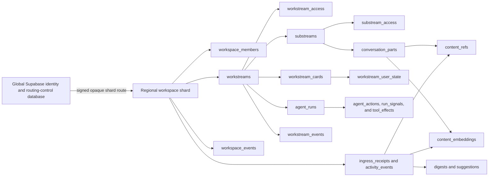

# Supabase workspace and work-stream conversations

> Created 2026-08-15.
>
> Avalon stores workspace, work-stream, conversation, activity, suggestion, and
> agent-run state in regional Supabase project shards. Regional Postgres is the
> authority; private Realtime Broadcast accelerates delivery; Supabase Queues,
> Cron, Storage, and pgvector provide durable scheduling, object, and search
> services. Cloudflare Workers provide all application compute, and one data-
> minimal Cloudflare Workflow drives every inference run: one full loop or one
> bounded one-shot inference.
> Companions: [`state.md`](state.md), [`flows.md`](flows.md), the underlying
> [`research.md`](research.md), and the technical/economic
> [`comparison.md`](comparison.md). The newer full three-way comparison,
> including the hybrid design, is
> [`here`](../2026-08-16_hybrid-workstream-do-supabase/comparison.md).

## Summary

Avalon should not reproduce a Durable Object hierarchy inside Supabase. The
idiomatic Supabase architecture is one shared Postgres authority per product-
data region. Every workspace and work stream is a row-scoped aggregate inside
that authority. Short database transactions serialize writes to a work stream,
allocate its one conversation sequence, update common and person-specific
sidebar state, append replay events, and enqueue follow-up work atomically. The
database can therefore make a work-stream update visible in **Work Streams**,
**In Progress**, **Completed**, **You Are Mentioned**, **Unread**, and **Needs
Your Input** without delivering a fallible child-to-parent projection.

The initial topology is exactly one EU Supabase product shard, one Global/US
product shard, and one required global Supabase control database. A shard is a
whole Supabase project and residency/capacity unit. Additional regional shards
remain a production-driven Supabase scaling option; this version does not
create them, but bounded staging tests exercise the launch topology and hot
paths before production. The global database owns stable identity
bindings, billing references, invitations,
the regional-shard directory, workspace route/epoch, and idempotent routing-
control outbox/receipts. It stores no work-stream title, description, message,
activity, suggestion, embedding, or person-specific sidebar state. Every
product transaction stays inside the workspace's assigned regional shard. The
existing Avalon identity provider remains the primary authentication authority
and is configured as a Supabase Auth Custom OIDC provider in every project.
Authorization Code with PKCE exchanges that login for one project-local
Supabase Auth access/refresh session. Supabase Auth owns each project session;
Avalon's stable OIDC `(iss, sub)` maps the project-local `auth.users` identity
to one stable Avalon person.

Conversation storage follows how language models consume context without
turning the whole transcript into one mutable JSON document. `substreams`
describes explicit context lanes and inheritance. `conversation_parts` holds
one work-stream-wide order of user, assistant, tool, attachment, compaction,
terminal, and control parts. A deterministic materializer selects an authorized
fence and produces a provider-valid message array. The same model supports the
shared feed, private contextual chats, human forks, and bounded sub-agent work.
Substreams are semantic context boundaries, not database shards, tabs, per-turn
buckets, or independent security domains.

User messages are committed before acknowledgement. A normal queued message is
eligible at the next admission boundary and does not invalidate current work. A
steering message commits the same durable user part but also increments the run
control revision and requests interruption. A Workflow event can wake a waiting
loop immediately, while database revision checks before output commit and
before irreversible effects are the safety mechanism when notification is late
or lost.

A full agent loop—not merely one model turn—usually lasts 2–30 minutes and can
rarely exceed two hours during coding. Daytona remains the Terminal plugin's
execution provider. One Terminal call is usually seconds, p95 is under a minute,
and the tail may take 3–5 minutes or longer. One Cloudflare Workflow represents
the full loop, and every bounded one-shot inference has its own Workflow run.
The Workflow itself performs every model, tool, Terminal, compaction,
suggestion, and embedding inference action; ordinary Cloudflare Worker handlers
remain only for APIs, Workflow creation/signalling, and non-inference queue
work. Persisted Workflow state contains only opaque IDs, revisions, cursors, enums,
timing, and hashes while all product state remains in Supabase. There is no
Supabase Edge Function or home-grown Queue/Cron workflow-engine fallback. EU
residency in this PRD is a durable-data promise: EU Database, Storage objects,
vectors, and Database backups remain in the approved EU shard. Transient Realtime, CDN, log,
Worker, Workflow, model-provider, and Daytona processing may be global under
the applicable DPA. Configuration and continuous controls—not a separate
contractual Cloudflare regional-processing guarantee—provide execution-path
assurance.

Private Supabase Realtime Broadcast provides low-latency, renderable common-card
and personal-overlay patches, active-output text, and bounded inline semantic
parts, including tool calls and results. It is still not the event log.
Durable `workspace_events` and `workstream_events` carry monotonically ordered
replay cursors. The launch path appends deltas to a bounded 16 KiB active-output
chunk at most every 500 ms while observed and every second while unobserved. The
checkpoint transaction also calls database Broadcast with the new text and up
to two prior committed deltas. This creates one managed `realtime.messages` row
per checkpoint so Broadcast Replay can accelerate recovery. Clients deduplicate
by attempt/revision/offset and fetch only bytes after their durable offset
through live RLS when an overlap or replay does not close a gap. Final output seals as one immutable
conversation part. The desktop animates committed batches at 20 frames per
second by default; reduced-motion clients show each batch without animation.
Reconnect always recovers from the database. One regional Realtime WebSocket
multiplexes an active workspace and a small set of foreground work-stream
topics. When an active run or completion obligation exists, a background app
retains one user-level notification socket per regional shard containing active
work. With no active obligation it closes after a grace period and catches up
by cursor rather than consuming an idle connection forever or reconnecting
every few minutes.

Connector ingress, normalized activity, digests, suggested work streams, and
suggested actions also live in the assigned regional shard. Signed webhook receipts
and large raw bodies are stored once; logged Queues normalize and derive them;
Postgres records provenance, access/recipient scope, source watermarks, lifecycle, and user
feedback. A suggestion is not a work stream until an acceptance transaction
creates one. Supabase Storage holds large immutable bodies behind authoritative
`content_refs`. Postgres full-text search and pgvector provide authorization-
aware hybrid retrieval. Supabase Vector Buckets remain a later, rebuildable
option because they are public alpha and do not yet match the transactional and
authorization needs of the launch path.

The Supabase design does not require a Durable Object fleet migration control
plane. Schema changes are regional Postgres deployments using expand/backfill/
contract. Large transformations and D1/R2 imports use regional campaign, job,
receipt, and exception tables processed in bounded queue-backed slices. The PRD
specifies that smaller control surface because it is required for safe rollout,
but it does not create a separate migration-control-plane companion. The D1/R2
authority cutover uses a scheduled read-only maintenance window of at most 15
minutes for the final copy, verification, source-closure receipt, and Supabase
activation; it does not dual-write.

## Motivation

The Durable Object design makes one process the serialized authority for each
workspace and work stream. That is useful on an actor platform, but an awkward
shape on a relational platform. Emulating it with one queue, schema, database,
or Realtime channel per entity would discard Postgres transactions while
retaining cross-owner delivery problems and fleet-management overhead.

Supabase changes the pressure. Work-stream state and workspace sidebar state can
commit in one regional transaction. A relational query can combine common
work-stream metadata with the current person's sparse overlay. Connector events,
digests, suggestions, and search already benefit from regional SQL. Supabase
also puts its durable queue in Postgres, allowing the job and its originating
state mutation to commit together.

The architecture still needs deliberate boundaries. A regional shard primary is
a shared contention and failure domain. Realtime is not durable history.
Supabase Auth sessions, RLS, and Realtime connections are project-local even
when every project uses the same Avalon Custom OIDC provider. The global route database
and a shard cannot commit atomically. Cloudflare Workflow/Worker execution and
Supabase product state cannot commit atomically. Storage bytes are not recovered by
database PITR. External model, connector, and Daytona calls cannot be atomic
with Postgres. Treating those limitations as explicit contracts is safer than
hiding them behind one service name.

## Goals

1. For this version, make regional Postgres the only product-data authority for
   a workspace's metadata, work streams, conversations, sidebar projections,
   activity, suggestions, files, search metadata, and run state.
2. Serialize every canonical work-stream mutation with a short database lock
   and transaction, including common workspace collections, sparse per-person
   attention state, durable events, and required queue messages.
3. Store conversation content as ordered, typed, provider-neutral parts and
   explicit substreams that deterministically materialize into valid model
   message arrays at an authorization and context fence.
4. Support shared main conversations, private contextual chats, forks, and
   bounded sub-agent investigations without turning them into separate work
   streams or leaking their access scope through compaction, search, or previews.
5. Commit both queued and steering user messages before acknowledgement. Queue
   preserves the active attempt; steer invalidates stale work and prevents a
   later irreversible effect from starting against superseded context.
6. Run generic full agent loops lasting 2–30 minutes and rarely 2+ hours across
   work-stream and non-work-stream owners, with durable retries, event waits,
   deployment survival, usage telemetry, and uniform at-least-once effect
   retries under one stable Avalon operation ID.
7. Keep Daytona as the Terminal execution provider and reconcile long commands
   by provider reference rather than retrying them after a Workflow action timeout.
8. Deliver human-realtime tokens and sidebar changes through private Realtime
   Broadcast while using durable database cursors for every reconnect, gap,
   authorization change, and terminal convergence.
9. Avoid row-per-token storage, per-work-stream sockets, unnecessary idle-
   background socket waste, high-frequency empty polling, and one Realtime fan-
   out message per database row while retaining a notification-only regional user socket
   for active-run completion obligations.
10. Store connector ingress, activity, digests, suggested work streams, and
    suggested actions with durable provenance, deduplication, access/recipient scope, expiry,
    feedback, and exactly-once promotion semantics.
11. Use private regional Storage and `content_refs` for large payloads, and use
    authorization-filtered Postgres FTS plus pgvector for exact and semantic
    retrieval without making a vector index authoritative.
12. Keep EU durable product data—Database, Storage objects, vectors, and
    Database backups—inside
    the approved EU regional shard and fail closed rather than failing durable
    data over across a residency boundary. Permit transient Realtime/CDN/log,
    Cloudflare Worker/Workflow, model-provider, and Daytona processing globally
    under the applicable DPA, with configuration-based assurance and continuous
    controls.
13. Migrate from D1/R2 and evolve the regional schema through observable,
    pausable, idempotent, bounded campaigns without waking or instantiating an
    entity fleet and without two long-lived write authorities.
14. Make cost grow with active users, useful stream frames, durable checkpoints,
    stored content, and bounded work—not historical work-stream count, idle
    sockets, row-per-token writes, or duplicate cross-service projections.
15. Continue using UUIDv7 for every newly generated Avalon-owned opaque UUID so
    distributed IDs retain temporal locality across Postgres, Workers,
    Workflows, clients, and a possible future export target. UUID order is only a
    temporal sorting/locality aid; explicit domain sequences and revisions
    remain the canonical ordering and fencing mechanism.

## Non-goals

1. This PRD does not create one Supabase project, database, schema, queue,
   function, or process per workspace or work stream.
2. The launch version does not create a synthetic workspace or work-stream
   actor. The database aggregate and command API preserve logical ownership
   without a resident process.
3. This PRD does not store regional product metadata in the global control database or create
   global search, global vectors, a global inbox, or cross-region product SQL.
4. This PRD does not silently fail an EU workspace over to a Global/US project.
5. This PRD does not assert that Supabase project selection alone satisfies
   GDPR or a customer's residency contract.
6. This PRD does not expose canonical tables for arbitrary client writes. The
   client uses RLS-protected views and narrow transactional RPCs.
7. This PRD does not use Realtime Broadcast, Broadcast Replay, Presence, logs,
   or a Cloudflare Workflow as canonical product state.
8. This PRD does not use Postgres Changes for token streaming or high-fan-out
   workspace feeds.
9. This PRD does not keep every background desktop client connected forever,
   nor force periodic two- or three-minute WebSocket reconnects.
10. This PRD does not store a database row per generated token or rendered
    frame, and it does not delay all output until the final assistant part.
11. This PRD does not make an entire full agent loop one Worker request,
    database transaction, queue visibility window, or retryable Workflow step.
12. This PRD does not make every agent loop a work stream. The run model is
    owner-neutral and domain state remains with its owner tables.
13. This PRD does not promise exactly-once external side effects. Every provider
    call is retried automatically under the same Avalon operation ID; providers
    that ignore idempotency may perform a duplicate effect.
14. Terminal remains on its existing Daytona provider under the separate
    Terminal subsystem contract; Cloudflare Workers and Workflows do not run
    shell commands.
15. This PRD does not use substreams as storage shards, UI tabs, one-per-turn
    containers, independent authorization roots, or substitutes for work
    streams. A substream may only inherit or further restrict its parent access.
16. This PRD does not delete source messages merely because compaction produced
    a summary.
17. This PRD does not treat a suggested work stream as a real work stream before
    an authorized acceptance transaction succeeds.
18. This PRD does not use Supabase Vector Buckets for launch-critical search or
    authorization while that product remains public alpha.
19. This PRD does not use Supabase Edge Functions or construct a second workflow
    engine from Queue/Cron leases. Cloudflare Workers/Workflows are the one
    application compute plane.
20. This PRD does not build or continuously test a compatibility subsystem for
    a hypothetical future runtime. Postgres remains the only authority unless a
    future superseding PRD explicitly chooses and designs a migration.

## Product behavior

### Workspace collections, sidebar, and work streams of interest

Opening a workspace calls one paginated regional snapshot RPC. It returns
common work-stream cards, the current user's sparse overlays, collection counts,
and a durable `workspace_seq` cursor. It never fans out to work-stream processes.

The render-complete common card contains the work-stream ID, title, short
description/objective, origin, created time, last people-visible activity time,
latest conversation sequence, exact run state and blocker/terminal reason,
lifecycle family, short preview, active-agent summary, needs-input flag,
compact participant/activity counts, completion/error timestamps, and common
revision. Full message bodies, the full description, participant lists, and
mention details are fetched only when their surface opens. Every exact state
maps to one family:

| Exact state/reason | Sidebar family |
| --- | --- |
| `scheduled`, `preparing_context`, `running`, `interrupting`, `waiting_capacity` | `in_progress` |
| `needs_input` with an ordinary question or missing choice | `in_progress` |
| `completed`, `cancelled_cleanly`, `archived` | `completed` |
| `failed` or `needs_input` with an operator intervention | `error` |
| `deleting`, `restoring` | hidden by the visibility gate |

**Work Streams** is every visible real work stream. **In Progress**,
**Completed**, and **Error** are indexed predicates over the common row. Date
groups use the same documented `last_activity_at` or `completed_at` field and
workspace timezone; they are not client guesses.

The render-complete person-specific overlay contains a monotonic seen waterline,
unread count and ordinals, mention ordinals, latest mention time,
`needs_your_input`, assignment state, pin, mute, dismiss, last opened, and per-
person revision. Only displayed collection/attention counts are cached; detailed
mention and participant data is refetched. **You Are Mentioned**, **Unread**,
**Needs Your Input**, and **Pinned** are indexed overlay predicates. **Of
Interest** on the main screen is the documented union of pin, mention, unread,
assignment/input need, accepted suggestion, and recently opened/active signals.
No opaque recommender silently changes this collection.

The system does not eagerly create one overlay row for every member and work
stream. It creates one when the person opens, is mentioned or assigned, needs
input, pins/mutes/dismisses, accepts a suggestion, or otherwise differs from the
default. A message may explicitly mention at most 250 people; affected sparse
overlays are created asynchronously in bounded batches from the committed
attention event. Group and workspace mentions always append one recipient-
scoped attention event and expand lazily rather than synchronously writing one
row per member.

Marking seen is a monotonic RPC. It advances only to a sequence or attention
ordinal the caller is authorized to see and never moves backward or into the
future. Rendering, Presence, and an open socket do not mark content seen.

The same transaction that changes a work-stream title, state, last activity,
message attention, mention, or assignment updates the common row, direct sparse
overlays, canonical attention/mention facts, appends workspace/work-stream
events, and queues required follow-up. Explicit mention overlays are the one
intentional asynchronous exception: at most 250 are materialized in bounded
batches, while snapshot/collection queries fold any pending authorized mention
event so **You Are Mentioned** never waits for the projection. There is no
cross-object delivery to repair. The commit transaction Database-Broadcasts the
actual bounded common card patch and each directly affected personal overlay
patch, including its durable sequence and field revision. A missed patch is
recovered from `workspace_events` plus the current RLS-filtered projection.

### Activity ingestion, digests, and suggestions

A connector delivery enters the assigned shard through its regional Cloudflare
Worker HTTPS hostname. The Worker verifies the provider signature, timestamp,
replay window, installation, and size before accepting content. It records one
receipt keyed by installation and provider event ID, or by a documented semantic
hash/window when the provider has no stable ID. A repeated ID with the same body
returns the prior receipt; the same ID with different bytes is quarantined and
audited.

Large raw bodies go to private regional Supabase Storage through a pending-
then-ready `content_refs` lifecycle. The receipt and a logged
`connector_ingress` queue message commit atomically. A bounded worker creates
immutable normalized activity facts, version/tombstone records, resource links,
access scopes, and reconciliation cursors. Raw receipts are evidence and replay
input; normalized activity is the product-facing authority; vectors and
Realtime are neither.

Digests freeze an authorized activity watermark, timezone, access/recipient scope, source
revision, and model/prompt version. Late events enter the next digest or an
explicit revision. Model generation and delivery are separate, idempotent
effects. Revocation between selection and commit invalidates the artifact.

Opportunity processing creates `suggestions` and their source links. A suggested
work stream is a proposal with provenance, score, explanation, target recipients,
expiry, and lifecycle. It appears in **Suggested** or the appropriate personal
surface, never in real work-stream collections. Accepting it runs one
transaction that revalidates source access, creates the work stream and initial
parts, updates the sidebar, records the accepted ID, and emits events. A retry
returns the same work stream.

A suggested action targets an existing work stream or external object but does
not execute until a person approves it or a separately defined policy permits
autonomy. Acceptance records a generic run/effect intent with the same revision
and idempotency rules as any other agent action. Dismissal, expiry, feedback,
source deletion, and access revocation are durable and recipient scoped.

### Main conversation and LLM message arrays

The main feed is the root `substream` of a work stream. Every accepted user,
assistant, tool, attachment, terminal, compaction, or control part receives one
monotonic `seq` under a short lock on the `workstreams` row. A logical turn has a
`turn_id`; provider-valid tool-call/result adjacency is captured by explicit
relations and materialized correctly even if a human message arrived while the
tool was running. Physical arrival order is retained, while the model projector
admits complete units according to the documented admission fence.

Specifically, a human part that arrives after a tool call but before its result
keeps its physical `seq` and is shown as queued while the tool exchange is open.
The tool turn receives the next `admission_ordinal` only when its result/error is
sealed; the queued human turn receives the following ordinal. Provider context
therefore orders assistant tool call, tool result/error, then user input. The UI
may show the user's wall-clock arrival between live tool statuses, but the
provider array never places a user role inside a required call/result pair. This
is an explicit projection rule, not a claim that physical and provider order are
always identical.

The projector is a deterministic, versioned database/application function over:

- the requested work stream and substream lineage;
- an inclusive work-stream sequence fence;
- the current workspace, work-stream, substream, connector-resource, and
  context-scope revisions relevant to the requested materialization;
- complete, visible turns and tool-call/result pairs;
- applicable, still-valid compaction summaries;
- promoted child summaries and referenced content versions;
- a provider adapter that maps neutral roles and typed parts into its wire
  format.

It produces the same logical array on retry and records the materializer and
provider-adapter versions, source fence, hashes, and every relevant access/
scope revision on the run action. Compaction and redaction are applied at that
frozen fence. A promoted child contributes only its provenance-bearing summary/
reference. Provider wire payloads are not canonical history. Small text may be
inline; large bodies resolve from ready `content_refs`. Missing, corrupt,
unauthorized, or revised content fails materialization explicitly rather than
silently changing the prompt.

### Queued and steering messages

Every user input command supplies an idempotency key, expected work-stream
revision, and mode `queue` or `steer`. The append RPC authenticates live
membership, locks the work stream, commits the user part and attention/sidebar
effects, appends durable events, and advances run-control state before success.

A queued message does not increment the interrupting control revision. The
active attempt may finish, and the next admission boundary batches every
eligible queued input exactly once in canonical order. A sender can see that
the message is committed and waiting.

A steering message increments `control_revision`, sets
`interrupt_requested_at`, and records the requested boundary. After commit the
API sends the durable `run_signal` ID to the attached Cloudflare Workflow with
`sendEvent`; Realtime is not the run-control bus. A cooperative active model
request is aborted when possible. An ordinary read-only tool may finish if stopping it is
unsafe or unsupported, but its result cannot be admitted against the stale
revision. No new irreversible effect may begin after the steering revision
commits: the effect-begin RPC checks the current revision in the same transaction
that records intent.

If the notification is lost, the Workflow learns at its next database fence.
If a provider cannot cancel, its late output is recorded as superseded diagnostic
state or discarded and never seals the winning assistant part. If an external
write already began, the system reconciles its idempotency/provider reference
and tells the user what happened; steering does not rewrite reality.

Multiple steering messages coalesce by revision into one deterministic next
admission batch. Queue/steer commands remain ordinary transcript history; a
control flag cannot exist without its durable user part.

### Chats, forks, sub-agents, and substreams

Supported substream kinds are deliberately finite:

| Kind | Purpose | Inheritance | Default access |
| --- | --- | --- | --- |
| `main` | Shared work-stream history | none; it is the root | inherit work-stream access |
| `private_chat` | Private contextual exchange | frozen visible parent fence | explicit people/agent access |
| `human_fork` | Explore from an exact completed past | frozen parent fence | creator-selected restricted access |
| `subagent_fresh` | Bounded independent investigation | explicit task packet only | owning agent and permitted viewers |
| `subagent_fork` | Investigation inheriting an exact parent context | frozen parent fence | owning agent and permitted viewers |
| `document_chat` | Focus on a versioned resource | frozen or explicit live version policy | intersection with typed resource access |

Substreams should be used when content has a coherent model-context boundary
inside one work stream and its result may be summarized or promoted. They keep
private chat or tool chatter out of unrelated future prompts while preserving
one audit order.

Substreams should not be used for pagination, storage distribution, one model
turn, one tool call, one user, one UI tab, one socket, arbitrary tags, or access
control by identifier alone. A body of work needing its own title, sidebar card,
participants, lifecycle, retention, completion, or independent objective is a
work stream. A depth limit, explicit parent, base sequence, inheritance mode,
scope revision, lifecycle, and promotion relation prevent branch bombs and
ambiguous ancestry.

Every part retains the one work-stream-wide `seq`; substream-local order is
derived. RLS checks workspace, work stream, and the part's owning substream, not
mere possession of a substream ID. Promotion appends a provenance-bearing
summary/reference into the target substream; it does not retroactively widen
the child's access.

### Active runs, streaming, and steering

A full loop starts when committed input is admitted and ends only at
`completed`, `waiting_user`, `failed`, `interrupted`, `cancelled`, or another
product terminal state. It can contain many model turns, tool calls, Daytona
commands, retries, compactions, and waits. It is not one inference request and
not one user/assistant turn.

`AgentLoopWorkflow` creates one Workflow instance per full loop. The
deterministic Workflow instance ID is stored directly on `agent_runs`; there is
no separate driver binding, run lease, Postgres wait scheduler, or agent Queue
consumer. Persisted Workflow input/results contain only shard routing,
owner/run IDs, revisions, cursors, action enums, timing, and integrity hashes.
Within a Workflow step, the Workflow code loads canonical context from
Supabase, begins one fenced semantic action, calls the model, tool, connector,
or Daytona provider, and commits or reconciles the result. Tokens and tool
payloads may exist transiently in the running step, but never appear in a
persisted Workflow step result or instance parameter. The token path is
provider -> Workflow step -> Supabase checkpoint/database Broadcast -> desktop.

Workflow owns action sequencing, retry timing, sleeps, and event waits. Postgres
stores only product-semantic truth: the run lifecycle and control revision,
completed/active action receipts, external-effect intents and provider
references, content checkpoints, terminal state, usage, and durable product
signals. A model request is one bounded semantic step; an ordinary seconds-long
tool call is another. A long Daytona command is started once with a durable
provider command ID, then the Workflow sleeps or waits for an event and
reconciles in later steps rather than holding a retryable request or polling
continuously. This supports ordinary 2–30 minute loops and rare 2+ hour coding
sessions without making one full loop one step.

A steering transaction commits the user part and advances
`agent_runs.control_revision` before acknowledging, then sends an identifier-
only Workflow event. Cloudflare buffers an event sent after instance creation
even if the matching `waitForEvent` step has not yet been reached. If the
Workflow is waiting, that event wakes it. `sendEvent` cannot interrupt code
already running inside a step, so an active model stream observes steering
through the next `checkpoint_active_output` compare-and-set: the RPC rejects the
old control revision, and the Workflow aborts the provider stream. At the
selected cadence, safe inference interruption is normally detected within
500 ms while observed or one second while unobserved. Every irreversible effect
also begins through a fresh control/access check and committed effect intent.
The race after intent commit is resolved by the stable Avalon operation ID. A
provider that honors it deduplicates retries; one that does not may execute a
duplicate, which is an explicit at-least-once risk.

### Token streaming and realtime socket lifecycle

Time to first token is normally 1–5 seconds. Provider token cadence, provisional
UI frame cadence, durable checkpoint cadence, and final semantic-part cadence
are four separate clocks. **No token causes a database write.** The Workflow
buffers deltas and, at launch, calls `checkpoint_active_output` at most every
500 ms while observed, every one second while unobserved, when the open 16 KiB
chunk would fill, or immediately at a semantic/final boundary. It sends no
checkpoint when no new bytes arrived.

The checkpoint RPC sends only bytes after the last durable offset plus expected
run/attempt/control revisions, frame range, provider cursor, and hash. After
first-chunk creation it uses the open tail as the recurring CAS/lock gate,
rejects stale/gapped input, and mutates only that bounded
`active_output_chunks` row; crossing 16 KiB seals the chunk and inserts the next
in the same transaction. Sealed chunks are immutable. It does **not**
rewrite the complete accumulated response, update the sidebar/work-stream/run
row or append a domain event on every checkpoint. It does insert exactly one
managed `realtime.messages` Broadcast row for each nonempty checkpoint. The
Workflow permits one checkpoint RPC in flight and retains the
unacknowledged delta, so a lost response retries the same expected offset/hash
instead of creating a receipt row per checkpoint.

The same checkpoint transaction calls `safe_realtime_send` on the current private
access-revision topic. Its `stream_batch` payload contains run, attempt, part,
checkpoint revision, frame sequence, start/end byte offsets, hashes, the actual
new UTF-8 text, and up to the two previous committed deltas retained by the
running Workflow. Each overlap entry carries its own offsets/hash. The RPC
validates every supplied overlap range against canonical chunks before
broadcasting it; after a Workflow restart it may send fewer than three entries.
The total application envelope is capped at 192 KiB even though the paid-plan
platform limit is higher. When Realtime has an active replication subscriber,
this transactional database-Broadcast path adds WAL and one ephemeral Realtime
row but ensures no client sees coordinates or text
for bytes that did not commit. It also makes the event eligible for Supabase's
72-hour Broadcast Replay, currently limited to 25 messages per request.

The client applies only the suffix beginning at its exact durable byte offset.
A single missed batch is normally reconstructed from the next message's
overlap; reconnect may request Broadcast Replay from its last receive time. A
remaining attempt/revision/offset/hash gap calls the RLS-protected
`active_output_after(attempt_id, byte_offset)` RPC, which returns every newly
durable byte after that offset—not merely the latest checkpoint. The Electron
main process permits one catch-up fetch per attempt and coalesces newer gaps.
Realtime accelerates delivery; Postgres remains the complete recovery source.
Broadcast unavailability never rejects or rolls back the checkpoint.

Committed semantic events use the same pattern. A `parts_batch` Broadcast
contains the current authorized semantic batch and, while the 192 KiB envelope
cap permits, the two preceding complete Broadcast batches selected from the
durable event log. Each included batch carries the actual inline text, tool-call
JSON, and tool-result JSON plus part IDs, durable event cursors, order, access
revision, and content hashes. The newest batch is required and older batches
are included newest-first without truncating structured JSON. If the current
batch alone would exceed the envelope, the transaction commits normally and
Broadcast carries the bounded renderable parts plus `content_ref` metadata for
the oversized bodies; the client obtains those bodies through the authorized
content path. Text or structured content beyond the canonical inline 256 KiB/
64 KiB limits is always a private `content_ref`. Clients dedupe parts by ID/
cursor and use `events_after(last_cursor)` for any unresolved gap.

Transport cadence and visual cadence are independent. The desktop queues each
fetched delta and drains it via `requestAnimationFrame` at 20 visual frames per
second by default. It allocates available tokens or characters across the
frames until the next expected batch; it does not assume one model token per
frame. At 100 tokens/second and 500 ms checkpoints, each batch is about 50
tokens, so 20 fps renders about five tokens per frame over the next half second.
This is continuous visual motion while the transport remains near 2 Hz. A
reduced-motion client displays the fetched batch immediately without per-token
animation. A bounded-lag controller
accelerates when a late batch arrives, pauses rather than inventing content if
the buffer empties, never renders beyond the committed byte offset, and flushes
or reconciles to the sealed final part on completion. Switching work streams
preserves a separate animation queue and committed/displayed offset for each.
Realtime messages carry the actual bounded content plus durable coordinates.
Clients reject old attempts, duplicate ranges/parts, hashes that do not match
their bytes, gaps, and offsets below the last sealed or checkpointed byte.

`active_output_attempts` holds stable attempt identity and lifecycle;
`active_output_chunks` holds the bounded mutable tail and immutable earlier
chunks. Checkpoint revision, byte offset, frame sequence, token estimate,
provider cursor, and hash advance only in the transaction that stores all bytes
they describe. Approximate token-usage progress rides the chunk checkpoint and
the exact run counter settles at the model-step boundary; there is no separate
per-token counter update. For output at or below 256 KiB, completion locks the
attempt, verifies the ordered chunk hash/offset, inserts one inline sealed
assistant part, updates semantic run/work-stream state and durable events, and
marks the attempt sealed in one transaction. Larger output first uploads one
immutable private-Storage object through the pending/verified `content_refs`
protocol; the active chunks remain recoverable until a later terminal
transaction inserts the part by ready content reference and seals the attempt.
Chunk deletion is bounded asynchronous cleanup after the recovery window rather
than a large finalization transaction. Advancing a durable cursor without its
bytes is forbidden.

#### Checkpoint write model

For token rate `R`, total tokens `N`, and checkpoint interval `I` seconds, a
continuous observed generation lasts `N/R` seconds and produces approximately
`ceil((N/R)/I)` checkpoint transactions—not `N` transactions. Chunk-boundary
row inserts are `O(output_bytes / 16 KiB)`. Actual physical WAL, TOAST, index,
vacuum, PITR, and disk I/O can exceed logical row mutations and must be measured
on the chosen compute/disk tier.

For the required worked case—100 tokens/second, 10,000 tokens, 500 ms observed
checkpoints, and an explicit planning assumption of four UTF-8 bytes/token:

| Quantity | Result |
| --- | ---: |
| Generation duration | 100 seconds |
| Tokens / estimated bytes per checkpoint | 50 / about 200 bytes |
| Durable checkpoint transactions | 200 |
| Bounded 16 KiB chunks for about 40 KiB output | 3 |
| Streaming content-row mutations | About 200 updates plus two boundary insert/seal operations |
| Final semantic transaction | 1 |
| Database Broadcast inserts/sends | 200 |
| Billed Realtime messages with one receiver | 400: 200 sends + 200 deliveries |
| Realtime text delivered to one continuously observing client | About 120 KiB at steady-state three-delta overlap for about 40 KiB unique text, plus protocol overhead |
| Desktop visual cadence | 20 fps by default from the same 2 Hz batches; reduced motion shows each batch immediately |
| Tokens rendered per visual frame at 20 fps | About 5 while draining each batch |

At one second the same run has about 100 checkpoints and 200 Realtime messages
for one receiver. A naive token-write design
would issue 10,000 streaming transactions—50 times the 500 ms design—and is
rejected. A single such run is well inside the architecture; fleet safety is a
concurrency question. With `A` continuously observed streams at 500 ms, the
regional primary receives roughly `2A` checkpoint transactions/second, each
including one active-output mutation and one `realtime.messages` insert, and
Realtime sees `2A * (1 + average_receivers)` messages/second. For example, 100
streams with one receiver mean about 200 checkpoint transactions, roughly 200
active-output row mutations plus 200 managed Broadcast-row inserts, and 400
Realtime messages/second, before other traffic. One thousand mean about 2,000
and 4,000 respectively, above Supabase's currently documented default 2,500
messages/second for Pro without Spend Cap/Team and therefore require a vendor
limit increase, lower cadence/fan-out, vertical scaling, or an additional
regional Supabase shard. Database capacity is governed from production
WAL/IO/CPU telemetry; Supabase has no public per-row-write price that proves it
from arithmetic alone.

The checkpoint guarantees client reconnect to the latest durable provisional
bytes; it does not promise that a crashed model step can continue a
nondeterministic generation. If the provider supplies a verified resumable
cursor/event spool, the same attempt may resume and later seal. Otherwise the
entire incomplete attempt is marked superseded, the client may visibly retract
its provisional text, and a new attempt starts from the original model fence.
Two attempts are never spliced, and only one complete attempt can seal.

The Electron main process owns at most one physical Realtime WebSocket per
regional session. It joins the active workspace common/personal topics and only
foreground work-stream content topics; Supabase multiplexes them on that
socket. The client subscribes first, buffers Broadcast payloads, loads a snapshot
and durable cursor, applies newer payloads, then continues live. Sequence gaps fetch durable
events. Broadcast Replay's 72-hour/25-message bound accelerates short reconnects
but is never the recovery contract.

The app keeps the socket while foreground interaction, a visible active stream,
or a promised live completion requires it. It leaves stale work-stream channels
after a grace period but retains one notification-only user-level topic on one socket
per regional shard that still contains the user's active work. That topic
delivers completion/needs-input coordinates without generated bodies. When fully
backgrounded with no active-run or completion obligation, the shard socket
closes and catches up on focus. This avoids both repeated reconnect churn and
indefinitely billing a user with no active work. Presence is limited to online/
typing hints at human cadence.

### Switching between two streaming work streams

Suppose work streams A and B are both running and emitting assistant output.
Selecting either work stream changes observation only: neither full agent loop,
Workflow, provider request, tool, nor Daytona command is restarted
or cancelled. The Electron main process keeps independent per-work-stream
caches keyed by `workstream_id`, with the current `run_id`, `attempt_id`,
checkpoint revision, byte offset, content hash, durable event cursor, and active
text. The renderer never reuses one global streaming buffer for both work
streams.

While both runs are active, the preferred path keeps A and B's private logical
work-stream topics joined on the existing regional Realtime WebSocket. Switching
then changes only the selected cache and is immediate; it creates neither a new
physical connection nor a new inference request. This remains a small
foreground/running set, not a subscription to every pinned, unread, mentioned,
or background work stream. Supabase's paid-plan limit of 100 channels per
connection leaves ample protocol headroom for this two-stream case. Bounded
staging tests exercise two-stream switching, channel joins, payload overlap,
Replay, catch-up, and the expected launch concurrency before production.

If B's topic was evicted, the client joins it first and buffers Broadcast payloads before
fetching an authorized hydration RPC. One SQL statement snapshot returns the
visible immutable `conversation_parts` page, current `active_output_attempts`
root and ordered `active_output_chunks` if any, attempt/revision/offset/hash,
and an authorized durable `scanned_through` watermark. The client installs that
snapshot, discards buffered payloads at or below its watermark/revision, applies
newer payloads, and calls `events_after(cursor)` or
`active_output_after(attempt_id, byte_offset)` when it detects a sequence,
revision, or offset gap. Broadcast Replay is optional acceleration only; it is
not the recovery source.

A UI-only switch therefore loses no accepted message, immutable part, or
durably checkpointed provisional byte. The launch path displays verified text
from content-bearing Broadcast after the checkpoint transaction has stored the
same bytes and offsets; any missing overlap is fetched through live RLS.
The newest Workflow-produced bytes may be up to the 500 millisecond launch-default
observed checkpoint interval behind, or up to one second after observation
stops, but appear after the next commit. Completion atomically replaces
the active attempt with its immutable final part, so hydration sees a coherent
active or sealed state even when completion races the switch.

Payloads and caches from an old `attempt_id` are discarded rather than spliced
into a replacement. If the Workflow/provider cannot resume a failed
nondeterministic attempt, either work stream may still perform the already
documented whole-attempt reset and visibly retract provisional output. That is
inference recovery, not loss caused by switching. Content-bearing Broadcast,
offset/hash validation, Replay, and live-RLS catch-up ensure every displayed
offset is durably recoverable.

### Compaction while messages continue

Compaction never rewrites the mutable conversation head. A transaction freezes
a complete-turn source range, content hashes, substream lineage, every relevant
workspace/work-stream/substream/connector-resource access revision, the
context-scope revision, and compactor/model version into a unique job.
Messages sent during compaction allocate higher work-stream sequences normally
and are not observed by the job.

The compaction Workflow reads exactly the fence, performs one bounded inference
action, and
commits a derived summary only if every source, scope, and authorization input
still matches. The materializer then uses that summary for the fenced prefix and
ordinary parts above it. A retry returns the same summary by compaction key. A
permission, document-version, redaction, or lineage change invalidates the
result and schedules a new fence. Old parts remain under the retention/audit
policy; compaction alone is not deletion.

### Completion, errors, and offline recovery

Exactly one attempt wins each admitted input range. Unique constraints and
compare-and-set terminal RPCs reject late completions. A terminal transaction
seals output, updates the run and work-stream state, updates common/person
sidebar projections, appends both event streams, and enqueues any derived work.
The UI can therefore recover a coherent terminal card and transcript after any
lost Broadcast.

An error is classified as retryable, user-actionable, authorization
invalidation, infrastructure/capacity exhaustion, or permanent failure.
Uncertain provider responses are retried automatically under the original
operation ID; a provider without idempotency may duplicate an effect. The
sidebar maps terminal results deterministically. Operators can inspect opaque
IDs, revisions, timings, hashes, and error classes without routine content
access.

Offline writes carry idempotency and expected revision. Reconnect submits them
to the regional command API, receives the original result on duplicate, and
surfaces a conflict when semantics cannot be merged. Clients never infer
success from an optimistic row or Realtime echo.

## Impact on the product contract

This PRD changes infrastructure ownership, not the user-facing work-stream
model. The standing product contract gains explicit queue/steer semantics,
substream context rules, background socket lifecycle, durable event cursors,
suggestion provenance, and full-loop execution boundaries. Existing references
to a per-work-stream realtime coordinator or D1 as canonical conversation state
must be replaced by the regional Supabase command and event contracts.

The main intentional product differences are operationally positive:

- sidebar/common/personal state becomes transactionally current rather than an
  eventually delivered child projection;
- a client can query and paginate collections relationally without waking an
  entity fleet;
- all agent owners use one durable run interface while preserving their own
  domain tables;
- a disconnected client recovers from sequence-numbered database events rather
  than relying on socket retention;
- migration is a regional schema/data campaign rather than per-object wake-up.

The product must not expose implementation details such as queue visibility,
Realtime topic names, row locks, Worker invocation boundaries, or Workflow step
retries. It exposes committed, queued, steering, running,
waiting, terminal, and recovery states.

## Decision log

| Decision | Outcome | Reason |
| --- | --- | --- |
| Global control database | One required Supabase project with identity bindings, shard directory, workspace routes/epochs, invitations/billing, and routing-command outbox/receipts | Gives every client and global lifecycle command one non-product routing authority |
| Regional physical unit | Exactly one EU and one Global/US product shard initially, with bounded staging load/failure tests | Start simply, verify the hot paths, and select later tiers, limits, vertical scale, or shards from production and abuse observations |
| Authentication | Avalon IdP as a Supabase Auth Custom OIDC provider; Authorization Code + PKCE creates one project-local Supabase session | Uses the documented Auth/session path while preserving Avalon as the primary identity authority and stable `(iss, sub)` source |
| EU promise | EU durable data only: Database, Storage objects, vectors, and Database backups | Transient Realtime/CDN/log/Cloudflare/provider processing may be global under the DPA; configuration and controls provide assurance rather than a separate processing-location contract |
| Workspace/work-stream authority | Regional Postgres rows and functions; Supabase-only remains the selected architecture | Relational transactions solve sidebar projection and query needs directly; no future-runtime compatibility subsystem is built at launch |
| Serialization | Short `workstreams` row lock in a database function | Clear order without a resident actor or connection-scoped lock |
| Client API | Narrow RLS-protected views/RPCs; canonical tables private | Prevents partial multi-request mutations and centralizes live auth checks |
| Realtime authorization | Private content-bearing database Broadcast on workspace/work-stream/substream access-revision topics | Each access change rotates the logical topic by advancing its container revision, so an already-joined old topic receives no content committed after revocation |
| Realtime payload | Broadcast actual bounded card/overlay patches, token deltas, text parts, tool calls, and tool results with durable coordinates; include the preceding two complete batches when the envelope permits | Removes a normal-path body fetch while Postgres cursor/offset recovery, Replay, hashes, and access-revision topic rotation preserve correctness and revocation safety; managed-row and payload-egress cost is explicit |
| Event replay | Durable event tables retain seven days; older cursors require `snapshot_required` | Provides a clear offline contract without making Broadcast Replay or unbounded events authoritative |
| Background notification | One user-level Realtime socket per regional shard while that user has active work | Preserves completion/needs-input notification without retaining every work-stream channel or billing users with no active obligation |
| Sidebar cards | Render-complete compact common and personal fields; refetch detailed bodies/lists | Makes list surfaces immediate without turning cards into transcript or membership replicas |
| Mention fan-out | At most 250 explicit people, asynchronously materialized in bounded batches; group/workspace mentions expand lazily | Avoids synchronous Cartesian writes while retaining sparse user attention rows |
| Context materialization | Deterministic versioned materializer at frozen sequence, access-container, resource, and scope fences with pinned provider adapter | Retries produce provider-valid arrays without leaking compacted, redacted, or revoked content |
| Token persistence | Human/assistant text up to 256 KiB and structured bodies up to 64 KiB inline; larger/binary content in private Storage; 16 KiB mutable-tail chunks at 500 ms observed/1 s unobserved | Avoids row-per-token and ever-growing-row WAL/IO while bounding reconnect loss |
| Desktop stream rendering | Animate each 2 Hz committed batch at 20 fps by default; reduced motion displays batches immediately | Preserves perceived continuity without increasing transport cadence |
| Application compute | Cloudflare Workflow performs every inference-loop action; Worker handlers provide APIs, Workflow lifecycle, and non-inference queue work | One durable inference engine with no duplicate Postgres or Queue scheduler; Supabase remains product authority |
| Async jobs | Logged Supabase Queues plus Cron/Cloudflare Worker consumers | Atomic enqueue with domain state; content is processed only after shard Worker admission |
| Queue policy | Batches 32 with 60 s visibility, renew at 30 s through hardcoded least-privilege wrappers, DLQ after 10 reads | Defines one pull-based at-least-once contract without giving consumers a project-wide RLS bypass |
| Inference engine | One Cloudflare Workflow per full loop or bounded one-shot inference; Workflow owns steps, waits, retries, and timers | Gives work-stream and non-work-stream inference one implementation without reproducing a workflow engine in Postgres |
| Product budgets | No product-level limits initially; record usage and observe production/abuse | Product policy will be chosen from evidence; unavoidable platform/provider hard ceilings still surface as infrastructure/capacity failures |
| External effects | Uniform automatic retry under the same Avalon operation ID | This is at least once; providers that ignore idempotency may duplicate effects, while Daytona reattaches safely by named session/command ID |
| Terminal | Existing Daytona plugin/provider | The provider remains separately governed; long commands reconcile by provider ID |
| Large content | Private Supabase Storage plus canonical `content_refs` | Separates bytes from relational state without making Storage metadata authoritative |
| Search | Postgres FTS + pgvector/HNSW | Supports authorization joins and transactional lifecycle |
| Vector Buckets | Defer launch use | Public alpha and weaker proof for transaction/RLS/residency semantics |
| Retention | PITR 14 d; no application-level Storage recovery promise; active-data/derivative deletion 24 h; database-backup expiry 30 d; ops logs 30 d through a mandatory regional drain or Enterprise; content-free security/audit 1 y; provider/Daytona artifacts <=30 d; exports 7 d; scoped legal holds override | States only recovery and lifecycle guarantees the selected platform design can implement |
| Table partitioning | Never partition Postgres tables | Preserve ordinary relational tables/indexes and use bounded cleanup, vertical scaling, or later regional shards |
| Encryption | Platform encryption at rest/TLS/RLS for ordinary content; Vault for connector credentials after explicit Public Alpha acceptance; regional Worker secrets for model/Daytona credentials | Keeps searchable data searchable and defines cross-project credential re-keying without copying Vault roots |
| D1/R2 migration | Scheduled read-only maintenance window up to 15 minutes; final copy/verification/closure then activate Supabase; no dual writes | Simplifies authority transfer while retaining an independently verifiable source-closure receipt |

## Key design decisions

### Global database, regional shards, and routing control

The required global Supabase project is the sole global routing/control
database. A regional shard is one complete Supabase project with Database,
Auth Custom OIDC configuration, Realtime, Queues/Cron, Storage, and vectors. Launch has
`eu-1` and `global-us-1`; capacity may later add `eu-2` or `global-us-2` without
changing workspace IDs or creating one project per workspace. `region_key` is
immutable after workspace creation. `shard_id` may change only through the
fenced authority-transfer protocol, and every change increments `route_epoch`.

The desktop first calls the global routing Worker, which reads this database
and returns a signed, short-lived route envelope containing opaque workspace ID,
`region_key`, `shard_id`, regional API/Realtime origin identifiers, route epoch,
and expiry. It then creates the shard-local Supabase client with that project's
Supabase Auth session. Ordinary product reads/writes never proxy through the global database.
Every shard command carries workspace ID, shard ID, route epoch, operation key,
and no product body; the shard-local admission row rejects an old shard/epoch.

The global database is limited to:

- account identity and sign-in configuration;
- opaque organization/workspace IDs, immutable selected region, assigned shard,
  route epoch, lifecycle, and non-content shard health/capacity class;
- invitations that must be discoverable before regional workspace membership
  exists;
- billing/customer/entitlement references and non-product lifecycle state;
- a routing-command outbox, delivery attempts, shard receipts, and convergence
  status for create/suspend/delete/move/invite/entitlement operations.

A global lifecycle transaction updates its canonical global fact and appends one
`routing_commands` row. A Cloudflare Workflow/Worker dispatcher delivers that
identifier-only command to the target shard's regional Worker. The shard
transaction checks epoch and operation hash, updates its local
`workspace_route_gates`/regional identity or invitation state, stores a receipt,
and returns only the receipt ID/state. The dispatcher writes the acknowledgement
back globally. Retry is expected; a command ID plus payload hash is idempotent.
No synchronous transaction spans databases, and global `delivered` never means
the regional transaction happened unless a matching shard receipt was observed.

The global directory is not the authority-transfer linearization point. A shard
move closes the source shard's local write gate at a final cursor/epoch, copies
and verifies the destination, activates the destination only from that immutable
closure receipt, and then updates the global route as a retryable derived
pointer. A crash may make the workspace temporarily unavailable; it cannot make
both shards writable. Globally initiated deletion/suspension is deny-first: the
global route stops issuing writable envelopes immediately, while shard command
delivery is retried to converge stored state.

The existing Avalon identity provider is the primary authentication authority
for every project and exposes standards-compliant OIDC discovery, authorization,
token, UserInfo, and JWKS endpoints. Each Supabase project configures it as the
same named Custom OIDC provider. The Electron main process starts Supabase
Auth's Authorization Code flow with PKCE. Avalon's existing IdP session normally
completes that redirect without another credential prompt, and Supabase Auth
then creates or reuses a project-local `auth.users` row and returns that
project's access/refresh session. This is the selected token exchange; Avalon
access tokens are never presented directly to Data API, Storage, or Realtime.

The desktop first holds a global-project Supabase session so it can discover
routes. On first access to a regional project it completes the same PKCE flow
for that project and stores the resulting refresh session in OS-protected
main-process storage, never the renderer. It retains sessions only for projects
the user actually visits. Signing out revokes every locally known Supabase
session and then the Avalon IdP session. Account suspension/deletion also
advances the global and regional live account epochs, so authorization does not
depend on waiting for a project JWT to expire.

The stable application principal remains Avalon's OIDC `(iss, sub)`, captured
from the verified provider identity when the project-local Auth user is linked.
The first session in a project has no product access until the trusted routing
Worker validates that session with Supabase Auth, reads its Custom-OIDC identity
record, matches the provider subject to the globally routed Avalon person, and
upserts `platform_identities(auth_user_id, issuer, subject, platform_user_id)`.
The client cannot supply or change that mapping.
RLS resolves `auth.uid()` to that project's `platform_identities.auth_user_id`;
authorization data never comes from user-editable metadata. Supabase Auth owns
project access-token issuance, refresh-token rotation, session expiry, and
`session_id`. Every successful refresh invokes `realtime.setAuth()` with the
new access token before further content-bearing Broadcast is trusted; token
errors close the channel and force session recovery plus cursor catch-up.
Shared JWT secrets, imported signing keys, an Avalon-minted Supabase JWT, a
bespoke backend grant, and client-held service roles are rejected.

### Schemas, grants, and API boundary

Canonical application tables live in `avalon_private`; queue tables remain in
the managed `pgmq` schemas; Supabase-managed `auth`, `storage`, and `realtime`
schemas are not modified. An explicitly exposed `api` schema contains only
security-invoker views and command/query functions. New tables are not assumed
to be exposed by the Data API: migrations grant only required `SELECT`/function
execute rights and revoke default `PUBLIC` function execution.

RLS is enabled on every tenant-bearing `avalon_private` base table reachable
through a client-facing view or function, as well as every exposed table.
Canonical writes occur through
`SECURITY INVOKER` functions when possible. A necessary `SECURITY DEFINER`
function has `search_path = ''`, fully qualified identifiers, explicit live
authorization and tenant assertions, revoked public execution, and a narrow
grant. The project-wide `service_role`/secret key is treated as an RLS-bypass
administrator credential and is never described as narrow or used by ordinary
queue consumers. Server Storage/S3 credentials stay only in trusted regional
execution.

Cloudflare uses two shard-local least-privilege Postgres logins through
Supavisor transaction mode: `avalon_workflow_runner` can execute only the
reviewed run/action/effect/checkpoint/signal RPCs, and `avalon_queue_runner` can
execute only reviewed Queue wrappers. Neither role has `BYPASSRLS`, direct
table DML, Auth administration, or wildcard function execution. The privileged
RPCs validate workspace, run, expected revisions, and allowed operation kind
internally; possession of the login alone is not authority to choose another
tenant.

Views use `security_invoker = true`, receive only the least base-table grants
needed to execute, and inherit the underlying tables' RLS. UPDATE policies
include both `USING` and `WITH CHECK`, and the required SELECT policy. Every
membership/access/RLS predicate has a supporting index. User-editable Auth metadata never grants
access, and JWT workspace claims are not treated as fresh membership.

### Command transaction and lock order

All canonical mutations use one database function or trusted direct-database
transaction. A chain of PostgREST requests is not an atomic command. The common
work-stream command order is:

1. resolve the regional principal to `platform_user_id` and validate the live
   workspace membership/session epoch;
2. insert or find `command_receipts` by `(workspace_id, actor_id,
   operation_key)`, rejecting reuse with a different request hash;
3. lock `workstreams` with `SELECT ... FOR UPDATE`;
4. lock narrower existing rows in a stable documented order when needed;
5. verify expected work-stream, run-control, context-scope, access-container,
   and Workflow revisions;
6. allocate `workstream_seq`/attention ordinals and mutate canonical rows;
7. update common and sparse user projections;
8. append `workstream_events` and `workspace_events`;
9. enqueue a logged `pgmq` message when required and transactionally call a
   private `safe_realtime_send` wrapper around `realtime.send` with the bounded
   private renderable content/patch payload. The wrapper catches a Realtime delivery/partition
   failure, records only redacted metrics, and never rolls back canonical state.
   Active-output
   checkpoints use the same database Broadcast path so the payload and its
   revision/offset become visible only after the bytes commit;
10. finalize the command receipt and commit.

No transaction calls a model, connector, Daytona, Storage upload, external
HTTP endpoint, or waits for a user. `READ COMMITTED` plus explicit locks is the
default. `SERIALIZABLE` is used only for a measured invariant that cannot use a
known lock order, and callers retry SQLSTATE `40001`. `SKIP LOCKED` is for job
claims, never for user commands whose ordering must be explicit.

### Idempotency, outbox, and external effects

Idempotency is scoped to a real operation, never a global hash of tool name and
input. Repeating the same operation key with the same request returns its stored
result; reusing it with different bytes is an error. Queue deliveries have
semantic inbox receipts. Run effects use `(run_id, action_no, effect_kind,
effect_key)` so two intentionally repeated actions remain distinct.

An external side effect follows `planned -> started -> succeeded|failed`, with
an intermediate `response_uncertain` diagnostic state:

1. commit intent and its idempotency key;
2. call the provider outside the transaction;
3. commit the response/provider reference through a fenced RPC;
4. after a crash, timeout, or uncertain response, automatically retry the same
   provider call with the same Avalon operation ID.

This policy is uniform across model and tool providers. When a provider honors
idempotency, the repeated ID deduplicates the effect. When it ignores the ID and
offers no lookup, Avalon still retries and accepts that the external effect may
occur more than once. UI and audit surfaces disclose this at-least-once risk;
they do not invent an exactly-once guarantee or block waiting for a person.
Daytona is the safer special case because its deterministic named-session,
command ID, and log-offset protocol reattaches to the existing command rather
than launching another. An outbox is used only where a provider push/callback
cannot be part of the Postgres-native queue; it is drained with the same receipt
rules. Database Webhooks may accelerate an external notification but are not
the durable job bus.

### Supabase Queues/Cron with Cloudflare Worker consumers

Avalon uses a few logged Basic queues, not one queue per workspace/work stream:

| Logical queue | Contents | Consumer |
| --- | --- | --- |
| `workflow_starts` | Run ID, deterministic Workflow instance ID, expected revision | Workflow creation/attachment reconciler only |
| `workflow_signals` | Durable signal ID, run ID, deterministic Workflow ID, control revision, signal kind | Immediate Workflow `sendEvent` reconciliation only |
| `connector_ingress` | Ingress receipt ID and parser version | Normalizer |
| `sidebar_attention` | Attention event ID, bounded explicit-mention cursor, expected revision | Sparse overlay batch materializer |
| `derived_content` | Compaction, embedding, digest, suggestion job IDs | Workflow start reconciler for inference; typed Worker only for deterministic non-inference finalization |
| `maintenance` | Export, deletion, orphan, migration job IDs | Typed maintenance workers |

Queue bodies contain identifiers and expected revisions, not canonical content
or secrets. Enqueue occurs in the originating database transaction. Delivery is
treated as at least once end to end despite visibility semantics.
`workflow_starts` does not execute or schedule agent steps; it only closes the
transaction-to-Workflow-creation gap. The consumer
creates/fetches a unique receipt, commits the authoritative outcome, then
deletes an ordinary successful delivery or archives the message when auditable
delivery history is required. Trusted Cloudflare Workers pull with
`pgmq.read(queue_name, 60, 32)`: a batch of at most 32 and a 60-second visibility
timeout. Work expected to continue renews visibility after 30 seconds through
`avalon_private.queue_set_visibility`, a `SECURITY DEFINER` wrapper around
`pgmq.set_vt` that hardcodes the allowed queue names/ranges and requires the
current claim token, message ID, semantic key, and request hash, uses an empty
`search_path`, and has `PUBLIC` execution revoked. A message enters the explicit
dead-letter queue after ten reads only if the caller still owns that exact live
claim. Invalid bodies are claimed under `message-<queue message ID>` before
schema validation. Dead-letter insertion, receipt quarantine, and PGMQ archive
are one transaction, so an expired consumer cannot archive a successor's live
delivery.

Queue Workers connect through Supavisor transaction mode as a dedicated
`avalon_queue_runner` login whose only grants are execute on the reviewed
claim/renew/ack/DLQ wrappers. Its shard-specific password is a Cloudflare
secret. It has no `BYPASSRLS`, table DML, Storage, Auth administration, or
general function execution. The Supabase project secret/`service_role` remains
a full-project RLS-bypass credential and is not used or mislabeled as a narrow
runner identity.

Per-kind and per-workspace concurrency, fairness, oldest-visible age, `read_ct`,
next attempt, and DLQ count are observable. Queue availability follows the
regional Postgres primary. Public docs do not provide a hosted Queue SLA;
throughput and latency are observed in production rather than launch-certified.

At most eight concurrently eligible regional Supabase Cron jobs create due
queue rows and finish well below Supabase's documented ten-minute guidance;
they never perform the underlying work. Cloudflare Cron Triggers send opaque
wakes to the matching Worker when an external wake is useful, with credentials
kept in Cloudflare secrets rather than embedded in a Cron definition. Due state
remains in Postgres; neither scheduler is one job per run or an SLA. Alerts
cover `cron.job_run_details`, overlapping/slow jobs, `pg_net` failures where it
is used, and oldest-visible queue age. For EU, a Cron/Queue trigger does not
itself process content because Cloudflare Regional Services does not cover those
trigger types. The regionalized HTTPS handler dequeues only after in-region
admission.

The Worker validates transport and its shard-scoped runner identity, calls a
transactional RPC, performs one bounded external or CPU-light action, and calls
a completion RPC. Workflow steps may await network I/O for a model stream, but
unavoidable Cloudflare CPU, subrequest, output, and wall-time ceilings still
apply. Avalon records product usage but sets no product-level token, tool, cost,
elapsed, idle, or step limit in this version. Large
transforms are divided into database-key ranges or addressable provider
operations. `waitUntil`, a client socket, or a queue visibility timeout is not
durability; Workflow and Supabase receipts are.

### Workflow execution boundary

Every inference uses `AgentLoopWorkflow`. A full loop gets one Workflow for its
entire lifecycle; a bounded description, attachment summary, classification,
ranking, embedding, or other one-shot inference gets one Workflow for that
single inference. Workflow owns the executable control flow: semantic action
order, retries, backoff, sleeps, `waitForEvent`, timeouts, and terminal return.
There is no `RunDriver` abstraction with a second scheduler in Postgres and no
Queue-backed inference fallback.

The Workflow reads and commits product state through narrow shard RPCs. Each
action begins against the expected run, control, access-container, resource,
and scope revisions and commits its semantic receipt through compare-and-set.
Model and tool bodies remain transient in the running step or canonical in
Supabase; persisted Workflow parameters/results contain only IDs, revisions,
cursors, enums, timing, and hashes. A long wait uses `step.waitForEvent`,
`step.sleep`, or `step.sleepUntil`, so it consumes no active Worker request or
client socket. Cloudflare documents that events sent after instance creation
are buffered until a matching future `waitForEvent`, closing the early-event
race without `run_waits` or `run_wait_events` tables.

Run admission and Workflow creation cannot share one transaction. Admission
creates `agent_runs(state='admitted')` with a deterministic
`workflow_instance_id` and transactionally enqueues a small
`workflow_starts` PGMQ message. The API Worker also attempts Workflow creation
immediately after commit for low latency. A bounded start reconciler consumes
the same message, creates or attaches to the deterministic instance, and calls
`attach_workflow`; duplicate creates/attaches return the existing run. This
queue is only a transactional start outbox, not an agent scheduler. No provider
effect begins until attachment succeeds. If Workflows is unavailable, the run
remains visibly queued/capacity-limited and later start reconciliation retries.

Signals are durable product facts in `run_signals`. A user input, provider
callback, or other signal transaction stores the row first and then calls
`instance.sendEvent` with its opaque signal ID. The Workflow consumes the
canonical signal once through a fenced RPC. A duplicated event is harmless;
the signal row and unique semantic key provide idempotency. A signal received
before Workflow creation remains pending and is loaded on attachment; a failed
`sendEvent` never loses it. A signal received while code is already running does
not magically abort that code: model-stream
checkpoints and effect-begin RPCs observe the revised control fence as described
above.

Workflow code directly performs provider and Daytona calls; there is no generic
regional execution Worker hop for agent actions. In Global/US, placement hints
may place that Worker script near the Supabase backend where supported. The EU
promise remains durable-data residency, not full processing residency:
Workflow/provider execution and outgoing subrequests may be global under the
applicable DPA, while all canonical EU Database, Storage, and vector writes use
the EU shard. Deployment configuration, redacted state/logging, and continuous
controls provide assurance.

Cloudflare Workflow persisted input/result/state must never include prompt
text, generated text, connector or Terminal content, file paths, personal
sidebar metadata, embeddings, access/refresh tokens, or provider credentials.
Deleting Workflow instance history cannot delete product truth.

### Realtime protocols

Six logical private topic classes are sufficient for the active surface:

- `workspace:<workspace_id>:<workspace_access_revision>`: actual bounded common
  sidebar-card/activity patches and durable cursor;
- `workspace-user:<workspace_id>:<user_id>:<workspace_access_revision>`:
  actual bounded personal-overlay patches;
- `workstream:<workstream_id>:<workspace_access_revision>:<workstream_access_revision>`:
  actual foreground committed inline parts and active-output text batches;
- `substream:<substream_id>:<workspace_access_revision>:<workstream_access_revision>:<substream_access_revision>`:
  content for a restricted lane when it must stream independently, with the
  same actual bounded inline-part envelope. Carrying every enclosing access
  revision strands an already joined channel after a workspace-, work-stream-,
  or substream-level revocation;
- `region-user:<user_id>`: notification-only completion/needs-input coordinates
  while that user has active work in the regional shard;
- Workflow `sendEvent`, not a Realtime topic, carries run-control signal IDs.

The first four are multiplexed over one regional client connection. Topic RLS
queries live indexed membership and the explicit workspace/work-stream/
substream access hierarchy and requires every revision in the topic to equal
the current container revision. Topic names grant nothing. Server sends use the
revision values locked by the same transaction that commits the payload.
Application content topics are receive-only for desktop sessions: their
`realtime.messages` RLS permits authorized reads but no client inserts. Only the
reviewed private database function calls `realtime.send(..., private := true)`;
client-originated Broadcast cannot spoof a card, part, tool result, or stream
checkpoint.

“Common” means common to everyone currently allowed to list that work stream,
not necessarily every workspace member. A workspace Broadcast may include a
subject/card ID only when that subject is workspace-listable. A restricted
work-stream update uses its access-revision work-stream/substream or affected
personal topic. A workspace cursor wake for restricted activity contains no
subject ID, kind, count, or body. The durable catch-up RPC applies access RLS before returning
event rows, previews, or collection deltas.

Snapshot handshake is subscribe with Replay from the last receive time, buffer,
fetch snapshot+cursor, discard events/parts/ranges at or below the installed
cursor or byte offset, apply newer content, and then go live. Envelopes contain
topic/access revisions, durable sequence or byte range, entity/part IDs, kind,
content hashes, and the bounded actual content described above. Gaps fetch
`events_after(cursor)` or `active_output_after(offset)` using keyset/offset
pagination. Postgres Changes is not used for high-fan-out domain streaming.

The snapshot and its visible event high watermark are produced by one SQL
statement/CTE under one statement snapshot; a sequence read performed before or
after separate card queries is not sufficient. Workspace sequences may contain
committed gaps and events addressed to other users. Catch-up therefore returns
the caller's authorized events plus an authorized `scanned_through` watermark;
the client advances through invisible/global sequence gaps only to that server-
attested watermark. It never treats every missing integer as a leaked event or
endless transport gap.

Membership removal increments `workspaces.access_revision`; a restricted-work-
stream or substream access change increments only that container's
`access_revision`. The same transaction emits any final old-revision event and
all later content commits address the new revision topic. An already-joined old
channel therefore receives no content committed after the access-change
linearization point even though Supabase caches its subscription authorization.
Remaining authorized clients fetch the new revisions through live RLS and
rejoin; anything missed during rotation is recovered from durable cursors.

New commands, catch-up queries, authenticated Storage reads, and topic joins
fail immediately through live checks. Supabase Auth refreshes each project
session; the desktop's token-refresh handler explicitly calls
`client.realtime.setAuth(newAccessToken)`, handles token errors by closing the
socket, and then rejoins/catches up. An eviction hint accelerates UI cleanup but
topic revision plus live data RLS is the security boundary. Content-bearing
Broadcast is retained in the managed `realtime.messages` partitions for the
documented 72-hour Replay window and is included in Realtime message/egress
costs; product retention and recovery never depend on that copy.

### Storage and content references

Buckets are private and regional. Application code treats the managed `storage`
schema as read-only and uses the Storage API for bytes. A deterministic or
content-addressed path contains the workspace and a non-guessable object ID,
never authorization by path convention alone.

The database/Storage state machine is:

1. allocate a `pending` `content_refs` row with expected hash, size,
   access-container, owner, and expiry;
2. upload with a user session or trusted project-scoped Storage credential;
3. trusted code computes the canonical digest while proxying a small upload or
   streams the completed object back from Storage for digest/size verification;
   client metadata and unsupported S3 checksum headers are never treated as
   proof. It then atomically marks `ready` with the domain link;
4. serve only `ready` references after a live authorization check;
5. reconcile expired pending/database-orphan/object-orphan states;
6. delete bytes through the Storage API, verify absence, then seal `deleted`.

Revoke-sensitive content is served through Storage's authenticated object path
with the caller's current Supabase access token, so every read evaluates live
Storage RLS. Signed URLs are allowed only for an explicitly classified
non-revoke-sensitive delivery, have the shortest product-valid TTL, and use a
cache TTL no longer than that window. They cannot normally be revoked before
expiry, remain valid across Auth-key rotation, and are never stored in
transcript, queue, Workflow, Realtime, suggestion, or logs.

Supabase Storage has no S3 versioning, deleted objects are permanently
unrecoverable, and object bytes are not part of database backups. This PRD
therefore makes no independent 30-day Storage recovery promise and builds no
secondary object-copy system. Product deletion verifies absence before sealing
the tombstone; operational recovery can restore relational metadata but must
mark a missing object unavailable unless its original provider or user can
re-supply it.

### Exact, semantic, and hybrid retrieval

Generated `tsvector` columns with GIN indexes serve exact/token-aware search.
Regional `content_embeddings` use pgvector HNSW and record model, dimension,
content hash, source revision, access-container revision, and scope revision. Embedding generation
is queued and idempotent. Changed/deleted/revoked content invalidates its
embedding before it may be returned.

Every search function begins with an authorized regional candidate set and
joins FTS/vector rows inside the database. It may combine ranks with reciprocal-
rank fusion. It never retrieves cross-tenant vectors into application code and
filters them afterward. Because HNSW applies selective tenant/access filters
after approximate candidate traversal and may otherwise return fewer rows than
`LIMIT`, each query class must use measured pgvector iterative scans or bounded
overfetch with an exact/fallback query. Recall and latency tests cover highly
selective workspaces and restricted work streams. Vectors are derived and
rebuildable; source content and provenance remain canonical.

### Capacity, connection, and cost model

The regional primary is shared by interactive transactions, queues, semantic
Realtime database Broadcast, Auth metadata, activity, vectors, active-output
checkpoints, and offset reads. Each nonempty token checkpoint also inserts one
content-bearing `realtime.messages` row, so its WAL, managed-table churn,
Realtime egress, and 72-hour duplicate-content retention are part of the hot-
path cost. This version starts with exactly one product shard per region.
Bounded staging tests measure checkpoint RPC/WAL behavior, RLS sidebar reads,
Realtime joins/fan-out/replay, and Queue/Cron overlap at expected launch
concurrency; they are not a promise of fleet-scale capacity certification. Production
telemetry observes workspace/card counts, active writers, connector burst,
token fan-out, checkpoint transactions and bytes, mutable-chunk inserts/updates,
WAL bytes/checkpoint, TOAST/vacuum, incremental RLS reads, queue backlog, vector
index memory, IOPS, and connection-pool demand together. Those observations
select Supabase tier, limits, vertical scaling, and any later additional shard.
Correctness, failover, restore, and failure-injection tests remain required.

Cloudflare Workers normally call narrow Supabase Data API/RPC endpoints over
HTTPS. Any measured direct-Postgres path uses Supavisor transaction pooling;
migrations use direct connections, and code does not rely on prepared statements
or session state in transaction mode. Interactive commands have bounded
statement timeouts. Large reads use keyset pagination, not deep `OFFSET`. All
foreign keys, RLS predicates, due-state claims, collection filters, and event
cursors have indexes.

Postgres table partitioning is not used in this architecture, even after a size
threshold. Ordinary indexed tables, bounded deletion/archive jobs, vertical
scaling, and—if production operations later require it—another regional project
are the supported responses. Read replicas may serve lag-tolerant historical/
analytics views; they never serve
read-your-write sidebar, authorization, active runs, Queues, Realtime, Auth, or
Storage correctness.

Realtime cost is transport send rate, delivered receiver count, and payload
egress—not desktop render rate. Only foreground work-stream subscribers receive
active-output content batches; common invalidations remain small. Two-delta
overlap intentionally trades bounded additional egress for single-message
recovery, and metrics separate unique from retransmitted bytes. The client turns each 2 Hz
batch into 20 fps local animation by default without more network or database
work; reduced-motion clients display the batch immediately. Large generated or
tool bodies remain outside Realtime Broadcast and are fetched by content
reference.
Worker request/CPU and Workflow-step cost are controlled with due-state,
callbacks, and durable waits rather than hot polling. Storage holds large
immutable bodies; Postgres holds metadata and hot text. Idle sockets close
intentionally and recover from cursors.

## Data model

### Conventions

This section is normative at the logical-schema level. Migration authors may
split a payload into a child table or replace an enum with a lookup only when
the stated keys, authority, lifecycle, transaction boundary, and indexes remain
equivalent.

- Canonical tables live in `avalon_private`; names below omit that prefix.
- Every newly generated Avalon-owned opaque ID represented as `uuid` is UUIDv7.
  This includes workspace, work-stream, substream, turn, part, run, step,
  command, receipt, job, and operation identities created by Avalon. Trusted
  regional Workers generate canonical entity IDs; approved clients may generate
  idempotency/operation IDs, whose UUID version and shape are validated at the
  command boundary. Each runtime uses a pinned RFC 9562-compatible
  implementation before the mutation transaction. A reviewed database-native
  generator may replace it only when the deployed Supabase Postgres version and
  migration tests prove identical UUIDv7 semantics. Auth/provider IDs, retained
  import IDs, semantic composite keys, content hashes, and physical event rows
  using `bigint identity` are not rewritten into UUIDv7.
- UUIDv7's timestamp prefix provides approximate creation-time sorting and
  B-tree insert locality, not transcript order, event replay, causality, or a
  security timestamp. Product queries use explicit `created_at`, domain
  sequence/revision, and stable tie-breaker columns; they never rely on
  `ORDER BY id` for correctness. Clock skew or several IDs in one millisecond
  must not change observable behavior.
- Every timestamp is `timestamptz`; every regional product row includes or can
  reach `workspace_id` through an indexed foreign key. Every work-stream-owned
  row includes or reaches `workstream_id` through a bounded indexed normalized
  ownership path.
- Human text is `text`, bounded at the command boundary. Arbitrary provider
  metadata is versioned `jsonb` with a size cap and a GIN index only for a
  measured query.
- Hashes are fixed `bytea` or constrained hex, and unique keys include their
  semantic scope. `NULL` never means both unknown and not applicable.
- Foreign-key delete behavior is explicit. Large destructive cascades are
  avoided in favor of deletion jobs and tombstones.
- Append-only tables have identity `bigint` primary keys plus the domain unique
  key used for cursor/order. Every foreign key is covered by an index whose
  leftmost columns support the FK lookup, unless an existing primary/unique
  index already does; Postgres does not create those indexes automatically.
  Composite and partial indexes follow current query/RLS/retention predicates,
  not hypothetical future-runtime access patterns.
- Sealed conversation/event/audit rows are immutable to application roles.
  Corrections append a replacement/tombstone relation.
- Managed Supabase tables in `auth`, `storage`, `realtime`, `pgmq`, `cron`, and
  extension schemas are platform-owned and intentionally absent below.

Normalization remains the default. A shorthand child table may use only its
parent ID when that foreign key is indexed and the join back to its work-stream
root is bounded and unambiguous. Redundant scope columns are added only for
current RLS, query, retention, or integrity needs established by the Supabase
design—not to imitate a hypothetical future store.

### Relationship overview

There is no cross-database relationship between a workspace and one of its
work streams: both rows are in the same regional primary. A command changing a
work stream locks it and updates `workstream_cards`, direct sparse user state,
`workstream_events`, and `workspace_events` before one commit. Database
Broadcast carries a bounded content copy after that same commit; durable rows
remain authoritative. The only normal cross-system edges are global route/
command to a regional shard/gate, Postgres metadata to Storage bytes, Postgres
run state to a Workflow, and effect intent to an external provider. Each is resolved by revision,
receipt, or pending/finalized state rather than a distributed transaction.

### Identity, workspace, and authorization tables

#### Global identity, organization, invitation, and entitlement tables

The existing Avalon identity provider remains the primary credential authority.
Supabase Auth Custom OIDC exchanges that login for a global-project session;
the global project stores only the project-local Auth link, stable application
mapping, and lifecycle below. None is copied
into a regional product query or treated as sufficient to read workspace
content.

| Table | Required columns / constraints | Role |
| --- | --- | --- |
| `global_accounts` | `platform_user_id uuid primary key`, `auth_user_id uuid not null unique references auth.users(id)`, `issuer text not null`, `subject text not null`, `state` (`active`, `suspended`, `deleted`), `account_epoch bigint not null`, `created_at`, `updated_at`; unique `(issuer, subject)` | Stable global person identity, project-local Auth link, and live account revocation fence for an Avalon IdP subject |
| `organizations` | `organization_id uuid primary key`, `billing_owner_platform_user_id`, `state` (`active`, `suspended`, `closed`), `created_at`, `updated_at`, `closed_at` | Non-content tenant and billing scope |
| `organization_roles` | `organization_id`, `platform_user_id`, `role` reviewed enum, `state`, `revision bigint`, `created_at`, `updated_at`; primary key `(organization_id, platform_user_id)` | Global account/billing administration only; never a regional workspace-content grant |
| `workspace_invitations` | `invitation_id uuid primary key`, `workspace_id`, `organization_id`, `inviter_platform_user_id`, normalized destination or provider subject stored under the approved PII policy, `regional_role`, `route_epoch`, `state`, `expires_at`, `accepted_by_platform_user_id`, `created_at`, `updated_at`; unique active invite key | Pre-session invitation discovery and one-time acceptance intent; acceptance still converges to the shard before content access |
| `billing_entitlements` | `organization_id primary key`, opaque provider customer/subscription references, `plan_code`, bounded entitlement fields, `revision bigint`, `state`, `effective_at`, `updated_at` | Globally required commercial admission facts without usage/content replicas |

Foreign keys connect these tables within the global database:
`organization_roles` and `billing_entitlements` reference `organizations`;
people reference `global_accounts`; invitations reference an organization and
the opaque `workspace_routes` identity. A transaction changing an invitation,
entitlement, suspension, or deletion appends its matching `routing_commands`
row before commit. Regional access begins only after the target shard applies
that command and stores a matching `global_command_receipts` row. The desktop
then obtains or refreshes that regional project's Supabase Auth Custom OIDC
session, while live regional membership permits the request. This deliberately
separates global discoverability and commercial control from regional content
authorization.

#### Global `regional_shards`

| Column | Type / constraints | Meaning |
| --- | --- | --- |
| `shard_id` | text primary key | Stable opaque shard identity such as `eu-1`; never a hostname credential |
| `region_key` | text not null | Residency boundary; immutable while any workspace is assigned |
| `lifecycle` | `provisioning`, `active`, `draining`, `read_only`, `unavailable`, `retired` | Routing/admission state |
| `capacity_class` | constrained text | Operator routing tier, not customer/product telemetry |
| `api_origin_id`, `realtime_origin_id` | opaque configuration references | Resolve through trusted config; do not store secret URLs/tokens |
| `min_schema_version`, `max_schema_version` | bigint not null | Compatibility gate for clients/commands |
| `route_public_key_id` | text not null | Key ID used to verify global route envelopes/commands |
| `created_at`, `updated_at`, `draining_at` | timestamps | Fleet lifecycle |

The shard directory is global fleet metadata. It contains no workspace count
derived from product activity, names, user lists, health payloads, credentials,
or customer content. Capacity admission may use coarse operator-maintained bands
and redacted aggregate counters, never a globally queryable product replica.

#### Global `workspace_routes`

| Column | Type / constraints | Meaning |
| --- | --- | --- |
| `workspace_id` | uuid primary key | Globally unique opaque workspace identity |
| `organization_id` | uuid not null, FK to global `organizations` | Global account/billing/invitation scope |
| `region_key` | text not null | Immutable selected residency boundary |
| `shard_id` | FK to `regional_shards` | Current destination shard |
| `route_epoch` | bigint not null, positive | Monotonic fence on every route/control command |
| `authority_state` | `creating`, `active`, `suspending`, `moving`, `deleting`, `closed` | Global routing lifecycle, not product status |
| `source_shard_id`, `destination_shard_id` | nullable shard FKs | Present only during a fenced move |
| `source_closure_receipt_id` | nullable opaque ID | Proof required before destination activation/global pointer change |
| `created_at`, `updated_at`, `closed_at` | timestamps | Lifecycle audit |

Unique `(workspace_id, route_epoch)` supports command references; indexes cover
`(shard_id, authority_state, workspace_id)` and organization discovery. This row
contains no title, description, last activity, work-stream count, member overlay,
or content-derived value. The global router returns it only through a signed,
expiring route envelope after global identity/invitation authorization.

#### Global `routing_commands`, `routing_command_attempts`, and receipts

| Table | Required columns / constraints | Role |
| --- | --- | --- |
| `routing_commands` | `command_id uuid primary key`, `workspace_id`, `route_epoch`, `target_shard_id`, `operation_kind` reviewed enum, `operation_key`, `payload_version`, bounded non-product `payload`, `payload_hash`, `state`, `not_before`, `attempt_count`, `created_at`, `acknowledged_at`; unique `(workspace_id, operation_key)` | Transactional global outbox and convergence state |
| `routing_command_attempts` | `command_id`, `attempt_no`, `dispatcher_workflow_id`, `started_at`, `finished_at`, `outcome`, `error_class`, `next_attempt_at`; primary key `(command_id, attempt_no)` | Redacted delivery/retry evidence, never command authority |
| `routing_command_receipts` | `command_id primary key`, `workspace_id`, `route_epoch`, `target_shard_id`, `regional_receipt_id`, `regional_state`, `response_hash`, `observed_at` | Global proof that a matching shard receipt was observed |

The payload allowlist covers create/suspend/delete/move/invitation/entitlement
identifiers and versions only. A transaction that changes a global account,
invitation, entitlement, or route also inserts the command. The dispatcher uses
a deterministic Workflow ID, retries by `command_id`, and cannot mark
acknowledged without a matching target, epoch, payload hash, and regional
receipt. A conflicting reuse quarantines the command.

#### Regional `workspace_route_gates` and `global_command_receipts`

| Table | Required columns / constraints | Role |
| --- | --- | --- |
| `workspace_route_gates` | `workspace_id primary key/FK`, `local_shard_id`, `region_key`, `route_epoch`, `authority_state` (`pending`, `writable`, `read_only`, `closed`), `source_closure_cursor`, `source_closure_hash`, `updated_at`; check local configured shard/region | Shard-local admission authority checked by every command |
| `global_command_receipts` | `command_id primary key`, `workspace_id`, `route_epoch`, `operation_kind`, `payload_hash`, `result_state`, `result_hash`, `applied_at`; unique `(workspace_id, operation_kind, command_id)` | Idempotent shard result returned to the global dispatcher |

The regional Worker calls one shard RPC that locks the gate, rejects the wrong
shard/epoch or a conflicting hash, changes only allowed regional control rows,
and inserts the receipt in the same transaction. Product writes check a
`writable` gate and current epoch. During movement, the source closure receipt—
not `workspace_routes`—changes the only writable authority; destination
activation requires its cursor/hash. This explicit cross-database protocol
replaces an impossible foreign key or distributed transaction.

#### `platform_identities`

Maps a project-local Supabase Auth user, created through Avalon's Custom OIDC
provider, to Avalon's stable person ID. It is the regional bridge used by RLS
and commands; `auth.users` is session identity, never product membership.

| Column | Type / constraints | Meaning |
| --- | --- | --- |
| `auth_user_id` | `uuid primary key references auth.users(id)` | Project-local Supabase Auth principal resolved by `auth.uid()` |
| `issuer`, `subject` | `text not null`, unique pair | Stable verified Avalon OIDC principal captured when the Auth identity is linked |
| `platform_user_id` | `uuid not null unique` | Stable Avalon person ID from the identity-provider subject |
| `account_epoch` | `bigint not null default 1` | Live suspension/deletion revocation fence |
| `state` | enum `active`, `suspended`, `deleted` | Regional account usability |
| `created_at`, `updated_at` | `timestamptz not null` | Audit times |

Indexes: primary `auth_user_id`, unique `(issuer, subject)`, and
`(platform_user_id, state)`. Mapping changes are privileged and audited. RLS
resolves `(select auth.uid())` to this row and never grants from mutable user
metadata.

#### `workspaces`

| Column | Type / constraints | Meaning |
| --- | --- | --- |
| `id` | `uuid primary key` | Globally unique opaque workspace ID |
| `region_key` | `text not null` | Must match this project; immutable after creation |
| `shard_id` | `text not null` | Must match this project and `workspace_route_gates.local_shard_id` |
| `route_epoch` | `bigint not null` | Rejects stale global/regional commands |
| `name` | `text not null` | Regional product metadata, never copied global |
| `state` | enum `active`, `suspended`, `deleting`, `deleted` | Admission gate |
| `timezone` | `text not null` | Date grouping/digest scheduling IANA zone |
| `access_revision` | `bigint not null default 1` | Workspace membership/content topic and derived-artifact fence |
| `retention_policy_id` | `uuid null` | Regional retention policy reference |
| `created_at`, `updated_at`, `deleting_at` | timestamps | Lifecycle |

Checks enforce a positive epoch and configured local region/shard. The gate and
workspace route epoch change in the same shard transaction; the gate is the
admission check and the workspace copy supports audit/query joins. Indexes cover
`(state, updated_at)` and operational deletion. The row is locked for workspace-
wide membership/lifecycle operations. At high write rates, workspace event
sequences use a regional database sequence with committed gaps rather than
making this row a common lock; order must remain total and monotonic, not gapless.

#### `retention_policies`

`retention_policies(id, workspace_id, version, state, conversation_days,
activity_days, raw_ingress_days, audit_days, export_days, terminal_artifact_days,
legal_hold_mode, created_by, created_at, superseded_at)` is immutable by version
and unique per workspace/version. Jobs store the applied policy version; a
policy change schedules explicit deletion/archive work and never silently
rewrites an active export or legal hold. The service contract fixes Database
PITR at 14 days, no application-level Storage object recovery, generated
exports at seven days, operational logs at 30 days through a mandatory regional
Log Drain or an Enterprise-native retention commitment, and content-free security/
audit records at one year. Active-data deletion completes within 24 hours;
Database backup copies expire within 30 days; search/vector derivatives delete
within 24 hours and remain rebuildable; and Daytona/provider artifacts persist
no more than 30 days with zero-retention enabled where available. An explicit,
scoped legal hold may override the affected deletion/expiry fields and must be
audited; it never becomes an unscoped workspace-wide boolean by accident.

#### `workspace_members`

| Column | Type / constraints | Meaning |
| --- | --- | --- |
| `workspace_id`, `platform_user_id` | composite primary key | Live membership |
| `role` | enum / constrained text | Owner, admin, member, guest policy |
| `state` | `active`, `invited`, `suspended`, `removed` | Authorization state |
| `joined_at`, `removed_at`, `updated_at` | timestamps | Lifecycle |
| `invited_by` | `uuid null` | Audit principal |

Indexes: `(platform_user_id, state, workspace_id)`, `(workspace_id, state,
role)`. RLS predicates use this table with `platform_identities`. Removal also
increments `workspaces.access_revision` and affected run/scope revisions.

#### `workstream_access` and `substream_access`

Authorization follows one explicit hierarchy rather than a polymorphic grant
graph. An `access_mode='workspace'` work stream inherits active
`workspace_members`. A restricted work stream uses:

`workstream_access(workstream_id, platform_user_id, capability, state,
granted_by, granted_at, revoked_at)` with primary key
`(workstream_id, platform_user_id)`. `capability` is the small reviewed set
`view`, `contribute`, or `administer`; the parent `workstreams.access_revision`
advances on every effective change.

A substream normally has `access_mode='inherit_workstream'`. A restricted
private/fork/document substream uses:

`substream_access(substream_id, platform_user_id, capability, state, granted_by,
granted_at, revoked_at)` with primary key `(substream_id, platform_user_id)`;
the parent `substreams.access_revision` advances on every effective change.

Conversation parts inherit access from their substream. There is no universal
`audiences` table, polymorphic `workspace_resource_grants`, or per-part access
graph. Connector resources that genuinely need independent authorization use
their typed access table. Every RLS path is therefore workspace membership,
optional work-stream restriction, optional substream restriction, and—only for
connector content—typed resource access. Derived artifacts record the relevant
container ID/revision and fail closed when it changes.

### Work-stream and sidebar tables

#### `workstreams`

The row is the serialization anchor and canonical common metadata.

| Column | Type / constraints | Meaning |
| --- | --- | --- |
| `id` | `uuid primary key` | Work-stream ID |
| `workspace_id` | FK not null | Owning workspace |
| `title`, `description` | bounded text | Common sidebar/main metadata |
| `origin_kind`, `origin_id` | constrained text, UUID nullable | Human, accepted suggestion, automation, import |
| `access_mode` | `workspace` or `restricted` | Whether workspace membership is sufficient or `workstream_access` is required |
| `state` | exact lifecycle enum | Product state, not only collection family |
| `state_reason` | constrained text nullable | Blocker/terminal detail |
| `next_seq` | `bigint not null default 1` | One conversation order allocator |
| `latest_seq` | `bigint not null default 0` | Highest committed part sequence |
| `attention_ordinal` | `bigint not null default 0` | People-visible attention order |
| `revision` | `bigint not null default 1` | Common compare-and-set revision |
| `context_scope_revision` | `bigint not null default 1` | Invalidates materializations/compactions |
| `access_revision` | `bigint not null default 1` | Restricted-access, Realtime-topic, and derived-artifact fence |
| `active_run_id` | `uuid null unique` | Current admitted full loop, if any |
| `root_substream_id` | `uuid null unique` | Set during creation transaction |
| `created_by` | `uuid not null` | Platform user or system actor |
| `created_at`, `updated_at`, `last_activity_at` | timestamps | Common ordering/grouping |
| `completed_at`, `error_at`, `deleting_at` | timestamps nullable | Lifecycle |

Unique `(workspace_id, id)` supports composite tenant FKs. Indexes cover
workspace collection pagination: `(workspace_id, state, last_activity_at desc,
id)`, `(workspace_id, completed_at desc, id)`, and active-run/operational
states. Checks ensure `latest_seq < next_seq` and terminal timestamps match
state. Only command functions update this row. No future-runtime routing,
extraction-registry, or compatibility columns participate in launch writes.

#### `workstream_cards`

A transactionally maintained read projection for common sidebar/home queries.
It is rebuildable from canonical tables but is updated synchronously so users do
not wait for a projector.

| Column | Type / constraints | Meaning |
| --- | --- | --- |
| `workstream_id` | primary/FK | Same identity as work stream |
| `workspace_id` | FK not null | Fast tenant filtering |
| `title`, `short_description`, `origin_kind` | denormalized bounded common fields | Render-complete compact card content; full description stays canonical on `workstreams` |
| `exact_state`, `state_reason`, `lifecycle_family` | constrained values | Collection placement |
| `last_activity_at`, `completed_at`, `error_at` | timestamps | Date/order groups |
| `latest_seq`, `attention_ordinal` | `bigint not null` | Catch-up/unread inputs |
| `preview_text`, `preview_content_ref_id` | bounded text or FK | Authorized common preview only |
| `active_run_summary` | bounded `jsonb` | Non-sensitive common status fields |
| `needs_input` | boolean | Common input requirement |
| `participant_count`, `activity_count` | nonnegative integer | Compact render-only counts, not participant/activity replicas |
| `common_revision` | `bigint not null` | Monotonic patch revision |
| `access_revision` | `bigint not null` | Prevents stale read after access change |

The primary key prevents two common cards. Indexes match all supported common
collections and keyset order. A card never contains private substream text or a
person-specific mention.

#### `workstream_user_state`

Sparse overlay for one person.

| Column | Type / constraints | Meaning |
| --- | --- | --- |
| `workspace_id`, `workstream_id`, `platform_user_id` | composite primary/foreign keys | Scoped overlay |
| `seen_attention_ordinal` | `bigint not null default 0` | Monotonic waterline |
| `latest_unread_ordinal` | `bigint not null default 0` | Fast unread predicate |
| `unread_count` | `integer null` | Exact cached count only for displayed attention/collection surfaces |
| `latest_mention_ordinal` | `bigint not null default 0` | Mention predicate |
| `mentioned_at` | timestamp nullable | Ordering |
| `needs_your_input` | boolean not null | Targeted request |
| `assignment_state` | constrained nullable | Render-complete personal assignment state |
| `pinned`, `muted`, `dismissed` | booleans not null | Explicit preference |
| `interest_reason_bits` | `integer not null` | Documented derived union bits |
| `last_opened_at`, `last_interest_at` | timestamps nullable | Recent interest |
| `user_revision` | `bigint not null default 1` | Monotonic personal patch revision |
| `access_revision` | `bigint not null` | Rejects stale overlay after work-stream access change |

Indexes cover the user's collection predicates with targeted composite or
partial indexes, not a separate index for every boolean. A removal can leave an
audited tombstone but RLS excludes it immediately.

#### `workstream_attention_events`

| Column | Type / constraints | Meaning |
| --- | --- | --- |
| `id` | `bigint identity primary key` | Physical row |
| `workspace_id`, `workstream_id` | FKs not null | Scope |
| `attention_ordinal` | `bigint not null` | Work-stream people-visible order |
| `part_id` | UUID nullable FK | Originating part when applicable |
| `kind` | mention, message, assignment, state, etc. | Attention semantics |
| `access_container_kind`, `access_container_id`, `access_revision` | constrained kind/UUID/bigint | Work stream or substream whose current access controls counting/visibility |
| `created_at` | timestamp | Audit/order |

Unique `(workstream_id, attention_ordinal)`; indexes support access-filtered
range counts. Workspace-wide events do not eagerly materialize every user row.

`attention_materialization_jobs(attention_event_id primary key,
next_mentioned_user_id, processed_count, expected_count, state, attempts,
next_attempt_at, created_at, completed_at)` exists only for explicit-person
fan-out. `expected_count` is at most 250. Each `sidebar_attention` delivery locks
the job, upserts a bounded key-ordered batch into `workstream_user_state`,
advances the cursor, and re-enqueues or completes atomically. A broad
workspace/restricted-work-stream event never creates one row per member;
authorized queries fold it lazily through the current access hierarchy.

#### `part_mentions`

| Column | Type / constraints | Meaning |
| --- | --- | --- |
| `part_id`, `mentioned_user_id` | composite primary key | Canonical parsed mention |
| `workspace_id`, `workstream_id` | FKs not null | Tenant/query scope |
| `mention_ordinal` | `bigint not null` | Attention event linkage |
| `source_token` | bounded text | Canonical identity reference, not display-name auth |
| `created_at` | timestamp | Audit |

Indexes: `(workspace_id, mentioned_user_id, mention_ordinal desc)` and
`(workstream_id, part_id)`. At most 250 explicit people may be mentioned in one
part. The append transaction stores the canonical mentions and one attention
event; a logged queue job creates or updates sparse person overlays in bounded
batches. Group/workspace mentions store one access-scoped event and expand lazily.

#### `workstream_participants` and `workstream_assignments`

`workstream_participants(workspace_id, workstream_id, platform_user_id,
participant_kind, first_contributed_seq, last_contributed_seq, state, joined_at,
left_at)` has primary key `(workstream_id, platform_user_id)` and records actual
contributors/explicit participants; opening or Presence never inserts it.
`workstream_assignments(workstream_id, platform_user_id, assignment_kind,
state, assignment_revision, assigned_by, assigned_at, completed_at)` has a
semantic composite primary key. Assignment commands update `needs_your_input`,
interest, card state, and durable events transactionally. Both tables remain
subject to current workspace/work-stream access; participant status alone does
not authorize access.

### Conversation tables

#### `substreams`

| Column | Type / constraints | Meaning |
| --- | --- | --- |
| `id` | `uuid primary key` | Context lane |
| `workspace_id`, `workstream_id` | composite tenant FK | Owner |
| `kind` | supported-kind enum | Main/private/fork/subagent/document semantics |
| `parent_substream_id` | self FK nullable | Explicit lineage; null only for main/fresh |
| `base_seq` | `bigint null` | Frozen parent fence when inherited |
| `inheritance_mode` | enum `none`, `frozen`, `document_version` | No ambiguous implicit live inheritance |
| `access_mode` | `inherit_workstream` or `restricted` | One inherited boundary or explicit `substream_access` rows |
| `resource_id`, `resource_revision` | UUID/bigint nullable | Versioned document/resource context |
| `scope_revision` | `bigint not null default 1` | Context invalidation fence |
| `access_revision` | `bigint not null default 1` | Restricted access, Realtime topic, and derived-artifact fence |
| `depth` | smallint with check | Bounded ancestry, launch max four |
| `state` | `active`, `completed`, `abandoned`, `deleted` | Lifecycle |
| `created_by`, `created_at`, `completed_at` | identity/timestamps | Audit |

Unique root constraint permits exactly one `main` per work stream. Checks enforce
kind-specific parent/base/resource requirements and max depth. Indexes cover
`(workstream_id, parent_substream_id)` and access/resource lookup. A recursive
cycle is rejected by the creation function, not merely trusted to the client.

#### `turns`

Tracks admission units separately from raw arrival so a late human message
cannot split a provider tool call/result pair.

| Column | Type / constraints | Meaning |
| --- | --- | --- |
| `id` | `uuid primary key` | Logical turn |
| `workspace_id`, `workstream_id`, `substream_id` | FKs not null | Scope |
| `kind` | user, agent, tool_exchange, control | Admission kind |
| `first_seq`, `last_seq` | bigint nullable | Complete canonical range |
| `admission_ordinal` | bigint nullable | Provider-unit order assigned only at safe completion/admission |
| `status` | `open`, `complete`, `superseded`, `redacted` | Materialization eligibility |
| `run_id`, `action_id` | UUID nullable | Producing run/semantic action |
| `admission_batch_id` | UUID nullable | User input admission |
| `created_at`, `completed_at` | timestamps | Lifecycle |

Indexes cover work-stream/substream physical order, unique non-null
`(substream_id, admission_ordinal)`, and run lookup. `first_seq..last_seq` is an
audit extent and need not be a turn-exclusive contiguous range when other turns
arrive concurrently. A complete tool exchange includes both call and result (or
explicit error/cancellation) before the projector assigns/admits it.

#### `conversation_parts`

The canonical provider-neutral append log.

| Column | Type / constraints | Meaning |
| --- | --- | --- |
| `id` | `uuid primary key` | Stable part identity |
| `workspace_id`, `workstream_id`, `substream_id`, `turn_id` | FKs not null | Scope/context/admission |
| `seq` | `bigint not null` | One work-stream-wide order |
| `ordinal_in_turn` | smallint not null | Provider-valid local order |
| `role` | system, user, assistant, tool | Neutral message role |
| `kind` | text, tool_call, tool_result, attachment, terminal, summary, control, etc. | Typed content |
| `author_kind`, `author_id` | constrained identity | Human, inherent agent, subagent, connector/system |
| `inline_text` | text nullable with UTF-8 size cap `<= 262144` | Human/assistant text up to 256 KiB |
| `content_ref_id` | UUID nullable FK | Large/immutable content |
| `structured_payload` | versioned `jsonb` nullable with serialized size cap `<= 65536` | Tool/connector structured bodies up to 64 KiB |
| `provider_call_id` | text nullable | Tool pairing/provider reconciliation, not authority |
| `related_part_id` | UUID nullable FK | Tool result/replacement/promotion relation |
| `content_hash` | fixed hash not null | Deterministic materialization/audit |
| `source_operation_key` | text nullable | Scoped idempotency provenance |
| `created_at`, `sealed_at` | timestamps not null | Immutable lifecycle |
| `redacted_by_part_id` | UUID nullable | Append-only redaction linkage |

Unique `(workstream_id, seq)`, `(turn_id, ordinal_in_turn)`, and scoped provider/
operation keys where applicable. Indexes support substream ranges, run/turn,
and keyset retrieval. Access always inherits from the owning substream; arbitrary
per-part audiences are not supported. Exactly one of inline content, content reference,
or a kind-valid structured payload is required. UPDATE/DELETE are denied to
normal application roles after seal.
Text above 256 KiB, structured bodies above 64 KiB, and every binary payload
must use a ready private-Storage `content_ref_id`; the database never silently
truncates them.

#### `input_admission_batches`

| Column | Type / constraints | Meaning |
| --- | --- | --- |
| `id` | `uuid primary key` | Exact input range admitted to one run/continuation |
| `workspace_id`, `workstream_id`, `substream_id` | FKs | Scope |
| `first_seq`, `last_seq` | bigint not null | Audit bounds enclosing the selected turns; not membership |
| `mode` | queue/steer/system | Admission source |
| `control_revision` | bigint not null | Revision the attempt must match |
| `run_id` | UUID nullable FK | Winning full loop/continuation; several batches may join one loop |
| `state` | `pending`, `admitted`, `superseded`, `cancelled` | Lifecycle |
| `created_at`, `admitted_at` | timestamps | Audit |

`input_admission_batch_turns(batch_id, turn_id, admission_ordinal)` has primary
key `(batch_id, admission_ordinal)` and unique `(batch_id, turn_id)`. The join
rows—not a possibly interleaved `first_seq..last_seq` interval—are authoritative
membership and order. A turn can belong to at most one winning batch unless an
explicit supersession/replay relation says otherwise. Each batch is admitted
once, while one full loop may consume its initial batch and later steering/
resumption batches. A queue part can be committed before its turn is assigned to
a batch.

#### `active_output_attempts`

| Column | Type / constraints | Meaning |
| --- | --- | --- |
| `run_id`, `attempt_id` | UUIDs, composite primary key; `run_id` FK | Stable identity for one nondeterministic generation attempt |
| `workspace_id`, `workstream_id`, `substream_id`, `turn_id` | required FKs with same-scope composite constraints | Destination and inherited access scope |
| `part_id` | UUID unique not null | Identity reserved for the future sealed assistant part |
| `status` | `streaming`, `sealing`, `sealed`, `superseded` | Lifecycle; only `streaming` accepts checkpoints |
| `created_at`, `sealed_at`, `expires_at` | timestamps | Recovery, terminal state, and bounded cleanup |
| `final_checkpoint_revision`, `final_byte_offset` | bigint nullable, nonnegative | Terminal ordered extent; null while streaming |
| `final_content_hash` | fixed hash nullable | Terminal hash over the ordered chunk sequence |
| `terminal_content_ref_id` | UUID nullable FK | Verified ready private-Storage object for assistant text above 256 KiB |

A partial unique constraint permits only the winning nonterminal attempt for a
run/turn, while terminal attempts remain auditable. This root is locked on each
attempt's first-chunk creation and at finalization/supersession, but not on every
500 ms checkpoint. The open tail row is the recurring serialization/CAS gate.
All terminal transitions lock that open tail before changing the root, so a
checkpoint holding it can safely verify the root is still `streaming` without
creating a second hot-row mutation. The root connects the run fence to the
provisional chunks and eventual immutable `conversation_parts` row. A new
attempt gets a new `attempt_id` and `part_id`; bytes from two attempts are never
combined.

#### `active_output_chunks`

| Column | Type / constraints | Meaning |
| --- | --- | --- |
| `run_id`, `attempt_id`, `chunk_index` | composite primary key and composite FK to `active_output_attempts`; nonnegative index | Ordered bounded chunk identity |
| `byte_start`, `byte_end` | bigint not null, `0 <= byte_start <= byte_end` | Half-open byte range in the whole attempt |
| `checkpoint_revision` | bigint not null, nonnegative | Latest committed CAS revision represented by this chunk |
| `first_frame_seq`, `through_frame_seq` | bigint not null | Provider/UI frame range represented by committed bytes |
| `token_estimate_through` | bigint not null, nonnegative | Approximate usage telemetry; exact usage settles at model-step end |
| `text_buffer` | text not null with UTF-8 byte-length check `<= 16384` | Provisional bytes for this bounded chunk only |
| `chunk_hash`, `attempt_hash_through` | fixed hashes not null | Chunk integrity and ordered prefix integrity |
| `provider_cursor` | bounded encrypted/json reference nullable | Resume coordinate when the provider supports it |
| `status` | `open`, `sealed`, or `abandoned` | Only the tail chunk may mutate; failed attempts are never hydrated as winners |
| `checkpointed_at` | timestamp not null | Recovery and lag measurement |

The partial unique index `(run_id, attempt_id) WHERE status = 'open'` permits
one mutable tail. `(run_id, attempt_id, byte_start)` supports ordered hydration,
and the parent FK is indexed for cleanup. `checkpoint_active_output` receives
only the delta after the acknowledged offset and the expected attempt,
revision, byte offset, frame sequence, prefix hash, and at most two prior
committed overlap deltas with their ranges/hashes. After first-chunk
creation it locks only the open chunk, verifies the parent is still streaming,
returns success for an exact duplicate retry, rejects a stale revision, gap,
overlap, or hash mismatch, and mutates only that bounded row. Every code path
that seals, abandons, finalizes, or supersedes an attempt follows the same
open-chunk-then-root lock order. When a delta crosses 16 KiB, the same
transaction splits only at a valid UTF-8 boundary, seals the full chunk, and
inserts the remainder as the next open chunk. Before commit, the function
validates every overlap range against the canonical chunks, reads the current
workspace/work-stream/substream access revisions, and calls
`safe_realtime_send` on
that exact private topic with the bounded actual text. The Workflow keeps one
RPC in flight, so a timeout retries the same delta instead of allocating a
receipt row; duplicate detection prevents a second checkpoint/Broadcast commit.

`active_output_after(attempt_id, byte_offset)` live-authorizes the caller and
returns only chunk slices after that offset plus the latest revision, through-
frame sequence, total byte offset, and prefix hash. It never returns an
ever-growing prefix to a continuously watching client. Finalization locks the
attempt and open chunk, verifies contiguous byte ranges and the ordered hash,
inserts exactly one sealed `conversation_parts` row, applies semantic run/work-
stream/event changes, and marks the attempt sealed in one transaction. It does
not copy a growing row on every token checkpoint or append a durable event for
every checkpoint. If the assembled assistant text exceeds 256 KiB, a verified
ready `content_ref` must exist before that terminal transaction and the part
references it instead of using `inline_text`. Chunk cleanup happens
asynchronously after the recovery window. A provider-resumable attempt may continue from its verified cursor;
otherwise a crash supersedes the entire attempt and starts a new one.

#### `compaction_jobs` and `compaction_sources`

`compaction_jobs` freezes one derived-summary operation.

| Column | Type / constraints | Meaning |
| --- | --- | --- |
| `id` | `uuid primary key` | Job |
| `workspace_id`, `workstream_id`, `substream_id` | FKs | Scope |
| `first_seq`, `last_seq` | bigint not null | Complete-turn frozen range |
| `source_merkle_hash` | fixed hash not null | Ordered content/lineage digest |
| `workspace_access_revision`, `workstream_access_revision`, `substream_access_revision`, `resource_access_revision`, `scope_revision` | bigint nullable | Relevant access-container and context staleness fences |
| `format_version`, `model`, `model_version`, `prompt_version` | text not null | Reproducibility |
| `compaction_key` | text unique not null | Idempotent semantic identity |
| `state` | queued/running/ready/invalid/failed | Lifecycle |
| `summary_part_id` | UUID nullable unique/FK | Sealed derived result |
| `attempts`, `last_error`, `created_at`, `completed_at` | operational fields | Retry/audit |

`compaction_sources(job_id, part_id, seq, content_hash)` has composite primary
key `(job_id, seq)` and verifies exact lineage. A summary is usable only when the
job is ready and all stored revisions/hashes remain current. New tail messages do
not change the fence.

#### `substream_promotions`

| Column | Type / constraints | Meaning |
| --- | --- | --- |
| `id` | `uuid primary key` | Promotion |
| `workspace_id`, `workstream_id` | FKs | Scope |
| `source_substream_id`, `target_substream_id` | FKs | Explicit direction |
| `source_first_seq`, `source_last_seq` | bigint | Frozen source range |
| `source_scope_revision`, `source_access_revision`, `target_access_revision` | bigint | Validity fences |
| `promoted_part_id` | UUID unique FK | Summary/reference appended to target |
| `content_hash`, `created_by`, `created_at` | provenance | Audit |

The promotion function proves the promoter can read the source and write the
target, and that the promoted content is safe for the target access boundary. It does
not change source access.

### Durable event and command tables

#### `workspace_events`

| Column | Type / constraints | Meaning |
| --- | --- | --- |
| `id` | `bigint identity primary key` | Physical event |
| `workspace_id` | FK not null | Scope |
| `workspace_seq` | bigint not null | Durable replay cursor; monotonic, gaps allowed |
| `kind`, `subject_kind`, `subject_id` | constrained values | Patch/refetch meaning |
| `common_revision`, `user_revision` | bigint nullable | Deduplication/patch coordinates |
| `target_user_id` | UUID nullable | Null common, set personal |
| `access_container_kind`, `access_container_id`, `access_revision` | nullable kind/UUID/bigint | Required for restricted common events; current-container visibility fence |
| `payload` | small versioned `jsonb` | IDs/count deltas only; no large/private body |
| `created_at` | timestamp not null | Retention/order |

Unique `(workspace_id, workspace_seq)`. Indexes support common and target-user
keyset catch-up. The catch-up function returns authorized rows and a
`scanned_through` high watermark so a person's cursor can pass sequence values
used by other users' private events without learning their contents. Event rows
are retained for exactly seven days in ordinary, non-partitioned tables. A
cursor older than that window returns `snapshot_required`; canonical messages
and other product retention are unaffected.

#### `workstream_events`

Same pattern with `(workstream_id, workstream_seq)` unique, plus `run_id`,
`attempt_id`, `part_id`, `byte_offset`, and `target_user_id` where relevant.
Events identify durable semantic changes and final output boundaries; they do
not duplicate entire conversation bodies or append one row per active-output
checkpoint. An event is inserted in the same transaction as its semantic row.

#### `command_receipts`

| Column | Type / constraints | Meaning |
| --- | --- | --- |
| `id` | `uuid primary key` | Receipt |
| `workspace_id`, `workstream_id`, `actor_id` | workspace/actor required; work stream nullable with same-workspace FK | Idempotency scope; work stream required for work-stream-targeted commands |
| `operation_key` | text not null | Caller-generated key |
| `operation_kind`, `request_hash` | text/hash not null | Prevents conflicting key reuse |
| `state` | started/completed/rejected | Command lifecycle |
| `result_kind`, `result_id`, `result_revision` | bounded canonical result | Retry response |
| `error_code` | constrained nullable | Stable rejection |
| `created_at`, `completed_at`, `expires_at` | timestamps | Retention |

Unique `(workspace_id, actor_id, operation_key)`. A partial index on
`(workspace_id, workstream_id, expires_at) WHERE workstream_id IS NOT NULL`
supports current incident/retry queries and a future bounded transfer of live
receipts without indexing workspace-only receipts. Equality scope precedes the
expiry range. The function atomically claims or returns the receipt; a different
request hash is always a conflict.

#### `queue_inbox_receipts`, `outbox_messages`, and `dead_letters`

`queue_inbox_receipts(queue_name, semantic_key, message_id, request_hash,
state, claim_token, lease_expires_at, result_ref, attempts, created_at,
completed_at)` is unique by queue and
semantic key. `outbox_messages(id, workspace_id, destination_kind,
destination_ref, operation_key, payload_ref, state, attempts, next_attempt_at,
last_error, created_at)` represents a required external delivery only when a
Postgres queue is insufficient. `dead_letters(id, source_queue, semantic_key,
message_snapshot, error_class, attempts, quarantined_at, replayed_at,
operator_id)` keeps bounded poison evidence and manual replay audit. Bodies are
size-capped and contain no secrets.

### Agent Workflow and effect tables

These tables store semantic product truth and external-effect receipts. They do
not schedule retries, model Workflow waits, lease a driver, or mirror every
internal Workflow transition.

#### `model_provider_configs` and `tool_policies`

`model_provider_configs(id, workspace_id nullable, provider, model, revision,
state, region_policy, parameter_policy, pricing_version, created_at,
superseded_at)` stores no API secret; the secret is a shard-scoped Cloudflare
secret reference. `tool_policies(id, workspace_id, version, state,
allowed_tool_kinds, approval_rules, resource_access_revision, created_at,
superseded_at)` is immutable and bounded. Runs record the exact revisions used,
while each irreversible effect still checks current access and control.

#### `agent_runs`

| Column | Type / constraints | Meaning |
| --- | --- | --- |
| `id` | `uuid primary key` | Full-loop or bounded one-shot inference identity |
| `workspace_id` | FK not null | Region/tenant scope |
| `owner_kind`, `owner_id` | constrained kind + UUID | Work stream or another registered domain owner |
| `substream_id`, `admission_batch_id` | UUID nullable, unique admission where present | Conversation destination and exact trigger |
| `state` | admitted/starting/running/waiting_user/waiting_event/waiting_provider/interrupting/completed/failed/interrupted/cancelled | Product-visible full-loop lifecycle |
| `run_revision`, `control_revision` | bigint not null | Product state CAS and steering authority |
| `workspace_access_revision`, `workstream_access_revision`, `substream_access_revision`, `resource_access_revision`, `scope_revision` | bigint nullable | Relevant container fences captured at admission/action begin |
| `workflow_instance_id` | text not null unique | Deterministic Cloudflare Workflow instance ID; direct binding |
| `workflow_version` | text not null | Compatible Workflow definition |
| `next_action_no` | integer not null | Monotonic semantic action receipt allocator, not a scheduler |
| `model_provider`, `model_name`, `provider_config_revision` | text/revision | Reproducibility |
| `tokens_used`, `tools_used`, `cost_used_micros`, `actions_used`, `elapsed_ms` | nonnegative counters | Observed usage, not product admission limits |
| `terminal_reason`, `last_error_class` | constrained nullable | Honest terminal/sidebar state |
| `created_at`, `workflow_attached_at`, `started_at`, `last_progress_at`, `completed_at` | timestamps | Operations |

Unique `(owner_kind, owner_id, admission_batch_id)` prevents double admission.
Partial indexes cover active state and owner history. The domain admission
function validates that `owner_id` belongs to `workspace_id`. No run lease,
`driver_bindings`, `run_control`, or due-time scheduler exists. Steering updates
this row's single `control_revision` authority.

#### `agent_actions`

| Column | Type / constraints | Meaning |
| --- | --- | --- |
| `id` | `uuid primary key` | Semantic model/tool/Terminal/compaction/reconcile action receipt |
| `run_id`, `action_no` | FK + integer, unique pair | Full-loop semantic order |
| `kind`, `state` | reviewed enums | planned/started/succeeded/failed/response_uncertain/superseded receipt state |
| `expected_run_revision`, `expected_control_revision` | bigint | Commit fences |
| `workspace_access_revision`, `workstream_access_revision`, `substream_access_revision`, `resource_access_revision`, `scope_revision` | bigint nullable | Only the access containers relevant to this action |
| `input_ref_id`, `output_ref_id`, `input_hash`, `output_hash` | nullable references/hashes | Bounded canonical action I/O |
| `provider_request_id`, `provider_result_id` | text nullable | Reconciliation references |
| `source_seq_fence`, `materializer_version`, `provider_adapter_version`, `materialized_context_hash` | revision/text/hash nullable | Frozen provider-array inputs for model actions |
| `avalon_operation_id` | text not null unique | Stable retry/idempotency identity |
| `provider_attempt_count` | integer not null | Observed Workflow retries, not scheduling authority |
| `started_at`, `finished_at` | timestamps | Timing |

Only actions with product meaning are rows. Workflow sleeps, retry timers,
branch choices, and ordinary internal transitions remain in Workflow state.
Action completion atomically appends its conversation part/domain result where
applicable; no separate event mirror is required.

#### `run_signals`

`run_signals(id uuid primary key, run_id, signal_kind, semantic_key,
source_part_id, payload_ref_id, payload_hash, state, created_at, consumed_at)`
stores durable user input, provider callbacks, or other product facts that wake
a Workflow. Unique `(run_id, semantic_key)` makes duplicate `sendEvent` calls
harmless. The Workflow consumes the canonical row through compare-and-set;
Cloudflare buffers early events, so Postgres does not reproduce Workflow wait
state.

#### `tool_effects`

| Column | Type / constraints | Meaning |
| --- | --- | --- |
| `id` | `uuid primary key` | External-effect intent |
| `workspace_id`, `run_id`, `action_id` | FKs not null | Scope |
| `effect_kind`, `effect_key`, `request_hash` | constrained text/hash | Intentional action and conflicting-replay detection |
| `state` | planned/started/succeeded/failed/response_uncertain | Durable effect lifecycle |
| `cancellability` | none/cooperative/provider | Steering behavior |
| `provider`, `provider_reference` | text nullable | Lookup/cancel/reattach when available |
| `result_ref_id`, `result_hash` | UUID/hash nullable | Bounded result |
| `started_control_revision`, `workspace_access_revision`, `workstream_access_revision`, `substream_access_revision`, `resource_access_revision` | bigint nullable | Start fence |
| `provider_attempt_count`, `last_error_class` | operational telemetry | Workflow retries under the same operation ID |
| `planned_at`, `started_at`, `settled_at` | timestamps | Audit |

Unique `(run_id, action_id, effect_kind, effect_key)`. `begin_effect` locks the
run, checks current control/access, and commits the intent before the provider
call. Workflow owns retry timing and reuses the same action/effect operation ID;
Postgres never schedules `next_retry_at`.

#### `terminal_sessions` and `terminal_commands`

Terminal remains Daytona-backed but has explicit product receipts.
`terminal_sessions(id, workspace_id, workstream_id, run_id,
daytona_workspace_id, state, region_policy, created_at, last_used_at,
expires_at)` maps an authorized run to a Daytona environment.
`terminal_commands(id, session_id, effect_id unique, command_key unique,
provider_command_id, state, exit_code, stdout_ref_id, stderr_ref_id,
last_output_offset, started_at, reconciled_at, finished_at)` tracks one command.
The Workflow persists the Daytona command ID, sleeps or waits, and later
reattaches through `getSession`/`getSessionCommand`, resuming stdout/stderr from
the durable offset rather than launching a duplicate. Timeout sends TERM and
then KILL. The session is deleted only after the result is durable.

### Connector and activity tables

#### `connector_installations`

| Column | Type / constraints | Meaning |
| --- | --- | --- |
| `id` | `uuid primary key` | Workspace connector installation |
| `workspace_id` | FK not null | Regional tenant |
| `provider`, `external_installation_id` | text not null, unique scoped | Provider routing/dedup |
| `state` | active/paused/revoked/deleting | Ingress/admission gate |
| `credential_ref` | Vault/secret logical reference | Never raw secret |
| `access_revision` | bigint not null | Connector-scope and derived-data invalidation |
| `webhook_cursor`, `backfill_cursor` | bounded text nullable | Reconciliation |
| `created_at`, `updated_at`, `revoked_at` | timestamps | Lifecycle |

Indexes cover workspace/provider/state and operational reconciliation.

#### `ingress_receipts`

| Column | Type / constraints | Meaning |
| --- | --- | --- |
| `id` | `uuid primary key` | Accepted/rejected delivery receipt |
| `workspace_id`, `connector_installation_id` | FKs | Regional scope |
| `provider_event_id` | text not null | Provider dedup key or documented synthetic key |
| `body_hash`, `byte_size` | hash/bigint not null | Conflicting-replay detection |
| `raw_content_ref_id` | UUID nullable FK | Large ready Storage body |
| `bounded_body` | `bytea` nullable with size check `<= 65536` | Structured connector body up to 64 KiB under platform encryption at rest |
| `provider_schema_version`, `signature_version` | text | Replay/parser provenance |
| `state` | accepted/queued/normalized/rejected/quarantined/dead | Lifecycle |
| `received_at`, `normalized_at` | timestamps | Watermark/latency |
| `last_error_class`, `attempts` | operational | Retry/DLQ |

Unique `(connector_installation_id, provider_event_id)`. A duplicate with a
different hash cannot fit in or mutate this canonical row. It creates an
immutable conflict row below. Queue enqueue shares the accepting transaction.
Exactly one of `bounded_body` or ready `raw_content_ref_id` is required; bodies
above 64 KiB and binary attachments use private Storage.

#### `ingress_receipt_conflicts`

| Column | Type / constraints | Meaning |
| --- | --- | --- |
| `id` | `uuid primary key` | Conflicting delivery evidence |
| `canonical_receipt_id` | UUID FK not null | Original immutable provider-ID receipt |
| `conflicting_body_hash`, `byte_size` | hash/bigint not null | Differing bytes |
| `raw_content_ref_id`, `bounded_body` | exactly one content location; inline body `<= 65536` bytes | Separately retained conflict body under policy |
| `signature_version`, `provider_received_at` | text/timestamp | Verification evidence |
| `state` | quarantined/reviewed/discarded | Operator lifecycle |
| `created_at`, `reviewed_at`, `reviewed_by` | audit | Handling |

Unique `(canonical_receipt_id, conflicting_body_hash)` prevents a flood of
identical conflict evidence while preserving every distinct signed body. It is
never sent through the normal normalization/opportunity queue. Invalid-signature
attempts use a separate bounded security audit and do not store arbitrary bodies
unless the retention policy explicitly permits it.

#### `connector_resources`

`connector_resources(id, workspace_id, installation_id, provider_resource_kind,
provider_resource_id, provider_version, current_content_ref_id, access_mode,
access_revision, state, first_seen_at, updated_at, tombstoned_at)` is
unique on installation/kind/provider ID. It represents current external
identity/version while activity remains append-only.

`connector_resource_access(connector_resource_id, platform_user_id, capability,
state, granted_by, granted_at, revoked_at)` is the typed exceptional access
table for `access_mode='restricted'`, with primary key
`(connector_resource_id, platform_user_id)`. Workspace-visible resources inherit
`workspace_members`. There is no generic polymorphic resource-grant graph.

#### `activity_events`

| Column | Type / constraints | Meaning |
| --- | --- | --- |
| `id` | `uuid primary key` | Normalized immutable product fact |
| `workspace_id`, `installation_id`, `receipt_id` | FKs not null | Provenance |
| `event_seq` | bigint not null | Workspace activity cursor |
| `event_kind`, `actor_kind`, `actor_ref` | constrained | Actor/action semantics |
| `object_kind`, `object_ref` | constrained | Subject resource |
| `provider_occurred_at`, `ingested_at` | timestamps | Provider time vs arrival time |
| `normalized_payload` | versioned `jsonb` with serialized size check `<= 65536` | Queryable safe facts up to 64 KiB |
| `content_ref_id` | UUID nullable | Large/sensitive content |
| `access_container_kind`, `access_container_id`, `access_revision` | constrained kind/UUID/bigint | Workspace or connector-resource read/derivation fence |
| `source_version`, `parser_version` | text | Lineage |
| `supersedes_event_id`, `tombstone_for_event_id` | UUID nullable | Update/delete lineage |
| `content_hash` | hash not null | Dedup/integrity |

Unique `(workspace_id, event_seq)` and semantic source-version keys. Indexes
cover time/keyset, object, actor, access container, receipt, and eligible digest/
opportunity windows. Provider occurrence time never replaces ingestion order as
the durable cursor. Normalized content above 64 KiB uses `content_ref_id`; only
its queryable safe summary remains inline. No connector body receives
application-layer encryption that would prevent authorized relational
processing.

#### `activity_links` and `activity_cursor_state`

`activity_links(activity_event_id, target_kind, target_id, relation_kind,
created_at)` has a composite semantic primary key and links facts to people,
work streams, resources, or predecessor events. `activity_cursor_state(
installation_id, cursor_kind, cursor_value, source_watermark, state,
updated_at)` owns webhook/backfill reconciliation. Both are updated by an
idempotent normalization receipt; a vector is not a link.

#### `normalization_attempts`

`normalization_attempts(id, receipt_id, attempt_no, parser_version, state,
input_hash, output_event_count, output_hash, error_class, started_at,
finished_at)` is unique by receipt/attempt and lets a replay prove that it
created the same events rather than duplicating them.

### Digest and suggestion tables

#### `digest_schedules`, `digest_jobs`, and `digests`

`digest_schedules(id, workspace_id, target_user_id, timezone, cadence,
next_due_at, last_source_watermark, state, revision, updated_at)` owns due state.
Cron only wakes rows where `next_due_at <= now()`. Partial indexes cover active
due schedules.

`digest_jobs(id, schedule_id, source_first_seq, source_last_seq,
workspace_access_revision, prompt_version, model_version, state, attempts,
next_attempt_at, created_at, completed_at)` freezes one eligible activity range;
the semantic range/version is unique. `digest_sources(job_id, activity_event_id,
content_hash)` records exact provenance.

`digests(id, job_id unique, workspace_id, target_user_id,
access_container_kind, access_container_id, access_revision,
inline_text, content_ref_id, content_hash, revision, state, delivered_effect_id,
created_at, invalidated_at)` is the versioned artifact. Only one of inline text
or ready content reference is set. A revoked source invalidates visibility;
delivery is a separate effect.

#### `suggestions`

Holds both proposed work streams and proposed actions.

| Column | Type / constraints | Meaning |
| --- | --- | --- |
| `id` | `uuid primary key` | Suggestion |
| `workspace_id` | FK not null | Regional scope |
| `kind` | `workstream` or `action` | Product behavior |
| `target_user_id` | UUID nullable/FK | Personal suggestion when set |
| `access_container_kind`, `access_container_id` | nullable constrained kind/UUID | Workspace, work stream, substream, or connector resource whose access scopes visibility |
| `target_workstream_id` | UUID nullable FK | Required for an existing-stream action |
| `title`, `summary` | bounded text | Proposed surface content |
| `action_kind`, `action_payload_ref_id` | constrained/ref nullable | Proposed action, not executable secret |
| `detector_version`, `model_version`, `prompt_version` | text not null | Reproducibility |
| `semantic_key` | text not null | Dedup in defined scope/window |
| `score` | numeric bounded | Ranking signal, not authorization |
| `explanation_ref_id` | UUID nullable | Provenance explanation |
| `source_watermark` | bigint not null | Eligible activity fence |
| `access_revision`, `scope_revision` | bigint not null | Current container acceptance/visibility fence |
| `state` | proposed/shown/accepted/dismissed/expired/invalidated | Lifecycle |
| `accepted_workstream_id`, `accepted_run_id`, `accepted_effect_id` | UUID nullable | Exactly-once outcome |
| `created_at`, `shown_at`, `decided_at`, `expires_at` | timestamps | Lifecycle |

Unique `(workspace_id, kind, target_user_id, semantic_key)` within the defined
active window, implemented with `NULLS NOT DISTINCT` or a reviewed normalized
scope key so workspace-wide null targets do not duplicate. Indexes cover
personal/workspace proposed ranking and expiration.
RLS and query functions re-evaluate source/container access; score never grants
visibility.

#### `suggestion_sources` and `suggestion_feedback`

`suggestion_sources(suggestion_id, activity_event_id, source_revision,
content_hash)` is the exact source set. `suggestion_feedback(suggestion_id,
platform_user_id, decision, reason_code, created_at)` records shown/accepted/
dismissed feedback with a semantic uniqueness rule. Acceptance locks the
suggestion, revalidates every source and epoch, creates the destination work
stream/run/effect, writes the outcome IDs, and updates sidebar/events in one
transaction. A retry never produces a second work stream or action.

### Content, file, and search tables

#### `content_refs`

| Column | Type / constraints | Meaning |
| --- | --- | --- |
| `id` | `uuid primary key` | Canonical byte reference |
| `workspace_id` | FK not null | Regional tenant |
| `bucket`, `object_path` | constrained text, unique pair | Private Storage location |
| `state` | pending/ready/deleting/deleted/orphaned/corrupt | Cross-system lifecycle |
| `content_hash`, `byte_size`, `media_type` | hash/bigint/text | Integrity/type |
| `access_container_kind`, `access_container_id`, `access_revision` | constrained kind/UUID/bigint | Workspace/work-stream/substream/connector-resource access fence |
| `source_kind`, `source_id`, `source_revision` | constrained/ref | Owning provenance |
| `uploaded_by_kind`, `uploaded_by_id`, `upload_operation_key` | identity/key | Upload receipt |
| `created_at`, `ready_at`, `expires_at`, `deleted_at`, `verified_at` | timestamps | Reconciliation |

Unique `(workspace_id, upload_operation_key)` where present and unique object
path. Indexes cover pending expiry, deleting verification, source, and access container.
Domain rows may point only to ready content. Storage object ownership is not
authorization. Ordinary workspace content uses Supabase encryption at rest,
TLS, RLS, and regional controls; it is not application-layer encrypted, so FTS,
pgvector, and authorized relational queries remain usable.

#### `storage_reconciliation_jobs`

`storage_reconciliation_jobs(id, workspace_id, kind, content_ref_id,
expected_hash, state, attempts, next_attempt_at, result_hash, last_error,
created_at, completed_at)` handles finalize, orphan scan, integrity verification,
retention, and deletion. A unique live semantic job prevents competing deletes.

#### `content_search_documents`

| Column | Type / constraints | Meaning |
| --- | --- | --- |
| `id` | `uuid primary key` | Search document |
| `workspace_id` | FK not null | Tenant |
| `source_kind`, `source_id`, `source_revision` | constrained unique semantic source | Rebuild link |
| `access_container_kind`, `access_container_id`, `access_revision`, `scope_revision` | fence columns | Read validity |
| `title`, `body` | bounded eligible text | Exact-search material |
| `search_vector` | generated `tsvector` | GIN-indexed exact search |
| `content_hash`, `state`, `created_at`, `invalidated_at` | lifecycle | Derived state |

The source must be eligible for indexing under product/privacy rules. Invalid
documents are excluded before ranking.

#### `content_embeddings`

| Column | Type / constraints | Meaning |
| --- | --- | --- |
| `id` | `uuid primary key` | Derived vector row |
| `workspace_id` | FK not null | Regional tenant |
| `source_kind`, `source_id`, `source_revision` | semantic source | Rebuild/delete link |
| `chunk_no` | integer not null | Bounded source chunk |
| `model`, `model_version`, `dimensions` | text/int | Vector compatibility |
| `embedding` | `vector(n)` or `halfvec(n)` | HNSW-indexed vector |
| `content_hash` | hash not null | Staleness/dedup |
| `access_container_kind`, `access_container_id`, `access_revision`, `scope_revision` | fence columns | Access validity |
| `state`, `created_at`, `invalidated_at` | lifecycle | Derived state |

Unique source/chunk/model/version/hash. HNSW index and authorized filtering are
chosen with explain/analyze and recall benchmarks. Query functions use
`SET LOCAL hnsw.iterative_scan` with a measured strict/relaxed policy or a
bounded overfetch/exact fallback for selective access filters; approximate
retrieval never bypasses relational access predicates. Changing dimensions uses a new column/
table/index and a queued rebuild, not an in-place mixed vector.

### Migration, export, deletion, and audit tables

#### `migration_campaigns`

| Column | Type / constraints | Meaning |
| --- | --- | --- |
| `id` | `uuid primary key` | Regional schema/data/import campaign |
| `kind`, `target_version`, `region_key` | constrained text | Intent/scope |
| `state` | draft/running/paused/validating/completed/failed/cancelled | Operator lifecycle |
| `code_version`, `schema_min_version`, `schema_target_version` | text/int | Compatibility |
| `selection_predicate` | bounded reviewed metadata | Stable scope, not executable SQL from UI |
| `concurrency_limit`, `batch_size` | positive ints | Load controls |
| `total_estimate`, `claimed_count`, `success_count`, `error_count` | bigint | Progress |
| `invariant_version`, `expected_hash` | text/hash nullable | Validation contract |
| `pause_epoch`, `created_by`, `created_at`, `started_at`, `completed_at` | audit | Control |

Only operators can create/advance campaigns. Pausing increments `pause_epoch`;
workers recheck it in the same claim transaction. An action already outside the
database may finish, but its result commit must match campaign/job epochs.

#### `migration_jobs`, `migration_receipts`, and `migration_exceptions`

`migration_jobs(id, campaign_id, workspace_id, target_kind, target_start,
target_end, expected_source_revision, state, lease_owner, lease_token,
lease_expires_at, attempts, next_attempt_at, input_count, output_count,
input_hash, output_hash, last_error, created_at, completed_at)` is claimed in
small batches with `FOR UPDATE SKIP LOCKED`. Indexes cover campaign/state/due and
expired leases.

`migration_receipts(campaign_id, semantic_target_key, target_version,
source_hash, result_hash, row_count, committed_at)` has a composite primary key
and makes replays idempotent. `migration_exceptions(id, campaign_id, job_id,
workspace_id, target_ref, error_class, redacted_detail, state, operator_id,
created_at, resolved_at)` quarantines poison data without storing unreviewed
customer content in operator surfaces.

#### `import_chunks`

`import_chunks(id, campaign_id, workspace_id, source_system, source_cursor,
content_ref_id, byte_size, row_count, content_hash, state, loaded_at,
validated_at)` describes immutable D1/R2 export chunks staged in the destination
region. A unique source cursor/hash and per-row import receipts prevent duplicate
authority. The cutover uses an announced read-only maintenance window of at most
15 minutes, final copy, invariant check, and one source-D1-local authority gate
as its linearization point. Global and regional route rows are reconciled copies
of that gate, never an atomic cross-system CAS. It never lets both sides accept
independent canonical writes and does not queue held writes.

The temporary source D1 migration schema includes
`workspace_authority_gates(workspace_id primary key, authority_epoch, state,
target_region, maintenance_started_at, final_source_cursor, final_row_count,
final_content_hash, closure_receipt_hash, updated_at)`, where state is
`source_open`, `maintenance_read_only`, or `source_closed`. In destination Supabase,
`import_authority_receipts(workspace_id primary key, authority_epoch,
source_closure_receipt_hash, imported_source_cursor, imported_row_count,
imported_content_hash, state, verified_at, activated_at)` progresses
`prepared -> verified -> active`.
The source gate row is the only authority linearization record; the destination
and global route may lag it but may never contradict it by accepting writes.
Every D1 table with direct `workspace_id` ownership, and every relationship
table that inherits workspace ownership through a parent, has insert/update/
delete triggers that require the gate to remain writable. `workspaces` itself
has update/delete guards. Only authority-gate, export-manifest, and comparison
evidence is allowed to mutate during or after closure, and a schema inventory
test fails when a future workspace-owned table omits those fences.
Before closure, a failed or over-15-minute migration reopens D1. After closure,
recovery can only finish Supabase activation/global convergence at that epoch.

#### `export_jobs` and `export_chunks`

`export_jobs(id, workspace_id, requested_by, workspace_access_revision, source_fence,
state, manifest_content_ref_id, expires_at, created_at, completed_at)` freezes one
authorized export. `export_chunks(job_id, chunk_no, source_kind, source_range,
content_ref_id, content_hash, byte_size, state)` has primary key `(job_id,
chunk_no)`. Retries reuse completed chunks; the manifest records source
revisions, omissions, and hashes. `expires_at` is exactly seven days after the
completed export becomes available. Exports are revoke-sensitive and download
through authenticated Storage reads after live RLS; no bearer URL is persisted.

#### `deletion_jobs` and `deletion_receipts`

`deletion_jobs(id, workspace_id, phase, target_kind, target_cursor, state,
legal_hold_state, deadline_at, attempts, next_attempt_at, last_error, created_at,
completed_at)` performs bounded relational, Storage, vector/search, export, and
provider cleanup after admission is closed. `deletion_receipts(workspace_id,
target_kind, target_key_hash, deletion_version, result, verified_at)` proves each
non-content target. Database deletion, Storage verification, log/backup
retention, and external provider cleanup remain distinct phases. Unless an
explicit scoped legal hold applies, `deadline_at` is no later than 24 hours for
active product data and search/vector derivatives; backup-object expiry is
tracked separately and must complete within 30 days.

#### `product_audit_events`

| Column | Type / constraints | Meaning |
| --- | --- | --- |
| `id` | `bigint identity primary key` | Audit event |
| `workspace_id` | FK nullable only for global-safe operations | Region/tenant |
| `actor_kind`, `actor_id` | constrained identity | Human/system/operator |
| `action`, `target_kind`, `target_id` | constrained | What happened |
| `access_container_kind`, `access_container_id`, `access_revision`, `decision` | nullable scope/revision/result | Auth decision evidence |
| `request_id`, `operation_key`, `source_ip_hash` | bounded identifiers | Correlation without raw secrets |
| `detail` | redacted versioned `jsonb` | IDs, counts, hashes, error classes only |
| `created_at` | timestamp | Immutable time |

Indexes support tenant/time, actor/time, and target lookup. Customer content,
prompts, full connector bodies, Terminal output, signed URLs, and credentials
are prohibited. Supabase operational logs remain diagnostic and are not a
replacement for this product evidence.

### Cross-table transaction protocols

The following protocols define how the tables connect; implementing the rows
without these boundaries is non-conforming.

#### Append a user message

`append_user_input` validates identity and current workspace/work-stream/
substream access, claims a command
receipt, locks `workstreams`, creates/extends a complete user `turn`, allocates
`seq` and attention ordinal, inserts the part and parsed mentions, upserts the
common card and directly affected sender state, records queue/steer control,
appends both durable event streams, enqueues `workflow_starts` if admission is
possible, and enqueues bounded sparse-overlay materialization for up to 250
explicit mentions. Group/workspace attention remains one lazy access-scoped
event. The function calls Database Broadcast with the actual current bounded
semantic batch plus the preceding two complete authorized batches when they fit
the envelope, then finalizes the receipt in the same transaction.

#### Change work-stream status or metadata

`update_workstream` locks the row, validates expected revision/capability,
updates canonical fields, recomputes exactly one lifecycle family in
`workstream_cards`, appends common/personal events, and broadcasts. There is no
asynchronous workstream-to-workspace projection. A late client patch is ignored
by its field/revision tuple; fetching the durable event or snapshot converges it.

#### Begin and finish an agent effect

`begin_action` locks the run and owner work stream when applicable, validates
all control/access/scope revisions, allocates one semantic `agent_actions` row,
and returns a bounded action descriptor. The Workflow calls the provider
outside Postgres. `complete_action` locks the same entities, rejects stale
results, records the action/effect result, appends complete tool/assistant parts
and a content-bearing Broadcast when appropriate, and advances or terminates
the product run. Workflow—not a database queue or `next_action` column—chooses
the next executable branch.

#### Mark seen

`mark_workstream_seen` proves visibility, locks/upserts only the caller's sparse
row, advances with `GREATEST`, caps at the highest visible attention ordinal,
recomputes personal predicates, appends a personal workspace event, and commits.
It never locks or rewrites every member row.

#### Accept a suggestion

`accept_suggestion` locks the suggestion and sources, validates expiry/current
access-container revision, claims a command receipt, creates a work stream/root
substream/initial parts or a run/effect intent, updates the suggestion outcome,
sidebar rows, events, and queue message in one transaction. The suggestion and
result therefore cannot disagree after a crash.

#### Finalize a Storage upload

The byte upload is outside SQL. `finalize_content_ref` verifies the expected
object bytes through trusted digesting code, locks the pending row, checks hash/
size/access-container/source revision, marks it ready, and inserts the domain reference in
one transaction. Orphan reconciliation covers either side of a crash.

#### Apply a compaction

`complete_compaction` locks the job and work stream, rechecks the exact source
rows/hashes and recorded access/scope revisions, appends the summary part with lineage, marks the job
ready, appends events, and commits. Tail messages above `last_seq` are neither
locked nor included.

## Regional impact

EU and Global/US product shards use the same migrations and API contracts but
separate database primaries, Auth Custom OIDC configuration, Realtime services,
Queues, Cron, Storage buckets, vector indexes, Database backups, telemetry, and shard-
scoped Cloudflare Worker configuration/secrets. A workspace never spans shards
while active. A user establishes one project-local Supabase Auth session per
visited project and at most one active Realtime socket per regional shard after
global route lookup.

The global database schema is an allowlist. It contains global identity,
organization, invitation, billing/entitlement facts plus the shard/route/control
tables specified above. Adding any workspace field requires privacy and
regional-impact review. Ordinary product reads/writes go directly to the chosen
regional shard after session establishment; the global database is not a SQL
federation, product cache, sidebar index, or cross-workspace analytics store.

The selected EU promise is durable-data residency, not complete EU processing.
Database rows, Storage objects, vectors/search derivatives, and Database
backups for an EU workspace stay in the approved EU product shard. Storage has
no separate application recovery copy in this version.
Supabase Realtime/CDN and operational control paths are globally distributed;
Cloudflare Worker/Workflow execution, logs, and outbound model/Daytona/provider
processing may be global under the applicable DPA. Avalon relies on explicit
project/bucket/backup placement, shard-scoped secrets, content-minimized
Workflow state/logs, denylisted cross-region routes, configuration audits, and
continuous controls. It does not require a separate contractual guarantee that
every transient Cloudflare instruction executes in the EU.

For EU workspaces, Avalon must:

- keep canonical Database, private Storage, vector/search derivatives, and
  Database backups in the approved EU Supabase project and Storage objects in
  its approved regional bucket;
- prohibit an out-of-region durable replica, backup, export default, or failover
  target;
- send only globally required identity/billing/invitation and opaque shard/
  route/control metadata to the global database, and only opaque identifiers to
  Workflow state;
- configure transient Cloudflare/provider paths and subprocessors under the
  approved DPA, minimize their content and retention, and continuously detect
  drift; and
- exercise export, deletion, restore, support, and incident procedures in the
  durable-data map.

No synchronous product transaction spans projects. A global account action
commits a globally safe command and invokes/retries a regional idempotent
endpoint; regional acknowledgement updates the global command. Availability
degradation is preferable to silent cross-region processing.

## Security and trust model

Knowing a workspace, work-stream, substream, part, Storage path, Realtime topic,
run, suggestion, or vector ID grants no access. Regional RLS and command
functions resolve `(select auth.uid())` through `platform_identities`, require
an active account epoch and workspace membership, then enforce optional
`workstream_access`, optional `substream_access`, typed connector-resource
access, and operation capability.

The client receives a publishable project key and the project-local Supabase
Auth session created through Avalon Custom OIDC. The refresh token remains in
OS-protected Electron main-process storage. Service-role,
direct-database, Vault, Storage S3, connector, model, Daytona, and Workflow
credentials never enter the desktop or a signed URL payload. The project
secret/`service_role` is explicitly a full-project RLS bypass, not the queue
runner. Trusted services
that bypass RLS must pass workspace/owner IDs explicitly and call narrow
functions that repeat the authorization/epoch checks appropriate to their
capability.

The project-local `auth.uid()` identifies a session principal but is not live
workspace authorization. User-editable metadata never grants access. Strict
operations query current membership and access revisions in Postgres.
Membership/resource removal increments the relevant container revisions,
blocks command/materialization/search immediately, invalidates active run steps,
compactions, digests, suggestions, vectors, previews, and content delivery,
rotates subsequent content-bearing Realtime topics, and requests client
eviction/rejoin.

Private content is filtered before materialization, compaction, indexing,
digests, suggestions, previews, export, or logging. Access inherits only from
workspace to work stream to substream and can never broaden implicitly. A
summary's key includes source hashes and the relevant access/resource/scope
revisions. A private suggested action does
not enter shared parts merely because it targets a shared work stream; acceptance
is a new authorized disclosure/action decision.

Large content references are opaque metadata, not bearer capabilities. Every
hydrate checks ready state, source revision, content hash/size, regional tenant,
access container, and current access before an authenticated Storage read.
Signed URLs are exceptional non-revoke-sensitive delivery only. Storage outage after authorization may use a specifically approved,
bounded fallback; authorization denial never does.

Tool policy is an upper bound. Models cannot choose tenant, principal, region,
approval state, effect idempotency, or run revisions. A sub-agent inherits only
the explicit context and tool policy recorded on its substream/run. It does not
inherit ambient credentials merely because a parent could use them.

Operational logs contain opaque IDs, revisions, counts, hashes, durations,
states, and redacted error classes. They exclude prompts, generated content,
connector bodies, Terminal output, signed URLs, access/refresh tokens, service
keys, and secrets. Durable product audit rows follow the same minimization.

Ordinary workspace content uses Supabase encryption at rest, TLS, RLS, and
regional placement; Avalon adds no application-layer content encryption in this
version. Connector credentials live in Supabase Vault only after accepting its
current Public Alpha maturity as a launch dependency. A workspace move decrypts
only the selected source credentials through the trusted source executor,
writes them into destination Vault under that project's root key, validates or
rotates them, and deletes source secrets only after cutover; it never copies or
replaces a populated destination project's Vault root key. Model and Daytona
credentials live only in regional Cloudflare Worker secrets. This keeps
authorized relational search and vector retrieval usable while separating the
two credential trust boundaries.

## Agent behavior

The model receives one ordered, authorized message array at an immutable fence.
It never reads canonical tables directly, selects its own access scope, or sees
parts arriving after the admitted range. Current system policy, provider config,
tool catalog, and approvals are constructed at projection time rather
than preserved as an untrusted old system message.

Spawning a sub-agent is one recorded tool lifecycle:

1. append or plan the parent tool call with a run/action-scoped effect key;
2. create one bounded child substream with explicit task, inheritance, access,
   depth, scope revision, and tool policy;
3. create a child `agent_run` owned by that substream/work stream;
4. execute through the same `AgentLoopWorkflow`, recording each semantic child
   action/effect;
5. append a terminal child part and an authorized promotion/result;
6. append exactly one parent tool result and settle the effect.

A retry finds the same child/effect by causal occurrence. Equal tool input in a
later model iteration is a new occurrence. A fresh child gets only its task
packet; a forked child gets the explicit frozen lineage. Fixed substream depth
and structural admission rules prevent unbounded ancestry; this version sets no
product-level token, tool, cost, elapsed, idle, step, or breadth budget.

### Full-loop lifetime and Workflow step shape

An agent loop is the entire execution from admission through all model
iterations, tool calls, steering cuts, resumptions, waits, and compactions until
a product terminal state. It is not a turn or model request. Avalon designs for
2–30 minutes normally and rare 2+ hour coding/research loops. The two-hour case
is usually many bounded model and Daytona Terminal actions, not a single two-
hour shell command.

The selected architecture creates one Cloudflare Workflow instance for the full loop,
not per turn. It uses durable steps for one model action, one tool action, one
settlement/reconciliation, and bounded context work. It waits only when no live
provider/tool executor is required. User steering commits in Supabase before a
Workflow event; the event wakes a waiter but does not itself abort a running
step. The next active-output checkpoint observes a changed control revision and
aborts a running provider stream; the Supabase revision/effect fences provide
correctness before any subsequent irreversible effect.

The following paid Workflow limits were verified in the source architecture
against Cloudflare's [Workflow limits](https://developers.cloudflare.com/workflows/reference/limits/)
and [rules](https://developers.cloudflare.com/workflows/build/rules-of-workflows/).
They must be rechecked and account-confirmed before release.

| Paid-plan limit | Published value used by this design | Avalon consequence |
| --- | --- | --- |
| Workflow script size | 10 MB | Keep Workflow/provider adapter code small and enforce bundle gates |
| Scripts per account | 500 shared with Workers | Include every regional router/Workflow script in one inventory |
| Active CPU per step | 30 s default, configurable to 5 m | Configure the full-loop Workflow at 5 m; model/tool waiting is I/O and heavy transforms are still sliced |
| Wall time per step | Unlimited | Does not justify putting the full loop in one retry unit |
| Non-stream step result / event payload | 1 MiB each | IDs, cursors, hashes only; no content |
| Persisted state per instance | 1 GB including streamed output | Failure ceiling, not a storage budget |
| Steps per instance | 10,000 default, configurable to 25,000 | Configure 25,000; it remains a hard infrastructure ceiling that is monitored and surfaced honestly |
| Maximum sleep | 365 days | Hard platform ceiling, not a configured product limit |
| Running instances | Paid table published 50,000; prose has differed | Use account-confirmed value and conservative 10,000 planning until resolved |
| Creation | 300/s/account, 100/s/workflow | Rate-limit admission; 429 is non-admission and retried from Supabase |
| Queued instances | 2,000,000 | Platform capacity is not a user-facing latency SLO |
| Completed Workflow history | 30 days | Cloudflare's control history may expire; Supabase independently retains canonical product history and receipts |
| Subrequests | 10,000 default, configurable to 10,000,000 | Configure 10,000,000; count Supabase/provider calls and keep a recovery reserve |

This version intentionally configures no product-level limits. Cloudflare,
Supabase, model-provider, and Daytona hard ceilings still exist and surface as
infrastructure/capacity failures; production usage and abuse observations will
inform later product policy. The Workflow returns small references and never
accumulates transcript or Terminal output. Stable Workflow instance/step IDs
make retries consult Supabase receipts. Deleting Workflow history must not
affect product history.

Each Workflow action is one bounded semantic step in the Workflow code. No
application wall-time timeout is added merely because an ordinary loop can run
for hours: the paid Workflow wall time per step is unlimited while active CPU
remains bounded. A long model response still checkpoints output,
observes platform time/token/subrequest ceilings and usage telemetry, and cannot
make the entire full loop one retry unit. A Daytona command is an addressable effect started once,
parked through Workflow wait/sleep or callback, and reconciled by provider ID.

Daytona workspaces, command caps, filesystem persistence, egress, secrets,
regional availability, and cost remain governed by the Terminal subsystem. A
closed desktop does not stop an admitted loop or keep a Daytona workspace warm.
Steering during a Terminal write prevents the next effect and reconciles the
current command; it cannot promise to erase filesystem/network effects already
made.

### Current inference inventory and generic-host boundary

The generic run contract must cover more than the main work-stream agent:

| Inference family in Avalon | Durable domain owner in this design |
| --- | --- |
| Main work-stream, HyperSight, and inline child-agent loops | Work stream/substream rows plus generic run tables |
| Automation drafting and elicitation loop | Automation-domain record plus generic run tables |
| Live meeting control tower and final meeting summary | Meeting-domain record plus generic run tables |
| Attachment summary and work-stream naming/description | Work stream/content job plus one-shot generic run |
| Activity structuring and opportunity admission/ranking | Activity/opportunity job plus one-shot generic run |
| Activity digest | Digest job/artifact plus generic run tables when iterative |

Every model or embedding inference uses `AgentLoopWorkflow`, even
when it is a bounded, idempotent one-shot description, attachment summary,
classification, ranking, or embedding. The one-shot run creates one Workflow,
performs the bounded semantic action, commits its domain result, and terminates. A
full loop creates one Workflow for the whole loop. This uniform boundary avoids
one-off inference retry code; no direct Worker-only inference exception exists.

## Provider configuration

Each regional Supabase shard configures:

- CLI-managed migrations and explicit `api` schema exposure/grants;
- `pgmq`, `pg_cron`, `pg_net`, `vector`, and required observability extensions,
  with deployed `pg_extension.extversion` inventoried per project and
  compatibility tests run before shard creation/upgrade. Requested extension
  versions are not treated as pins because Supabase ignores them;
- private Realtime with RLS on `realtime.messages`, no public domain channels,
  content-bearing database Broadcast/Replay, access-revision topics, and
  account limits sized for one socket per active regional session;
- logged Basic queues, a few Cron wake schedules, and DLQ/receipt tables;
- private Storage buckets, file/product size limits, TUS/multipart behavior,
  trusted digest verification, and orphan cleanup; no independent object-
  recovery guarantee;
- pgvector HNSW and FTS indexes per regional dataset, with measured iterative
  scans or bounded overfetch/fallback for selective access filters;
- connector credentials in Supabase Vault after explicit Public Alpha launch
  acceptance; model, Daytona, workflow-runner, queue-runner, and
  Supabase server credentials in the matching regional Cloudflare Worker secret
  configuration;
- Logs/Metrics and a mandatory redacted regional Log Drain retaining at least
  30 days, unless the selected Enterprise plan provides and contractually
  commits equivalent native retention;
- 14-day Database PITR/backups, plus restore drills that reconcile external
  effects and mark absent Storage objects unavailable rather than inventing a
  byte restore;
- clean Supabase Security/Performance Advisor results, `pg_stat_statements`
  review, Realtime/Database reports, and Platform Audit Logs or Audit Log Drains
  where the selected plan supports them.

The desktop uses each active region's publishable endpoint with that project's
Supabase Auth Custom OIDC session and one multiplexed Realtime connection per regional
shard with active work. Direct database connection strings, pooled server
credentials, queue APIs, Vault, service-role, and Storage S3 credentials are
never client configuration.

The Cloudflare compute plane deploys `AgentLoopWorkflow` plus public/API,
Workflow lifecycle, and non-inference queue Worker handlers per shard
configuration. Its queue secrets belong to the least-privilege
`avalon_queue_runner`; any unavoidable project administrator credential is
labeled and isolated as full-project access, never a narrow runner. Workflow inputs
are the approved opaque tuple. There is no Supabase Edge deployment, external
WebSocket hub, Railway/EC2 queue consumer, or always-on loop server.

Record the selected Supabase plan/compute/disk, connection ceilings, Realtime
connection/message/join limits, Queue behavior, Worker CPU/subrequest/placement
limits, backup/PITR, Storage caps, and Cloudflare Workflow account limits.
Bounded staging load/failure tests validate the launch shape; production
telemetry drives later capacity changes. Pricing and public limits are inputs,
not an availability SLA.

## Rollout

Rollout is regional and reversible at phase boundaries. D1/R2 remain canonical
until a workspace's route epoch changes once; Supabase shadow data is never
silently treated as authority.

### Phase 0 — identity, configuration, and failure spikes

Before product migration:

1. prove Avalon Custom OIDC Authorization Code + PKCE into separate global and
   regional Supabase Auth sessions, stable `(iss, sub)`/`auth.uid()` mapping,
   refresh/logout, explicit `realtime.setAuth`, membership revocation, and
   routing outbox/gate/receipt convergence;
2. configure and audit the EU durable-data boundary for Database, Storage,
   vectors, and backups, plus the DPA-approved global transient processing path;
3. verify current paid Supabase/Cloudflare hard limits and selected account
   settings without treating them as product budgets;
4. correctness-test private content-bearing database Broadcast/RLS, last-three
   overlap, Broadcast Replay, snapshot/cursor/offset catch-up, access-revision
   topic rotation, and notification-only background channels;
5. failure-inject Workflow execution across model, Daytona, Queue,
   deployment, early event, steering, automatic effect retry, and terminal races;
6. restore a 14-day Database/PITR point, verify relational recovery, and prove
   missing/deleted Storage bytes become explicit unavailable references; and
7. verify FTS/pgvector authorization, recall, reindex, rebuild, and 24-hour
   derivative deletion.

This phase also runs bounded staging tests for checkpoint/WAL/Realtime egress,
RLS sidebar queries, joins/fan-out, and Queue/Cron overlap at expected launch
concurrency. It does not claim fleet-scale capacity certification or require a
contractual full-EU transient processing guarantee; production usage and abuse
determine later capacity policy.

### Phase 1 — regional foundation and application schema

Create the global control project plus EU and Global/US Supabase shards through
reviewed infrastructure and CI. Install required extensions, private schemas,
explicit grants/RLS, core tables/functions, route/gate/outbox/receipt APIs,
queues/Cron, Storage buckets, search/vector skeletons, telemetry, and backups.
Deploy the global routing Worker, shard API/queue Workers, Workflow binding,
and Regional Services/placement configuration without global product fields.

All schema changes use checked-in Supabase CLI migrations and one production
pusher per regional environment. Preview branches are data-less by default and
receive synthetic correctness/race fixtures. Dashboard edits are detected as
drift.

Deploy application writers/readers that understand both current D1/R2 and the
new Supabase representation behind a per-workspace authority flag/route epoch.
Nothing reads Supabase as authority yet.

### Phase 2 — shadow projection and invariant harness

For selected internal workspaces, copy immutable historical data in hashed
regional chunks and tail current writes through an idempotent source outbox.
Transform into staging/canonical Supabase rows while D1 remains authoritative.
Never invoke model/tool side effects from shadow runs.

Continuously compare:

- work-stream counts, identities, states, titles/descriptions, and timestamps;
- common collection/date membership and current-user personal overlays;
- ordered parts, tool pairing, substream lineage, access scope, content hashes, and
  model materializations at stable fences;
- run/effect terminal status without re-execution;
- connector receipt/activity counts, digests/suggestion provenance;
- Storage object manifests and search/vector eligibility;
- deletion/retention exclusions.

Mismatch quarantines the workspace/job; it never self-heals by choosing one
authority arbitrarily.

### Phase 3 — realtime and read canary

Canary the Supabase snapshot/event/Broadcast path while canonical writes remain
on D1. Validate subscribe-Replay-buffer-snapshot, gap catch-up, actual text/tool
payloads with last-three overlap, notification-only background socket
retention/close/reopen, default 20 fps local animation and reduced motion from
2 Hz checkpoints, active-output checkpoints, access-revision topic rotation,
authorization revocation,
collection pagination, and fan-out cost. Compare every rendered card and
transcript to the current authority.

Enable Supabase reads only for eligible internal workspaces whose shadow
invariants and Storage manifests are current. A route flag rolls reads back
without changing write authority.

### Phase 4 — scheduled read-only authority cutover

Cut over one regional cohort during an announced maintenance window of at most
15 minutes. The product shows a maintenance/read-only state; it does not accept
and hold commands for later replay.

1. stop new source run/connector admission and let already-started work reach a
   recorded safe boundary;
2. change the D1 source gate to `maintenance_read_only`; client writes fail with
   a retry-after-maintenance response rather than writing either authority;
3. copy the final source delta and Storage manifest into Supabase staging;
4. verify row counts, ordered cursors, materializations, sidebar projections,
   content hashes, run/effect receipts, and Storage readiness;
5. in one D1 transaction, seal an independently verifiable source-closure
   receipt containing authority epoch, final cursors, counts, and hashes, and
   change the source gate to `source_closed`;
6. verify that immutable receipt in the regional Supabase transaction, activate
   the workspace at the same epoch, and update the global route as a retryable
   derived pointer; and
7. end maintenance only after the Supabase route and write gate are usable,
   while retaining the closed D1 evidence under the migration retention policy.

There are no dual writes. Historical/shadow copy may run before maintenance,
but every product command is accepted by only D1 before closure or only
Supabase after activation. If validation fails before source closure, reopen
D1 and end maintenance. Once the source closure receipt commits, D1 never
reopens at that epoch; recovery resumes destination activation/global
convergence. Provider callbacks and run/effect results carry epochs and receipts
so a late old-system result cannot append canonically. A cohort that cannot
finish within 15 minutes aborts before closure and is rescheduled smaller.
The D1 fence applies to every row with actual workspace ownership. Nullable
workspace references on global telemetry are not captured by a workspace
cutover. Foreign-key child cascades are authorized by the already-fenced parent
delete, while standalone deletion of the workspace authority gate is forbidden;
these exceptions preserve referential cleanup without reopening a product write
path.

### Phase 5 — Workflow and derived-work cutover

First move connector normalization and non-inference maintenance to regional
Queues plus Cloudflare Workers with shadow comparison. Then enable the generic
run schema and Cloudflare Workflow for every inference, beginning with bounded
one-shot compaction, embeddings, descriptions, classifications, digests, and
suggestions. Finally canary full work-stream and non-work-stream loops through
the same `AgentLoopWorkflow` implementation.

The current full-loop harness cannot remain one year-long or monolithic step.
Bind must expose a next-action/checkpoint interface so each model, tool, wait,
and settlement is independently durable. Daytona commands use start/attach/
reconcile receipts before long-loop canary.

Cloudflare Workflow is the only supported inference engine. There is no
Supabase Edge Function or Queue/Cron state-machine fallback and no direct Worker-
only one-shot exception. A deployment may replace the Workflow version for a
nonterminal run only through an explicit compatible resume or quiescent restart;
deployment alone never changes its recorded version.

### Phase 6 — scale, schema evolution, and source retirement

Expand by workspace cohorts and keep per-region pause, concurrency, backlog-age,
error, mismatch, and rollback controls. Throttle imports/backfills below
interactive traffic. Observe compute/disk/Realtime/Queue usage and abuse in
production, then resize the one regional shard or add another shard through a
separately reviewed routing change. Bounded staging load/failure tests precede
launch; this version does not claim fleet-scale certification or partition
tables.

Routine compatible schema evolution follows expand/backfill/contract:

1. add nullable/new tables/functions and compatible indexes, using concurrent
   index build and `NOT VALID` constraints where appropriate;
2. deploy code tolerant of old/new forms;
3. create regional campaign/jobs over stable primary-key ranges;
4. process small idempotent `SKIP LOCKED` batches and record receipts/hashes;
5. validate and soak;
6. switch reads/stop old writes;
7. remove old representations in a later release.

An additive column does not require touching every workspace/work stream. A
heavy data transformation does. No transaction scans/transforms the whole
fleet, and a pause stops new claims without claiming that an already external
effect can be atomically recalled.

After every workspace passes the retention window and exports/deletion/audit
requirements, remove D1/R2 canonical writers and obsolete projection paths.
Retain only data required by the approved backup/legal policy.

### Rollback and disaster recovery

Schema rollback is forward-compatible deployment, not PITR. PITR restores a
whole regional database with downtime, may resurrect queues/runs, cannot undo
provider effects, and does not restore Storage bytes. After any restore, all
nonterminal effects, Workflow attachments, queue messages, Storage references, and
connector cursors enter reconciliation before execution resumes.

A regional DR exercise recreates Database, Auth configuration, Realtime RLS,
Queues/Cron, Storage buckets/policies, vector indexes, Cloudflare Worker secrets/
placement and Workflow integration, and observability—not only SQL rows.
Because this version has no independent Storage copy, the exercise marks
unavailable object references explicitly instead of claiming to recreate lost
bytes. EU
Database, Storage-bucket configuration, vector, and Database-backup recovery
remains in the approved durable-
data boundary; transient recovery processing follows the DPA-approved global
path.

## Acceptance

### Product and conversation behavior

1. Two concurrent writers always observe one committed work-stream order, and
   retries do not duplicate a part.
2. A complete materialization at the same sequence, workspace/work-stream/
   substream/resource access revisions, scope, compaction/redaction, config, materializer, and
   provider-adapter version has the same ordered content hash on every retry.
3. Tool call/result pairs remain provider valid when human input arrives between
   their physical timestamps; the later user input is admitted at a safe turn
   boundary.
4. Private/fork/sub-agent/document substreams expose exactly their declared
   lineage and access set, never ambient work-stream history.
5. The depth limit, cycle checks, and supported-kind rules reject a substream
   branch bomb without corrupting its parent.
6. A real independent objective with its own lifecycle/card is created as a work
   stream, not hidden in a substream.
7. A queued message is durable/visible but does not invalidate the active
   attempt; it is admitted exactly once at the next boundary.
8. A steering message is durable before success, advances the control revision,
   prevents any later irreversible effect from beginning under the old revision,
   and resumes from a provider-valid boundary.
9. A provider response from a superseded attempt never becomes the winning
   sealed assistant part.
10. A message sent during compaction is above the immutable fence and appears
    after the summary without loss, duplication, or accidental inclusion.
11. Authorization/resource revision during compaction rejects the result; a
    summary cannot launder revoked/private content.

### Sidebar, collections, and realtime

12. A metadata/status/message transaction atomically changes canonical work-
    stream state, common card, affected personal overlays, durable events, and
    queue work; crash tests reveal no permanent split state.
13. **Work Streams**, **In Progress**, **Completed**, **Error**, and date groups
    match their documented common predicates under pagination.
14. **You Are Mentioned**, **Unread**, **Needs Your Input**, **Pinned**, and
    **Of Interest** match the authorized sparse overlay on sidebar and main
    screen.
15. Mark-seen is monotonic, device independent, authorization bounded, and
    cannot acknowledge future or inaccessible content.
16. An explicit mention of at most 250 people commits once and populates sparse
    overlays asynchronously in bounded batches. Group/workspace mentions avoid
    one eager row write per member while preserving correct lazy attention.
17. Subscribe-buffer-snapshot produces no missed or duplicated committed event
    across the handshake.
18. Dropped, duplicated, delayed, and out-of-order Broadcasts converge through
    durable cursor catch-up and field/revision comparison.
19. Reconnect within the seven-day event window catches up through durable
    events; an older cursor receives `snapshot_required` without deleting or
    changing canonical messages.
20. Active text checkpoints/Broadcasts reject stale attempts and reconnect from
    committed bytes/offset. Each content-bearing database Broadcast carries the
    actual new text plus up to two prior committed deltas with verified
    offsets/hashes; semantic Broadcasts carry up to the last three bounded
    inline text/tool-call/tool-result parts. Broadcast Replay may accelerate a
    reconnect, while any remaining gap is recovered from Postgres.
    Human/assistant text above 256 KiB, structured tool/connector bodies above
    64 KiB, and binary payloads use private Storage. At the 500 ms observed
    cadence, a 100-token/second,
    10,000-token stream completes in about 100 seconds with at most 200
    nonempty checkpoint transactions, about three 16 KiB chunks under the
    four-byte/token planning assumption, no row/event/database-Broadcast per
    token, exactly one `realtime.messages` insert per nonempty checkpoint, and
    catch-up reads only on an unresolved gap. The same batches render continuously
    at 20 fps by default without increasing database or Realtime cadence;
    reduced-motion clients show the batches immediately. Unobserved output
    checkpoints at most once per second. Bounded staging tests measure the
    expected launch load; production telemetry governs scale decisions.
21. Completion seals one immutable part and terminal state even if the final
    Broadcast is lost.
22. One physical regional socket multiplexes expected topics. With A and B both
    streaming, both logical work-stream topics update independent main-process
    caches and A-to-B-to-A focus changes render the latest checkpoint without
    reconnecting or restarting either loop. If either topic was evicted, the
    subscribe-buffer-one-statement-snapshot protocol loses or duplicates no
    accepted input, committed byte, or final part across dropped, delayed, or
    out-of-order hints, completion during hydration, and attempt reset. A
    background app retains one notification-only user socket per regional shard while
    active work requires completion notification, closes it when no obligation
    remains, and restores from cursor on focus.
23. Membership removal blocks subsequent content fetch/commands/authenticated
    Storage access immediately and advances the workspace access revision;
    restricted work-stream/substream changes advance their own revision. New
    content uses only the new revision topic, so an already-joined old channel
    receives nothing committed after revocation. Every Supabase Auth token
    refresh calls `realtime.setAuth`, then rejoins and cursor-catches up.

### Agent loops and external effects

24. The same `AgentLoopWorkflow` executes every bounded one-shot inference, a
    typical 2–30 minute work-stream loop, and at least one non-work-stream
    iterative loop.
25. A failure-injected 2+ hour coding session survives deploys, Workflow retries,
    early events, Realtime loss, and desktop closure without duplicated terminal
    state; Daytona recovers its deterministic named session, command ID, and log
    offsets instead of starting a second command.
26. Worker/Workflow tests enforce the paid-plan CPU, subrequest, step, result,
    state, creation, and concurrency hard limits; no full loop is one retryable
    Worker request or Workflow step.
27. Workflow input/result/state inspection contains only approved opaque fields
    and remains below platform limits. Usage telemetry exists, but no product-
    level token/tool/cost/elapsed/idle/step budget is configured.
28. Deleting/recreating a Workflow instance cannot delete, duplicate, or invent
    Supabase run/domain state.
29. A Workflow event sent after instance creation but before `waitForEvent` is
    delivered from Cloudflare's event buffer; its canonical `run_signals` row
    is consumed exactly once despite duplicate `sendEvent` calls.
30. Cloudflare creation/running/step/subrequest pressure produces durable queued
    or capacity state, not lost admission.
31. A trusted Worker pulls at most 32 `pgmq` messages with 60-second visibility,
    renews after 30 seconds through the hardcoded `api.renew_queue_message`
    wrapper, and sends a message to the DLQ
    after ten reads. A crash after domain commit but before delete returns the
    receipt and does not repeat the domain mutation.
32. Queue visibility expiry, poison messages, Cron overlap, and consumer deploy
    are recovered with the defined retry/DLQ policy and no user-command
    corruption; Queue availability follows the regional Postgres primary.
33. A Daytona command timing out in the Workflow reattaches through its named
    session/provider command ID and durable log offset before TERM/KILL; the
    session is deleted only after the result is durable.
34. Steering during a safe read cancels promptly; steering during an unsafe
    Terminal write prevents subsequent effects and reports/reconciles the
    already-started effect.
35. Usage/access/control races have one compare-and-set terminal winner.
    Every model/tool provider call retries automatically under the same Avalon
    operation ID; tests demonstrate and document possible duplicate external
    effects for a provider that ignores idempotency.

### Activity, suggestions, Storage, and search

36. A connector duplicate with identical bytes reuses its receipt; identical ID
    with different bytes quarantines without overwriting evidence.
37. Ingress acknowledgement commits raw receipt/reference and queue work
    atomically; replay across every async boundary creates the same activity.
38. Provider update/delete produces version/tombstone lineage and invalidates
    derived artifacts under current authorization.
39. Digest source watermark/access container is frozen; late events are next/revised,
    and delivery retries reuse the same Avalon operation ID. A provider that
    ignores idempotency retains the documented duplicate-delivery risk.
40. A suggested work stream is absent from real work-stream collections until
    one acceptance transaction creates exactly one work stream/card/initial
    history.
41. A suggested action remains a proposal until authorized acceptance and uses
    generic run/effect receipts.
42. Revoked, expired, or deleted suggestion sources remove visibility and make
    acceptance fail closed.
43. Crashes before/after Storage upload/finalize/delete converge pending,
    ready, orphan, and deleted states; trusted code computes/verifies the
    canonical digest, and database deletion never falsely proves byte deletion.
44. Revoke-sensitive objects use authenticated Storage reads. Exceptional
    signed URLs are short lived, explicitly non-revoke-sensitive, cache-bounded,
    and absent from persisted transcript/events/queues/Workflow/logs.
45. FTS and vector queries return only current authorized regional candidates;
    a stale embedding cannot leak after access/deletion/source revision, and
    selective-filter tests verify iterative-scan or overfetch/fallback recall.
46. A vector index can be fully rebuilt from canonical source/version metadata.

### Regional, migration, security, and operations

47. Avalon Custom OIDC Authorization Code + PKCE creates separate global and
    regional Supabase Auth sessions mapped through stable `(iss, sub)` and
    project-local `auth.uid()`. Live regional membership—not Auth metadata or a
    service key—grants workspace access. Global route commands
    converge only through matching shard receipts; stale shard/epoch commands
    fail closed, and a source closure receipt is the sole workspace-move
    linearization point.
48. EU Database, Storage objects, vectors, and Database backups remain durably in the EU shard.
    Realtime/CDN/log/Cloudflare/provider processing may be global under the DPA;
    configuration audits and continuous controls detect drift without claiming
    full EU processing residency.
49. No regional product content appears in the global control database,
    Workflow state, routine logs, queue bodies, or operator migration surfaces;
    the global schema contains only specified identity/invitation/billing and
    opaque shard/route/control fields.
50. RLS tests cover anonymous, Custom-OIDC session, member, removed member,
    wrong workspace, restricted work stream/substream/resource, least-privilege
    queue runner, and Storage/Realtime policies. Every tenant-bearing private
    base table reachable through an invoker view has RLS and policy/query-plan
    tests.
51. Additive schema deployment does not rewrite every entity or block hot
    interactive tables beyond the reviewed lock-duration threshold.
52. A paused migration stops new bounded claims; repeated jobs return receipts;
    exceptions quarantine; interactive traffic retains priority.
53. D1/R2 import completes final copy, counts/hashes, independently verifiable
    source closure, and Supabase activation inside an announced read-only
    maintenance window of at most 15 minutes. It accepts no held or dual writes,
    tolerates a crash at every later destination/global convergence edge, and
    never has two writers.
54. PITR/restore tests exercise 14-day Database recovery, prove Storage bytes
    are not part of that restore, mark unavailable references explicitly, and
    reconcile runs, effects, queues, connectors, and Workflow attachments before
    reopening admission.
55. Workspace export includes authorized substreams, parts, activity,
    suggestions, audit, and Storage manifest at a frozen fence.
56. Workspace deletion revokes admission first, removes active product data and
    vector/search derivatives within 24 hours, expires backup copies within 30
    days, verifies Storage removal, honors only explicit scoped legal holds, and
    records non-content receipts under the one-year security/audit policy.
57. Exactly one product shard per region launches after bounded staging tests
    of checkpoint/WAL, RLS sidebar queries, Realtime content fan-out/replay, and
    Queue/Cron overlap. Production telemetry records database/pool/Queue/Cron,
    Realtime, Worker, Storage, vector, Workflow, and abuse pressure and informs
    tier, limits, vertical scaling, or a later additional shard.
58. Clean Supabase Security/Performance Advisors, `pg_stat_statements`,
    Realtime/Database reports, the mandatory 30-day regional Log Drain (or
    Enterprise equivalent), and extension-version inventory are release gates.
    Alerts cover global command convergence and route/gate epoch mismatch,
    DB/disk/pool/lock/WAL, queue age/read/DLQ, Cron, Worker/Workflow failure,
    Realtime gaps/disconnect/RLS, stuck run/response-uncertain retry, ingress lag, Storage
    orphan, migration mismatch, and deletion/export SLO.
59. Schema/contract tests reject a newly generated Avalon-owned opaque UUID that
    is not UUIDv7, prove UUIDv7 values survive JSON/API/Postgres/export round
    trips byte-for-byte, and prove all canonical ordering remains correct
    under clock regression and same-millisecond ID generation.

## Resolved architecture interview

The 21 architecture choices that previously appeared as open questions are now
resolved and applied throughout this PRD. The [decision log](#decision-log) is
the compact index of those normative outcomes. Account-specific hard limits,
provider behavior, operational measurements, and configuration drift remain
facts to observe and validate; they are not unresolved product architecture
choices and do not silently override the decisions above.

## References

The detailed product-to-platform analysis and current official links are in
[`research.md`](research.md). Implementation and capacity reviews must recheck
the current official pages, especially:

- [Supabase Realtime limits](https://supabase.com/docs/guides/realtime/limits)
- [Supabase Realtime pricing](https://supabase.com/docs/guides/realtime/pricing)
- [Supabase Auth Custom OAuth/OIDC providers](https://supabase.com/docs/guides/auth/custom-oauth-providers)
- [Supabase Auth sessions](https://supabase.com/docs/guides/auth/sessions)
- [Supabase Realtime authorization and token refresh](https://supabase.com/docs/guides/realtime/authorization)
- [Supabase JavaScript `setAuth`](https://supabase.com/docs/reference/javascript/setauth)
- [Supabase Broadcast](https://supabase.com/docs/guides/realtime/broadcast)
- [Supabase Realtime message usage](https://supabase.com/docs/guides/platform/manage-your-usage/realtime-messages)
- [Supabase compute and disk](https://supabase.com/docs/guides/platform/compute-and-disk)
- [Supabase Queues](https://supabase.com/docs/guides/queues)
- [Supabase Cron](https://supabase.com/docs/guides/cron)
- [Supabase Storage access control](https://supabase.com/docs/guides/storage/security/access-control)
- [Supabase authenticated and signed Storage downloads](https://supabase.com/docs/guides/storage/serving/downloads)
- [Supabase Storage S3 compatibility](https://supabase.com/docs/guides/storage/s3/compatibility)
- [Supabase database backups and Storage exclusion](https://supabase.com/docs/guides/platform/backups)
- [Supabase Vault](https://supabase.com/docs/guides/database/vault)
- [Supabase Row Level Security](https://supabase.com/docs/guides/database/postgres/row-level-security)
- [Supabase pgvector indexes](https://supabase.com/docs/guides/ai/vector-indexes)
- [Supabase database migrations](https://supabase.com/docs/guides/deployment/database-migrations)
- [RFC 9562 UUIDs](https://www.rfc-editor.org/rfc/rfc9562.html)
- [PostgreSQL UUID type and UUIDv7 generation](https://www.postgresql.org/docs/current/datatype-uuid.html)
- [Cloudflare Workflow limits](https://developers.cloudflare.com/workflows/reference/limits/)
- [Cloudflare Worker placement](https://developers.cloudflare.com/workers/configuration/placement/)
- [Cloudflare Worker service bindings](https://developers.cloudflare.com/workers/runtime-apis/bindings/service-bindings/)
- [Cloudflare Data Localization for Workers](https://developers.cloudflare.com/data-localization/how-to/workers/)
- [Hybrid WorkstreamDO and Supabase PRD](../2026-08-16_hybrid-workstream-do-supabase/prd.md)
