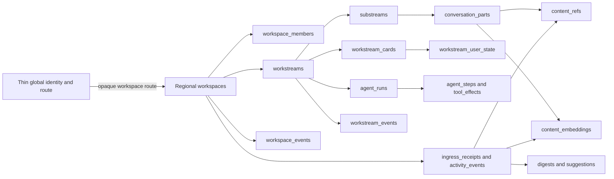

# Supabase workspace and work-stream conversations

> Created 2026-08-15.
>
> Avalon stores workspace, work-stream, conversation, activity, suggestion, and
> agent-run state in regional Supabase projects. Regional Postgres is the
> authority; private Realtime Broadcast accelerates delivery; Supabase Queues,
> Cron, Edge Functions, Storage, and pgvector provide bounded asynchronous,
> object, and search services. One data-minimal Cloudflare Workflow normally
> drives each full agent loop because a loop may outlive an Edge Function.
> Companions: [`state.md`](state.md), [`flows.md`](flows.md), the underlying
> [`research.md`](research.md), and the technical/economic
> [`comparison.md`](comparison.md).

## Summary

Avalon should not reproduce a Durable Object hierarchy inside Supabase. The
idiomatic Supabase architecture is one shared Postgres authority per product-
data region. Every workspace and work stream is a row-scoped aggregate inside
that authority. Short database transactions serialize writes to a work stream,
allocate its one conversation sequence, update common and person-specific
sidebar state, append replay events, and enqueue follow-up work atomically. The
database can therefore make a work-stream update visible in **Work Streams**,
**In Progress**, **Completed**, **You Are Mentioned**, **Unread**, and **Needs
Your Input** without delivering a fallible child-to-parent projection.

The initial topology is one EU Supabase product project and one Global/US
Supabase product project. A deliberately thin global Supabase project may own
sign-in, account identity, billing references, invitations, and the opaque
workspace-to-region directory. It stores no work-stream title, description,
message, activity, suggestion, embedding, or person-specific sidebar state.
Every product transaction stays inside the workspace's immutable regional
project. The identity federation between the global and regional Supabase Auth
services is a launch-gating spike rather than an assumed feature.

Conversation storage follows how language models consume context without
turning the whole transcript into one mutable JSON document. `substreams`
describes explicit context lanes and inheritance. `conversation_parts` holds
one work-stream-wide order of user, assistant, tool, attachment, compaction,
terminal, and control parts. A deterministic materializer selects an authorized
fence and produces a provider-valid message array. The same model supports the
shared feed, private contextual chats, human forks, and bounded sub-agent work.
Substreams are semantic context boundaries, not database shards, tabs, per-turn
buckets, or independent security domains.

User messages are committed before acknowledgement. A normal queued message is
eligible at the next admission boundary and does not invalidate current work. A
steering message commits the same durable user part but also increments the run
control revision and requests interruption. Realtime can notify an active
executor immediately, while database revision checks before output commit and
before irreversible effects are the safety mechanism when notification is late
or lost.

A full agent loop—not merely one model turn—usually lasts 2–30 minutes and can
rarely exceed two hours during coding. Daytona remains the Terminal plugin's
execution provider. One Terminal call is usually seconds, p95 is under a minute,
and the tail may take 3–5 minutes or longer. A paid Supabase Edge Function has a
documented 400-second wall-clock limit, 150-second request-idle limit, and two-
second CPU limit, so no Edge invocation owns a full loop or an unbounded
Terminal call. The recommended driver is one Cloudflare Workflow per full loop,
containing only opaque IDs, revisions, cursors, and action results while all
product data remains in Supabase. If a residency boundary cannot approve
Cloudflare Workflow state and processing, the same `RunDriver` contract is
implemented with Supabase Postgres, logged Queues, Cron, and one bounded Edge
invocation per model/tool/reconciliation action. The Supabase-native driver is
feasible, but it is an Avalon-built workflow engine and must pass the same
failure-injection suite.

Private Supabase Realtime Broadcast provides low-latency invalidations,
committed control hints, and active-output revision/offset hints. It is not the
event log and, by default, does not carry generated text bodies because an
already-joined channel is not proven to reauthorize immediately after removal.
Durable `workspace_events` and `workstream_events` carry monotonically ordered
replay cursors. Token text is broadcast in batches no faster than 30 frames per
second only behind a separately proven revocable stream lease; the launch-safe
path mutates a bounded active-output row approximately every 250–500 ms while
observed and up to one second while unobserved, then Broadcasts its coordinates.
Clients fetch text through live RLS and final output seals as one immutable
conversation part. Reconnect always recovers from the database.
One regional Realtime WebSocket multiplexes an active workspace and a small set
of foreground work-stream topics. A background app with no visible active run
closes it after a grace period and catches up by cursor rather than consuming an
idle connection forever or reconnecting every few minutes.

Connector ingress, normalized activity, digests, suggested work streams, and
suggested actions also live in the regional project. Signed webhook receipts
and large raw bodies are stored once; logged Queues normalize and derive them;
Postgres records provenance, audience, source watermarks, lifecycle, and user
feedback. A suggestion is not a work stream until an acceptance transaction
creates one. Supabase Storage holds large immutable bodies behind authoritative
`content_refs`. Postgres full-text search and pgvector provide authorization-
aware hybrid retrieval. Supabase Vector Buckets remain a later, rebuildable
option because they are public alpha and do not yet match the transactional and
authorization needs of the launch path.

The Supabase design does not require a Durable Object fleet migration control
plane. Schema changes are regional Postgres deployments using expand/backfill/
contract. Large transformations and D1/R2 imports use regional campaign, job,
receipt, and exception tables processed in bounded queue-backed slices. The PRD
specifies that smaller control surface because it is required for safe rollout,
but it does not create a separate migration-control-plane companion.

## Motivation

The Durable Object design makes one process the serialized authority for each
workspace and work stream. That is useful on an actor platform, but an awkward
shape on a relational platform. Emulating it with one queue, schema, database,
or Realtime channel per entity would discard Postgres transactions while
retaining cross-owner delivery problems and fleet-management overhead.

Supabase changes the pressure. Work-stream state and workspace sidebar state can
commit in one regional transaction. A relational query can combine common
work-stream metadata with the current person's sparse overlay. Connector events,
digests, suggestions, and search already benefit from regional SQL. Supabase
also puts its durable queue in Postgres, allowing the job and its originating
state mutation to commit together.

The architecture still needs deliberate boundaries. A single regional primary
is a shared contention and failure domain. Realtime is not durable history.
Supabase Auth sessions are project-local. Edge Functions do not provide a
native hours-long orchestration primitive. Storage bytes are not recovered by
database PITR. External model, connector, and Daytona calls cannot be atomic
with Postgres. Treating those limitations as explicit contracts is safer than
hiding an actor design under new names.

## Goals

1. Make regional Postgres the only product-data authority for a workspace's
   metadata, work streams, conversations, sidebar projections, activity,
   suggestions, files, search metadata, and run state.
2. Serialize every canonical work-stream mutation with a short database lock
   and transaction, including common workspace collections, sparse per-person
   attention state, durable events, and required queue messages.
3. Store conversation content as ordered, typed, provider-neutral parts and
   explicit substreams that deterministically materialize into valid model
   message arrays at an authorization and context fence.
4. Support shared main conversations, private contextual chats, forks, and
   bounded sub-agent investigations without turning them into separate work
   streams or leaking their audiences through compaction, search, or previews.
5. Commit both queued and steering user messages before acknowledgement. Queue
   preserves the active attempt; steer invalidates stale work and prevents a
   later irreversible effect from starting against superseded context.
6. Run generic full agent loops lasting 2–30 minutes and rarely 2+ hours across
   work-stream and non-work-stream owners, with durable retries, event waits,
   deployment survival, effect reconciliation, and explicit budgets.
7. Keep Daytona as the Terminal execution provider and reconcile long commands
   by provider reference rather than retrying them after an executor timeout.
8. Deliver human-realtime tokens and sidebar changes through private Realtime
   Broadcast while using durable database cursors for every reconnect, gap,
   authorization change, and terminal convergence.
9. Avoid row-per-token storage, per-work-stream sockets, idle-background socket
   waste, high-frequency empty polling, and one Realtime fan-out message per
   database row.
10. Store connector ingress, activity, digests, suggested work streams, and
    suggested actions with durable provenance, deduplication, audience, expiry,
    feedback, and exactly-once promotion semantics.
11. Use private regional Storage and `content_refs` for large payloads, and use
    authorization-filtered Postgres FTS plus pgvector for exact and semantic
    retrieval without making a vector index authoritative.
12. Keep EU product data and processing within its approved regional path, fail
    closed rather than failing over across a residency boundary, and validate
    Realtime, Edge, Auth, backups, support, logs, and optional Workflow with
    legal/security before launch.
13. Migrate from D1/R2 and evolve the regional schema through observable,
    pausable, idempotent, bounded campaigns without waking or instantiating an
    entity fleet and without two long-lived write authorities.
14. Make cost grow with active users, useful stream frames, durable checkpoints,
    stored content, and bounded work—not historical work-stream count, idle
    sockets, row-per-token writes, or duplicate cross-service projections.

## Non-goals

1. This PRD does not create one Supabase project, database, schema, queue,
   function, or process per workspace or work stream.
2. This PRD does not create a synthetic workspace or work-stream actor. The
   database aggregate and command API preserve logical ownership without a
   resident process.
3. This PRD does not store product metadata in the thin global plane or create
   global search, global vectors, a global inbox, or cross-region product SQL.
4. This PRD does not silently fail an EU workspace over to a Global/US project.
5. This PRD does not assert that Supabase project selection alone satisfies
   GDPR or a customer's residency contract.
6. This PRD does not expose canonical tables for arbitrary client writes. The
   client uses RLS-protected views and narrow transactional RPCs.
7. This PRD does not use Realtime Broadcast, Broadcast Replay, Presence, logs,
   or a Cloudflare Workflow as canonical product state.
8. This PRD does not use Postgres Changes for token streaming or high-fan-out
   workspace feeds.
9. This PRD does not keep every background desktop client connected forever,
   nor force periodic two- or three-minute WebSocket reconnects.
10. This PRD does not store a database row per generated token or rendered
    frame, and it does not delay all output until the final assistant part.
11. This PRD does not make an entire full agent loop one Edge Function, Worker,
    database transaction, queue visibility window, or retryable step.
12. This PRD does not make every agent loop a work stream. The run model is
    owner-neutral and domain state remains with its owner tables.
13. This PRD does not make an ambiguous external write safe to repeat. Unknown
    effects reconcile or request intervention.
14. Terminal remains on its existing Daytona provider under the separate
    Terminal subsystem contract; Edge Functions and Workflows do not run shell
    commands.
15. This PRD does not use substreams as storage shards, UI tabs, one-per-turn
    containers, security boundaries, or substitutes for work streams.
16. This PRD does not delete source messages merely because compaction produced
    a summary.
17. This PRD does not treat a suggested work stream as a real work stream before
    an authorized acceptance transaction succeeds.
18. This PRD does not use Supabase Vector Buckets for launch-critical search or
    authorization while that product remains public alpha.
19. This PRD does not add a separate fleet migration service when regional
    campaign tables, Queues, Cron, and Edge workers are sufficient.

## Product behavior

### Workspace collections, sidebar, and work streams of interest

Opening a workspace calls one paginated regional snapshot RPC. It returns
common work-stream cards, the current user's sparse overlays, collection counts,
and a durable `workspace_seq` cursor. It never fans out to work-stream processes.

The common card contains the work-stream ID, title, short description/objective,
origin, created time, last people-visible activity time, latest conversation
sequence, exact run state and blocker/terminal reason, lifecycle family,
preview, active-agent summary, needs-input flag, completion/error timestamps,
and common revision. Every exact state maps to one family:

| Exact state/reason | Sidebar family |
| --- | --- |
| `scheduled`, `preparing_context`, `running`, `interrupting`, `waiting_capacity` | `in_progress` |
| `needs_input` with an ordinary question or missing choice | `in_progress` |
| `completed`, `cancelled_cleanly`, `archived` | `completed` |
| `failed`, `budget_exhausted`, or `needs_input` with an ambiguous effect/intervention | `error` |
| `deleting`, `restoring` | hidden by the visibility gate |

**Work Streams** is every visible real work stream. **In Progress**,
**Completed**, and **Error** are indexed predicates over the common row. Date
groups use the same documented `last_activity_at` or `completed_at` field and
workspace timezone; they are not client guesses.

The person-specific overlay contains a monotonic seen waterline, unread and
mention ordinals, latest mention time, `needs_your_input`, pin, mute, dismiss,
last opened, and per-person revision. **You Are Mentioned**, **Unread**,
**Needs Your Input**, and **Pinned** are indexed overlay predicates. **Of
Interest** on the main screen is the documented union of pin, mention, unread,
assignment/input need, accepted suggestion, and recently opened/active signals.
No opaque recommender silently changes this collection.

The system does not eagerly create one overlay row for every member and work
stream. It creates one when the person opens, is mentioned or assigned, needs
input, pins/mutes/dismisses, accepts a suggestion, or otherwise differs from the
default. Large workspace-wide attention events use an audience ordinal and lazy
evaluation instead of a Cartesian write.

Marking seen is a monotonic RPC. It advances only to a sequence or attention
ordinal the caller is authorized to see and never moves backward or into the
future. Rendering, Presence, and an open socket do not mark content seen.

The same transaction that changes a work-stream title, state, last activity,
message attention, mention, or assignment updates the common row and affected
overlays, appends workspace/work-stream events, and queues required follow-up.
There is no cross-object delivery to repair. Realtime sends a small sequence
hint after commit; a lost hint is recovered from `workspace_events`.

### Activity ingestion, digests, and suggestions

A connector delivery enters a short regional Edge Function. The function
verifies the provider signature, timestamp, replay window, installation, and
size before accepting content. It records one receipt keyed by installation and
provider event ID, or by a documented semantic hash/window when the provider has
no stable ID. A repeated ID with the same body returns the prior receipt; the
same ID with different bytes is quarantined and audited.

Large raw bodies go to private regional Supabase Storage through a pending-
then-ready `content_refs` lifecycle. The receipt and a logged
`connector_ingress` queue message commit atomically. A bounded worker creates
immutable normalized activity facts, version/tombstone records, resource links,
audiences, and reconciliation cursors. Raw receipts are evidence and replay
input; normalized activity is the product-facing authority; vectors and
Realtime are neither.

Digests freeze an authorized activity watermark, timezone, audience, source
revision, and model/prompt version. Late events enter the next digest or an
explicit revision. Model generation and delivery are separate, idempotent
effects. Revocation between selection and commit invalidates the artifact.

Opportunity workers create `suggestions` and their source links. A suggested
work stream is a proposal with provenance, score, explanation, target audience,
expiry, and lifecycle. It appears in **Suggested** or the appropriate personal
surface, never in real work-stream collections. Accepting it runs one
transaction that revalidates source access, creates the work stream and initial
parts, updates the sidebar, records the accepted ID, and emits events. A retry
returns the same work stream.

A suggested action targets an existing work stream or external object but does
not execute until a person approves it or a separately defined policy permits
autonomy. Acceptance records a generic run/effect intent with the same revision
and idempotency rules as any other agent action. Dismissal, expiry, feedback,
source deletion, and access revocation are durable and user/audience scoped.

### Main conversation and LLM message arrays

The main feed is the root `substream` of a work stream. Every accepted user,
assistant, tool, attachment, terminal, compaction, or control part receives one
monotonic `seq` under a short lock on the `workstreams` row. A logical turn has a
`turn_id`; provider-valid tool-call/result adjacency is captured by explicit
relations and materialized correctly even if a human message arrived while the
tool was running. Physical arrival order is retained, while the model projector
admits complete units according to the documented admission fence.

Specifically, a human part that arrives after a tool call but before its result
keeps its physical `seq` and is shown as queued while the tool exchange is open.
The tool turn receives the next `admission_ordinal` only when its result/error is
sealed; the queued human turn receives the following ordinal. Provider context
therefore orders assistant tool call, tool result/error, then user input. The UI
may show the user's wall-clock arrival between live tool statuses, but the
provider array never places a user role inside a required call/result pair. This
is an explicit projection rule, not a claim that physical and provider order are
always identical.

The projector is a versioned database/application function over:

- the requested work stream and substream lineage;
- an inclusive work-stream sequence fence;
- a current authorization and context-scope epoch;
- complete, visible turns and tool-call/result pairs;
- applicable, still-valid compaction summaries;
- promoted child summaries and referenced content versions;
- a provider adapter that maps neutral roles and typed parts into its wire
  format.

It produces the same logical array on retry and records the projection version,
source fence, hashes, and audience epoch on the run step. Provider wire payloads
are not canonical history. Small text may be inline; large bodies resolve from
ready `content_refs`. Missing, corrupt, unauthorized, or revised content fails
materialization explicitly rather than silently changing the prompt.

### Queued and steering messages

Every user input command supplies an idempotency key, expected work-stream
revision, and mode `queue` or `steer`. The append RPC authenticates live
membership, locks the work stream, commits the user part and attention/sidebar
effects, appends durable events, and advances run-control state before success.

A queued message does not increment the interrupting control revision. The
active attempt may finish, and the next admission boundary batches every
eligible queued input exactly once in canonical order. A sender can see that
the message is committed and waiting.

A steering message increments `control_revision`, sets
`interrupt_requested_at`, and records the requested boundary. It immediately
Broadcasts a private run-control hint. A cooperative active model request is
aborted when possible. An ordinary read-only tool may finish if stopping it is
unsafe or unsupported, but its result cannot be admitted against the stale
revision. No new irreversible effect may begin after the steering revision
commits: the effect-begin RPC checks the current revision in the same transaction
that records intent.

If the notification is lost, the executor learns at its next database fence.
If a provider cannot cancel, its late output is recorded as superseded diagnostic
state or discarded and never seals the winning assistant part. If an external
write already began, the system reconciles its idempotency/provider reference
and tells the user what happened; steering does not rewrite reality.

Multiple steering messages coalesce by revision into one deterministic next
admission batch. Queue/steer commands remain ordinary transcript history; a
control flag cannot exist without its durable user part.

### Chats, forks, sub-agents, and substreams

Supported substream kinds are deliberately finite:

| Kind | Purpose | Inheritance | Default audience |
| --- | --- | --- | --- |
| `main` | Shared work-stream history | none; it is the root | work-stream audience |
| `private_chat` | Private contextual exchange | frozen visible parent fence | explicit people/agent audience |
| `human_fork` | Explore from an exact completed past | frozen parent fence | creator-selected audience |
| `subagent_fresh` | Bounded independent investigation | explicit task packet only | owning agent and permitted viewers |
| `subagent_fork` | Investigation inheriting an exact parent context | frozen parent fence | owning agent and permitted viewers |
| `document_chat` | Focus on a versioned resource | frozen or explicit live version policy | resource-authorized audience |

Substreams should be used when content has a coherent model-context boundary
inside one work stream and its result may be summarized or promoted. They keep
private chat or tool chatter out of unrelated future prompts while preserving
one audit order.

Substreams should not be used for pagination, storage distribution, one model
turn, one tool call, one user, one UI tab, one socket, arbitrary tags, or access
control by identifier alone. A body of work needing its own title, sidebar card,
participants, lifecycle, retention, completion, or independent objective is a
work stream. A depth limit, explicit parent, base sequence, inheritance mode,
scope revision, lifecycle, and promotion relation prevent branch bombs and
ambiguous ancestry.

Every part retains the one work-stream-wide `seq`; substream-local order is
derived. RLS checks the work stream and part audience, not mere possession of a
substream ID. Promotion appends a provenance-bearing summary/reference into the
target substream; it does not retroactively widen the child audience.

### Active runs, streaming, and steering

A full loop starts when committed input is admitted and ends only at
`completed`, `waiting_user`, `failed`, `interrupted`, `cancelled`, or another
product terminal state. It can contain many model turns, tool calls, Daytona
commands, retries, compactions, and waits. It is not one inference request and
not one user/assistant turn.

The recommended `CloudflareWorkflowRunDriver` creates one Workflow instance per
full loop. Its persisted input/result contains only regional routing, owner/run
IDs, revisions, cursors, next-action enums, timing, and integrity hashes. Each
Workflow step calls a region-specific Supabase adapter, which loads canonical
context, begins one fenced step, performs one bounded provider action, and
commits or reconciles its result. Prompts, messages, connector data, tokens,
Terminal output, provider secrets, and customer files never enter Workflow
state. Supabase remains authoritative if the Workflow is retried, lost,
recreated, or replaced.

The `SupabaseRunDriver` fallback uses the same run, step, wait, effect, and
control tables. Supabase Cron wakes a regional dispatcher; logged Queues carry
due run IDs; one Edge invocation begins and finishes or parks one bounded action.
Leases, retry classification, early event delivery, unknown effects, driver
versioning, and terminal races are explicit application behavior. No invocation
may approach the 400-second wall or 150-second idle limit; a long Daytona command
is started, persisted by provider reference, parked, and reconciled later.

Both drivers implement the same contract:

1. load a run by opaque ID in its region;
2. atomically claim the next action against run, control, authorization, scope,
   and driver revisions;
3. make at most one externally meaningful model/tool/reconciliation action;
4. checkpoint provisional output independently of the durable action result;
5. commit through a compare-and-set RPC or classify an unknown result;
6. return `continue`, `wait_event`, `wait_until`, `terminal`, or `reconcile`;
7. preserve explicit token, tool, cost, elapsed, idle, and step budgets.

An executor may listen to `run-control:<run_id>` while a model/tool request is
active to reduce interrupt latency. The socket is an optimization, not a lease
or authority. Every irreversible effect starts through a database RPC after a
fresh control/authorization check. The race between that check and the external
call is resolved by the committed effect intent and provider idempotency or
reconciliation—not by pretending it can be made atomic.

### Token streaming and realtime socket lifecycle

Time to first token is normally 1–5 seconds. The launch-safe executor commits
provisional text to `active_outputs` approximately every 250–500 ms while it has
foreground observers, then Broadcasts only run, attempt, part, revision, frame
sequence, byte offset, and content hash. Clients fetch the corresponding text
through an RLS-protected RPC. This four-to-two-frame-per-second durable cadence
is human-real-time without exposing generated bodies to a removed user whose
private Realtime join may still be cached.

An optional faster path may coalesce generated text bodies every 50–75 ms and
never above 30 frames per second only after Avalon proves a stream capability/
lease that the server can rotate at the authorization transaction's epoch and
that prevents an already-joined removed client from decrypting/receiving later
bodies. An eviction hint, client cooperation, JWT refresh, or a merely bounded
channel-disconnect delay is not sufficient. Until then, Realtime messages carry
coordinates only. Clients reject old attempts, duplicates, gaps, and offsets
below the last sealed or checkpointed byte.

A mutable `active_outputs` row holds one attempt's accumulated current text and
provider cursor. It is checkpointed approximately every 250–500 ms while
observed and no slower than one second while unobserved, subject to measured
database load. The checkpoint and its durable event commit together. Completion
inserts one sealed assistant part and deletes/tombstones the active output in the
same transaction. Advancing a durable cursor without the bytes it represents is
forbidden.

The checkpoint guarantees client reconnect to the latest durable provisional
bytes; it does not promise that a crashed model executor can continue a
nondeterministic generation. If the provider supplies a verified resumable
cursor/event spool, the same attempt may resume and later seal. Otherwise the
entire incomplete attempt is marked superseded, the client may visibly retract
its provisional text, and a new attempt starts from the original model fence.
Two attempts are never spliced, and only one complete attempt can seal.

The Electron main process owns at most one physical Realtime WebSocket per
regional session. It joins the active workspace common/personal topics and only
foreground work-stream common/personal topics; Supabase multiplexes them on that
socket. The client subscribes first, buffers hints, loads a snapshot and durable
cursor, applies newer hints, then continues live. Sequence gaps fetch durable
events. Broadcast Replay's 72-hour/25-message bound is never the recovery
contract.

The app keeps the socket while foreground interaction, a visible active stream,
or a promised live completion requires it. It leaves stale work-stream channels
after a grace period. When fully backgrounded with no such obligation, it closes
the socket and catches up on focus. This avoids both repeated reconnect churn and
indefinitely billing an idle user. Presence is limited to online/typing hints at
human cadence.

### Switching between two streaming work streams

Suppose work streams A and B are both running and emitting assistant output.
Selecting either work stream changes observation only: neither full agent loop,
Workflow/queue driver, provider request, tool, nor Daytona command is restarted
or cancelled. The Electron main process keeps independent per-work-stream
caches keyed by `workstream_id`, with the current `run_id`, `attempt_id`,
checkpoint revision, byte offset, content hash, durable event cursor, and active
text. The renderer never reuses one global streaming buffer for both work
streams.

While both runs are active, the preferred path keeps A and B's private logical
work-stream topics joined on the existing regional Realtime WebSocket. Switching
then changes only the selected cache and is immediate; it creates neither a new
physical connection nor a new inference request. This remains a small
foreground/running set, not a subscription to every pinned, unread, mentioned,
or background work stream. Supabase's paid-plan limit of 100 channels per
connection leaves ample protocol headroom for this two-stream case, but the
release limit must remain lower and load tested for Avalon's workspace,
personal, work-stream, and control topics.

If B's topic was evicted, the client joins it first and buffers hints before
fetching an authorized hydration RPC. One SQL statement snapshot returns the
visible immutable `conversation_parts` page, current `active_outputs` row if
any, attempt/revision/offset/hash, and an authorized durable `scanned_through`
watermark. The client installs that snapshot, discards buffered hints at or
below its watermark/revision, applies newer hints, and calls
`events_after(cursor)` or refetches `active_outputs` when it detects a sequence,
revision, or offset gap. Broadcast Replay is optional acceleration only; it is
not the recovery source.

A UI-only switch therefore loses no accepted message, immutable part, or
durably checkpointed provisional byte. The launch-safe path displays text
fetched through live RLS only after the checkpoint transaction has stored the
bytes and matching offset, so a lost or delayed Broadcast loses only a wake-up.
The newest executor bytes may be up to the 250-500 millisecond observed
checkpoint interval behind, or up to one second after observation stops, but
appear after the next commit. Completion atomically replaces the active attempt
with its immutable final part, so hydration sees a coherent active or sealed
state even when completion races the switch.

Hints and caches from an old `attempt_id` are discarded rather than spliced
into a replacement. If the executor/provider cannot resume a failed
nondeterministic attempt, either work stream may still perform the already
documented whole-attempt reset and visibly retract provisional output. That is
inference recovery, not loss caused by switching. A future direct token-body
fast path cannot claim the same displayed-byte safety unless its revocable
lease and resume protocol prove that every displayed offset is durably
recoverable; until then, body-free coordinates plus live-RLS fetch remain the
required path.

### Compaction while messages continue

Compaction never rewrites the mutable conversation head. A transaction freezes
a complete-turn source range, content hashes, substream lineage, authorization
epoch, context-scope revision, and compactor/model version into a unique job.
Messages sent during compaction allocate higher work-stream sequences normally
and are not observed by the job.

The worker reads exactly the fence, performs one bounded compaction action, and
commits a derived summary only if every source, scope, and authorization input
still matches. The materializer then uses that summary for the fenced prefix and
ordinary parts above it. A retry returns the same summary by compaction key. A
permission, document-version, redaction, or lineage change invalidates the
result and schedules a new fence. Old parts remain under the retention/audit
policy; compaction alone is not deletion.

### Completion, errors, and offline recovery

Exactly one attempt wins each admitted input range. Unique constraints and
compare-and-set terminal RPCs reject late completions. A terminal transaction
seals output, updates the run and work-stream state, updates common/person
sidebar projections, appends both event streams, and enqueues any derived work.
The UI can therefore recover a coherent terminal card and transcript after any
lost Broadcast.

An error is classified as retryable, user-actionable, ambiguous external
effect, budget exhaustion, authorization invalidation, or permanent failure.
The sidebar maps it deterministically. Operators can inspect opaque IDs,
revisions, timings, hashes, and error classes without routine content access.

Offline writes carry idempotency and expected revision. Reconnect submits them
to the regional command API, receives the original result on duplicate, and
surfaces a conflict when semantics cannot be merged. Clients never infer
success from an optimistic row or Realtime echo.

## Impact on the product contract

This PRD changes infrastructure ownership, not the user-facing work-stream
model. The standing product contract gains explicit queue/steer semantics,
substream context rules, background socket lifecycle, durable event cursors,
suggestion provenance, and full-loop execution boundaries. Existing references
to a per-work-stream realtime coordinator or D1 as canonical conversation state
must be replaced by the regional Supabase command and event contracts.

The main intentional product differences are operationally positive:

- sidebar/common/personal state becomes transactionally current rather than an
  eventually delivered child projection;
- a client can query and paginate collections relationally without waking an
  entity fleet;
- all agent owners use one durable run interface while preserving their own
  domain tables;
- a disconnected client recovers from sequence-numbered database events rather
  than relying on socket retention;
- migration is a regional schema/data campaign rather than per-object wake-up.

The product must not expose Supabase implementation details such as queue
visibility, Realtime topic names, row locks, Edge invocation boundaries, or
Workflow step retries. It exposes committed, queued, steering, running,
waiting, terminal, and recovery states.

## Decision log

| Decision | Outcome | Reason |
| --- | --- | --- |
| Regional physical unit | One Supabase product project per residency boundary | Keeps product transactions local and avoids per-tenant compute/control overhead |
| Workspace/work-stream authority | Regional Postgres rows and functions | Relational transactions solve sidebar projection and query needs directly |
| Serialization | Short `workstreams` row lock in a database function | Clear order without a resident actor or connection-scoped lock |
| Client API | Narrow RLS-protected views/RPCs; canonical tables private | Prevents partial multi-request mutations and centralizes live auth checks |
| Realtime | Private Broadcast hints plus durable event cursors | Low latency without confusing transient delivery with authority |
| Token persistence | Mutable active output checkpoints, then one sealed part | Avoids row-per-token WAL/IO and bounds reconnect loss |
| Async jobs | Logged Supabase Queues plus Cron/Edge consumers | Atomic enqueue with domain state and regional processing |
| Full-loop driver | Cloudflare Workflow by default; Supabase-native state machine where required | Edge Functions cannot own 2–30 minute or 2+ hour loops; data stays authoritative in Supabase |
| Terminal | Existing Daytona plugin/provider | The provider remains separately governed; long commands reconcile by provider ID |
| Large content | Private Supabase Storage plus canonical `content_refs` | Separates bytes from relational state without making Storage metadata authoritative |
| Search | Postgres FTS + pgvector/HNSW | Supports authorization joins and transactional lifecycle |
| Vector Buckets | Defer launch use | Public alpha and weaker proof for transaction/RLS/residency semantics |
| Migration | CLI schema migrations plus regional campaign/job tables | Shared database removes per-object fleet migration but still needs bounded backfill/import control |

## Key design decisions

### Regional project topology and routing

Each workspace has an immutable `region_key` and `route_epoch`. Product state is
created only in the corresponding regional project. The desktop resolves the
route before creating the regional Supabase client. Trusted global commands
carry workspace ID, region, epoch, operation key, and no product body; the
regional endpoint rejects a stale epoch.

The optional global project is limited to:

- account identity and sign-in configuration;
- opaque organization/workspace IDs and selected region;
- invitations that must be discoverable before a regional session exists;
- billing/customer references and non-product lifecycle state;
- idempotent global-to-regional command acknowledgements.

Supabase Auth is project-local. Before implementation, Avalon must prove a
supported federation flow in which global Auth acts as OIDC provider to each
regional product project, or adopt another explicitly reviewed session exchange.
It must prove stable subject mapping, regional session issuance, refresh,
logout, membership removal, Realtime token replacement, and recovery. A shared
JWT signing key or a client-held service role is rejected.

### Schemas, grants, and API boundary

Canonical application tables live in `avalon_private`; queue tables remain in
the managed `pgmq` schemas; Supabase-managed `auth`, `storage`, and `realtime`
schemas are not modified. An explicitly exposed `api` schema contains only
security-invoker views and command/query functions. New tables are not assumed
to be exposed by the Data API: migrations grant only required `SELECT`/function
execute rights and revoke default `PUBLIC` function execution.

RLS is enabled on every exposed relation. Canonical writes occur through
`SECURITY INVOKER` functions when possible. A necessary `SECURITY DEFINER`
function has `search_path = ''`, fully qualified identifiers, explicit live
authorization and tenant assertions, revoked public execution, and a narrow
grant. `service_role` and server Storage/S3 credentials stay only in trusted
regional execution.

Views use `security_invoker = true`. UPDATE policies include both `USING` and
`WITH CHECK`, and the required SELECT policy. Every membership/audience/RLS
predicate has a supporting index. User-editable Auth metadata never grants
access, and JWT workspace claims are not treated as fresh membership.

### Command transaction and lock order

All canonical mutations use one database function or trusted direct-database
transaction. A chain of PostgREST requests is not an atomic command. The common
work-stream command order is:

1. resolve the regional principal to `platform_user_id` and validate the live
   workspace membership/session epoch;
2. insert or find `command_receipts` by `(workspace_id, actor_id,
   operation_key)`, rejecting reuse with a different request hash;
3. lock `workstreams` with `SELECT ... FOR UPDATE`;
4. lock narrower existing rows in a stable documented order when needed;
5. verify expected work-stream, run-control, context-scope, authorization, and
   driver revisions;
6. allocate `workstream_seq`/attention ordinals and mutate canonical rows;
7. update common and sparse user projections;
8. append `workstream_events` and `workspace_events`;
9. enqueue a logged `pgmq` message and/or transactionally call
   `realtime.send` for a small private hint;
10. finalize the command receipt and commit.

No transaction calls a model, connector, Daytona, Storage upload, external
HTTP endpoint, or waits for a user. `READ COMMITTED` plus explicit locks is the
default. `SERIALIZABLE` is used only for a measured invariant that cannot use a
known lock order, and callers retry SQLSTATE `40001`. `SKIP LOCKED` is for job
claims, never for user commands whose ordering must be explicit.

### Idempotency, outbox, and external effects

Idempotency is scoped to a real operation, never a global hash of tool name and
input. Repeating the same operation key with the same request returns its stored
result; reusing it with different bytes is an error. Queue deliveries have
semantic inbox receipts. Run effects use `(run_id, step_no, effect_kind,
effect_key)` so two intentionally repeated actions remain distinct.

An external side effect follows `planned -> started -> succeeded|failed|unknown`:

1. commit intent and its idempotency key;
2. call the provider outside the transaction;
3. commit the response/provider reference through a fenced RPC;
4. after a crash or timeout, reconcile by provider reference before retrying.

If the provider neither accepts idempotency keys nor supports result lookup, a
post-call crash is `unknown` and may require a person. An outbox is used only
where a provider push/callback cannot be part of the Postgres-native queue; it
is drained with the same receipt rules. Database Webhooks may accelerate an
external notification but are not the durable job bus.

### Supabase Queues, Cron, and Edge Functions

Avalon uses a few logged Basic queues, not one queue per workspace/work stream:

| Logical queue | Contents | Consumer |
| --- | --- | --- |
| `agent_ready` | Run ID, expected revision, due time, driver hint | Run dispatcher/step adapter |
| `connector_ingress` | Ingress receipt ID and parser version | Normalizer |
| `derived_content` | Compaction, embedding, digest, suggestion job IDs | Typed bounded workers |
| `maintenance` | Export, deletion, orphan, migration job IDs | Typed maintenance workers |

Queue bodies contain identifiers and expected revisions, not canonical content
or secrets. Enqueue occurs in the originating database transaction. Delivery is
treated as at least once end to end despite visibility semantics. The consumer
creates/fetches a unique receipt, commits the authoritative outcome, then
deletes or archives the message. Poison messages enter an explicit dead-letter
record/queue after a policy-defined attempt count.

Visibility exceeds the bounded action p99 plus margin and is renewed only after
the deployed `pgmq` API is verified. Per-kind and per-workspace concurrency,
fairness, oldest-visible age, `read_ct`, next attempt, and DLQ count are
observable. The launch requires a throughput/latency test because public docs do
not give a hosted queue SLA or continuously running consumer.

A small number of regional Supabase Cron jobs wake dispatchers, potentially as
often as every second if load tests permit. Due state lives in tables; Cron is
not one job per run and not an SLA. Jobs follow Supabase's recommendation of no
more than eight concurrent Cron executions and no execution above ten minutes.

An Edge Function validates transport and secrets, calls a transactional RPC,
performs one bounded external or CPU-light action, and calls a completion RPC.
It is explicitly budgeted below 400 seconds wall, 150 seconds idle, two seconds
CPU, and 256 MB. Large transforms are divided into database-key ranges or
external provider operations; `waitUntil`, background mode, or an open
WebSocket does not extend durability.

### Full-loop driver boundary

`RunDriver` is an internal control interface, not the product authority:

```text
start(region, owner_kind, owner_id, run_id)
signal(region, run_id, event_id, expected_revision)
reconcile(region, run_id)
cancel(region, run_id, expected_revision)
```

The database decides the next action. A driver may only request
`begin_next_step` and submit `complete_step`, `fail_step`, or
`reconcile_effect`. Each RPC is compare-and-set on run/attempt/revisions. A
driver event is only a wake-up; early events are persisted in `run_wait_events`
before a waiter exists, and a later wait consumes them exactly once.

The default Cloudflare implementation is one Workflow instance per `agent_run`.
Workflow steps stay bounded and data-minimal. A long wait uses Workflow event or
duration waiting; it does not keep an executor or client socket active. A
Workflow call into Supabase identifies the regional project explicitly. The EU
path remains disabled until Cloudflare contractually confirms acceptable state,
logs, backup, trigger, execution, and outbound-subrequest locality.

Run admission and driver creation are not one distributed transaction. The
admission transaction creates `agent_runs`/`driver_bindings(state='pending')`
and sends `agent_ready`. A bounded regional dispatcher creates the Workflow
with a deterministic instance ID derived from region and run ID, then calls a
fenced RPC to mark the binding active. A create retry attaches to the same
instance; a database-bind retry returns the existing binding. No provider/tool
effect can begin until the binding is active and `begin_next_step` claims it.
If creation repeatedly fails, the run remains visibly queued/capacity-limited
and a later dispatcher retries—it is never rolled back into an uncommitted user
message. The Supabase-native driver follows the same binding protocol but marks
the queue-backed driver active without an external create.

The Supabase-only implementation dispatches one state-machine action at a time
through Queue/Cron/Edge. It must implement leases, wake deduplication, early
events, retry policies, version compatibility, and recovery; these are not
outsourced to `pgmq`. It is the required fallback for any region where the
Workflow exception is not allowed, and it is also the escape hatch from vendor
lock-in.

Cloudflare Workflow input and result must never include prompt text, generated
text, connector or Terminal content, file paths, personal sidebar metadata,
embeddings, access tokens, or provider credentials. A later audit should be able
to delete every Workflow instance without deleting product truth.

### Realtime protocols

Four logical private topics are sufficient for the active surface:

- `workspace:<opaque_workspace_id>`: common invalidations and durable cursor;
- `workspace-user:<workspace_id>:<user_id>`: personal overlay invalidations;
- `workstream:<opaque_workstream_id>`: foreground committed/checkpoint hints;
- `run-control:<opaque_run_id>`: trusted executor acceleration.

The first three are multiplexed over one regional client connection. Topic RLS
queries live indexed membership and audience state. Topic names grant nothing.
Server control sends request acknowledgement where supported, but the durable
row/revision is authoritative.

“Common” means common to everyone currently allowed to list that work stream,
not necessarily every workspace member. A workspace Broadcast may include a
subject/card ID only when that subject is workspace-listable. A restricted
work-stream update uses its authorized work-stream/audience or affected personal
topic. If the product explicitly approves a body-free workspace cursor wake for
restricted activity, it contains no subject ID/kind/count; otherwise it sends no
common hint. The durable catch-up RPC applies audience RLS before returning
event rows, previews, or collection deltas.

Snapshot handshake is subscribe, buffer, fetch snapshot+cursor, discard events
at/below cursor, apply newer events, and then go live. Envelopes are small and
contain topic, durable sequence, entity ID, revision, kind, and optional
active-output frame coordinates. Gaps fetch `events_after(cursor)` using keyset
pagination. Postgres Changes is not used for high-fan-out domain streaming.

The snapshot and its visible event high watermark are produced by one SQL
statement/CTE under one statement snapshot; a sequence read performed before or
after separate card queries is not sufficient. Workspace sequences may contain
committed gaps and events addressed to other users. Catch-up therefore returns
the caller's authorized events plus an authorized `scanned_through` watermark;
the client advances through invisible/global sequence gaps only to that server-
attested watermark. It never treats every missing integer as a leaked event or
endless transport gap.

Membership removal increments authorization epochs and updates regional rows in
one transaction. New commands and catch-up queries fail immediately. The client
is sent an eviction hint and regional tokens/channels are renewed. Because the
public contract for already-joined Realtime channel reauthorization is not
sufficiently precise, launch requires an integration test and a maximum stale-
channel bound; sensitive payloads remain IDs/invalidation hints, and every
content fetch performs live RLS.

### Storage and content references

Buckets are private and regional. Application code treats the managed `storage`
schema as read-only and uses the Storage API for bytes. A deterministic or
content-addressed path contains the workspace and a non-guessable object ID,
never authorization by path convention alone.

The database/Storage state machine is:

1. allocate a `pending` `content_refs` row with expected hash, size, audience,
   owner, and expiry;
2. upload with a user session or narrow server credential;
3. verify object size/hash and atomically mark `ready` with the domain link;
4. serve only `ready` references after a live authorization check;
5. reconcile expired pending/database-orphan/object-orphan states;
6. delete bytes through the Storage API, verify absence, then seal `deleted`.

Signed URLs are short lived and never stored in transcript, queue, Workflow,
Realtime, suggestion, or logs. Supabase Storage has no S3 versioning and its
bytes are not included in database backups, so customer backup/retention and DR
must cover them independently.

### Exact, semantic, and hybrid retrieval

Generated `tsvector` columns with GIN indexes serve exact/token-aware search.
Regional `content_embeddings` use pgvector HNSW and record model, dimension,
content hash, source revision, audience and scope epochs. Embedding generation
is queued and idempotent. Changed/deleted/revoked content invalidates its
embedding before it may be returned.

Every search function begins with an authorized regional candidate set and
joins FTS/vector rows inside the database. It may combine ranks with reciprocal-
rank fusion. It never retrieves cross-tenant vectors into application code and
filters them afterward. Vectors are derived and rebuildable; source content and
provenance remain canonical.

### Capacity, connection, and cost model

The regional primary is shared by interactive transactions, queues, Realtime
database Broadcast, Auth metadata, activity, and vectors. Launch sizing must
measure workspace/card counts, active writers, connector burst, token fan-out,
checkpoint rate, queue backlog, vector index memory, WAL, IOPS, and connection
pool demand together.

Short-lived Edge/serverless database access uses Supavisor transaction pooling;
migrations use direct connections; code does not rely on prepared statements or
session state in transaction mode. Interactive commands have bounded statement
timeouts. Large reads use keyset pagination, not deep `OFFSET`. All foreign keys,
RLS predicates, due-state claims, collection filters, and event cursors have
indexes.

Partition append-heavy event/activity/run-event tables only after measured
size, vacuum, index, or retention pressure establishes the boundary. Read
replicas may serve lag-tolerant historical/analytics views; they never serve
read-your-write sidebar, authorization, active runs, Queues, Realtime, Auth, or
Storage correctness.

Realtime cost is frame rate multiplied by receivers. Only foreground work-
stream subscribers receive active-output coordinate hints; common invalidations
are tiny. Generated body frames remain disabled until the revocable-lease gate
in the token protocol is satisfied.
Edge invocation cost is controlled with due-state and callbacks rather than hot
polling. Storage holds large immutable bodies; Postgres holds metadata and hot
text. Idle sockets close intentionally and recover from cursors.

## Data model

### Conventions

This section is normative at the logical-schema level. Migration authors may
split a payload into a child table or replace an enum with a lookup only when
the stated keys, authority, lifecycle, transaction boundary, and indexes remain
equivalent.

- Canonical tables live in `avalon_private`; names below omit that prefix.
- IDs exposed across APIs are UUIDv7/time-ordered UUIDs when supported by the
  chosen library; internal append sequences use `bigint`.
- Every timestamp is `timestamptz`; every regional product row includes or can
  reach `workspace_id` through an indexed foreign key.
- Human text is `text`, bounded at the command boundary. Arbitrary provider
  metadata is versioned `jsonb` with a size cap and a GIN index only for a
  measured query.
- Hashes are fixed `bytea` or constrained hex, and unique keys include their
  semantic scope. `NULL` never means both unknown and not applicable.
- Foreign-key delete behavior is explicit. Large destructive cascades are
  avoided in favor of deletion jobs and tombstones.
- Append-only tables have identity `bigint` primary keys plus the domain unique
  key used for cursor/order. Frequently filtered foreign keys are indexed even
  though Postgres does not create those indexes automatically.
- Sealed conversation/event/audit rows are immutable to application roles.
  Corrections append a replacement/tombstone relation.
- Managed Supabase tables in `auth`, `storage`, `realtime`, `pgmq`, `cron`, and
  extension schemas are platform-owned and intentionally absent below.

### Relationship overview



There is no cross-database relationship between a workspace and one of its
work streams: both rows are in the same regional primary. A command changing a
work stream locks it and updates `workstream_cards`, sparse user state,
`workstream_events`, and `workspace_events` before one commit. Realtime only
announces that commit. The only normal cross-system edges are global route to
regional project, Postgres metadata to Storage bytes, Postgres run state to a
driver, and effect intent to an external provider. Each is resolved by epoch,
receipt, or pending/finalized state rather than a distributed transaction.

### Identity, workspace, and authorization tables

#### Global `workspace_routes` and `regional_command_receipts`

These two tables live only in the thin global Supabase project. `workspace_routes(
workspace_id primary key, organization_id, region_key, route_epoch, state,
created_at, updated_at)` contains opaque routing/lifecycle fields and no title,
description, member overlay, or content-derived value. `regional_command_receipts(
id primary key, workspace_id, route_epoch, operation_kind, operation_key,
request_hash, state, regional_receipt_id, created_at, completed_at)` is unique by
workspace/operation key and coordinates invitation/account/deletion commands
that genuinely start globally. Its payload is a reviewed non-product enum and
IDs; regional product commands never transit this table.

#### `platform_identities`

Maps a regional Auth principal to Avalon's stable person ID. It is the regional
bridge that RLS and commands use; `auth.users` is not extended with product
membership.

| Column | Type / constraints | Meaning |
| --- | --- | --- |
| `regional_auth_user_id` | `uuid primary key`, FK to `auth.users` | Regional session principal |
| `platform_user_id` | `uuid not null unique` | Stable Avalon person ID from the identity-provider subject |
| `issuer`, `subject` | `text not null`, unique pair | Federated identity binding |
| `session_epoch` | `bigint not null default 1` | Live revocation-sensitive epoch |
| `state` | enum `active`, `suspended`, `deleted` | Regional account usability |
| `created_at`, `updated_at` | `timestamptz not null` | Audit times |

Indexes: unique `(issuer, subject)`, `(platform_user_id, state)`. Mapping changes
are privileged and audited. One global identity can have one regional principal
per project.

#### `workspaces`

| Column | Type / constraints | Meaning |
| --- | --- | --- |
| `id` | `uuid primary key` | Globally unique opaque workspace ID |
| `region_key` | `text not null` | Must match this project; immutable after creation |
| `route_epoch` | `bigint not null` | Rejects stale global/regional commands |
| `name` | `text not null` | Regional product metadata, never copied global |
| `state` | enum `active`, `suspended`, `deleting`, `deleted` | Admission gate |
| `timezone` | `text not null` | Date grouping/digest scheduling IANA zone |
| `authorization_epoch` | `bigint not null default 1` | Invalidates derived/audience-sensitive work |
| `retention_policy_id` | `uuid null` | Regional retention policy reference |
| `created_at`, `updated_at`, `deleting_at` | timestamps | Lifecycle |

Checks enforce a positive epoch and local `region_key`. Indexes cover
`(state, updated_at)` and operational deletion. The row is locked for workspace-
wide membership/lifecycle operations. At high write rates, workspace event
sequences use a regional database sequence with committed gaps rather than
making this row a common lock; order must remain total and monotonic, not gapless.

#### `retention_policies`

`retention_policies(id, workspace_id, version, state, conversation_days,
activity_days, raw_ingress_days, audit_days, export_days, terminal_artifact_days,
legal_hold_mode, created_by, created_at, superseded_at)` is immutable by version
and unique per workspace/version. Jobs store the applied policy version; a
policy change schedules explicit deletion/archive work and never silently
rewrites an active export or legal hold.

#### `workspace_members`

| Column | Type / constraints | Meaning |
| --- | --- | --- |
| `workspace_id`, `platform_user_id` | composite primary key | Live membership |
| `role` | enum / constrained text | Owner, admin, member, guest policy |
| `state` | `active`, `invited`, `suspended`, `removed` | Authorization state |
| `membership_epoch` | `bigint not null` | Increments on scope/role/revocation changes |
| `joined_at`, `removed_at`, `updated_at` | timestamps | Lifecycle |
| `invited_by` | `uuid null` | Audit principal |

Indexes: `(platform_user_id, state, workspace_id)`, `(workspace_id, state,
role)`. RLS predicates use this table with `platform_identities`. Removal also
increments `workspaces.authorization_epoch` and affected run/scope revisions.

#### `workspace_resource_grants`

Captures work-stream/resource audiences more precisely than workspace
membership when required.

| Column | Type / constraints | Meaning |
| --- | --- | --- |
| `id` | `uuid primary key` | Grant |
| `workspace_id` | FK not null | Tenant |
| `subject_kind`, `subject_id` | constrained kind + UUID | Person, group, or workspace role |
| `resource_kind`, `resource_id` | constrained kind + UUID | Work stream, connector resource, content reference, etc. |
| `capability` | constrained text | View, contribute, administer, execute |
| `grant_epoch` | `bigint not null` | Revision used by derived artifacts |
| `state`, `created_at`, `revoked_at` | lifecycle | Live/revoked grant |

Unique live semantic grant and indexes on both subject and resource directions
are required. Substreams do not replace this table.

#### `audiences` and `audience_members`

`audiences(id, workspace_id, kind, revision, state, created_at)` names a stable
content audience. `audience_members(audience_id, subject_kind, subject_id,
membership_epoch, created_at, revoked_at)` has a composite primary key over the
audience and subject. Content points to an audience revision; read functions
join current grants/membership. Updating membership increments the audience and
workspace authorization epochs so derived summaries, suggestions, and vectors
cannot reuse an older access set.

### Work-stream and sidebar tables

#### `workstreams`

The row is the serialization anchor and canonical common metadata.

| Column | Type / constraints | Meaning |
| --- | --- | --- |
| `id` | `uuid primary key` | Work-stream ID |
| `workspace_id` | FK not null | Owning workspace |
| `title`, `description` | bounded text | Common sidebar/main metadata |
| `origin_kind`, `origin_id` | constrained text, UUID nullable | Human, accepted suggestion, automation, import |
| `visibility` | enum / policy reference | Workspace or restricted audience |
| `state` | exact lifecycle enum | Product state, not only collection family |
| `state_reason` | constrained text nullable | Blocker/terminal detail |
| `next_seq` | `bigint not null default 1` | One conversation order allocator |
| `latest_seq` | `bigint not null default 0` | Highest committed part sequence |
| `attention_ordinal` | `bigint not null default 0` | People-visible attention order |
| `revision` | `bigint not null default 1` | Common compare-and-set revision |
| `control_revision` | `bigint not null default 0` | Latest steering/input-control revision |
| `context_scope_revision` | `bigint not null default 1` | Invalidates materializations/compactions |
| `authorization_epoch` | `bigint not null default 1` | Work-stream access revision |
| `active_run_id` | `uuid null unique` | Current admitted full loop, if any |
| `root_substream_id` | `uuid null unique` | Set during creation transaction |
| `created_by` | `uuid not null` | Platform user or system actor |
| `created_at`, `updated_at`, `last_activity_at` | timestamps | Common ordering/grouping |
| `completed_at`, `error_at`, `deleting_at` | timestamps nullable | Lifecycle |

Unique `(workspace_id, id)` supports composite tenant FKs. Indexes cover
workspace collection pagination: `(workspace_id, state, last_activity_at desc,
id)`, `(workspace_id, completed_at desc, id)`, and active-run/operational
states. Checks ensure `latest_seq < next_seq` and terminal timestamps match
state. Only command functions update this row.

#### `workstream_cards`

A transactionally maintained read projection for common sidebar/home queries.
It is rebuildable from canonical tables but is updated synchronously so users do
not wait for a projector.

| Column | Type / constraints | Meaning |
| --- | --- | --- |
| `workstream_id` | primary/FK | Same identity as work stream |
| `workspace_id` | FK not null | Fast tenant filtering |
| `title`, `description`, `origin_kind` | denormalized common fields | Card content |
| `exact_state`, `state_reason`, `lifecycle_family` | constrained values | Collection placement |
| `last_activity_at`, `completed_at`, `error_at` | timestamps | Date/order groups |
| `latest_seq`, `attention_ordinal` | `bigint not null` | Catch-up/unread inputs |
| `preview_text`, `preview_content_ref_id` | bounded text or FK | Authorized common preview only |
| `active_run_summary` | bounded `jsonb` | Non-sensitive common status fields |
| `needs_input` | boolean | Common input requirement |
| `common_revision` | `bigint not null` | Monotonic patch revision |
| `visibility_epoch` | `bigint not null` | Prevents stale read after ACL change |

The primary key prevents two common cards. Indexes match all supported common
collections and keyset order. A card never contains private substream text or a
person-specific mention.

#### `workstream_user_state`

Sparse overlay for one person.

| Column | Type / constraints | Meaning |
| --- | --- | --- |
| `workspace_id`, `workstream_id`, `platform_user_id` | composite primary/foreign keys | Scoped overlay |
| `seen_attention_ordinal` | `bigint not null default 0` | Monotonic waterline |
| `latest_unread_ordinal` | `bigint not null default 0` | Fast unread predicate |
| `unread_count` | `integer null` | Optional bounded/exact cached count |
| `latest_mention_ordinal` | `bigint not null default 0` | Mention predicate |
| `mentioned_at` | timestamp nullable | Ordering |
| `needs_your_input` | boolean not null | Targeted request |
| `pinned`, `muted`, `dismissed` | booleans not null | Explicit preference |
| `interest_reason_bits` | `integer not null` | Documented derived union bits |
| `last_opened_at`, `last_interest_at` | timestamps nullable | Recent interest |
| `user_revision` | `bigint not null default 1` | Monotonic personal patch revision |
| `authorization_epoch` | `bigint not null` | Rejects stale overlay after access change |

Indexes cover the user's collection predicates with targeted composite or
partial indexes, not a separate index for every boolean. A removal can leave an
audited tombstone but RLS excludes it immediately.

#### `workstream_attention_events`

| Column | Type / constraints | Meaning |
| --- | --- | --- |
| `id` | `bigint identity primary key` | Physical row |
| `workspace_id`, `workstream_id` | FKs not null | Scope |
| `attention_ordinal` | `bigint not null` | Work-stream people-visible order |
| `part_id` | UUID nullable FK | Originating part when applicable |
| `kind` | mention, message, assignment, state, etc. | Attention semantics |
| `audience_id` | UUID FK not null | Who may count/see it |
| `created_at` | timestamp | Audit/order |

Unique `(workstream_id, attention_ordinal)`; indexes support audience-specific
range counts. Workspace-wide events do not eagerly materialize every user row.

#### `part_mentions`

| Column | Type / constraints | Meaning |
| --- | --- | --- |
| `part_id`, `mentioned_user_id` | composite primary key | Canonical parsed mention |
| `workspace_id`, `workstream_id` | FKs not null | Tenant/query scope |
| `mention_ordinal` | `bigint not null` | Attention event linkage |
| `source_token` | bounded text | Canonical identity reference, not display-name auth |
| `created_at` | timestamp | Audit |

Indexes: `(workspace_id, mentioned_user_id, mention_ordinal desc)` and
`(workstream_id, part_id)`. Mention creation and sidebar overlay update are in
the part append transaction.

#### `workstream_participants` and `workstream_assignments`

`workstream_participants(workspace_id, workstream_id, platform_user_id,
participant_kind, first_contributed_seq, last_contributed_seq, state, joined_at,
left_at)` has primary key `(workstream_id, platform_user_id)` and records actual
contributors/explicit participants; opening or Presence never inserts it.
`workstream_assignments(workstream_id, platform_user_id, assignment_kind,
state, assignment_revision, assigned_by, assigned_at, completed_at)` has a
semantic composite primary key. Assignment commands update `needs_your_input`,
interest, card state, and durable events transactionally. Both tables remain
subject to current grants; participant status alone does not authorize access.

### Conversation tables

#### `substreams`

| Column | Type / constraints | Meaning |
| --- | --- | --- |
| `id` | `uuid primary key` | Context lane |
| `workspace_id`, `workstream_id` | composite tenant FK | Owner |
| `kind` | supported-kind enum | Main/private/fork/subagent/document semantics |
| `parent_substream_id` | self FK nullable | Explicit lineage; null only for main/fresh |
| `base_seq` | `bigint null` | Frozen parent fence when inherited |
| `inheritance_mode` | enum `none`, `frozen`, `document_version` | No ambiguous implicit live inheritance |
| `audience_id` | UUID/FK not null | Explicit audience policy |
| `resource_id`, `resource_revision` | UUID/bigint nullable | Versioned document/resource context |
| `scope_revision` | `bigint not null default 1` | Context invalidation fence |
| `depth` | smallint with check | Bounded ancestry, launch max four |
| `state` | `active`, `completed`, `abandoned`, `deleted` | Lifecycle |
| `created_by`, `created_at`, `completed_at` | identity/timestamps | Audit |

Unique root constraint permits exactly one `main` per work stream. Checks enforce
kind-specific parent/base/resource requirements and max depth. Indexes cover
`(workstream_id, parent_substream_id)` and audience/resource lookup. A recursive
cycle is rejected by the creation function, not merely trusted to the client.

#### `turns`

Tracks admission units separately from raw arrival so a late human message
cannot split a provider tool call/result pair.

| Column | Type / constraints | Meaning |
| --- | --- | --- |
| `id` | `uuid primary key` | Logical turn |
| `workspace_id`, `workstream_id`, `substream_id` | FKs not null | Scope |
| `kind` | user, agent, tool_exchange, control | Admission kind |
| `first_seq`, `last_seq` | bigint nullable | Complete canonical range |
| `admission_ordinal` | bigint nullable | Provider-unit order assigned only at safe completion/admission |
| `status` | `open`, `complete`, `superseded`, `redacted` | Materialization eligibility |
| `run_id`, `step_id` | UUID nullable | Producing run/step |
| `admission_batch_id` | UUID nullable | User input admission |
| `created_at`, `completed_at` | timestamps | Lifecycle |

Indexes cover work-stream/substream physical order, unique non-null
`(substream_id, admission_ordinal)`, and run lookup. `first_seq..last_seq` is an
audit extent and need not be a turn-exclusive contiguous range when other turns
arrive concurrently. A complete tool exchange includes both call and result (or
explicit error/cancellation) before the projector assigns/admits it.

#### `conversation_parts`

The canonical provider-neutral append log.

| Column | Type / constraints | Meaning |
| --- | --- | --- |
| `id` | `uuid primary key` | Stable part identity |
| `workspace_id`, `workstream_id`, `substream_id`, `turn_id` | FKs not null | Scope/context/admission |
| `seq` | `bigint not null` | One work-stream-wide order |
| `ordinal_in_turn` | smallint not null | Provider-valid local order |
| `role` | system, user, assistant, tool | Neutral message role |
| `kind` | text, tool_call, tool_result, attachment, terminal, summary, control, etc. | Typed content |
| `author_kind`, `author_id` | constrained identity | Human, inherent agent, subagent, connector/system |
| `inline_text` | text nullable with size cap | Small content |
| `content_ref_id` | UUID nullable FK | Large/immutable content |
| `structured_payload` | bounded versioned `jsonb` nullable | Typed non-text fields |
| `provider_call_id` | text nullable | Tool pairing/provider reconciliation, not authority |
| `related_part_id` | UUID nullable FK | Tool result/replacement/promotion relation |
| `audience_id` | UUID/FK not null | Effective content audience |
| `authorization_epoch`, `scope_revision` | bigint not null | Projection fence inputs |
| `content_hash` | fixed hash not null | Deterministic materialization/audit |
| `source_operation_key` | text nullable | Scoped idempotency provenance |
| `created_at`, `sealed_at` | timestamps not null | Immutable lifecycle |
| `redacted_by_part_id` | UUID nullable | Append-only redaction linkage |

Unique `(workstream_id, seq)`, `(turn_id, ordinal_in_turn)`, and scoped provider/
operation keys where applicable. Indexes support substream ranges, run/turn,
audience, and keyset retrieval. Exactly one of inline content, content reference,
or a kind-valid structured payload is required. UPDATE/DELETE are denied to
normal application roles after seal.

#### `input_admission_batches`

| Column | Type / constraints | Meaning |
| --- | --- | --- |
| `id` | `uuid primary key` | Exact input range admitted to one run/continuation |
| `workspace_id`, `workstream_id`, `substream_id` | FKs | Scope |
| `first_seq`, `last_seq` | bigint not null | Audit bounds enclosing the selected turns; not membership |
| `mode` | queue/steer/system | Admission source |
| `control_revision` | bigint not null | Revision the attempt must match |
| `run_id` | UUID nullable FK | Winning full loop/continuation; several batches may join one loop |
| `state` | `pending`, `admitted`, `superseded`, `cancelled` | Lifecycle |
| `created_at`, `admitted_at` | timestamps | Audit |

`input_admission_batch_turns(batch_id, turn_id, admission_ordinal)` has primary
key `(batch_id, admission_ordinal)` and unique `(batch_id, turn_id)`. The join
rows—not a possibly interleaved `first_seq..last_seq` interval—are authoritative
membership and order. A turn can belong to at most one winning batch unless an
explicit supersession/replay relation says otherwise. Each batch is admitted
once, while one full loop may consume its initial batch and later steering/
resumption batches. A queue part can be committed before its turn is assigned to
a batch.

#### `active_outputs`

| Column | Type / constraints | Meaning |
| --- | --- | --- |
| `run_id`, `attempt_id` | composite primary key | Only current attempt is visible |
| `workspace_id`, `workstream_id`, `substream_id`, `turn_id` | FKs | Destination |
| `part_id` | UUID unique | Future sealed part identity |
| `revision`, `frame_seq`, `byte_offset` | bigint not null | Stream/checkpoint coordinates |
| `text_buffer` | bounded text | Accumulated durable provisional text |
| `provider_cursor` | bounded encrypted/json reference nullable | Resume metadata when supported |
| `content_hash` | hash not null | Detect corruption |
| `status` | `streaming`, `sealing`, `superseded` | Lifecycle |
| `checkpointed_at`, `expires_at` | timestamps | Recovery/cleanup |

The checkpoint transaction updates text, offset, hash, and durable event
together. Unique current-output constraints prevent two visible attempts. Seal
copies exactly this content into `conversation_parts` before removing or
tombstoning the row. A provider-resumable attempt may continue from its verified
cursor. Otherwise an executor crash supersedes this whole row and starts another
attempt; a new generation never appends to the prior buffer.

#### `compaction_jobs` and `compaction_sources`

`compaction_jobs` freezes one derived-summary operation.

| Column | Type / constraints | Meaning |
| --- | --- | --- |
| `id` | `uuid primary key` | Job |
| `workspace_id`, `workstream_id`, `substream_id` | FKs | Scope |
| `first_seq`, `last_seq` | bigint not null | Complete-turn frozen range |
| `source_merkle_hash` | fixed hash not null | Ordered content/lineage digest |
| `authorization_epoch`, `scope_revision` | bigint not null | Leak/staleness fence |
| `format_version`, `model`, `model_version`, `prompt_version` | text not null | Reproducibility |
| `compaction_key` | text unique not null | Idempotent semantic identity |
| `state` | queued/running/ready/invalid/failed | Lifecycle |
| `summary_part_id` | UUID nullable unique/FK | Sealed derived result |
| `attempts`, `last_error`, `created_at`, `completed_at` | operational fields | Retry/audit |

`compaction_sources(job_id, part_id, seq, content_hash)` has composite primary
key `(job_id, seq)` and verifies exact lineage. A summary is usable only when the
job is ready and all stored epochs/hashes remain current. New tail messages do
not change the fence.

#### `substream_promotions`

| Column | Type / constraints | Meaning |
| --- | --- | --- |
| `id` | `uuid primary key` | Promotion |
| `workspace_id`, `workstream_id` | FKs | Scope |
| `source_substream_id`, `target_substream_id` | FKs | Explicit direction |
| `source_first_seq`, `source_last_seq` | bigint | Frozen source range |
| `source_scope_revision`, `authorization_epoch` | bigint | Validity fence |
| `promoted_part_id` | UUID unique FK | Summary/reference appended to target |
| `content_hash`, `created_by`, `created_at` | provenance | Audit |

The promotion function proves the promoter can read the source and write the
target, and that the promoted content is safe for the target audience. It does
not change source access.

### Durable event and command tables

#### `workspace_events`

| Column | Type / constraints | Meaning |
| --- | --- | --- |
| `id` | `bigint identity primary key` | Physical event |
| `workspace_id` | FK not null | Scope |
| `workspace_seq` | bigint not null | Durable replay cursor; monotonic, gaps allowed |
| `kind`, `subject_kind`, `subject_id` | constrained values | Patch/refetch meaning |
| `common_revision`, `user_revision` | bigint nullable | Deduplication/patch coordinates |
| `target_user_id` | UUID nullable | Null common, set personal |
| `audience_id` | UUID nullable FK | Required for restricted common-to-audience events |
| `authorization_epoch` | bigint not null | Visibility fence |
| `payload` | small versioned `jsonb` | IDs/count deltas only; no large/private body |
| `created_at` | timestamp not null | Retention/order |

Unique `(workspace_id, workspace_seq)`. Indexes support common and target-user
keyset catch-up. The catch-up function returns authorized rows and a
`scanned_through` high watermark so a person's cursor can pass sequence values
used by other users' private events without learning their contents. Partition/
retention is measured; the cursor lifetime must exceed the supported offline
window or the API returns `snapshot_required`.

#### `workstream_events`

Same pattern with `(workstream_id, workstream_seq)` unique, plus `run_id`,
`attempt_id`, `part_id`, `byte_offset`, and `target_user_id` where relevant.
Events identify durable changes/checkpoints; they do not duplicate entire
conversation bodies. An event is inserted in the same transaction as its row.

#### `command_receipts`

| Column | Type / constraints | Meaning |
| --- | --- | --- |
| `id` | `uuid primary key` | Receipt |
| `workspace_id`, `actor_id` | FKs/identity | Idempotency scope |
| `operation_key` | text not null | Caller-generated key |
| `operation_kind`, `request_hash` | text/hash not null | Prevents conflicting key reuse |
| `state` | started/completed/rejected | Command lifecycle |
| `result_kind`, `result_id`, `result_revision` | bounded canonical result | Retry response |
| `error_code` | constrained nullable | Stable rejection |
| `created_at`, `completed_at`, `expires_at` | timestamps | Retention |

Unique `(workspace_id, actor_id, operation_key)`. The function atomically
claims or returns the receipt; a different request hash is always a conflict.

#### `queue_inbox_receipts`, `outbox_messages`, and `dead_letters`

`queue_inbox_receipts(queue_name, semantic_key, message_id, request_hash,
state, result_ref, attempts, created_at, completed_at)` is unique by queue and
semantic key. `outbox_messages(id, workspace_id, destination_kind,
destination_ref, operation_key, payload_ref, state, attempts, next_attempt_at,
last_error, created_at)` represents a required external delivery only when a
Postgres queue is insufficient. `dead_letters(id, source_queue, semantic_key,
message_snapshot, error_class, attempts, quarantined_at, replayed_at,
operator_id)` keeps bounded poison evidence and manual replay audit. Bodies are
size-capped and contain no secrets.

### Generic agent-run tables

These tables are owner-neutral. A work-stream run references `workstreams`; a
digest, suggested action, onboarding agent, or other non-work-stream loop uses
its own `owner_kind` and `owner_id`. The driver never manufactures domain state.

#### `model_provider_configs` and `tool_policies`

`model_provider_configs(id, workspace_id nullable, provider, model, revision,
state, region_policy, parameter_policy, pricing_version, created_at,
superseded_at)` stores no API secret; the secret is an Edge secret reference.
`tool_policies(id, workspace_id, version, state, allowed_tool_kinds,
approval_rules, resource_scope_revision, created_at, superseded_at)` is immutable
by version and size bounded. Runs record exact config/policy revisions so a retry
does not silently adopt new behavior, while effect begin still rechecks current
authorization and revocation.

#### `agent_runs`

| Column | Type / constraints | Meaning |
| --- | --- | --- |
| `id` | `uuid primary key` | Full-loop identity |
| `workspace_id` | FK not null | Region/tenant/budget scope |
| `owner_kind`, `owner_id` | constrained kind + UUID | Work stream or another registered domain owner |
| `substream_id` | UUID nullable | Conversation destination where applicable |
| `admission_batch_id` | UUID nullable unique | Exact triggering inputs |
| `state` | admitted/ready/running/waiting_user/waiting_event/waiting_provider/interrupting/completed/failed/interrupted/cancelled | Full-loop lifecycle |
| `next_action` | constrained enum nullable | Driver instruction, never arbitrary code |
| `run_revision` | `bigint not null` | All state compare-and-set |
| `control_revision` | `bigint not null` | Steering fence |
| `authorization_epoch`, `scope_revision` | bigint not null | Safety/materialization fences |
| `next_step_no` | integer not null | Monotonic logical action allocator |
| `driver_kind`, `driver_instance_id`, `driver_version` | constrained text | Workflow or Supabase driver binding |
| `lease_owner`, `lease_token`, `lease_expires_at` | nullable | Supabase-driver bounded claim only |
| `next_wake_at` | timestamp nullable | Durable due state |
| `model_provider`, `model_name`, `provider_config_revision` | text/revision | Reproducibility |
| `token_budget`, `tool_budget`, `cost_budget_micros`, `step_budget`, `elapsed_budget_ms` | nonnegative bigint/int | Product limits |
| `tokens_used`, `tools_used`, `cost_used_micros`, `steps_used` | nonnegative counters | Enforced usage |
| `terminal_reason`, `last_error_class` | constrained nullable | Honest terminal/sidebar state |
| `created_at`, `started_at`, `last_progress_at`, `completed_at` | timestamps | Operations |

Unique `(owner_kind, owner_id, admission_batch_id)` prevents double admission.
Partial indexes cover active states/due time, owner history, expired leases, and
terminal retention. Only a domain admission RPC sets owner-related fields; only
fenced run RPCs advance execution.

#### `agent_steps`

| Column | Type / constraints | Meaning |
| --- | --- | --- |
| `id` | `uuid primary key` | Stable logical step |
| `run_id`, `step_no` | FK + integer, unique pair | Full-loop order |
| `attempt_no` | integer not null | Retry attempt within logical step |
| `kind` | model/tool/terminal/compaction/reconcile/wait/delivery | One bounded action |
| `state` | planned/started/waiting/succeeded/failed/superseded/unknown | Lifecycle |
| `expected_run_revision`, `expected_control_revision`, `authorization_epoch`, `scope_revision` | bigint | Commit fences |
| `input_ref_id`, `output_ref_id` | UUID nullable FK to `content_refs` | Large/redacted action I/O |
| `input_hash`, `output_hash` | hash nullable | Integrity/idempotency |
| `provider_request_id`, `provider_result_id` | text nullable | Reconciliation references |
| `retry_class`, `attempts`, `next_attempt_at` | operational fields | Retry policy |
| `driver_version`, `code_version` | text not null | Deployment compatibility |
| `started_at`, `heartbeat_at`, `finished_at` | timestamps | Timing/stuck detection |

Unique `(run_id, step_no, attempt_no)` and a partial unique winning-success row
per logical step. No step result directly appends a part; a completion RPC checks
all fences and does both atomically.

#### `run_events`

| Column | Type / constraints | Meaning |
| --- | --- | --- |
| `id` | `bigint identity primary key` | Physical row |
| `run_id`, `run_event_seq` | FK + bigint, unique pair | Durable run audit/order |
| `run_revision` | bigint not null | Resulting revision |
| `kind` | transition/control/retry/effect/budget/wait | Event class |
| `step_id`, `effect_id`, `wait_id` | UUID nullable | Related entity |
| `payload` | bounded redacted `jsonb` | Codes, counts, hashes, no prompt/body |
| `created_at` | timestamp | Audit |

Indexes support run keyset reads and operational error queries. Product history
may retain these longer than transient Realtime frames.

#### `run_control`

One row per active run: `(run_id primary key, control_revision, latest_input_seq,
interrupt_mode, interrupt_requested_at, requested_by, authorization_epoch,
updated_at)`. The steering append transaction updates it and the work stream.
Executors read it before output commit and effect begin. It cannot reference an
uncommitted user message.

#### `run_waits` and `run_wait_events`

`run_waits(id, run_id, step_id, wait_kind, event_key, state, expected_revision,
deadline_at, created_at, consumed_at)` records a durable event/time/user/provider
wait. `run_wait_events(id, run_id, event_key, event_idempotency_key,
payload_ref_id, payload_hash, arrived_at, consumed_by_wait_id)` records signals
even if they arrive before a wait is installed. Unique `(run_id, event_key,
event_idempotency_key)` plus a transactional match/consume operation prevents
early-event loss and double consumption. A Workflow event is only an accelerator
for this committed row.

#### `tool_effects`

| Column | Type / constraints | Meaning |
| --- | --- | --- |
| `id` | `uuid primary key` | External-effect intent |
| `workspace_id`, `run_id`, `step_id` | FKs not null | Scope |
| `effect_kind`, `effect_key` | constrained text | Semantic action in this step |
| `request_hash` | hash not null | Detects conflicting replay |
| `state` | planned/started/succeeded/failed/unknown/reconciled | Lifecycle |
| `cancellability` | none/cooperative/provider | Steering behavior |
| `provider`, `provider_reference` | text nullable | Lookup/cancel/reconcile |
| `result_ref_id`, `result_hash` | UUID/hash nullable | Bounded result |
| `started_control_revision`, `authorization_epoch` | bigint | Start fence |
| `attempts`, `next_reconcile_at`, `last_error_class` | operational | Recovery |
| `planned_at`, `started_at`, `settled_at` | timestamps | Audit |

Unique `(run_id, step_id, effect_kind, effect_key)`. `begin_effect` locks the run,
checks current control and authorization, and marks `started` in one transaction.
Different intentional invocations have different step/effect keys even when
tool/input bytes match.

#### `terminal_sessions` and `terminal_commands`

Terminal remains Daytona-backed but has explicit product receipts.

`terminal_sessions(id, workspace_id, workstream_id, run_id, daytona_workspace_id,
state, region_policy, created_at, last_used_at, expires_at)` maps an authorized
run to a Daytona execution environment. `terminal_commands(id, session_id,
effect_id unique, command_key unique, provider_command_id, state, exit_code,
stdout_ref_id, stderr_ref_id, last_output_offset, started_at, reconciled_at,
finished_at)` tracks one command. Provider IDs are never retried blindly.
Output checkpoints use `content_refs` or bounded append/chunk metadata, and all
reads recheck work-stream authorization.

#### `driver_bindings`

`driver_bindings(run_id primary key, driver_kind, external_instance_id,
binding_epoch, state, last_signalled_event_id, created_at, updated_at)` maps the
Supabase run to a Cloudflare Workflow or Supabase dispatcher. A binding is
replaceable only through a fenced reconciliation transaction. It contains no
product body and is not required to reconstruct run truth.

### Connector and activity tables

#### `connector_installations`

| Column | Type / constraints | Meaning |
| --- | --- | --- |
| `id` | `uuid primary key` | Workspace connector installation |
| `workspace_id` | FK not null | Regional tenant |
| `provider`, `external_installation_id` | text not null, unique scoped | Provider routing/dedup |
| `state` | active/paused/revoked/deleting | Ingress/admission gate |
| `credential_ref` | Vault/secret logical reference | Never raw secret |
| `authorization_epoch` | bigint not null | Derived-data invalidation |
| `webhook_cursor`, `backfill_cursor` | bounded text nullable | Reconciliation |
| `created_at`, `updated_at`, `revoked_at` | timestamps | Lifecycle |

Indexes cover workspace/provider/state and operational reconciliation.

#### `ingress_receipts`

| Column | Type / constraints | Meaning |
| --- | --- | --- |
| `id` | `uuid primary key` | Accepted/rejected delivery receipt |
| `workspace_id`, `connector_installation_id` | FKs | Regional scope |
| `provider_event_id` | text not null | Provider dedup key or documented synthetic key |
| `body_hash`, `byte_size` | hash/bigint not null | Conflicting-replay detection |
| `raw_content_ref_id` | UUID nullable FK | Large ready Storage body |
| `bounded_body` | encrypted/bounded bytea nullable | Small raw alternative |
| `provider_schema_version`, `signature_version` | text | Replay/parser provenance |
| `state` | accepted/queued/normalized/rejected/quarantined/dead | Lifecycle |
| `received_at`, `normalized_at` | timestamps | Watermark/latency |
| `last_error_class`, `attempts` | operational | Retry/DLQ |

Unique `(connector_installation_id, provider_event_id)`. A duplicate with a
different hash cannot fit in or mutate this canonical row. It creates an
immutable conflict row below. Queue enqueue shares the accepting transaction.

#### `ingress_receipt_conflicts`

| Column | Type / constraints | Meaning |
| --- | --- | --- |
| `id` | `uuid primary key` | Conflicting delivery evidence |
| `canonical_receipt_id` | UUID FK not null | Original immutable provider-ID receipt |
| `conflicting_body_hash`, `byte_size` | hash/bigint not null | Differing bytes |
| `raw_content_ref_id`, `bounded_body` | one nullable content location | Separately retained conflict body under policy |
| `signature_version`, `provider_received_at` | text/timestamp | Verification evidence |
| `state` | quarantined/reviewed/discarded | Operator lifecycle |
| `created_at`, `reviewed_at`, `reviewed_by` | audit | Handling |

Unique `(canonical_receipt_id, conflicting_body_hash)` prevents a flood of
identical conflict evidence while preserving every distinct signed body. It is
never sent through the normal normalization/opportunity queue. Invalid-signature
attempts use a separate bounded security audit and do not store arbitrary bodies
unless the retention policy explicitly permits it.

#### `connector_resources`

`connector_resources(id, workspace_id, installation_id, provider_resource_kind,
provider_resource_id, provider_version, current_content_ref_id,
authorization_scope_id, state, first_seen_at, updated_at, tombstoned_at)` is
unique on installation/kind/provider ID. It represents current external
identity/version while activity remains append-only.

#### `activity_events`

| Column | Type / constraints | Meaning |
| --- | --- | --- |
| `id` | `uuid primary key` | Normalized immutable product fact |
| `workspace_id`, `installation_id`, `receipt_id` | FKs not null | Provenance |
| `event_seq` | bigint not null | Workspace activity cursor |
| `event_kind`, `actor_kind`, `actor_ref` | constrained | Actor/action semantics |
| `object_kind`, `object_ref` | constrained | Subject resource |
| `provider_occurred_at`, `ingested_at` | timestamps | Provider time vs arrival time |
| `normalized_payload` | bounded versioned `jsonb` | Queryable safe facts |
| `content_ref_id` | UUID nullable | Large/sensitive content |
| `audience_id`, `authorization_epoch` | FK/bigint | Read/derivation fence |
| `source_version`, `parser_version` | text | Lineage |
| `supersedes_event_id`, `tombstone_for_event_id` | UUID nullable | Update/delete lineage |
| `content_hash` | hash not null | Dedup/integrity |

Unique `(workspace_id, event_seq)` and semantic source-version keys. Indexes
cover time/keyset, object, actor, audience, receipt, and eligible digest/
opportunity windows. Provider occurrence time never replaces ingestion order as
the durable cursor.

#### `activity_links` and `activity_cursor_state`

`activity_links(activity_event_id, target_kind, target_id, relation_kind,
created_at)` has a composite semantic primary key and links facts to people,
work streams, resources, or predecessor events. `activity_cursor_state(
installation_id, cursor_kind, cursor_value, source_watermark, state,
updated_at)` owns webhook/backfill reconciliation. Both are updated by an
idempotent normalization receipt; a vector is not a link.

#### `normalization_attempts`

`normalization_attempts(id, receipt_id, attempt_no, parser_version, state,
input_hash, output_event_count, output_hash, error_class, started_at,
finished_at)` is unique by receipt/attempt and lets a replay prove that it
created the same events rather than duplicating them.

### Digest and suggestion tables

#### `digest_schedules`, `digest_jobs`, and `digests`

`digest_schedules(id, workspace_id, target_user_id, timezone, cadence,
next_due_at, last_source_watermark, state, revision, updated_at)` owns due state.
Cron only wakes rows where `next_due_at <= now()`. Partial indexes cover active
due schedules.

`digest_jobs(id, schedule_id, source_first_seq, source_last_seq,
authorization_epoch, prompt_version, model_version, state, attempts,
next_attempt_at, created_at, completed_at)` freezes one eligible activity range;
the semantic range/version is unique. `digest_sources(job_id, activity_event_id,
content_hash)` records exact provenance.

`digests(id, job_id unique, workspace_id, target_user_id, audience_id,
inline_text, content_ref_id, content_hash, revision, state, delivered_effect_id,
created_at, invalidated_at)` is the versioned artifact. Only one of inline text
or ready content reference is set. A revoked source invalidates visibility;
delivery is a separate effect.

#### `suggestions`

Holds both proposed work streams and proposed actions.

| Column | Type / constraints | Meaning |
| --- | --- | --- |
| `id` | `uuid primary key` | Suggestion |
| `workspace_id` | FK not null | Regional scope |
| `kind` | `workstream` or `action` | Product behavior |
| `target_user_id`, `audience_id` | UUID nullable/FK | Personal or scoped audience |
| `target_workstream_id` | UUID nullable FK | Required for an existing-stream action |
| `title`, `summary` | bounded text | Proposed surface content |
| `action_kind`, `action_payload_ref_id` | constrained/ref nullable | Proposed action, not executable secret |
| `detector_version`, `model_version`, `prompt_version` | text not null | Reproducibility |
| `semantic_key` | text not null | Dedup in defined scope/window |
| `score` | numeric bounded | Ranking signal, not authorization |
| `explanation_ref_id` | UUID nullable | Provenance explanation |
| `source_watermark` | bigint not null | Eligible activity fence |
| `authorization_epoch`, `scope_revision` | bigint not null | Acceptance/visibility fence |
| `state` | proposed/shown/accepted/dismissed/expired/invalidated | Lifecycle |
| `accepted_workstream_id`, `accepted_run_id`, `accepted_effect_id` | UUID nullable | Exactly-once outcome |
| `created_at`, `shown_at`, `decided_at`, `expires_at` | timestamps | Lifecycle |

Unique `(workspace_id, kind, target_user_id, semantic_key)` within the defined
active window, implemented with `NULLS NOT DISTINCT` or a reviewed normalized
scope key so workspace-wide null targets do not duplicate. Indexes cover
personal/workspace proposed ranking and expiration.
RLS and query functions re-evaluate source/audience access; score never grants
visibility.

#### `suggestion_sources` and `suggestion_feedback`

`suggestion_sources(suggestion_id, activity_event_id, source_revision,
content_hash)` is the exact source set. `suggestion_feedback(suggestion_id,
platform_user_id, decision, reason_code, created_at)` records shown/accepted/
dismissed feedback with a semantic uniqueness rule. Acceptance locks the
suggestion, revalidates every source and epoch, creates the destination work
stream/run/effect, writes the outcome IDs, and updates sidebar/events in one
transaction. A retry never produces a second work stream or action.

### Content, file, and search tables

#### `content_refs`

| Column | Type / constraints | Meaning |
| --- | --- | --- |
| `id` | `uuid primary key` | Canonical byte reference |
| `workspace_id` | FK not null | Regional tenant |
| `bucket`, `object_path` | constrained text, unique pair | Private Storage location |
| `state` | pending/ready/deleting/deleted/orphaned/corrupt | Cross-system lifecycle |
| `content_hash`, `byte_size`, `media_type` | hash/bigint/text | Integrity/type |
| `audience_id`, `authorization_epoch` | FK/bigint | Access fence |
| `source_kind`, `source_id`, `source_revision` | constrained/ref | Owning provenance |
| `uploaded_by_kind`, `uploaded_by_id`, `upload_operation_key` | identity/key | Upload receipt |
| `encryption_metadata` | bounded metadata, no key | Optional application encryption descriptor |
| `created_at`, `ready_at`, `expires_at`, `deleted_at`, `verified_at` | timestamps | Reconciliation |

Unique `(workspace_id, upload_operation_key)` where present and unique object
path. Indexes cover pending expiry, deleting verification, source, and audience.
Domain rows may point only to ready content. Storage object ownership is not
authorization.

#### `storage_reconciliation_jobs`

`storage_reconciliation_jobs(id, workspace_id, kind, content_ref_id,
expected_hash, state, attempts, next_attempt_at, result_hash, last_error,
created_at, completed_at)` handles finalize, orphan scan, integrity verification,
retention, and deletion. A unique live semantic job prevents competing deletes.

#### `content_search_documents`

| Column | Type / constraints | Meaning |
| --- | --- | --- |
| `id` | `uuid primary key` | Search document |
| `workspace_id` | FK not null | Tenant |
| `source_kind`, `source_id`, `source_revision` | constrained unique semantic source | Rebuild link |
| `audience_id`, `authorization_epoch`, `scope_revision` | fence columns | Read validity |
| `title`, `body` | bounded eligible text | Exact-search material |
| `search_vector` | generated `tsvector` | GIN-indexed exact search |
| `content_hash`, `state`, `created_at`, `invalidated_at` | lifecycle | Derived state |

The source must be eligible for indexing under product/privacy rules. Invalid
documents are excluded before ranking.

#### `content_embeddings`

| Column | Type / constraints | Meaning |
| --- | --- | --- |
| `id` | `uuid primary key` | Derived vector row |
| `workspace_id` | FK not null | Regional tenant |
| `source_kind`, `source_id`, `source_revision` | semantic source | Rebuild/delete link |
| `chunk_no` | integer not null | Bounded source chunk |
| `model`, `model_version`, `dimensions` | text/int | Vector compatibility |
| `embedding` | `vector(n)` or `halfvec(n)` | HNSW-indexed vector |
| `content_hash` | hash not null | Staleness/dedup |
| `audience_id`, `authorization_epoch`, `scope_revision` | fence columns | Access validity |
| `state`, `created_at`, `invalidated_at` | lifecycle | Derived state |

Unique source/chunk/model/version/hash. HNSW index and authorized filtering are
chosen with explain/analyze and recall benchmarks; approximate retrieval never
bypasses relational audience predicates. Changing dimensions uses a new column/
table/index and a queued rebuild, not an in-place mixed vector.

### Migration, export, deletion, and audit tables

#### `migration_campaigns`

| Column | Type / constraints | Meaning |
| --- | --- | --- |
| `id` | `uuid primary key` | Regional schema/data/import campaign |
| `kind`, `target_version`, `region_key` | constrained text | Intent/scope |
| `state` | draft/running/paused/validating/completed/failed/cancelled | Operator lifecycle |
| `code_version`, `schema_min_version`, `schema_target_version` | text/int | Compatibility |
| `selection_predicate` | bounded reviewed metadata | Stable scope, not executable SQL from UI |
| `concurrency_limit`, `batch_size` | positive ints | Load controls |
| `total_estimate`, `claimed_count`, `success_count`, `error_count` | bigint | Progress |
| `invariant_version`, `expected_hash` | text/hash nullable | Validation contract |
| `pause_epoch`, `created_by`, `created_at`, `started_at`, `completed_at` | audit | Control |

Only operators can create/advance campaigns. Pausing increments `pause_epoch`;
workers recheck it in the same claim transaction. An action already outside the
database may finish, but its result commit must match campaign/job epochs.

#### `migration_jobs`, `migration_receipts`, and `migration_exceptions`

`migration_jobs(id, campaign_id, workspace_id, target_kind, target_start,
target_end, expected_source_revision, state, lease_owner, lease_token,
lease_expires_at, attempts, next_attempt_at, input_count, output_count,
input_hash, output_hash, last_error, created_at, completed_at)` is claimed in
small batches with `FOR UPDATE SKIP LOCKED`. Indexes cover campaign/state/due and
expired leases.

`migration_receipts(campaign_id, semantic_target_key, target_version,
source_hash, result_hash, row_count, committed_at)` has a composite primary key
and makes replays idempotent. `migration_exceptions(id, campaign_id, job_id,
workspace_id, target_ref, error_class, redacted_detail, state, operator_id,
created_at, resolved_at)` quarantines poison data without storing unreviewed
customer content in operator surfaces.

#### `import_chunks`

`import_chunks(id, campaign_id, workspace_id, source_system, source_cursor,
content_ref_id, byte_size, row_count, content_hash, state, loaded_at,
validated_at)` describes immutable D1/R2 export chunks staged in the destination
region. A unique source cursor/hash and per-row import receipts prevent duplicate
authority. The cutover uses a source write hold/outbox catch-up, invariant check,
and one source-D1-local authority gate as its linearization point. Global and
regional route rows are reconciled copies of that gate, never an atomic cross-
system CAS. It never lets both sides accept independent canonical writes.

The temporary source D1 migration schema includes
`workspace_authority_gates(workspace_id primary key, authority_epoch, state,
target_region, final_source_cursor, held_through_cursor, closure_receipt_hash,
updated_at)`, where state is `source_open`, `source_holding`, or
`source_closed`. `source_held_commands(workspace_id, hold_seq, operation_key,
request_hash, encrypted_payload_ref, state, created_at)` durably records commands
accepted during the bounded hold. In destination Supabase,
`import_authority_receipts(workspace_id primary key, authority_epoch,
source_closure_receipt_hash, imported_source_cursor, imported_hold_cursor,
state, verified_at, activated_at)` progresses `prepared -> verified -> active`.
The source gate row is the only authority linearization record; the destination
and global route may lag it but may never contradict it by accepting writes.

#### `export_jobs` and `export_chunks`

`export_jobs(id, workspace_id, requested_by, authorization_epoch, source_fence,
state, manifest_content_ref_id, expires_at, created_at, completed_at)` freezes one
authorized export. `export_chunks(job_id, chunk_no, source_kind, source_range,
content_ref_id, content_hash, byte_size, state)` has primary key `(job_id,
chunk_no)`. Retries reuse completed chunks; the manifest records source
revisions, omissions, and hashes. Download URLs are generated after live auth
and never persisted.

#### `deletion_jobs` and `deletion_receipts`

`deletion_jobs(id, workspace_id, phase, target_kind, target_cursor, state,
legal_hold_state, attempts, next_attempt_at, last_error, created_at,
completed_at)` performs bounded relational, Storage, vector/search, export, and
provider cleanup after admission is closed. `deletion_receipts(workspace_id,
target_kind, target_key_hash, deletion_version, result, verified_at)` proves each
non-content target. Database deletion, Storage verification, log/backup
retention, and external provider cleanup remain distinct phases.

#### `product_audit_events`

| Column | Type / constraints | Meaning |
| --- | --- | --- |
| `id` | `bigint identity primary key` | Audit event |
| `workspace_id` | FK nullable only for global-safe operations | Region/tenant |
| `actor_kind`, `actor_id` | constrained identity | Human/system/operator |
| `action`, `target_kind`, `target_id` | constrained | What happened |
| `authorization_epoch`, `decision` | revision/result | Auth decision evidence |
| `request_id`, `operation_key`, `source_ip_hash` | bounded identifiers | Correlation without raw secrets |
| `detail` | redacted versioned `jsonb` | IDs, counts, hashes, error classes only |
| `created_at` | timestamp | Immutable time |

Indexes support tenant/time, actor/time, and target lookup. Customer content,
prompts, full connector bodies, Terminal output, signed URLs, and credentials
are prohibited. Supabase operational logs remain diagnostic and are not a
replacement for this product evidence.

### Cross-table transaction protocols

The following protocols define how the tables connect; implementing the rows
without these boundaries is non-conforming.

#### Append a user message

`append_user_input` validates identity/membership/audience, claims a command
receipt, locks `workstreams`, creates/extends a complete user `turn`, allocates
`seq` and attention ordinal, inserts the part and parsed mentions, upserts the
common card and affected sparse states, records queue/steer control, appends
both durable event streams, enqueues `agent_ready` if admission is possible,
calls database Broadcast with small hints, and finalizes the receipt in one
transaction.

#### Change work-stream status or metadata

`update_workstream` locks the row, validates expected revision/capability,
updates canonical fields, recomputes exactly one lifecycle family in
`workstream_cards`, appends common/personal events, and broadcasts. There is no
asynchronous workstream-to-workspace projection. A late client patch is ignored
by its field/revision tuple; fetching the durable event or snapshot converges it.

#### Begin and finish an agent effect

`begin_next_step` locks the run and owner work stream when applicable, validates
all revisions/budgets, creates the step/effect intent, advances the run, and
returns a bounded action descriptor. The executor calls outside Postgres.
`complete_step` locks the same entities, rejects stale attempts, records result,
appends complete tool/assistant parts when appropriate, advances or terminates
the run, updates sidebar/event rows, and enqueues the next action atomically.

#### Mark seen

`mark_workstream_seen` proves visibility, locks/upserts only the caller's sparse
row, advances with `GREATEST`, caps at the highest visible attention ordinal,
recomputes personal predicates, appends a personal workspace event, and commits.
It never locks or rewrites every member row.

#### Accept a suggestion

`accept_suggestion` locks the suggestion and sources, validates expiry/current
audience/authorization, claims a command receipt, creates a work stream/root
substream/initial parts or a run/effect intent, updates the suggestion outcome,
sidebar rows, events, and queue message in one transaction. The suggestion and
result therefore cannot disagree after a crash.

#### Finalize a Storage upload

The byte upload is outside SQL. `finalize_content_ref` verifies the expected
object metadata through trusted code, locks the pending row, checks hash/size/
audience/source revision, marks it ready, and inserts the domain reference in
one transaction. Orphan reconciliation covers either side of a crash.

#### Apply a compaction

`complete_compaction` locks the job and work stream, rechecks the exact source
rows/hashes and epochs, appends the summary part with lineage, marks the job
ready, appends events, and commits. Tail messages above `last_seq` are neither
locked nor included.

## Regional impact

EU and Global/US product projects use the same migrations and API contracts but
separate database primaries, Auth sessions, Realtime services, Queues, Cron,
Edge Functions, Storage buckets, secrets, vector indexes, backups, telemetry,
and provider configuration. A workspace never spans projects. A user who belongs
to workspaces in both regions has two regional sessions and connections after
the global route lookup; one session is not assumed valid in the other.

The global project's schema is an allowlist. Its workspace route contains only
opaque workspace/organization IDs, `region_key`, lifecycle, `route_epoch`, and
the minimum invitation/billing references. Adding a field requires privacy and
regional-impact review. Ordinary product reads/writes go directly to the chosen
regional project after session establishment.

Regional project selection is necessary but not the entire residency claim.
Supabase describes Realtime as globally distributed and Edge Functions as
globally deployed with per-invocation region selection. Auth email, logs,
backups, support access, Storage internals, subprocessors, incident handling,
and outbound provider calls need contractual confirmation. The executed
Supabase DPA/TIA and enterprise agreement, not this architecture diagram, decide
whether EU promises are met.

For EU workspaces, Avalon must:

- force database-bound Edge invocation to the approved EU region;
- keep Database, Storage, Queues, Cron, Auth bridge, vector/search data, and
  Avalon-controlled log drains inside the approved path;
- use EU-compatible model, connector, and Daytona processing or disable that
  feature fail closed;
- prohibit an out-of-region read replica or failover target;
- send only opaque identifiers to the thin global route and optional driver;
- disable the Cloudflare Workflow driver until Workflow state, logs, backups,
  execution, trigger locality, and outbound subrequests are contractually
  approved; and
- exercise export, deletion, restore, support, and incident procedures in the
  data map.

No synchronous product transaction spans projects. A global account action
commits a globally safe command and invokes/retries a regional idempotent
endpoint; regional acknowledgement updates the global command. Availability
degradation is preferable to silent cross-region processing.

## Security and trust model

Knowing a workspace, work-stream, substream, part, Storage path, Realtime topic,
run, suggestion, or vector ID grants no access. Regional RLS and command
functions resolve `auth.uid()` through `platform_identities`, require an active
session epoch and workspace membership, then enforce work-stream grants,
substream/part audience, connector scope, and operation capability.

The client receives an anon key and its regional user session only. Service-role,
direct-database, Vault, Storage S3, connector, model, Daytona, and Workflow
credentials never enter the desktop or a signed URL payload. Trusted services
that bypass RLS must pass workspace/owner IDs explicitly and call narrow
functions that repeat the authorization/epoch checks appropriate to their
capability.

JWT claims are identity hints, not live workspace authorization. User-editable
metadata never grants access. Strict operations query current membership and
epochs in Postgres. Membership/resource removal increments the relevant epochs,
blocks command/materialization/search immediately, invalidates active run steps,
compactions, digests, suggestions, vectors, previews, and signed URL issuance,
and requests Realtime eviction/token renewal.

Private content is filtered before materialization, compaction, indexing,
digests, suggestions, previews, export, or logging. Audience recursion intersects
permissions and can never broaden them. A summary's key includes source hashes,
audience/authorization and resource revisions. A private suggested action does
not enter shared parts merely because it targets a shared work stream; acceptance
is a new authorized disclosure/action decision.

Large content references are opaque metadata, not bearer capabilities. Every
hydrate checks ready state, source revision, content hash/size, regional tenant,
audience, and current grant before generating a short signed URL or reading
server-side. Storage outage after authorization may use a specifically approved,
bounded fallback; authorization denial never does.

Tool policy is an upper bound. Models cannot choose tenant, principal, region,
approval state, effect idempotency, or run revisions. A sub-agent inherits only
the explicit context and tool policy recorded on its substream/run. It does not
inherit ambient credentials merely because a parent could use them.

Operational logs contain opaque IDs, revisions, counts, hashes, durations,
states, and redacted error classes. They exclude prompts, generated content,
connector bodies, Terminal output, signed URLs, access/refresh tokens, service
keys, and secrets. Durable product audit rows follow the same minimization.

## Agent behavior

The model receives one ordered, authorized message array at an immutable fence.
It never reads canonical tables directly, selects its own audience, or sees
parts arriving after the admitted range. Current system policy, provider config,
tool catalog, approvals, and budgets are constructed at projection time rather
than preserved as an untrusted old system message.

Spawning a sub-agent is one recorded tool lifecycle:

1. append or plan the parent tool call with a run/step-scoped effect key;
2. create one bounded child substream with explicit task, inheritance, audience,
   depth, scope revision, and tool policy;
3. create a child `agent_run` owned by that substream/work stream;
4. execute through the same `RunDriver`, recording every child step/effect;
5. append a terminal child part and an authorized promotion/result;
6. append exactly one parent tool result and settle the effect.

A retry finds the same child/effect by causal occurrence. Equal tool input in a
later model iteration is a new occurrence. A fresh child gets only its task
packet; a forked child gets the explicit frozen lineage. The depth and breadth
budgets prevent branch bombs.

### Full-loop lifetime and Workflow step shape

An agent loop is the entire execution from admission through all model
iterations, tool calls, steering cuts, resumptions, waits, and compactions until
a product terminal state. It is not a turn or model request. Avalon designs for
2–30 minutes normally and rare 2+ hour coding/research loops. The two-hour case
is usually many bounded model and Daytona Terminal actions, not a single two-
hour shell command.

The default hybrid creates one Cloudflare Workflow instance for the full loop,
not per turn. It uses durable steps for one model action, one tool action, one
settlement/reconciliation, and bounded context work. It waits only when no live
provider/tool executor is required. User steering commits in Supabase before a
Workflow event; the event wakes a waiter but does not itself abort a running
step. An active adapter's run-control Realtime subscription provides cooperative
abort, and the Supabase revision/effect fences provide correctness.

The following paid Workflow limits were verified in the source architecture
against Cloudflare's [Workflow limits](https://developers.cloudflare.com/workflows/reference/limits/)
and [rules](https://developers.cloudflare.com/workflows/build/rules-of-workflows/).
They must be rechecked and account-confirmed before release.

| Paid-plan limit | Published value used by this design | Avalon consequence |
| --- | --- | --- |
| Workflow script size | 10 MB | Keep driver/adapter code small and enforce bundle gates |
| Scripts per account | 500 shared with Workers | Include every regional router/driver in one inventory |
| Active CPU per step | 30 s default, configurable to 5 m | Start at 30 s; model/tool waiting is I/O; heavy transforms are sliced |
| Wall time per step | Unlimited | Does not justify putting the full loop in one retry unit |
| Authored step timeout guidance | At most 30 m | Bound attached actions; detach and reconcile longer operations |
| Non-stream step result / event payload | 1 MiB each | IDs, cursors, hashes only; no content |
| Persisted state per instance | 1 GB including streamed output | Failure ceiling, not a storage budget |
| Steps per instance | 10,000 default, configurable to 25,000 | Enforce lower product budget and reserve recovery/terminal steps |
| Maximum sleep | 365 days | Product elapsed/idle budgets are much lower |
| Running instances | Paid table published 50,000; prose has differed | Use account-confirmed value and conservative 10,000 planning until resolved |
| Creation | 300/s/account, 100/s/workflow | Rate-limit admission; 429 is non-admission and retried from Supabase |
| Queued instances | 2,000,000 | Platform capacity is not a user-facing latency SLO |
| Completed history | 30 days | Supabase retains product history and receipts |
| Subrequests | 10,000 default, configurable much higher | Count Supabase/provider calls and keep a recovery reserve |

Product budgets remain far below platform maxima. Duration alone is not a
license for unbounded steps, cost, tokens, tools, retries, output, or idle waits.
The driver returns small references and never accumulates transcript or Terminal
output. Stable Workflow instance/step IDs make retries consult Supabase receipts.
Deleting Workflow history must not affect product history.

The Supabase-native fallback has identical logical step boundaries, but a queue
message and Edge invocation replace each Workflow continuation. It must never
stretch an Edge invocation to simulate unlimited Workflow wall time. A model or
ordinary tool that might approach 400 seconds needs a shorter timeout; a Daytona
command is an addressable effect parked and reconciled before that boundary.

Daytona workspaces, command caps, filesystem persistence, egress, secrets,
regional availability, and cost remain governed by the Terminal subsystem. A
closed desktop does not stop an admitted loop or keep a Daytona workspace warm.
Steering during a Terminal write prevents the next effect and reconciles the
current command; it cannot promise to erase filesystem/network effects already
made.

### Current inference inventory and generic-host boundary

The generic run contract must cover more than the main work-stream agent:

| Inference family in Avalon | Durable domain owner in this design |
| --- | --- |
| Main work-stream, HyperSight, and inline child-agent loops | Work stream/substream rows plus generic run tables |
| Automation drafting and elicitation loop | Automation-domain record plus generic run tables |
| Live meeting control tower and final meeting summary | Meeting-domain record plus generic run tables |
| Attachment summary and work-stream naming/description | Work stream/content job through a bounded model adapter |
| Activity structuring and opportunity admission/ranking | Activity/opportunity job through bounded adapters |
| Activity digest | Digest job/artifact plus generic run tables when iterative |

A bounded, idempotent model-only classifier may run directly in one regional
Edge invocation when the caller has already durably recorded admission/retry and
the call fits conservative limits. Anything iterative, tool-using, user/provider-
waiting, or likely to outlive one request uses the generic run driver. This
avoids one-off loop code without paying orchestration overhead for every small
classification.

## Provider configuration

Each regional Supabase project configures:

- CLI-managed migrations and explicit `api` schema exposure/grants;
- `pgmq`, `pg_cron`, `pg_net`, `vector`, and required observability extensions,
  with behavior tested rather than permanently version-pinned;
- private Realtime with RLS on `realtime.messages`, no public domain channels,
  and account limits sized for one socket per active regional session;
- logged Basic queues, a few Cron dispatchers, DLQ/receipt tables, and bounded
  regional Edge Functions;
- private Storage buckets, file/product size limits, TUS/multipart behavior,
  orphan cleanup, and independent byte backup/retention;
- pgvector HNSW and FTS indexes per regional dataset;
- Vault secrets used by database-side network calls and Edge Function secrets
  for model/connector/Daytona credentials;
- Logs/Metrics and optional redacted regional Log Drains;
- PITR/backups at the contracted plan, plus restore drills that reconcile
  external effects and separately restore Storage.

The desktop uses one anon endpoint/session per active region and one
multiplexed Realtime connection. Direct database connection strings, pooled
server credentials, queue APIs, Vault, service-role, and Storage S3 credentials
are never client configuration.

The Cloudflare exception deploys one small Workflow/Worker driver service and a
regional allowlist of Supabase adapter endpoints. Its secrets are narrow
runner credentials, never client/service-role keys with arbitrary table access.
Workflow inputs are the approved opaque tuple. There is no external WebSocket
hub, Railway/EC2 queue consumer, or always-on loop server.

Before capacity sign-off, record the selected Supabase plan/compute/disk,
connection ceilings, Realtime connection/message/join limits, Queue behavior,
Edge limits, backup/PITR, Storage caps, and Cloudflare Workflow account limits.
Pricing and public limits are inputs, not an availability SLA.

## Rollout

Rollout is regional and reversible at phase boundaries. D1/R2 remain canonical
until a workspace's route epoch changes once; Supabase shadow data is never
silently treated as authority.

### Phase 0 — vendor, legal, and failure spikes

Before product migration:

1. prove global-to-regional Auth/OIDC session behavior, stable identity mapping,
   refresh/logout, membership revocation, and Realtime token replacement;
2. obtain written EU answers for Supabase Database, Auth, Realtime, Edge,
   Queues/Cron, Storage, backups/PITR, logs/support, and relevant subprocessors;
3. separately approve or disable the Cloudflare Workflow driver for EU;
4. verify current paid Supabase/Cloudflare limits and selected account settings;
5. benchmark private Broadcast/RLS, snapshot handshake, connection backgrounding,
   token fan-out, and already-joined channel revocation;
6. load-test `pgmq` latency/throughput/WAL, one-second Cron dispatch, poison/
   visibility recovery, and interactive-transaction interference;
7. failure-inject both run drivers across model, Daytona, queue, Edge/Workflow,
   deployment, early event, steer, unknown effect, and terminal races;
8. restore a database/PITR backup and separately recover/verify Storage bytes;
9. benchmark FTS/pgvector recall, RLS filtering, memory, and reindex/rebuild;
10. select compute/disk/pool/Realtime limits with safety headroom.

Any launch-blocking vendor fact remains an explicit gate; it is not converted
into an implementation assumption.

### Phase 1 — regional foundation and compatibility schema

Create EU and Global/US Supabase projects through reviewed infrastructure and
CI. Install required extensions, private schemas, explicit grants/RLS, core
tables/functions, event APIs, queues/Cron, Edge adapters, Storage buckets,
search/vector skeletons, telemetry, and backups. Configure the thin global route
without product fields.

All schema changes use checked-in Supabase CLI migrations and one production
pusher per regional environment. Preview branches are data-less by default and
receive synthetic race/scale fixtures. Dashboard edits are detected as drift.

Deploy application writers/readers that understand both current D1/R2 and the
new Supabase representation behind a per-workspace authority flag/route epoch.
Nothing reads Supabase as authority yet.

### Phase 2 — shadow projection and invariant harness

For selected internal workspaces, copy immutable historical data in hashed
regional chunks and tail current writes through an idempotent source outbox.
Transform into staging/canonical Supabase rows while D1 remains authoritative.
Never invoke model/tool side effects from shadow runs.

Continuously compare:

- work-stream counts, identities, states, titles/descriptions, and timestamps;
- common collection/date membership and current-user personal overlays;
- ordered parts, tool pairing, substream lineage, audience, content hashes, and
  model materializations at stable fences;
- run/effect terminal status without re-execution;
- connector receipt/activity counts, digests/suggestion provenance;
- Storage object manifests and search/vector eligibility;
- deletion/retention exclusions.

Mismatch quarantines the workspace/job; it never self-heals by choosing one
authority arbitrarily.

### Phase 3 — realtime and read canary

Canary the Supabase snapshot/event/Broadcast path while canonical writes remain
on D1. Validate subscribe-buffer-snapshot handshake, gap catch-up, background
socket close/reopen, 30-fps cap, active-output checkpoints, authorization
revocation, collection pagination, and fan-out cost. Compare every rendered card
and transcript to the current authority.

Enable Supabase reads only for eligible internal workspaces whose shadow
invariants and Storage manifests are current. A route flag rolls reads back
without changing write authority.

### Phase 4 — bounded write cutover

Cut over one workspace at a time:

1. mark the migration job `holding` and establish a short source write hold;
2. drain/copy the source outbox through a final source cursor;
3. validate counts/hashes/materializations/sidebar/events and Storage readiness;
4. in one source D1 transaction, seal the final/held cursors and change the
   source-local authority gate from `source_holding` to `source_closed` at the
   next epoch; this immutable closure receipt is the sole linearization point;
5. transfer/verify that closure receipt in destination Supabase, then activate
   the regional workspace at the same epoch; a crash before activation creates
   an availability gap, never two writers;
6. update the global route as a derived, retryable copy. Until it converges, the
   old source endpoint reads its closed gate and returns an opaque route
   correction without accepting product writes;
7. release held client/connector commands to the Supabase idempotent API in
   original accepted order; and
8. observe canary SLOs and retain read-only source evidence for the rollback
   window.

If validation fails before source closure, release the hold back to D1. Once the
source gate is closed it never reopens at that epoch. Recovery resumes destination
activation/global convergence, or performs a later forward authority move only
after fencing the destination. Global and destination rows are never described
as atomically updated with D1. Provider callbacks and run/effect results carry
epochs and receipts so a late old-system result cannot append canonically.

### Phase 5 — run-driver and derived-work cutover

First move bounded compaction, embeddings, connector normalization, digests, and
suggestions to regional Queues/Edge with shadow comparison. Then enable the
generic run schema for bounded model-only tasks. Finally canary full work-stream
and non-work-stream loops through the approved driver.

The current full-loop harness cannot remain one year-long or monolithic step.
Bind must expose a next-action/checkpoint interface so each model, tool, wait,
and settlement is independently durable. Daytona commands use start/attach/
reconcile receipts before long-loop canary.

Driver selection is a regional policy. `cloudflare_workflow` is default only
where approved; `supabase_state_machine` is supported and continuously tested.
Moving a nonterminal run between drivers requires a quiescent fenced binding
change and reconciliation; deployment alone never changes it.

### Phase 6 — scale, schema evolution, and source retirement

Expand by workspace cohorts and keep per-region pause, concurrency, backlog-age,
error, mismatch, and rollback controls. Throttle imports/backfills below
interactive traffic. Resize compute/disk/Realtime deliberately from measured
headroom; do not rely on emergency autoscaling.

Routine compatible schema evolution follows expand/backfill/contract:

1. add nullable/new tables/functions and compatible indexes, using concurrent
   index build and `NOT VALID` constraints where appropriate;
2. deploy code tolerant of old/new forms;
3. create regional campaign/jobs over stable primary-key ranges;
4. process small idempotent `SKIP LOCKED` batches and record receipts/hashes;
5. validate and soak;
6. switch reads/stop old writes;
7. remove old representations in a later release.

An additive column does not require touching every workspace/work stream. A
heavy data transformation does. No transaction scans/transforms the whole
fleet, and a pause stops new claims without claiming that an already external
effect can be atomically recalled.

After every workspace passes the retention window and exports/deletion/audit
requirements, remove D1/R2 canonical writers and obsolete projection paths.
Retain only data required by the approved backup/legal policy.

### Rollback and disaster recovery

Schema rollback is forward-compatible deployment, not PITR. PITR restores a
whole regional database with downtime, may resurrect queues/runs, cannot undo
provider effects, and does not restore Storage bytes. After any restore, all
nonterminal effects, driver bindings, queue messages, Storage references, and
connector cursors enter reconciliation before execution resumes.

A regional DR exercise recreates Database, Auth configuration, Realtime RLS,
Queues/Cron, Edge functions/secrets, Storage objects/policies, vector indexes,
driver integration, and observability—not only SQL rows. EU recovery remains in
the approved boundary.

## Acceptance

### Product and conversation behavior

1. Two concurrent writers always observe one committed work-stream order, and
   retries do not duplicate a part.
2. A complete materialization at the same fence, audience, scope, config, and
   projector version has the same ordered content hash on every retry.
3. Tool call/result pairs remain provider valid when human input arrives between
   their physical timestamps; the later user input is admitted at a safe turn
   boundary.
4. Private/fork/sub-agent/document substreams expose exactly their declared
   lineage and audience, never ambient work-stream history.
5. The depth limit, cycle checks, and supported-kind rules reject a substream
   branch bomb without corrupting its parent.
6. A real independent objective with its own lifecycle/card is created as a work
   stream, not hidden in a substream.
7. A queued message is durable/visible but does not invalidate the active
   attempt; it is admitted exactly once at the next boundary.
8. A steering message is durable before success, advances the control revision,
   prevents any later irreversible effect from beginning under the old revision,
   and resumes from a provider-valid boundary.
9. A provider response from a superseded attempt never becomes the winning
   sealed assistant part.
10. A message sent during compaction is above the immutable fence and appears
    after the summary without loss, duplication, or accidental inclusion.
11. Authorization/resource revision during compaction rejects the result; a
    summary cannot launder revoked/private content.

### Sidebar, collections, and realtime

12. A metadata/status/message transaction atomically changes canonical work-
    stream state, common card, affected personal overlays, durable events, and
    queue work; crash tests reveal no permanent split state.
13. **Work Streams**, **In Progress**, **Completed**, **Error**, and date groups
    match their documented common predicates under pagination.
14. **You Are Mentioned**, **Unread**, **Needs Your Input**, **Pinned**, and
    **Of Interest** match the authorized sparse overlay on sidebar and main
    screen.
15. Mark-seen is monotonic, device independent, authorization bounded, and
    cannot acknowledge future/unseen-audience content.
16. A large workspace-wide event avoids one eager row write per member while
    preserving correct lazy attention.
17. Subscribe-buffer-snapshot produces no missed or duplicated committed event
    across the handshake.
18. Dropped, duplicated, delayed, and out-of-order Broadcasts converge through
    durable cursor catch-up and field/revision comparison.
19. Reconnect after Realtime Replay limits or event retention either catches up
    through durable events or receives an explicit snapshot requirement.
20. Active text checkpoints/hints reject stale attempts and reconnect from
    committed bytes/offset; generated bodies never ride an already-joined
    channel without the revocable-lease gate, and any later faster path never
    exceeds 30 fps.
21. Completion seals one immutable part and terminal state even if the final
    Broadcast is lost.
22. One physical regional socket multiplexes expected topics. With A and B both
    streaming, both logical work-stream topics update independent main-process
    caches and A-to-B-to-A focus changes render the latest checkpoint without
    reconnecting or restarting either loop. If either topic was evicted, the
    subscribe-buffer-one-statement-snapshot protocol loses or duplicates no
    accepted input, committed byte, or final part across dropped, delayed, or
    out-of-order hints, completion during hydration, and attempt reset. A
    background idle app closes without periodic churn and restores from cursor
    on focus.
23. Membership removal blocks subsequent content fetch/commands immediately and
    meets the tested stale-channel eviction bound.

### Agent loops and external effects

24. The same run contract executes a typical 2–30 minute work-stream loop and
    at least one non-work-stream iterative loop.
25. A failure-injected 2+ hour coding session survives deploys, driver retries,
    early events, Realtime loss, and desktop closure without duplicated terminal
    state or blind tool repetition.
26. No Supabase Edge invocation approaches the 400-second wall, 150-second idle,
    two-second CPU, or memory ceiling under the validated workload.
27. Workflow input/result/state inspection contains only approved opaque fields
    and remains below product budgets/platform limits.
28. Deleting/recreating a driver instance cannot delete, duplicate, or invent
    Supabase run/domain state.
29. A Workflow event arriving before `waitForEvent`, or a Supabase queue wake
    arriving before a durable wait, is consumed from `run_wait_events` exactly
    once.
30. Cloudflare creation/running/step/subrequest pressure produces durable queued
    or capacity state, not lost admission.
31. A `pgmq` delivery crash after domain commit but before delete returns the
    receipt and does not repeat the operation.
32. Queue visibility expiry, poison messages, Cron overlap, and consumer deploy
    are recovered with bounded retry/DLQ and no user-command corruption.
33. A Daytona command timing out at the executor is reconciled by provider
    command ID before any retry. Ambiguous writes surface honestly.
34. Steering during a safe read cancels promptly; steering during an unsafe
    Terminal write prevents subsequent effects and reports/reconciles the
    already-started effect.
35. Budget/authorization/control races have one compare-and-set terminal winner.

### Activity, suggestions, Storage, and search

36. A connector duplicate with identical bytes reuses its receipt; identical ID
    with different bytes quarantines without overwriting evidence.
37. Ingress acknowledgement commits raw receipt/reference and queue work
    atomically; replay across every async boundary creates the same activity.
38. Provider update/delete produces version/tombstone lineage and invalidates
    derived artifacts under current authorization.
39. Digest source watermark/audience is frozen; late events are next/revised,
    and delivery retries do not regenerate/re-send blindly.
40. A suggested work stream is absent from real work-stream collections until
    one acceptance transaction creates exactly one work stream/card/initial
    history.
41. A suggested action remains a proposal until authorized acceptance and uses
    generic run/effect receipts.
42. Revoked, expired, or deleted suggestion sources remove visibility and make
    acceptance fail closed.
43. Crashes before/after Storage upload/finalize/delete converge pending,
    ready, orphan, and deleted states; database deletion never falsely proves
    byte deletion.
44. Signed URLs are short lived, live-authorized, and absent from persisted
    transcript/events/queues/Workflow/logs.
45. FTS and vector queries return only current authorized regional candidates;
    a stale embedding cannot leak after ACL/deletion/source revision.
46. A vector index can be fully rebuilt from canonical source/version metadata.

### Regional, migration, security, and operations

47. A person in EU and Global/US workspaces receives correct regional sessions
    without a token/service key that grants both projects.
48. EU paths fail closed when Realtime, Edge, provider, Workflow, log, backup, or
    support processing lacks the approved residency contract.
49. No product content appears in the thin global project, Workflow state,
    routine logs, queue bodies, or operator migration surfaces.
50. RLS tests cover anonymous, member, removed member, wrong workspace, private
    audience, trusted runner, and Storage/Realtime policies; all policy/FK
    predicates have query-plan/index tests.
51. Additive schema deployment does not rewrite every entity or block hot
    interactive tables beyond the change budget.
52. A paused migration stops new bounded claims; repeated jobs return receipts;
    exceptions quarantine; interactive traffic retains priority.
53. D1/R2 import compares immutable chunk/row counts and hashes, buffers/catches
    held writes, closes exactly one source-local authority gate, tolerates a
    crash at every later destination/global convergence edge, and never has two
    writers.
54. PITR/restore tests reconcile runs, effects, queues, connectors, driver state,
    and independently restored Storage before reopening admission.
55. Workspace export includes authorized substreams, parts, activity,
    suggestions, audit, and Storage manifest at a frozen fence.
56. Workspace deletion revokes admission first, removes/retains each data class
    according to policy, verifies Storage and derived-index removal, and records
    non-content receipts.
57. Load tests establish database, pool, Queue/Cron, Realtime, Edge, Storage,
    vector, and Workflow headroom plus cost per active/idle user and stream.
58. Alerts cover DB/disk/pool/lock/WAL, queue age/read/DLQ, Cron, Edge shutdown,
    Realtime gaps/disconnect/RLS, stuck run/lease/unknown effect, ingress lag,
    Storage orphan, migration mismatch, and deletion/export SLO.

## Open questions

1. Will launch use Cloudflare Workflow for all approved regions, or initially
   ship the Supabase-native driver everywhere to preserve a stricter primitive
   constraint?
2. What exact Supabase-supported Auth/OIDC topology gives one Avalon identity
   secure regional sessions, logout, and revocation without shared signing keys?
3. What contractual EU guarantees cover Supabase Realtime, regional Edge
   invocation, Auth, queues, Storage, logs, backups/support, and Cloudflare
   Workflow state/subrequests?
4. What launch workspace/member/work-stream size, active connection count,
   connector burst, token fan-out, and queue latency select the compute tier and
   account limit increases?
5. What exact event retention/offline support window triggers snapshot rather
   than cursor replay?
6. What common and personal card fields are returned inline versus refetched by
   ID, and which count caches are justified by measured query cost?
7. What is the final model-context algorithm for each substream kind, promotion,
   redaction, tool-pairing, and provider adapter version?
8. Which text/body sizes remain inline in Postgres versus private Storage, and
   what observer-aware active-output checkpoint intervals pass the load test?
9. What is the maximum explicit mention fan-out and the lazy audience-attention
   algorithm for workspace-wide events?
10. What maximum stale-access window can Supabase Realtime guarantee for an
    already joined private channel, and what forced disconnect/token renewal
    mechanism meets the product contract?
11. Which model/tool providers support abort, idempotency, and result lookup;
    which effects must become `unknown` after a crash?
12. Which Daytona API primitives provide addressable start, callback/status,
    incremental output, cancellation, and idempotency for long commands?
13. What exact loop budgets apply to tokens, steps, tools, elapsed/idle time,
    cost, output bytes, children, queue age, Workflow steps, and subrequests?
14. Which non-work-stream inference paths are genuinely iterative and migrate to
    `RunDriver` first, versus remaining bounded model-only jobs?
15. What Queue visibility/renewal API, throughput, latency, retention, DLQ, and
    availability does the contracted Supabase project provide?
16. What notification promise lets the desktop close its background Realtime
    socket while still informing a person of a long-loop completion?
17. What customer promises cover Database and Storage backup, legal hold,
    deletion expiry, logs, vectors, provider artifacts, and export retention?
18. At what measured table/index/vacuum threshold will events/activity be time-
    partitioned, and how will retention preserve cursor semantics?
19. Is application-layer encryption required for any connector/Terminal/file
    class beyond Supabase at-rest controls, and what key service owns it?
20. What invariant and write-hold duration makes D1/R2 cutover acceptable for a
    very hot workspace, what source-closure receipt is independently verifiable,
    and what is the user-visible backpressure/availability-gap contract?

## References

The detailed product-to-platform analysis and current official links are in
[`research.md`](research.md). Implementation and capacity reviews must recheck
the current official pages, especially:

- [Supabase Edge Function limits](https://supabase.com/docs/guides/functions/limits)
- [Supabase Realtime limits](https://supabase.com/docs/guides/realtime/limits)
- [Supabase Broadcast](https://supabase.com/docs/guides/realtime/broadcast)
- [Supabase Queues](https://supabase.com/docs/guides/queues)
- [Supabase Cron](https://supabase.com/docs/guides/cron)
- [Supabase Storage access control](https://supabase.com/docs/guides/storage/security/access-control)
- [Supabase pgvector indexes](https://supabase.com/docs/guides/ai/vector-indexes)
- [Supabase database migrations](https://supabase.com/docs/guides/deployment/database-migrations)
- [Cloudflare Workflow limits](https://developers.cloudflare.com/workflows/reference/limits/)
