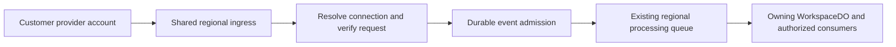

# Ashby connector: queries, events, and repeatable setup

> Created 2026-09-12.
>
> Query Ashby through personal MCP and ingest workspace events through webhooks,
> with a shared installation and maintenance lifecycle adopted by Granola.
> Companion: [MCP tool contract](design.md).
> Standing contract: [Rally implementation brief](../2026-08-05_avalon-implementation-brief/prd.md).
> Replaces the [personal-only Ashby proposal](../2026-09-10_ashby-connector/prd.md).
> Owners of the existing behavior: [connectors](../../connectors.md),
> [regionalization](../../regionalization.md), [security](../../security.md),
> [Ace](../../ace.md), and [data model](../../data-model.md).

## Summary

Rally members can ask Ashby questions in a work stream, and workspace
administrators can connect Ashby events for use by Rally's existing automation
engine. Both capabilities are required for this launch: personal OAuth to
Ashby's hosted MCP server supplies live recruiting queries and explicitly
requested updates; a workspace API key establishes signed webhook subscriptions.
One Ashby entry in Settings presents these independently authorized capabilities
and their individual readiness. Connecting one does not silently connect the other.

Rally also owns a reusable installation, maintenance, and removal lifecycle for
customer-managed webhooks. Ashby is its first new provider; existing Granola
workspace connections adopt it without changing credentials or URLs. Operators
can preview and resume changes across connections, with each unresolved result
visible. Future providers reuse that lifecycle through the existing adapter
registry. This PRD owns the complete Ashby launch and its shared infrastructure;
the companion contains only the detailed MCP contract.

## Motivation

The product owner explicitly needs two outcomes: receive Ashby events for future
automations and ask live questions such as “Which candidates are hired?” and
“Which profiles changed?” Separating these into independent launch proposals
made it unclear whether delivering the connector included both. This proposal
consolidates those outcomes and their acceptance into one launch requirement.

In the Ashby design discussion, it was identified that each connecting customer needs its own provider-side webhook configuration. The follow-up concern was maintaining N registrations when a destination,
subscription, or secret changes, then repeating that work for future providers.
Those meeting sketches and requests are the product evidence for this proposal;
there is no production fleet-size or failure-frequency measurement to cite.

Rally already has a connector registry, encrypted regional credentials,
authorization, webhook verification and normalization, and durable event
processing. Granola also has provider-specific setup, endpoint deletion, and
explicit repair. Its creation path lives in `ConnectionService`, while its
provider operations live in the adapter. Copying that whole path for Ashby would
copy the lifecycle and its failure cases along with the useful provider pattern.
See [the current Granola behavior](../../connectors.md#granola).

Ashby's public API supports creating, inspecting, updating, and deleting webhook
settings. Updates cover the destination, signing secret, and enabled state;
changing the subscribed event requires a different registration. This makes
automated maintenance practical, while also illustrating why adapters must
declare precisely which operations are supported.
[Create](https://developers.ashbyhq.com/reference/webhookcreate-1),
[inspect](https://developers.ashbyhq.com/reference/webhookinfo),
[update](https://developers.ashbyhq.com/reference/webhookupdate-1),
[delete](https://developers.ashbyhq.com/reference/webhookdelete-1).

## Goals

1. An administrator installs Ashby or Granola through the same lifecycle and
   sees authorization, delivery readiness, and any unfinished setup accurately.
2. A developer adds another supported provider without duplicating the
   installation coordinator, credential storage, maintenance runner, or UI states.
3. An operator changes a provider's required configuration across selected
   connections, resumes interrupted work, and identifies every unresolved result.
4. Existing Granola connections keep delivering during adoption of the shared
   lifecycle, without reconnecting or recreating their endpoints.
5. Duplicate delivery, repeated setup requests, partial provisioning, lost
   responses, and stale maintenance jobs cannot silently duplicate work or undo
   a person's disconnect decision.
6. Providers with incomplete management APIs have a supported manual completion
   path that identifies exactly what the administrator must do.
7. Workspace authority and regional ownership remain enforced throughout setup,
   incoming delivery, maintenance, and cleanup.
8. An eligible member connects personal Ashby OAuth, queries recruiting records
   with their own permissions, and receives sourced answers with honest coverage.
9. Personal queries and workspace event delivery are independently testable and
   revocable; neither can borrow the other's credentials to recover missing access.
10. Explicitly requested recruiting updates retain the existing confirmation and
    receipt contract, including clear handling of uncertain outcomes.

## Non-goals

1. **An integration builder or user-authored workflow engine.** Rejected for
   this proposal: adapters and configuration remain reviewed code.
2. **Migrating all existing connectors.** Deferred: Ashby and Granola prove the
   shared contract. Existing app-wide webhook and OAuth paths remain supported.
3. **Replacing the event pipeline.** Rejected: reuse normalized activities,
   regional queues, admission receipts, and existing automation matching.
4. **A second recruiting tool implementation over REST or a new MCP safety
   policy.** Deferred: live personal queries use the official MCP server and
   Rally's existing confirmation rules. REST manages workspace webhooks in
   this release; it is not a silent fallback for denied or unsupported queries.
5. **A background polling or bulk synchronization framework.** Deferred:
   webhook setup does not imply historical import, missed-event backfill, or
   perpetual reconciliation sweeps.
6. **Automatic expansion of customer access.** Rejected: a provider manifest
   change cannot grant itself new permissions or subscribe to newly authorized
   categories without the appropriate customer decision.
7. **Guaranteed exactly-once provider mutations or uninterrupted delivery during
   every provider configuration change.** Rejected as unsupported promises:
   surface ambiguous outcomes and any unavoidable cutover gap explicitly.
8. **Unattended recruiting queries under a personal grant.** Rejected: event
   ingestion does not let an automation inherit a member's OAuth authority.
   Workspace REST reads for later automation enrichment are deferred until their
   required fields, API permissions, tools, and workspace access are specified.
9. **An ATS replica, exhaustive profile-change history, or autonomous hiring
   decisions.** A replica and historical synchronization are deferred. Hiring,
   rejection, outreach, and stage changes require a concrete authorized request;
   the agent does not infer permission from an incoming event.

## Product behavior

### One Ashby entry, two independently authorized capabilities

**Settings → Connections → Ashby** presents two setup options:

| Option | Who connects | Mechanism | Readiness means |
| --- | --- | --- | --- |
| Personal queries | Each eligible member | Ashby hosted MCP with personal OAuth | Authorization and live tool discovery succeed for that member. |
| Workspace events | Workspace administrator | API key for management and signed incoming webhooks | Every selected registration is verified; last received activity is shown separately. |

Either option can be connected first. Show **Connect your account** and
**Set up workspace events** independently, along with who can perform each action.
Never collapse both states into one “Ashby connected” badge. Disconnecting personal
queries leaves the workspace's authorized event subscriptions in place; disconnecting
workspace events leaves members' personal OAuth connections in place.

Both paths ship together. A workspace can choose to use only one, but shipping only
webhooks or only MCP does not satisfy this PRD. The diagram below describes the
event path; personal queries go from the authorized Rally run to Ashby's MCP server
and return results to the work stream without passing through the webhook queue.

### Personal queries: connect your Ashby account

The **Personal queries** option within Ashby is searchable by Ashby, recruiting,
hiring, candidates, interviews, and applicant tracking. The entry says: “Use your
Ashby account for recruiting work. Access follows your Ashby permissions.” It also identifies the provider
service as beta and explains that tool calls use Rally's confirmation flow.

The setup surface explains the provider prerequisites in this PRD and opens Ashby
authorization in the browser. This option has no API-key field or editable
server URL; workspace event setup is the separate administrator option in the
same Ashby entry. A member does not need Rally administrator status to connect
their own account. One enabled Ashby personal connection per member per Rally
workspace matches the existing personal-connection experience;
reconnecting updates that connection rather than silently creating a duplicate.

The attempt belongs to the initiating member, workspace, and region. Switching
Rally workspaces while the browser is open cannot move the connection. The
callback follows the shared workspace-addressed desktop handoff and reconciles
against the stored attempt. Cancelled consent leaves the member disconnected;
an expired or replayed callback tells them to start again.

Success shows the connection with its personal scope and provider-verified
account or organization label when available. If the provider supplies no
verified label, show “Ashby — personal”; never infer identity from an email
domain or display a credential-derived identifier.

### Work in a work stream

The member asks for recruiting work in the composer. Rally discovers and loads
the eligible Ashby plugin, then uses its live tools. Loading does not fetch
candidate records, change hiring state, or start a background process.

Priority acceptance workflows are:

| User request | Required experience |
| --- | --- |
| “Which candidates are hired?” | Resolve the requested jobs and application status/stage fields through live discovery, filter for hired applications, and identify their candidates. State the filters, pagination coverage, and any deduplication; do not assume a candidate has one application. |
| “Which profiles changed since Monday?” | Resolve the time window and verify whether the live provider fields support modification filtering. Distinguish a record modification from a candidate editing their own profile and from a field-by-field change history. When that evidence is unavailable, state the limitation; do not infer changes from the current profile. |
| “How is the pipeline for our backend role looking?” | Resolve the intended job, distinguish similarly named jobs, and report the scope and freshness of the returned pipeline information. |
| “Help me prepare for my upcoming interview.” | Resolve the interview and relevant candidate before preparing a factual brief with source references. Ask for a disambiguating detail when necessary. |
| “Find Jordan Lee's application for this role.” | Resolve candidate and application separately; show alternatives when the name is ambiguous. |
| “Add this note to the candidate.” | Identify the exact candidate and note text, use the existing confirmation flow, and distinguish a provider draft from a saved note. |
| “Move this application to the next stage.” | Discover the actual application and valid destination stage; make the exact target and change reviewable before execution. |

These are product acceptance scenarios, not hard-coded remote operation names.
The implementation validates them against a test account's live tool surface
before release. It never claims a scenario succeeded merely because a tool with
a similar name was found.

Results appear in the transcript. Use source links and identifiers returned by
Ashby; do not manufacture candidate, application, or interview URLs. Where a
result contains no usable URL, identify the record by its returned type and ID
and say that no direct link was supplied. A source reference is not a watched
resource and does not schedule updates.

Answers distinguish “no matching records” from “no permission,” and a partial
page from a complete dataset. Counts come from an explicit provider count or a
fully traversed result set with its filters stated. A current read is not a
transactionally consistent snapshot across several calls. Historical transcript
content is not represented as a fresh Ashby lookup.

### Authority, visibility, and confirmations

Only an eligible run under the connection owner's authority uses the personal
connection. Another participant needs their own connection for a new provider
operation. Joining a work stream or seeing an earlier answer does not grant
access to the original connection.

**Personal credentials do not make a shared transcript private.** Setup and
connection details say: “Only you can use this connection. Information you bring
into a work stream is visible to people who can view that work stream.” Users
can use a private work stream for sensitive recruiting work. This proposal
does not add field-level transcript access control or automatically widen a
work stream's audience.

All hosted-MCP calls retain the existing confirmed-write classification,
including operations Ashby describes as reads. The confirmation identifies the
Ashby connection, operation, and concrete arguments. A declined confirmation
causes no provider call. Loading a plugin or receiving tool results is never
blanket consent for subsequent changes. Provider-required draft/confirmation
steps are honored as well; a draft is not reported as a completed mutation.

Feedback submission to Ashby and communication to third parties require an
explicit user request. An agent encountering an error does not volunteer
candidate information to provider support.

### Personal query connection and failure states

| State | What the user sees and can do |
| --- | --- |
| Not connected | Connect action, personal-scope explanation, and prerequisites. |
| Connecting | Pending browser authorization, with cancellation and shared attempt reconciliation. |
| Connected, tools not loaded | Connection is available; the first relevant task loads its current tools. |
| Loading tools | Visible tool/plugin progress. A failed discovery exposes no partial catalog. |
| Empty result | An explicit no-match result with the search scope; no invented candidate. |
| Provider access refused | A bounded explanation to check Ashby access or ask its admin; no inference that a hidden record exists. |
| Reconnect needed | Reconnect action for a refused grant. No repeated prompt for an API key. |
| Rate limited or unavailable | Explain that work could not finish. Honor supplied retry guidance; do not present cached content as current. |
| Offline | Connection management and live calls are unavailable. Existing transcript content remains historical; no provider write is queued invisibly. |
| Outcome uncertain | State that the operation may have happened. Stop duplicate execution and direct the member to inspect Ashby. |
| Disconnected | Future use is blocked and active runs lose authority at the next check. Historical work-stream content remains subject to Rally's existing retention and access rules. |

Connection testing is read-only at the protocol level: validate authorization
and discover tools, without invoking a recruiting tool or submitting feedback.
Disconnect removes local usable credentials and follows supported provider
revocation where available. Local disablement succeeds even when Ashby cannot
be reached; the UI does not claim provider revocation without confirmation.

### Workspace events: shared setup in Settings

The provider catalog in **Settings → Connections** uses the manifest to show
available personal and workspace modes. Workspace setup is administrator-only.
The form explains what data and events Rally receives, who in the workspace can
use the connection, the required provider permissions, and whether any steps
must be completed in the provider's dashboard.

For Ashby and Granola workspace setup, an administrator supplies the provider
API key through a password field. It is submitted to the selected workspace's
regional backend and is not saved in desktop preferences or returned by the API.
Personal OAuth modes retain their existing browser authorization flow.

Setup creates a durable attempt and a stable connection identity before any
provider mutation. Repeating the same setup request returns that attempt rather
than creating another installation. Where a provider already has a product rule
allowing one enabled workspace connection, that rule remains; this PRD does not
make connection cardinality universal.

The sequence is: validate credentials and permissions, prepare the receiving
route and verification material, establish the required provider registrations,
verify their state, and publish the installation result. Each stage is saved.
The page can close and reopen without losing progress. Errors appear inside the
setup surface with their next action.

Do not call the installation ready because credentials work. Every required
registration must also be verified or explicitly identified as unverified.
Do not claim delivery has been observed until a real delivery or supported
provider test establishes it.

### Standard connection states and controls

Keep credential health separate from webhook installation state. Existing
`healthy`, `error`, and `needs_reconnect` observations are not replacements for
the authoritative `disabled` decision. A transient installation problem must
not hide an otherwise usable tool connection.

| Installation state | What the administrator sees |
| --- | --- |
| Not configured | Required inputs and **Connect**. |
| Setting up | Current stage and preserved progress; no second setup begins on a repeated click. |
| Current | Required configuration is verified, with its last verification time and last received event time when known. |
| Update pending | What changes and whether the administrator must authorize additional access. |
| Updating | Per-registration progress; unaffected active registrations continue working. |
| Action required | Exact provider steps, missing permissions, or an outcome that requires inspection. |
| Failed | A known failure, its affected registration, and a safe retry or repair action. |
| Disconnected, cleanup pending | Rally access is disabled; specific provider registrations remain to be removed. |
| Disconnected | Rally access is disabled and required remote cleanup is confirmed complete. |

These installation states apply to workspace events only. An empty installation
list says no workspace connection exists. While loading,
show loading state rather than an empty result. Offline views can show the last
known state with its timestamp, but cannot imply a fresh test or silently queue
a provider mutation. Detailed errors never reveal credentials or provider content.

**Test connection** reads authorization and installation state. **Repair** is an
explicit administrator action whose proposed changes are shown first. Granola's
current repair-on-test behavior moves to this explicit control, so a test has
the same read-only meaning across providers. A provider-disabled subscription
is reported; an ordinary check never silently re-enables it.

### Stable webhook routing and admission

New customer-specific ingress follows `/ingest/{provider}/{connectionId}` on
the owning region's existing API host. A route maps to exactly one connection
and its workspace. The provider segment must agree with the stored connection.
Existing Granola URLs keep working unchanged; no new per-provider host or
per-customer deployment is required.

The connection identifier is routing metadata, not authentication. The adapter
verifies the raw request under the installation's current verification policy
before ordinary payload storage, normalization, or event admission. Setup
challenges use the provider's separate, documented handshake rules and never
become recruiting or meeting activity.

A new installation's route must be ready for an immediate provider ping. If
real events arrive during partial provisioning, verified deliveries are admitted
durably under the approved connection configuration. Already accepted deliveries
are not discarded merely because another registration is still being created.
Provider acknowledgement follows durable acceptance, not completion of downstream
processing. A durable outbox or the existing admission mechanism closes the gap
between committing acceptance and scheduling processing.

Provider adapters define delivery identity and related-event semantics. Duplicate
deliveries create no second normalized activity. Distinct legitimate events
must not collapse merely because a provider reuses a correlation identifier.
Out-of-order delivery never implies the latest-arriving event is the newest state.

### Desired configuration and bulk maintenance

The reviewed provider declaration defines a configuration version and the
registrations required for each granted capability. Each connection records the
desired version it is authorized to use and the version actually verified.
The executable plan is derived from those declarations and current observations;
operators cannot submit arbitrary provider URLs or API requests through it.

A Rally operator uses a shared maintenance command to select a provider, region,
target configuration version, and a workspace subset or all eligible workspaces
in that region. **Preview** reports planned creates, updates, removals, unchanged
registrations, and connections requiring customer action. **Apply** executes
that reviewed selection and returns a durable operation ID. The target list is
fixed for that operation; new installations use the current authorized setup
version through the normal connection path.

The same regional runner serves initial installation, approved upgrades, explicit
repair, and cleanup. It records per-connection and per-registration outcomes,
resumes after interruption, and skips completed work. Repeated invocation with
the same operation identity resumes rather than duplicates the operation.
Display progress as current, pending/running, failed, and action required, with
individual causes. Report completion only when every target has an explicit
outcome; a partially applied rollout is not reported as entirely current.

| Change | Maintenance behavior |
| --- | --- |
| Rally processing logic | One code deployment; no provider registrations change. |
| Destination URL | Update supported registrations, retaining the old receiver until cutover is verified. |
| Signing secret | Use the provider-specific rotation procedure and record pending versus active verification material. |
| New event category | Require customer authorization when it expands the approved event scope, then provision it. |
| Replacing an event registration | Establish and verify the replacement before retiring the old registration where the provider permits overlap. |
| Removed subscription | Stop matching it locally, then disable or delete the known remote registration and verify the result. |
| Unsupported provider operation | Produce a manual action; do not invent an endpoint or pretend the update succeeded. |

No fleet-wide periodic sweep is required for this release. Setup, explicit tests
and repair, operator upgrades, reconnect, and disconnect trigger work. Retryable
work uses the existing regional execution infrastructure and its failure/DLQ
visibility. A deploy alone does not mutate every customer's provider settings.

### Recovery and disconnect

Only one maintenance plan for a connection executes at a time. Plans carry the
connection's lifecycle generation and authorized configuration; every external
step rechecks them. New settings, credential replacement, or disconnect invalidate
older pending work. Cancellation stops future dispatches and records any call
already in flight; it does not claim to recall a provider request.

Before an external mutation, persist the exact intended operation and a stable
identity. Use provider idempotency if available. Otherwise inspect for its result
through a trustworthy provider lookup when possible. A timeout after creation
does not authorize a second create. If the provider cannot recover the created
ID or prove absence, mark the outcome unknown and require reconciliation. Never
adopt an unrelated customer webhook merely because its event type matches.

Disconnect immediately removes ordinary connector use and event-processing
authority. Pending maintenance cannot restore it. A provider resource created
by an already-dispatched stale call is recorded for cleanup, not adopted as a
new active installation. Revocation is rechecked when queued events are consumed.

An isolated cleanup operation may use the encrypted credential solely to remove
the exact recorded resources after disconnect; it cannot read business data,
create subscriptions, or restore tool access. Reuse the shared credential door
with this explicit cleanup purpose rather than bypassing it. Remove the retained
credential once cleanup finishes. If cleanup is unsupported or credentials are
revoked, show the provider's manual removal steps. The administrator can remove
the local credential without falsely marking remote cleanup complete.

### Repeatable provider onboarding

Each provider supplies one reviewed declaration and adapter implementing the
facets it actually supports. Authentication, connection scope, tool transport,
and event delivery are separate choices; adding MCP support does not imply a
workspace webhook subscription or vice versa.

| Rally-owned behavior | Provider-owned behavior |
| --- | --- |
| Connection identity, permissions, regional storage | Required credentials and endpoint permissions |
| Setup form, status, repair, disconnect, maintenance preview | Provider labels, prerequisites, and manual instructions |
| Desired/applied configuration and durable operation progress | Mapping desired event capabilities to remote registrations |
| Execution sequencing and recovery outcomes | Create, inspect, update, remove, and reconciliation APIs where supported |
| Stable routing and durable normalized admission | Signature verification, ping/challenge response, payload mapping, dedupe identity |
| Credential handling and host cancellation | Refresh/revocation semantics and secret-rotation procedure |
| Shared contract test harness | Protocol fixtures, documented limitations, and live acceptance evidence |

The management facet distinguishes **automatic**, **manual**, and **unsupported**
for each operation. It also states whether one registration represents one event
or several, whether registrations can be enumerated, and whether an ambiguous
create can be reconciled. Manual completion remains unverified until supported
inspection or authenticated provider evidence proves it; a checkbox alone does
not establish delivery readiness.

The shared contract uses existing authorized connection contexts. Provider code
does not write Rally installation tables, schedule its own fleet migrations, or
choose the destination workspace from a webhook body. Exceptions need a documented
provider constraint rather than a second copy of the lifecycle.

## Impact on the product contract

None — this refines connector setup and operations within the existing contract.
It creates no global activity feed, new work-stream type, or global approval
gate. A workspace connection remains workspace authority; a person's MCP
connection remains personal authority. Maintenance never turns one into the other.

## Decision log

None yet.

## Key design decisions

1. **Extract from Granola while adding Ashby.** Two real providers test the
   abstraction immediately. Copying Granola's lifecycle would repeat its
   recovery obligations; designing against hypothetical providers would enlarge
   the framework without proving it.
2. **One optional management facet on the existing adapter.** Reuse the registry,
   credential door, normalization, and regional infrastructure. A separate
   integration service would duplicate ownership and deployment boundaries.
3. **Desired configuration plus observed state.** A resumable comparison can
   explain partial success. A fire-and-forget loop over customers cannot tell
   the next operator what actually changed.
4. **A shared operator command first.** Provide preview, apply, status, and
   resume without adding a new operator site. An Ace GUI can consume the same
   regional management boundary later; it is not required to launch.
5. **Manual work is a typed result.** Lack of a provider endpoint is a product
   constraint. Browser automation or a generic HTTP escape hatch would hide it.
6. **Keep URLs stable and health checks read-only.** Most releases then change
   only Rally code; a connection test never becomes a fleet mutation mechanism.
7. **Separate customer grants from the software version.** A new manifest can
   describe more events without authorizing them for existing customers.
8. **One PRD and one launch, with two authorization modes.** Product scope follows
   the user's complete Ashby workflow; the protocol split belongs inside the design.
   The earlier personal-only proposal is replaced by this one.
9. **MCP for personal recruiting queries; REST for webhook management.** Reuse
   live discovery and OAuth instead of building a parallel recruiting API catalog.
   Ashby documents that MCP schemas can change and recommends its public API when
   a stable contract is needed. Deterministic workspace API queries can be added
   when a concrete automation requires them; they are not implicitly part of the
   webhook key's authority. [Ashby MCP documentation](https://docs.ashbyhq.com/ashby-mcp-server-beta).

## Data model

Register connector type `ashby` with both personal and workspace connection modes.
Personal tools use `ashby.personal.mcp`, a Rally authorization capability rather
than an OAuth scope. Reuse existing connection-owned grants, encrypted credentials,
regional OAuth attempt correlation, plugin activation, and execution receipts.
The shared identity model keeps personal and workspace connection IDs distinct.
There is no candidate mirror or historical synchronization table.

The existing WorkspaceDO connection authority owns the new installation state.
The following are logical records; physical schema and migrations follow
[the data model](../../data-model.md) and
[Durable Object SQLite rules](../../durable-object-sqlite.md).

| Record | Required information |
| --- | --- |
| Installation | Connection ID, provider, authorized configuration, desired/applied versions, lifecycle generation, setup identity, state, last verification, actionable error |
| Remote registration | Installation ID, stable logical registration key, provider ID when known, selected events, expected destination, observed enabled/configuration state, verification-secret reference |
| Maintenance operation | Owning region, operator identity, reviewed target configuration, frozen target enumeration, progress, cancellation state |
| Operation step | Connection/generation, intended action and input hash, pending/dispatched/completed/unknown outcome, resulting provider ID, verification evidence, safe next action |

Secrets use the existing versioned encrypted envelope, never plain configuration
or operation payloads. A required new record inherits the owning subsystem's
retention policy; do not create an unrelated indefinite store of credentials or
provider responses. Regional ingress directories hold only opaque routing data.
Regional maintenance progress is derived from authoritative per-connection work,
not a second control plane allowed to overwrite it.

## Regional impact

Personal OAuth exchanges, MCP discovery, and tool calls also stay in the
workspace's region. Use regional callbacks and never relay EU codes, tokens, or
results through Global. Ashby is an external processor; an EU Rally workspace
does not imply the provider's MCP server is EU-hosted. Verify the actual provider
configuration and disclosure instead of inventing an EU Ashby endpoint.

All setup, verification, credential handling, event admission, and maintenance
execution happen in the workspace's owning region. Global and EU receivers use
the existing regional API hosts. A shared command addresses both regions
explicitly and may display content-free progress locally; it does not copy EU
provider content or credentials into Global storage.

Use existing regional Queues for deferred work and typed calls when a caller
requires a committed response, per [Queues or RPC](../../choosing-queues-or-rpc.md).
If routing a new job kind requires queue configuration changes, both regions and
their dead-letter destinations must be registered together. No queue or Worker
is created per customer.

## Security and trust model

Personal OAuth uses the shared credential door, PKCE, single-use state, HTTPS
origin validation, and encrypted connection-bound credentials. Validate provider
origins explicitly. The renderer, model, shell, and logs never receive tokens.
Treat tool descriptions and returned recruiting content as untrusted data; they
cannot change authority or authorize external communication. Keep queries, record
URLs, and returned tool payloads out of diagnostics.

Workspace setup, repair, permission expansion, and disconnect require a workspace
administrator. Fleet maintenance requires the existing authenticated operator
boundary and is limited to reviewed provider configuration. Operator access is
not authority to expand a customer's grants. Lifecycle mutation is backend-owned
and never granted to an agent through a recruiting tool.

A workspace API key can expose data beyond a requesting member's personal
provider access. Setup must explain that workspace connection data is available
under Rally's workspace rules. Personal OAuth permission claims must not be
applied to workspace API keys or webhook payloads. Event admission applies the
approved event/data scope even if the supplied key has broader permissions.

Verify requests before ordinary content storage, keep setup challenges isolated,
reject cross-provider/connection substitution, and use provider-specific replay
and collision rules. A route suffix or provider account name is never proof of
authenticity. Unknown event types cannot auto-enable a new capability.

Content-free audit records include actor, operation, connection, generation,
configuration version, timestamps, and outcome. No API keys, signing secrets,
candidate records, meeting text, raw payloads, or request bodies enter maintenance
logs. Provider business content remains only in the existing authorized regional
event and product storage.

No new numeric timeout, retry ceiling, polling cadence, or concurrency cap is
selected here. Reuse existing execution limits and published provider constraints;
any genuinely new defensive bound follows [the limits rule](../../adding-security-defensive-and-other-limits.md).

## Agent behavior

The static Ashby descriptor is deferred and searchable. Loading it exposes the
current authorized server surface under a connection-specific plugin. Every
tool uses `ashby.personal.mcp`, `mode: write`,
`idempotency: record_before_execute`, serial execution, and the existing hosted
MCP timeout. [The companion contract](design.md) specifies identities, wire
mapping, discovery, schemas, error handling, replay, and exact standing guidance.

The agent discovers records before referring to their IDs, disambiguates before
mutations, uses returned valid fields/stages rather than guesses, and follows
provider draft semantics. It stops on uncertain side effects and revoked
authority. It does not imply that personal connection ownership shields data
placed in a shared work stream.

No model-callable installation or maintenance tools are introduced. Plugin
loading does not create or repair webhook subscriptions. Workspace events use
the existing authorized event-consumer path; setup alone creates no automation
and invokes no model. Setup pings and maintenance status are not recruiting
events. Event-triggered runs cannot spend a personal MCP connection's grant.

The profile-change workflow reports only what returned fields can establish.
Without historical data or actor evidence, the agent cannot turn “record updated”
into “the candidate edited their profile.” This limitation is part of the
model-usability acceptance, not an invitation to guess a provider operation.

## Provider configuration

Provider statements below were checked against official Ashby documentation on
2026-09-12. Granola's baseline is the checked-in adapter and its existing behavior;
live provider acceptance is required before replacing that path.

### Ashby personal MCP

Use `https://mcp.ashbyhq.com/mcp/v1` through the shared hosted-MCP adapter.
An Ashby organization administrator enables **MCP Server** under
**Admin → Organization Setup → Opt-in Features**; eligible elevated-access users
then connect individually through OAuth. Analytics-only organizations are excluded.
The service supports dynamic client registration, record filtering, candidate
reads, and pipeline queries; exact fields and operations come from live discovery.
These provider statements were checked on 2026-09-12.
[Ashby MCP documentation](https://docs.ashbyhq.com/ashby-mcp-server-beta).

Register Rally as the client with verified OAuth metadata, scopes, origins, and
regional callbacks. Release acceptance verifies DCR, refresh, account restrictions,
and live tool compatibility in both regions. Published documentation is not
evidence of a completed Rally authorization flow. No API key is requested for
this personal mode. The workspace webhook key does not authenticate MCP.

### Ashby workspace installation

An administrator creates a dedicated key using Ashby's
[API-key setup](https://docs.ashbyhq.com/how-do-i-generate-an-api-key).
The installation requests `apiKeysRead` for inspecting recorded webhooks and
`apiKeysWrite` for creating, changing, and removing them. These management grants
do not implicitly grant new model-facing recruiting tools.

The initial event catalog is `applicationSubmit` and `candidateStageChange`,
with explicit selection during setup. The first covers submitted applications
and manually added candidates, but not bulk imports or integration syncs; the
second reports stage changes, including those triggered by hiring. Do not label
the first as an exhaustive candidate-created feed.
[Application submission](https://developers.ashbyhq.com/reference/applicationsubmitwebhook),
[stage changes](https://developers.ashbyhq.com/reference/candidatestagechangewebhook).
Each selected event has its own remote registration. Normalization declares the
corresponding activity descriptor, identity, permitted payload fields, and
digestibility explicitly in the adapter before exposing it to consumers; no
new digest or automation subscription is enabled by connection setup.

The signed route exists before registration because Ashby sends a ping on
creation or update. A failed ping can leave the registration disabled, so verify
enabled state instead of treating a successful create response as readiness.
Manual setup uses **Admin → Integrations → Webhooks** with the same generated
URL and signing material.
[Webhook setup](https://developers.ashbyhq.com/docs/setting-up-webhooks).

Require `Ashby-Signature` verification using HMAC-SHA256 over raw bytes.
[Authentication](https://developers.ashbyhq.com/docs/authenticating-webhooks).
Deduplicate within the connection by `webhookActionId` and `action`; retain body
hash evidence to detect conflicting reuse. The provider's `data` is content,
while the workspace ID comes from Rally's connection lookup. Related event types
can share the same action ID and must remain distinct.
[Payload fields](https://developers.ashbyhq.com/docs/common-payload-data),
[related events](https://developers.ashbyhq.com/docs/related-webhooks).

The documented inspect operation requires a known webhook ID. The design must
not assume an undocumented list API or provider idempotency key can recover a
lost create response. If verified discovery cannot recover the registration,
that connection requires manual reconciliation before another create.

### Granola adoption

Import the existing connection's `webhookEndpointId` and encrypted
`webhookSigningSecret` into the shared inventory. Retain its connection ID,
credential, callback URL, and current event set (`note.access_granted`,
`note.edited`, `note.generated`, `note.regenerated`). One endpoint carries that
set; the framework must not assume Ashby's one-event-per-registration shape.

Reuse Granola's create, list/inspect, delete, and supported patch operations.
Verify additional update/rotation behavior before advertising it. Retain Standard
Webhooks verification rather than replacing it with Ashby's signature dialect.
Import runs inspect existing endpoints and do not create replacements. Missing
IDs, missing endpoints, or disabled delivery become explicit repair states.

## Rollout

The release gate includes both personal MCP workflows and workspace event
ingestion, plus Granola adoption. Deploy regional support before desktop setup
actions. An older backend shows an unavailable action rather than starting an
unsupported flow. Existing custom MCP connections are not silently migrated.

Ship without a feature flag, preserving the product owner's explicit decision
in this discussion to make the connector available to all workspaces. The shared
maintenance command still requires an explicit operator apply; unflagged release
does not imply a fleet-wide provider mutation on deploy.

Introduce additive installation records and compatible regional handlers before
the desktop setup/repair changes. Import and verify Granola records with no
provider writes. Transfer lifecycle ownership through a per-connection migration
marker so old and new setup/repair paths cannot both act during a rolling deploy.
That marker tracks ownership, not feature availability.

Exercise both providers with test accounts in Global and EU before release.
For a maintenance upgrade, inspect a selected subset, then deliberately expand
the same reviewed version. Existing enabled registrations remain until their
replacements are verified where supported. Capture any provider-imposed delivery
gap instead of promising an atomic cutover.

Rollback stops new work and preserves successful remote state, operation receipts,
and compatible receivers. An old executable cannot take over connections whose
installation version it cannot interpret. Downgrading provider configuration is
an explicit compensating maintenance operation, not an automatic consequence
of deploying older code. Disablement and manual disconnect remain usable.

Implementation updates `connectors.md`, `hosted-mcp-connectors.md`,
`provider-apps.md`, `data-model.md`, `security.md`, regional
and provider configuration, Settings discovery, and operational/manual acceptance
guidance. Add a durable `connector-installation-lifecycle.md` module document with
its running changelog and register it in the documentation index when the shared
subsystem ships. A phased `plan.md` is written only after PRD approval.

## Acceptance

| Behavior | Evidence required |
| --- | --- |
| Complete Ashby launch | Personal MCP queries and workspace events both pass; Settings shows their independent readiness and disconnecting either leaves the other authorized path intact. |
| Personal OAuth | Both regional callbacks handle consent, denial, replay, workspace switching, refresh, reconnect, and disconnect without exposing credentials. |
| Personal authority | Members with different Ashby permissions cannot spend one another's grants; workspace automation and read-only child paths cannot inherit personal tool authority. |
| Recruiting workflows | Complete the personal query/update scenarios with test records; hired answers state application filters and scope; unsupported profile history produces an explicit limitation. Verify confirmed writes in Ashby and no writes after denial. |
| Live tool contract | Fully paginated discovery, schema changes, removed tools, collisions, malformed schemas, uncertain writes, and clipped results follow the companion contract. |
| Model usability | On the configured medium fallback model, cover discovery, a successful multi-tool query, ambiguous names, wrong ID families, changed stages, missing modification fields, confirmation, and recovery without loops. |
| Shared implementation | Ashby and Granola use the same setup/maintenance state machine; provider-specific branches are limited to declared protocol facets. |
| Installation | Repeated setup and interrupted setup return the same attempt; immediate ping succeeds; partial registration failure remains visible. |
| Granola adoption | Existing IDs, secrets, URLs, and events survive; no create/delete is performed during import; delivery continues. |
| Regional ownership | Global and EU setup, events, and maintenance remain regional; forged provider or connection coordinates cannot cross tenants. |
| Durable admission | A crash between event acceptance and processing dispatch loses no accepted event; repeated delivery has one normalized effect. |
| Provider semantics | Ashby related actions with the same action ID remain distinct; Granola verifies its own signature format and grouped event set. |
| Bulk updates | Preview shows exact intended changes; interrupted apply resumes; completed steps are skipped; every target has an explicit result. |
| Ambiguous creation | Losing the provider response does not create a second subscription; unsupported reconciliation becomes action required. |
| Concurrent changes | Disconnect or newer settings fence old jobs; an in-flight stale creation becomes cleanup work and cannot restore access. |
| Test versus repair | Testing performs no provider mutations; explicit repair changes only the previewed approved configuration. |
| Manual capability | A synthetic provider lacking update/list/delete produces exact manual steps and never reports an unverified installation as current. |
| Permission expansion | New event/data scope cannot be applied before the administrator authorizes it, even through fleet maintenance. |
| Cleanup | Revoked credentials, unsupported deletion, and failed removal remain visible; local disablement succeeds immediately. |
| Rotation and cutover | Pending verification material is available before a provider switch; failed/unknown rotation preserves a recoverable state and never clears signing protection. |
| User surfaces | Real desktop inspection covers setup, loading, partial success, repair, denied access, offline state, and cleanup pending. |
| Maintainability | A developer can run the same contract suite against both providers and follow one documented onboarding checklist. |

Use provider-boundary doubles for remote protocol variations and the real
Cloudflare runtime for installation persistence, concurrency, durable admission,
and recovery. Prove each integration behavior fails under a representative
production break per [testing](../../testing.md). Run documentation checks,
lint, typecheck, appropriate tests, and live provider acceptance for implementation.
No production candidate or meeting data is used as a test fixture.

Measure success through completed acceptance flows and existing content-free
installation/maintenance outcomes: connected, current, failed, action required,
and cleanup outstanding. No invented adoption threshold or new metrics stack
blocks release.

## Open questions

1. **Provider recovery details — blocks release:** verify Ashby's create-response
   recovery options, ping payload/authentication behavior, and secret-rotation
   behavior; verify Granola's supported patch fields and secret recovery. Mark
   unsupported operations honestly instead of delaying the entire abstraction.
2. **Ashby payload authorization — blocks release:** confirm what data each
   selected webhook includes, including confidential records and fields, and
   whether it differs from REST read permissions. Finalize disclosure and the
   normalized allowlist before allowing workspace activity.
3. **Operational identity — blocks implementation of the command:** choose the
   existing operator-authenticated entrypoint and regional authorization mechanism
   for maintenance mutations. The current read/inspection interfaces do not
   automatically authorize this new write surface; no new permanent credential
   or arbitrary SQL mutation path is implied by this PRD.
4. **Personal MCP compatibility — blocks release:** verify OAuth metadata, scopes,
   registration, refresh, and live recruiting workflows against actual test
   accounts in both regions. Finalize Global/EU external-provider disclosures.
5. **Profile-change coverage — blocks claiming this query supported:** verify the
   fields available for modification-time filtering and whether actor or detailed
   change history is exposed. The initial experience must state any limitation;
   exhaustive history or a new REST query surface requires an explicit scope
   decision rather than an undocumented fallback.
