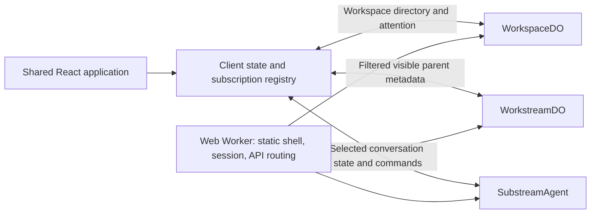

# Guest access and the Rally browser application

Design report · Updated September 16, 2026 · Guest/browser proposal, not implemented

## Recommendation

Use ordinary Rally identities, a workspace-specific guest relationship, and explicit grants to conversations or whole workstreams. Guests have full mutation capabilities within their granted scopes, including reads and writes through connectors made available to those scopes. They can be promoted to ordinary workspace members without changing identity. Make Main (`0`) an ordinary conversation for authorization. Share the application core between browser and desktop, with a static HTML entry shell and a persistent SPA for collaboration. Retain direct, hibernating WebSockets to the objects whose state is actually on screen. **A new WebSocket multiplexer Durable Object is not required for this product.**

The decisive distinction is **what someone can access versus what their client currently subscribes to**. Access to four conversations in four workstreams does not require four live transcripts. A directory can show all four while only the selected conversation streams.

This recommendation follows authority, information exposure, failure isolation, and client lifecycle—not implementation effort. The substantial changes are in authorization and shared application boundaries, rather than transport consolidation.

## 1. Evidence and current architecture

The original investigation used checkout `d3db0a308fa0923a3866fb06c51d05ec1c5d790a` and main at `b6cee0a5a6830aa02bfc0836e0b946b8eb78d4c7`. On September 16, I fetched and successfully rebased this clean detached checkout onto `origin/main` at `d7289cdbee192bc6e19ac4836f858e2b5029c40b`, then inspected the updated Sidekick documentation, authority, service and skill-loading paths. The original source anchors below retain their original revision; the Sidekick section cites the new revision. This is source research, not a production audit or a browser performance measurement. That initial refresh changed no application code; implementation foundations have since been added and remain in progress. The latest September 16 refresh targets `791905edb391db2af09daae1867e9b1b7de5ba44`; the intervening commit only updates release configuration. The Sidekick authority paths below were rechecked and retain the same recommendation, local-loading and ownership boundaries. Current main configures Global only; older documents still discuss Global/EU. Keep the configured deployment identifier in all addresses without introducing another deployment.

| Existing mechanism | Implication for this design |
| --- | --- |
| D1 owns users, sessions, workspace membership and invitations. Membership roles are owner/admin/member. | Guests fit the identity ledger, but existing membership assumptions must change. |
| Main SubstreamAgent owns its scope/roster; WorkstreamDO owns private-child membership. | Authorization is split around Main. Independent sharing needs a uniform conversation model. |
| WorkstreamDO `authorizeViewer` requires parent readability **and** child membership. | A child-only guest cannot be admitted under the present rule. |
| WorkstreamDO `canRead` treats workspace scope as readable; callers assume workspace membership was established. | Adding a guest role to middleware alone would expose workspace-public content. |
| Resource authorization combines resource facts, source connection policy and exact attachment locations. | Shareable resources need explicit exposure semantics; attachment presence alone is not sufficient today. |
| Artifact opening checks whole-workstream access. | Child-only artifact access needs a conversation/resource grant path. |
| WorkspaceDO supplies directory synchronization; WorkstreamDO supplies parent metadata; SubstreamAgent supplies conversation state. | UI hierarchy already has useful corresponding state owners. |
| Desktop opens a workspace socket and proactive control/Main pairs for selected workstreams. | Browser selection should follow visible surfaces, not inherit the desktop swarm. |
| The renderer already supports native browser WebSockets and a browser platform fallback. | Protocol reuse is plausible; production browser identity, routing and capabilities still require design. |

One documentation discrepancy matters: parts of `websocket-architecture.md` still describe message creation through WorkspaceDO. The inspected `use-workstream-socket.ts` sends `create_message` using `submitSubstreamCommand`. Preserve the owning conversation command path; do not build a second gateway based on stale prose.

Original investigation source anchors:

- [Authentication middleware](https://github.com/juno-ai-labs/avalon/blob/b6cee0a5a6830aa02bfc0836e0b946b8eb78d4c7/apps/api/src/middleware/auth.ts), [WorkstreamDO](https://github.com/juno-ai-labs/avalon/blob/b6cee0a5a6830aa02bfc0836e0b946b8eb78d4c7/apps/api/src/durable-objects/workstream-do.ts), [authorization service](https://github.com/juno-ai-labs/avalon/blob/b6cee0a5a6830aa02bfc0836e0b946b8eb78d4c7/apps/api/src/services/authorization-service.ts).
- [Browser platform fallback](https://github.com/juno-ai-labs/avalon/blob/b6cee0a5a6830aa02bfc0836e0b946b8eb78d4c7/apps/desktop/src/renderer/lib/platform.ts), [socket selection](https://github.com/juno-ai-labs/avalon/blob/b6cee0a5a6830aa02bfc0836e0b946b8eb78d4c7/apps/desktop/src/renderer/lib/workspace-workstream-sockets.tsx), [conversation socket](https://github.com/juno-ai-labs/avalon/blob/b6cee0a5a6830aa02bfc0836e0b946b8eb78d4c7/apps/desktop/src/renderer/lib/use-workstream-socket.ts).
- [Resource/artifact admission](https://github.com/juno-ai-labs/avalon/blob/b6cee0a5a6830aa02bfc0836e0b946b8eb78d4c7/apps/api/src/services/artifact-open-service.ts), [revocation contract and known producer gap](https://github.com/juno-ai-labs/avalon/blob/b6cee0a5a6830aa02bfc0836e0b946b8eb78d4c7/docs/access-revocation.md).

## 2. Model the primitives

### Identity, workspace relationship, grant, participation

These are separate facts:

1. **Identity:** who the person is, identified by an immutable user ID.
2. **Workspace relationship:** whether that identity is an active member or guest in this workspace.
3. **Grant:** which subject may perform which actions on a particular scope.
4. **Participation:** the people represented in a conversation's roster, messages, mentions and activity.

Guest is a property of the workspace relationship, not a global account type. The same person can be a member in their own workspace and a guest in three others. Promotion must preserve their user ID, messages, grants and history.

Use the existing membership ledger, generalized to an explicit access class (`member` or `guest`) and administrative role. A guest has no administrative role. Keeping these separate avoids treating “guest” as merely a lower rank in a role hierarchy that already assumes all ranks can read workspace-public material.

Generalize identity to provider-independent users plus verified login identities/email addresses. Do not fabricate a Google subject for an invitee. Pending invitations may appear in participant UI as **Invited**, but they are not authenticated participants or online viewers. On acceptance, all active participation references resolve to the ordinary user ledger. An existing account receives additional grants, not another guest account.

### Two grant scopes

| Scope | Meaning |
| --- | --- |
| Conversation `(workspace, workstream, substream)` | That conversation, its shared history and its explicitly exposed resources. Main is substream `0`. |
| Workstream | Main, the workstream's shared resources, and conversations configured to inherit the workstream audience. |

The requested guest grant is **full collaborator**: the same mutation capabilities an ordinary member receives on that scope. It includes creating/editing/deleting content where the ordinary action permits it, resource mutations, agent runs, and connector reads and writes. Sharing, lifecycle and connector-management operations use the same scope/ownership rules as for ordinary members; there is no extra read-only or guest-specific write restriction. A child grant does not authorize deleting its parent or administering its workspace. Narrower view-only grants may be added later if requested, but are not the guest default.

The effective participant roster is the union of active direct and inherited conversation grants, deduplicated by user ID, with provenance such as “via workstream.” Use that same effective set for participant display and mention eligibility. Reading implicitly through ordinary workspace membership need not add every employee to every roster.

Removing one grant does not remove access supplied by another grant. The share UI should explain remaining access. Suspending the workspace relationship overrides every grant in that workspace.

### Promotion to full member

Promotion changes the existing workspace relationship from guest to member and assigns the ordinary member role. It does not create a user, copy conversations, transfer authorship, replace connector credentials or require another signup. Preserve the user ID, direct grants, participant references, browser sessions, preferences and audit history. A workspace administrator performs the transition, with a durable revision and delivery intent.

The same identity gains normal member discovery and workspace capabilities, including member access to workspace-public scopes. Existing restricted conversations retain their rules. Notify connected clients to refresh directory/capabilities and refresh or re-admit socket attachments that froze the old access class; a token claim is not the membership authority. Existing valid guest-scope activity need not be interrupted just to promote someone. Optional member onboarding must not block their existing conversations. Workspace SSO/MFA policy, if configured, may require authentication before newly granted member capabilities become usable.

Retain the direct guest-era grants as independent provenance. If a future demotion feature is added, it must explicitly define which member-era permissions survive rather than assuming promotion can be reversed by changing one field.

### Main is not the parent permission

Separate workstream container visibility from permission to read Main. A child-only guest receives enough container information to navigate to their child, but no Main transcript, Main preview, Main-derived summary or Main participant list.

The intended rule is:

> Active workspace relationship AND an applicable action grant AND the target's lifecycle permits the action.

Ordinary member access to workspace-public material is one explicit grant rule. Guests are excluded from that rule. Parent existence and lifecycle still matter; parent transcript access does not.

### Define “complete workstream” honestly

Private children are already a product promise. An ordinary Main participant must not gain authority to expose another person's private child by sharing its container.

Recommend explicit child audience modes: **inherits workstream** or **restricted**. A workstream grant automatically covers current and future inheriting children. Restricted children require their own grant.

For literal complete sharing, the operation must cover every existing restricted child as well, and the actor must have sharing authority for each. Otherwise return the exact incomplete scope to the authorized sharer; do not label partial access “complete.” Future inheriting children are covered automatically. A future restricted child is excluded by its explicitly chosen boundary, and the UI must state that rule. This resolves the ambiguity without silently abolishing private substreams.

## 3. Put each fact under one authority

| Authority | Proposed responsibility |
| --- | --- |
| Identity/control-plane D1 | User and login identities, verified addresses, sessions, workspace relationships, invitation identity/routing, durable control-plane delivery intents. |
| WorkstreamDO | Workstream and conversation grants, child audience policy, sharing authority, grant revisions, effective participant derivation and grant-operation receipts. |
| SubstreamAgent | Conversation content, ordering, commands and an explicitly versioned local admission projection. |
| WorkspaceDO | Viewer-filtered directory and attention projections, resource identity/versions, resource exposure facts and invitation batch coordination. |

Move Main authorization ownership out of Main into WorkstreamDO as part of this design. Main becomes symmetric with other conversations. A new central guest/ACL DO is unnecessary: independent workstreams do not need to serialize their grant changes with each other.

Keep grant ownership in the parent. Actual participant additions may wait for the parent grant and its local projection; ordinary already-seated sends skip this coordination. The user explicitly chose this simpler ownership model on September 17 rather than redesigning admission to eliminate that first-addition cost.

Projection rows are not a second editable grant ledger. Each carries its source revision and is applied monotonically. Main roster compatibility readers must eventually use the new authority; avoid permanent dual writes with two plausible owners.

Sharing four conversations across three workstreams is a durable batch operation with per-target receipts, not a distributed transaction. Retry resumes committed targets. A result can accurately show three ready grants and one refused target. The client must never infer that all succeeded from email delivery alone.

## 4. Invitation and acceptance lifecycle

1. An authorized sharer selects scopes and enters email addresses. Validate sharing authority and external-sharing policy for every target.
2. Record a durable invitation operation and pending per-target grants. Dispatch email through a durable delivery intent. Repeating the same operation does not create duplicate grants or invitations.
3. The link opens a browser entry route. It is an invitation to authenticate and accept, not a transferable resource-read capability. A GET from an email scanner must not accept the invite.
4. Authenticate with an existing provider or verify the invited mailbox through email login. Support arbitrary email recipients rather than assuming everyone uses Google. Bind acceptance to a currently verified address matching the invitation. Never match only an unverified profile email or silently merge accounts by address.
5. Consume the invitation's single-use acceptance credential, establish/reuse the guest workspace relationship, and resume each target's grant activation. Revocation racing acceptance wins according to the owner's operation revision.
6. Return an authorized destination as soon as that target is ready. After email verification and invitation acceptance, open the shared conversation directly. The lite browser has no workspace creation, connector setup, onboarding, or name/avatar setup step.

Bind durable grants to user IDs after acceptance. Changing an email must not move access to whoever later acquires the address. Expiration, re-invitation, verification-attempt limits and email delivery budgets are explicit product/security choices whose numeric values the team must set, rather than incidental constants.

Existing full members remain members when accepting a share. Guest removal ends only that workspace relationship. Declining one invite must not remove previously accepted grants. Replies, mentions, unread state and notifications use the same identity/participant machinery as members, filtered to each accessible conversation.

## 5. Resources and AI are part of the sharing boundary

“Resources underneath” needs a precise definition: **resources exposed through an authorized conversation or workstream, including their explicitly shared descendants and versions**. A storage prefix, directory path, arbitrary link or reference to another workstream is not a grant.

Use a resource exposure relation that identifies the conversation/workstream, resource, allowed actions, and whether it exposes a pinned version or live updates. Check the canonical attachment/exposure relation together with the viewer's grant. A resource shared through two accessible conversations remains readable when one relationship is removed.

Apply this decision to metadata, file bytes, thumbnails, extracted text, versions, downloads, resource lists, search results, generated sites and artifact sessions. Parent or resource IDs alone grant nothing. The right rail must use the selected conversation's authorized inventory rather than its parent's complete inventory.

Sharing an attachment does not itself delegate provider credentials. Resource disclosure uses the resource authorization path; live provider operations use the existing connector execution policy described below. Opening an original provider URL may still require a separate provider account.

### Existing connectors inside shared workstreams

Confirmed requirement: guests can use the connectors already available inside their shared workstreams, including reads and writes. Reuse the current personal/workspace connector model, credential storage, refresh lifecycle, tool capability selection and execution principals. No new connector scope or per-workstream binding system is required.

The existing model makes workspace connector capabilities available to ad-hoc workstreams under the workspace principal. Extend guest admission so a full collaborator on a shared conversation can initiate those operations through that conversation, under the same connector policy as a member. Keep existing explicit connection selections for automations. Personal connections remain available only under their owner's existing authority; participation never shares somebody else's personal connection.

Authorization composes the guest's current conversation mutation grant with the existing execution-principal, connection and tool-capability checks. A child-only guest does not need Main transcript access to use the connectors available to that child. Enforce the same composition for discovery, execution, resource hydration and queued work; displaying a filtered tool inventory is not sufficient enforcement.

Record the human actor separately from the execution principal: the guest initiated the action; the workspace connection supplied provider authority. Preserve the user, conversation, connection and operation identity in Rally's receipt even when the provider attributes the operation to an installing account or bot. Reuse normal idempotency and uncertain-outcome reconciliation. No per-tool confirmation dialog is introduced.

Connector use does not grant workspace connector administration. Installation, reauthorization and disabling a shared connection retain the existing administrative rules for members and guests alike.

The external data boundary is the connector's existing granted capabilities, not the transcript's contents. A guest may use a workspace connector to read or mutate external data beyond what appears in the shared conversation. Do not claim a Slack channel or repository restriction unless the existing connector/provider authorization actually enforces it. Per-workstream connector selection would be a separate future product requirement.

Conversation access removal or connection disablement invalidates future calls and pending run admissions under the withdrawn authority. Already dispatched external writes may finish; record and reconcile their outcomes rather than promising cancellation can undo them. Revocation must also invalidate retained inventories and runnable queued work under the old grant.

### Existing substream context stays unchanged

Sharing an existing substream shares that conversation as it exists, including
its saved context and history. Preserve the existing capture, compaction and
model-input behavior. Sharing does not add a context review, context selector,
redaction pass, or fresh-substream flow. This is the user's September 17 decision.

A saved copy derived from Main remains part of the child's existing context;
access to that copy does not grant access to live Main or future Main changes.
Existing connector and execution-principal rules continue to apply. Never
silently execute under the inviter's personal credentials.

## 5A. Sidekicks under the current architecture

### Existing behavior verified after rebase

The new architecture separates **recommendation**, **local loading**, and **Sidekick ownership**. It supersedes the earlier statement in this discussion that child loads are execution-local only.

| Mechanism | Authority and current behavior |
| --- | --- |
| Workstream-owned Sidekick | SidekickDO owns the source; WorkspaceDO projects ownership. Ownership inherently recommends it throughout its workstream, including Main and children. It cannot be detached from that inherent recommendation. |
| Explicit recommendation of a workspace Sidekick | WorkstreamDO owns `workstream_sidekick_attachments`. Participants can attach/detach non-archived workspace Sidekicks. The recommendation applies throughout the workstream. |
| Loaded Sidekick | Each SubstreamAgent persists its own `sidekick_attachments`, including private children. Loading in one conversation does not copy a local attachment to Main or siblings. |
| Execution snapshot | Each execution retains the admitted skill revision/body for retries, while source eligibility is rechecked. New executions resolve current eligible sources. |

A recommendation marks an eligible catalog entry `[Recommended]`; it does not automatically load its instructions. Source availability is separate: drafts, paused sources and triggered/non-loadable Sidekicks can appear in the rail without being loadable skills. Triggered Sidekick execution remains its own lifecycle, rather than pretending every displayed Sidekick can be loaded or manually run.

The rail combines owned Sidekicks, explicit recommendations and the **selected substream's** loaded attachments, deduplicated by Sidekick ID. Removing an explicit recommendation also removes the current substream's local attachment, but leaves sibling local attachments intact. Removing a recommendation does not revoke the underlying workspace Sidekick's ordinary discoverability. Shared recommendation changes publish the existing workspace `automations` synchronization topic.

### Proposed guest behavior

Guests use this architecture directly. Add the guest grant checks to these paths rather than building a guest-specific Sidekick store or copying Main's attachment list into children.

| Action | Child-only or Main-only guest | Full-workstream guest |
| --- | --- | --- |
| See recommended Sidekicks in the shared conversation | Yes, with source metadata authorized for that conversation; Main transcript access is not required for a child. | Yes. |
| Load an eligible Sidekick and persist its local attachment | Yes, in the granted conversation, using the existing source/audience policy. | Yes, in each accessible conversation. |
| Remove a local loaded attachment | Yes, from the granted conversation only. | Yes, from accessible conversations. |
| Change workstream-wide recommendations | Requires a separate parent management grant; conversation mutation alone does not change all siblings. | Yes, under normal workstream participant rules. |
| Edit/manage a workstream-owned Sidekick | Requires its management grant; use from a child does not confer it. | Yes, under normal owning-workstream participant rules. |
| Edit a recommended workspace Sidekick | Existing workspace Sidekick manager rules apply. Recommendation grants use, not global editing rights. | Same rule. |
| Read Sidekick authoring conversation, memory or run history | Only through their own authorization; loading instructions does not expose these. | Apply existing Sidekick viewer rules and any separately restricted run audience. |

This preserves full mutation within the guest's granted scope. A workstream-wide recommendation is a parent mutation; a child-local attachment is a child mutation. Apply the same distinction to ordinary members with equivalent scope grants. The UI must distinguish **Remove from this substream** from **Remove workstream recommendation**, because their effects differ even when one Sidekick occupies a single merged row.

Recommendation is not itself authorization. Workstream-owned skill sources retain the same-parent check; workspace skill sources use the existing workspace execution context; personal sources retain their principal and whole-receiving-audience checks. Include guests in the effective audience used for those checks. Adding a guest must not let a previously admitted personal skill continue disclosing its instructions solely because its body was already pinned. Revalidate active sources at the established execution boundaries.

A guest's authenticated email session must resolve to the ordinary **user** execution principal for person-authorized Sidekick list/attach/detach tools. Connector calls may still use the existing workspace connector principal. Do not change a guest-initiated run into a workspace-principal run merely to unlock connector access: current workspace-principal runs intentionally lack person-authorized Sidekick management tools. Hidden background-child execution remains host-authorized and does not create human viewer access.

### Authorization integration status

- `recommendedSidekicks(id, substreamId)` now authorizes the receiving conversation before and after reading source-owned summaries, combining explicit recommendations and workstream ownership. The guest child route does not open Main.
- `sidekickAttachments(id, ..., substreamId)` now serves guest-aware reads/removals from the selected SubstreamAgent and uses source-owned summaries instead of authoring details. Local mutation rechecks participation and archive state.
- `setSidekickRecommendation` and WorkstreamDO currently require Main/parent participation. Replace that assumption with the proposed parent management grant for shared mutations, retaining child checks for the accompanying local detach. Never partially delete a shared recommendation before discovering that local removal is forbidden.
- `resolveSidekickSkills` and `readSkillSource` preserve independent source authorization. New guest discovery is restricted to existing recommendations, workstream ownership and local loads; guest participants remain in the receiving audience. Already admitted snapshots retain the established revalidation behavior. An inaccessible source is not made usable merely by its recommendation ID.
- Subscribe the browser to the existing `automations` sync topic and invalidate recommendation reads by workstream and local-attachment reads by conversation. No additional Sidekick socket or multiplexer is needed for these lists. Opening an authorized Sidekick authoring conversation uses its existing separate feed.

Source references verified at the latest rebase: [lifecycle](https://github.com/juno-ai-labs/avalon/blob/791905edb391db2af09daae1867e9b1b7de5ba44/docs/automation-lifecycle.md), [recommendation and attachment service](https://github.com/juno-ai-labs/avalon/blob/791905edb391db2af09daae1867e9b1b7de5ba44/apps/api/src/services/workstream-service.ts), [skill resolution](https://github.com/juno-ai-labs/avalon/blob/791905edb391db2af09daae1867e9b1b7de5ba44/apps/api/src/services/sidekick-skills.ts), [source eligibility](https://github.com/juno-ai-labs/avalon/blob/791905edb391db2af09daae1867e9b1b7de5ba44/apps/api/src/durable-objects/sidekick-do.ts), [recommendation authority](https://github.com/juno-ai-labs/avalon/blob/791905edb391db2af09daae1867e9b1b7de5ba44/apps/api/src/durable-objects/workstream-do.ts).

## 6. Directory, navigation and participant UI

Build viewer-specific navigation, not a complete workspace payload followed by client filtering.

- **Workspace layer:** show the workspace's actual name, icon and color in the left sidebar whenever the guest has access to any conversation in that workspace, including a child-only substream grant. This workspace presentation metadata is explicitly part of the shared navigation context and does not require Main access. Also show accessible workstream containers and authorized attention counts. No guest access to the full member directory, connection inventory, workspace search or administration by default.
- **Workstream layer:** safe container label and accessible child rows. Main appears only when accessible. Counts, previews, presence, last activity and running indicators must derive from visible scopes.
- **Conversation layer:** selected transcript, participant roster, composer capabilities and resource inventory.

A workstream title or description generated from Main can itself disclose Main. Give the workstream container a deliberately shareable label; otherwise show a neutral workstream label for child-only access. This restriction concerns workstream metadata; the workspace name, icon and color are explicitly visible as described above. Do not leak hidden sibling names, participant identities or counts through breadcrumbs and badges.

If access to the active child ends, select another authorized destination or show access removed. Do not automatically navigate to Main. Likewise, an inaccessible Main URL must not open a sibling by guessing what the user intended.

Keep the existing workspace-addressed HTTPS link shape and turn it into a working browser route, with an optional “Open in desktop” action. An unauthenticated preview should reveal no conversation metadata. Opening a different workspace validates that exact workspace and preserves account identity.

## 7. Lightweight browser collaboration: shared core with static HTML entry

The browser is a lite collaboration client, not desktop feature parity. It includes
email sign-in, invitation acceptance, shared-scope navigation, conversations,
resources, participants and scoped mutations, including existing connector and
Sidekick use. It omits workspace setup, connector setup, onboarding and desktop
settings. Account and workspace administration stay in the desktop host.

### Recommended decomposition

Extract the reusable application from the Electron renderer into three boundaries:

1. **Application state and protocol core:** typed commands, authorization capabilities, query keys, subscription ownership, replay reducers, optimistic receipts and navigation addresses.
2. **Shared React product surfaces:** scoped navigation, conversation, participants and resources that exist on both platforms.
3. **Platform adapters:** browser sessions/history/uploads/clipboard versus Electron credentials/IPC/windows/files/Node socket transport.

The web app is a lite collaboration deployment using this core. It does not aim for desktop feature parity: no workspace creation, setup, onboarding, connector installation or Sidekick authoring flows. Email verification and invitation acceptance take the user directly to shared content. It supports scoped conversation mutations, participants, resources, existing connectors and eligible Sidekicks. Promotion preserves identity and access without adding a browser onboarding requirement. The desktop is another host of the shared core. Avoid a second guest-only transcript application and avoid scattering checks for `window.rally` throughout product components. Browser development fallbacks are starting points, not a production host contract.

### SSR versus SPA

September 17 implementation revision: the lite client uses the static SPA option.
The earlier SSR implementation rendered only an unauthenticated form and still
needed client session discovery. It has been removed: there is no authenticated
server bootstrap to justify a second rendering path. The SSR discussion below
records the tradeoffs, not a requirement to implement server rendering.

SSR determines how the first document is produced. SPA determines whether navigation preserves the running client. They are compatible.

| Approach | Assessment |
| --- | --- |
| Pure client-rendered SPA | Chosen for the lite client: persistent lifecycle and reuse; first visit loads JavaScript before session discovery and authenticated route work. |
| Server-rendered document on every navigation | Useful for ordinary content pages; destroys collaboration state and connections unless the application layer persists. Poor fit here. |
| Server-rendered entry, hydrated persistent SPA | Optional if authenticated bootstrap is added: fast route/auth/error handling, optional initial visible data, then one long-lived client state owner. |

Serve the static HTML shell and immutable JavaScript/CSS assets. The client mounts
once, discovers its cookie-backed session, and navigates without replacing its
subscription owner. Invitation, login and access-denied states use this same
client. No personalized data is embedded in cached HTML.

Authenticated server bootstrap would be a future change with its own need for
private response caching and an exact hydration/snapshot handoff. It is not part
of this lite implementation. Nested client routes must not each establish their
own socket or independently overwrite the live query cache.

### Snapshot-to-live handoff

The initial snapshot must include the exact conversation address, authorization generation, stream epoch, state revision and applicable replay cursor. Authorize at socket admission; the static document carries no conversation authority or initial transcript.

Subscribe from that cursor. The source atomically establishes the subscription boundary and supplies events after it, or returns a replacement snapshot when replay is unavailable. Preserve per-stream ordering, deduplicate replay, reject older snapshots and identify stream resets. Existing socket-owned range snapshots must be generalized deliberately if HTTP/SSR bootstrap is to resume them; a room-local ephemeral snapshot ID cannot simply be invented in the web Worker.

There is no need for a transactionally consistent snapshot of the entire workspace. Independent panels can expose their own revisions. A gap between initial HTML and socket readiness must not drop a message or overwrite a newer frame with an older loader response.

### Browser authentication

Use a same-origin browser session boundary backed by the ordinary session ledger. Prefer an opaque host-only `Secure`, `HttpOnly`, `SameSite` cookie; keep durable refresh credentials out of JavaScript storage. A thin web Worker can adapt cookie authentication to the existing API/service boundary while reusing business services. Workspace selection stays in the request address, not a single mutable server-side “active workspace” that would make two tabs conflict.

Cookie authentication requires CSRF protection for mutations and an exact Origin policy for WebSocket upgrades. Keep short-lived, purpose-bound, single-use socket tickets obtained through authenticated HTTP; present them using the existing subprotocol design. The web edge forwards an upgrade, rather than creating a second application WebSocket relay. Cookie prefixes and scope semantics are documented in [MDN Set-Cookie](https://developer.mozilla.org/en-US/docs/Web/HTTP/Reference/Headers/Set-Cookie).

Use a dedicated application origin if separating marketing scripts from authenticated content. Preserve canonical public links with a non-secret redirect. The origin choice and regional service routing must be explicit; do not forward arbitrary client-supplied API hosts or place privileged bearer tokens in URLs.

## 8. WebSocket topology and reuse

All public socket handshakes pass through an authenticated Worker route; the diagram's direct arrows refer to ownership, not publicly addressable Durable Objects.

### Own subscriptions above UI routes

Use one client subscription registry scoped to account, deployment and workspace. Parent keys include parent identity; conversation keys include parent and substream, including `0`. Reference counts let the transcript, roster and inspector share the same subscription. Routing within a workstream retains the parent socket and changes the selected feed. Account/workspace changes tear down the old scope and reject late frames.

For one visible conversation, the baseline is **three sockets**: workspace, parent and feed. Four accessible conversations still use three when one is open. If a second conversation is genuinely visible, it adds a feed and, only if needed, its distinct parent. In general: `1 + visible distinct parents + visible conversations`, plus separately justified features such as dictation.

Use the directory's filtered attention/running summaries for background rows. Do not open full Main transcripts to obtain sidebar status. Warm authorized destinations on deliberate navigation intent only when useful; connection warmth is never user presence. A browser host should not inherit Electron's pin/recent/running swarm or iOS's assumption that Main accompanies a child.

A component registry solves duplicate sockets within one page. Cross-tab pooling is a separate concern. Tabs can safely own their own registries; session/logout notifications can coordinate them. A SharedWorker can later share connections across compatible same-origin tabs, but it does not bypass browser network scheduling or guarantee survival through suspension. [MDN SharedWorker](https://developer.mozilla.org/en-US/docs/Web/API/SharedWorker).

### Does the browser require a server multiplexer?

**No.** There is no architectural rule that a browser application must have one WebSocket. The existing desktop documentation records Chromium same-endpoint handshake serialization; that is a reason to avoid speculative socket swarms, not proof that a handful of direct sockets is unsuitable. It is also not a universal “six WebSockets” browser limit. Browser and transport behavior should be tested, not assumed from HTTP connection folklore.

Cloudflare's accepted hibernating sockets can stay connected while an object leaves memory; outgoing WebSockets do not hibernate. This makes a relay that dials every source object materially different from the existing direct topology. [Cloudflare WebSocket guidance](https://developers.cloudflare.com/durable-objects/best-practices/websockets/).

| Option | Architectural consequence | Decision |
| --- | --- | --- |
| Direct workspace/parent/feed sockets | Source owns authorization, ordering and replay; transcript traffic stays off shared relays. | Recommended. |
| Put all feeds through WorkspaceDO | One client socket, but every visible token passes through a workspace-wide serialization point. | Reject for transcript transport. Keep directory aggregation there. |
| Dedicated per-user/workspace relay DO | One physical socket per client connection and logical subscriptions; extra hop, subscription protocol and replay/revocation responsibilities. | Conditional alternative. |
| Relay DO with outbound WebSocket per source | Recreates the swarm on the server and prevents normal idle hibernation there. | Reject as the default relay implementation. |

Cloudflare documents a soft limit around 1,000 requests/second per object, dependent on the work each request performs. It is not a transcript throughput guarantee, but it is sufficient reason not to concentrate independent conversations in one workspace transport bottleneck. [Durable Object limits](https://developers.cloudflare.com/durable-objects/platform/limits/).

For arithmetic: if `V` viewers each watch `F` feeds producing `R` frames/second, relaying them through WorkspaceDO adds approximately `V × F × R` outbound deliveries at that shared object. Direct feeds already need viewer delivery, but distribute it across the owning conversation objects. A multiplexer reduces client connection count; it does not eliminate the data volume.

### If one physical socket becomes a product requirement

Use a relay keyed by deployment/workspace/user, with independent device/tab connections. Do not create a global relay or route all workspace users through it. Keep product data and command receipts at their existing owners.

It would require all of the following:

- Authorized logical channel IDs, subscription generations, session identity and action capabilities.
- Durable subscription registration at each source, including reference counts for multiple client connections and cleanup/reconciliation after failure.
- Source-to-relay short RPC deliveries for interactive events, rather than persistent outbound sockets or long-lived RPC handles. Authorization/registration needs a committed response. Durable projection and recovery work can use queues/outboxes.
- Per-source epochs and cursors, replay after relay restart, duplicate handling and gap recovery. No invented cross-workstream total order.
- Fair scheduling, application flow control, cancellation and snapshot replacement. One large frame must not monopolize every conversation. The standard browser WebSocket API has no automatic receive backpressure. [MDN WebSocket](https://developer.mozilla.org/en-US/docs/Web/API/WebSocket).
- Revocation at both source and relay, fencing old queued deliveries before they reach a client.
- Hibernation-safe connection attachments or durable rows, and no assumption that in-memory subscriber maps survive eviction.

An RPC relay cannot lose a notification silently while the browser remains connected forever. It needs either durable source delivery intents with acknowledgement or a reconciliation signal that detects missing cursors. That is a real additional protocol, not a transparent wiring change.

A relay is justified if the product requires many simultaneous full-rate feeds or a single physical connection as a hard client constraint. Neither follows from sharing multiple scopes. Choose direct subscriptions for the stated product; the criteria above identify a different requirement, rather than postponing the architecture decision pending unavailable metrics.

## 9. Revocation and recovery contract

The current revocation documentation explicitly identifies a gap: a D1 removal can commit and its queue publication can fail without durable retry. External guest access should not ship on that guarantee.

Write a revocation intent in the same authority transaction as the membership/session change. Deliver it durably until the existing hierarchy has processed it. Workstream-local grant changes likewise record child projection/closure effects transactionally. Preserve monotonic grant incarnations so removing and re-adding someone never revives an old ticket.

Differentiate two milestones:

1. **Revocation committed:** fresh authority checks reject the withdrawn access.
2. **Revocation applied:** every affected live admission projection/session has installed the retraction and fenced further sends/commands.

A queue is not instantaneous global revocation, and a version number does not magically update a remote object. If the product promises completion on the Share dialog's response, that operation must wait for the affected enforcement owners to acknowledge the new revision, with a recoverable pending state when one cannot. Use immediate RPC where the caller needs that acknowledgement, backed by the durable intent for recovery. Source-local permission changes are checked before publication and command admission.

Messages already delivered cannot be recalled; cached and downloaded content cannot be remotely erased from another person's device. Client eviction removes stale display and local caches but is not enforcement. Narrowed access must reach resource downloads, artifact sessions, pending admissions, retained sockets, background notifications and queued commands.

The existing member-search policy deliberately accepts stale projected decisions. Do not use stale positive search grants as guest content authority: search should nominate candidates, and guest disclosure should validate current canonical scope/resource access before returning snippets or metadata. Use the same rule for lists that can leak hidden scopes. This is an intentional policy distinction, not a claim that the current search cache has immediate revocation.

Browser sleep, reload and reconnect must resume from acknowledged cursors or receive a replacement snapshot. Retry commands with their existing operation IDs and consult durable receipts; do not replay uncertain writes under new IDs. Unknown additive events remain compatible, while incompatible versions fail explicitly. Presence follows visible/focused UI and expires independently of socket warmth.

## 10. Implementation sequence and proof obligations

This is dependency order, not a reduced-scope estimate:

1. Agree on the access and information-disclosure semantics below.
2. Generalize user/login identity and workspace relationships; introduce versioned scope grants and durable invitation operations.
3. Unify Main/child grant authority at WorkstreamDO; migrate effective participants and admission projections without an interval of widened access.
4. Make directory, resources, search, artifacts, Sidekick recommendation/local-attachment/source admission, AI context and tools honor exact scope access; add durable revocation delivery and acknowledgement semantics.
5. Extract the shared client core and platform adapters. Build browser sessions, canonical routes and static HTML entry; reuse the existing socket snapshot-to-live contract.
6. Add browser subscription ownership by visible surfaces; validate desktop and native clients against changed server contracts, including old-client ticket versions.

Old clients must not treat guests as ordinary members. Release server support before browser access is enabled, and reject unsupported guest protocol paths explicitly. Promotion/demotion and migration must preserve identity and never temporarily widen scope.

Required acceptance cases:

- One guest sees Main in A, two children in B without Main, and the complete inheriting audience of C; inaccessible siblings and resources stay absent in every transport.
- The guest appears once in each effective participant list and uses ordinary identity for messages, mentions and unread state.
- A child-only guest sees the workspace's actual name, icon and color in the left sidebar without requiring access to Main.
- Guest and member collaborators can perform the same mutations on the same granted scope, including existing connector writes. Neither can escape its Rally conversation grants through raw IDs, dynamic tools or queued jobs; external provider access follows the connector’s actual capabilities.
- Promotion preserves user identity, authorship, participant entries, direct grants and active shared conversations while refreshing the newly available member capabilities.
- Duplicate invitations, wrong-account acceptance, expired/revoked invitations, email changes and partial multi-workstream activation behave predictably.
- Main-only, child-only, restricted-child and inherited grants remain distinct. Removing one overlapping grant leaves exactly the remaining access.
- Revocation races ticket preparation, child delivery, an active stream, a queued command, search and artifact access; a failed delivery is recoverable.
- Sidekick recommendations appear in Main and shared children without auto-loading; child-local loads persist without modifying Main or siblings. A child-only guest can use eligible recommendations without receiving parent management or Sidekick history access.
- Shared recommendation detach removes only the current local attachment; sibling loads survive. Personal-source eligibility changes when the receiving audience gains a guest. Workspace-principal runs never inherit person-authorized management tools.
- Initial socket snapshots race live messages and reconnect without missing or duplicating state.
- Two tabs use different workspaces, then logout/suspension/reload; no session, cache, presence or late frame crosses scopes.
- Sharing preserves the existing child history and saved model context without a new review or context-selection step; it does not grant live Main access.
- Real Chrome windows verify lite-client navigation and reconnect behavior. Safari/Firefox validation and full desktop parity are outside this implementation's scope. Real workerd verifies hibernation, replay and authority propagation. Integration tests must fail under deliberate dropped writes/skipped checks.

### Product decisions to settle

| Decision | Recommended default |
| --- | --- |
| Guest action bundle | Full collaboration and mutation within granted scopes, with the same per-action ownership rules as members. |
| Workstream connectors | Guests reuse the connectors already available inside shared workstreams, including reads and writes; no new connector scope or binding system. |
| Promotion | Update the existing workspace relationship to member, preserving identity, history, grants and sessions. |
| Sidekicks | Reuse workstream recommendations and persistent conversation-local loads; management follows the scope being mutated and source ownership. |
| Existing history | Shared conversation includes its visible history; offer a separately created clean conversation when that is unsuitable. |
| Workstream inheritance | Current/future inheriting children included; restricted children explicitly separate and never silently exposed. |
| Resource revisions | Declare pinned versus live exposure; use explicit approved publication for external connector content. |
| External sharing authority | A dedicated manage-sharing capability plus workspace policy; reading alone does not authorize invitation. |
| Revocation wording | Show committed versus applied accurately; only report fully removed once enforcement owners acknowledge. |
| Guest onboarding | Verify identity, accept, land in the shared conversation; no connector or workspace-creation requirement. |
| Browser collaboration | Hybrid entry plus persistent SPA; direct sockets selected by visible UI. |

## Conclusion

Build **scoped collaboration for ordinary users**, hosted by one shared application core. Treat Main as a conversation, make inherited access explicit, and make resources and model context obey the same audience boundary. Use static HTML entry and a persistent SPA to own live state. Reuse direct hibernating object sockets through a client subscription registry. A dedicated multiplexer would add an authority-adjacent distributed protocol without solving a requirement this sharing model creates.
