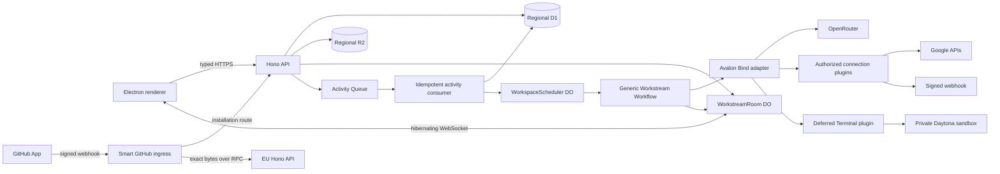

# Architecture

Avalon is a pnpm TypeScript monorepo with three deployment surfaces — an Electron
desktop client, a Hono Worker deployed twice as Global and EU, and shared
packages that hold every contract and rule the two ends agree on. This document
is the map of how those surfaces fit together: what runs where, what crosses
which boundary, and which document owns each subsystem in detail.

Read it before a change that spans more than one surface, before adding a
deployment surface or a package, and before assuming where a rule is enforced.
It stays a map: a subsystem described here in a paragraph has its own document,
and the map points at it rather than absorbing it.

## Where the code lives

```text
apps/
  desktop/                 Electron main, preload, React renderer, packaging
  api/                     Hono Worker, routes, services, DOs, Workflows, Queue
packages/
  contracts/               Zod API, WebSocket, agent, connector contracts
  db/                      D1 migrations, repositories, region-aware queries
  agent-harness/           Bind/OpenRouter adapter, prompts, skills, classifiers, tools
  connectors/              Core adapters and credential-plugin descriptors
docs/                      Product, architecture, security, setup, runbooks
```

| Path | Responsibility |
| --- | --- |
| `apps/desktop/src/main` | Window and Settings lifecycle, custom-protocol login completion, encrypted session storage, file selection, the macOS status item, and the main-owned telemetry/crash boundary. |
| `apps/desktop/src/preload` | The packaged CommonJS preload — the only channel between a sandboxed renderer and main. |
| `apps/desktop/src/renderer` | Both React surfaces. Talks only to the configured regional API. |
| `apps/api/src/app.ts`, `apps/api/src/routes` | The Hono application and its REST and upgrade routes. |
| `apps/api/src/services` | Business rules. Route handlers hold none. |
| `apps/api/src/services/terminal` | Deferred Terminal plugin, Daytona adapter, authority-fenced sandbox control plane, resources, and trusted GitHub publication. |
| `apps/api/src/durable-objects` | `WorkstreamRoom` and `WorkspaceScheduler`. |
| `apps/api/src/workflows`, `apps/api/src/queues` | The generic work-stream Workflow and the idempotent activity consumer. |
| `apps/api/src/*-regional-bridge.ts`, `apps/api/src/*-routing-bridge.ts` | The `WorkerEntrypoint` RPC bridges that are the only path from Global to EU. |
| `apps/api/src/env.ts` | `assertEnvContract` — the one place the Worker environment is parsed. |
| `apps/api/src/lib/rpc-contracts.ts` | The parsers every RPC bridge argument passes through. |
| `packages/contracts` | Every runtime contract both ends share. A type that only exists at build time is not one of them. |
| `packages/db` | Migrations and region-aware repositories. The migrations are authoritative for the schema. |
| `scripts/eslint-rules/require-validated-response.mjs` | The lint rule that makes a route validate its own response. |

## How it works

### The three surfaces

1. **`apps/desktop`** is the Electron application. Its main process owns main and
   Settings window lifecycle, custom-protocol login completion, encrypted session
   storage, file selection, and a minimal validated IPC bridge. Both sandboxed
   React surfaces use a packaged CommonJS preload and talk only to the configured
   regional API. The macOS application menu opens the singleton Settings window
   with **Command-,** and closes the focused window with **Command-W**, which on
   darwin has to come from a File menu of Avalon's own — Electron's `windowMenu`
   role omits it there. Settings also closes on **Escape**, a convenience rather
   than the platform gesture, and only when no dialog, select menu, or unsaved
   text field has a nearer claim on the keystroke. The main process also owns the
   macOS menu bar status item, which is the one surface that exists with no
   window open — Avalon opens at login by default and starts hidden — and which
   therefore reads the regional API for itself rather than through a renderer;
   [`menu-bar.md`](menu-bar.md) owns it. Main also owns the typed telemetry
   reporter, route and identity epochs, local spool, Crashpad generations, and
   authenticated regional upload; the renderer can only invoke registered
   semantic calls.
2. **`apps/api`** is a Hono application deployed as the same Cloudflare Worker
   code in Global and EU environments. It owns authentication, authorization,
   REST endpoints, WebSocket upgrades, D1 repositories, R2 objects, Queue
   production and consumption, Workflows, scheduling, connector execution, and
   the OpenRouter harness.
3. **Shared packages** contain runtime-validated contracts, database schema and
   repositories, connector adapters, agent-loop code, UI primitives, and test
   fixtures. Business rules live here or in services, never in route handlers.

### Request and event flow



Canonical product state lives in D1. Large activity payloads, uploads, and
snapshots live in R2 with relational metadata in D1. Durable Objects coordinate
ordering, presence, sockets, and alarms but are not canonical stores.

Users and workspaces each own a validated IANA timezone. The desktop detects the
local system timezone during native authentication, while browser or unavailable
detection falls back to `America/Los_Angeles`. Workspace defaults are
`America/Los_Angeles` in Global and `Europe/London` in EU. Automation compilation
preserves explicit trigger timezones and otherwise resolves personal or workspace
defaults according to scope before final schema validation.

### Region boundary

Google sign-in has one platform endpoint: the Global control plane at
`api.with-avalon.com`. It creates a short-lived, identity-only bootstrap session
and then discovers the user's existing workspace memberships and pending
invitations in both regions. Only users with neither receive the post-auth
workspace-region selector. Existing members activate their workspace directly,
while invited users can accept or decline the invitation in its issuing region
without a second Google sign-in.

Global reaches the EU deployment only through named Cloudflare Worker RPC service
bindings; there is no public internal-bridge HTTP route. `RegionalIdentityBridge`
carries minimal onboarding operations. `GitHubRegionalBridge` carries verified
setup operations and exact signed GitHub webhook bytes for installations
connected in EU. `WorkstreamEmailRoutingBridge` reserves globally unique,
immutable friendly addresses, while `InboundEmailRegionalBridge` passes only one
verified Resend event to the owning data plane so the body is fetched and stored
there. A successful activate, create, or accept operation mints a session in the
workspace's owning region, commits the Global opaque workspace binding, and
revokes the bootstrap session. The desktop then pins that regional API base URL.
Both deployments retain separate D1, R2, Durable Object namespaces,
session-signing and credential-encryption keys, and Worker secrets. Cross-region
workspace-content access is not implemented.

Telemetry begins before workspace selection without introducing a third data
plane. Global reduces Cloudflare's country signal to an immediate Global/EU route;
an affirmative EU result crosses only as a validated semantic projection over
`EU_TELEMETRY_BRIDGE` and prevents pre-region crash saving. The explicit workspace
binding controls future signals, but accepted history never moves. Global delivers
approved rows to PostHog; EU terminates telemetry in its regional D1, dedicated
EU-jurisdiction R2, and pinned crash processor. EU uses the separate
`GLOBAL_TELEMETRY_CONTROL` binding only for opaque preference mutation and
Global-signed journey authorization/closure; the key and destination identities
stay in Global. [`telemetry.md`](telemetry.md) owns the full event, preference,
identity, crash, and restricted operator flow.

### Identity and secrets

- Google sign-in uses server-side authorization code + PKCE against the single
  Global `/auth/google/start` endpoint. The Electron main process also creates a
  separate high-entropy verifier for each native attempt and exposes only its
  opaque attempt ID and S256 challenge to the renderer. The provider callback
  redirects through `https://with-avalon.com/auth/desktop/#target=…`; that page
  accepts only an exact `avalon://auth/complete` target, removes the fragment
  from history, and opens the app with a short-lived login ticket bound to the
  attempt. Ticket redemption is one-time and requires the verifier retained only
  in main-process memory. Workspace choice and invitations are resolved after
  identity authentication through authenticated onboarding APIs rather than being
  carried through provider state.
- Connector authorization is separate and incrementally requests only the
  selected capabilities. Each regional API persists an opaque connector-attempt
  record before returning the provider URL, completes the provider callback and
  credential persistence in-region, records a terminal result, and then redirects
  through the same hosted HTTPS-to-desktop handoff. The custom-protocol launch is
  a fast notification; Settings also polls the authenticated regional attempt
  endpoint, so the server record remains authoritative when a browser blocks or
  loses the launch. Google Mail + Calendar and Google Drive + Docs + Sheets remain
  presentation and authorization bundles over the same `google` adapter, not
  separate connector types.
- Desktop refresh material uses a versioned authenticated-encryption envelope. The
  default envelope uses an application-wide embedded key for update portability;
  Application → **Lockdown mode** uses Electron `safeStorage` and the
  operating-system keystore instead. Toggling the mode in-app migrates the auth
  credential, disposable profile cache, and any legacy session file under the
  serialized session-mutation boundary. The plaintext
  `userData/application-settings.json` preference is not authority to unwrap a
  Lockdown envelope by itself: an off preference paired with a new Lockdown
  envelope at startup removes only credential-bearing files and forces sign-in. If
  the keystore becomes unavailable, Avalon automatically applies the same
  off-and-relogin fallback. Access tokens remain in memory where practical.
- Connector refresh tokens are AES-GCM encrypted with a regional Worker secret.
- OpenRouter, Google, session-signing, webhook, and encryption keys are
  server-only values loaded from local `.env.local` during development and
  Cloudflare secrets in hosted environments.
- Azure OpenAI realtime dictation also keeps its endpoint and API key in the
  regional Worker. The desktop receives a one-minute, single-use Avalon socket
  ticket, presented through the handshake's `Sec-WebSocket-Protocol` header rather
  than the query string; Cloudflare consumes its JTI, reserves a bounded regional
  session, opens the authenticated Azure WebSocket, and admits only rate- and
  size-limited audio-buffer events from the client. Connections are capped at five
  minutes and raw microphone audio and transcripts are not persisted by this
  bridge.
- Every API operation resolves a session, workspace, role, execution principal,
  connection scope, and requested capability server-side.

### Work streams and live updates

Within each regional workspace, every work stream maps deterministically to one
`WorkstreamRoom` Durable Object named from region, workspace ID, and work-stream
ID. EU calls resolve the namespace through `jurisdiction("eu")`. The existing
namespace is SQLite-backed. Before its guarded maintenance cutover, D1 serves
the work-stream product rows; afterward the object's named SQL tables own root
metadata, transcript/substreams, viewer attention, runs/tools, compaction,
suggestions, and Terminal state. D1 retains workspace authority/routing and
versioned common/user directory projections. Its hidden KV migration, normalized
schema, fleet import, and authority states are documented in
[`workstream-durable-object.md`](workstream-durable-object.md).

An authoritative mutation that changes workspace/user surfaces writes a
versioned regional effect to the object's local outbox in the same SQLite
transaction. The room alarm publishes only opaque object/message IDs and a hash
through Cloudflare Queue. The consumer RPCs the regional object for the payload,
applies an idempotent D1 inbox transaction for sidebar projections, the
first-party activity log, or a short-lived notification intent, then RPCs an
acknowledgement to the source object. D1 resolves current membership, profile,
Slack, and email state. Mention delivery waits for the exact causally required
viewer-projection version, so Queue reordering cannot outrun a removal. The
object therefore owns the fact that a mention or state change occurred without
acquiring workspace credentials, placing product text in Queue storage, or
turning a failed network call into a lost sidebar update.

The room authorizes every connection against D1 itself rather than trusting the
one-minute ticket, using the same rule the REST reads apply — see
[`data-model.md`](data-model.md). That check happens once per socket, so anything
that retracts it has to reach the connections already inside. Before broadcasting
an event that narrows who may read — a work stream becoming `personal`, or a
participant being removed — the room sweeps its connected set against that same
rule and closes the sockets that fail it, marking each unsubscribed first so the
broadcast filter, not the runtime's closed-socket behavior, is what withholds the
frame. A revocation closes with `1008`, which the desktop treats as final: it
stops reconnecting and drops the cached work stream, because the ticket behind a
retry now answers 404.

Publishing is best-effort and swallows its own failures, which is right for every
event except a retraction. `publishWorkstreamEvent` reports whether the room
accepted the event so a retraction can be logged when it did not, and the room
does not rely on having been told at all: on any event other than a
`stream_delta`, if its last check is older than 30 seconds it re-asks before
delivering. A retraction that never arrived is applied before the next thing the
room would have sent, and the same sweep catches the retractions nothing publishes
— a workspace membership going inactive. When the sweep's own query fails while
resolving a retraction, the room closes every socket with `1011` instead: a failed
query is not evidence that any particular reader lost access, and a reconnect
re-authorizes against D1, so legitimate readers return in under a second rather
than dead-ending on `1008`.

An eviction refreshes presence, after the event rather than with it. Both carry
room sequence numbers and the client drops anything at or below the sequence it
last applied, so a roster broadcast emitted first — with the higher sequence —
would make the client discard the very event that closed the work stream.

The room accepts sockets with Cloudflare's hibernation API and stores connection
identity in serialized attachments. After opening, the client sends `subscribe`
with its last applied `afterSequence`. Sequence zero receives a snapshot; a
reconnect within the bounded in-memory event window receives only newer events.
The foreground composer sends `create_message` over this same socket, not over a
parallel desktop REST mutation. The command has a stable client message ID and
an operation ID. Its private success/failure receipt is deliberately outside the
room sequence; the resulting `message_created` remains the canonical sequenced,
broadcast event. If the connection drops before the receipt, the desktop
reconnects and resends the same command for idempotent replay. Every command
revalidates the regional session and workspace membership, while the persistence
service rechecks work-stream visibility, so a long-lived socket is not a
long-lived mutation grant. REST creation remains for compatibility and
non-desktop ingress.

An active assistant response is the exception to REST-only snapshots: the room
atomically checkpoints its accumulated text and Bind cursor with each sequenced,
batched stream frame, and includes that checkpoint in both an initial snapshot
and a `history_unavailable` resync. This lets a first-time or post-hibernation
subscriber cross into catch-up and live delivery without a missing or duplicated
chunk. The checkpoint is removed at terminal state; D1 still stores only the
complete final assistant message.

If hibernation discarded the replay window or the gap cannot be proved complete,
the server sends `resync_required` and the client refreshes its canonical REST
queries while retaining any active checkpoint carried by that frame. A cursor
ahead of the room takes the same REST path without trusting the checkpoint. The
replay cache itself remains memory-only and bounded to 256 events or 512 KB.

Room `sequence` orders replayable socket events. Model streaming has a second
cursor domain: stable `turnId`, retry `epoch`, and per-epoch `streamSeq`; `reset`
replaces only the active turn's partial text from an abandoned route, preserving
completed text from earlier tool turns. Deltas are batched without crossing
turn/epoch boundaries, and reset frames are emitted alone. The desktop retains
room and stream cursors across socket and route handoffs, keeps background
subscribers only for listed running work streams, drops duplicate or stale
frames, and still treats the final D1 message and terminal REST state as
canonical.

The desktop holds a work stream's harness status in two caches: the detail query
behind the open work stream's header, and the list query behind every sidebar row.
A `harness_status_changed` frame writes both in one update rather than writing the
detail and invalidating the list, so the header and the sidebar dot cannot
disagree across a refetch that is still in flight. Polling the list remains the
backstop, and is the only refresh for a work stream whose room this client holds
no socket to; when a poll returns a status the detail cache was written before,
the detail is re-read from REST. Nothing else refreshes it on a timer, so without
that a frame lost while connected would strand the header pulsing "Running" over a
sidebar row that had already moved on.

Cloudflare's WebSocket auto-response answers exact text `ping` frames with `pong`
without waking a hibernated object. The desktop sends jittered keepalives, closes
an unresponsive socket, and reconnects with equal-jitter exponential backoff
capped at 30 seconds; it pauses retry while offline and resumes with the last
room-sequence cursor.

Viewing is presence only. Participant persistence occurs only through explicit
addition or an authored work-stream action.

How a socket is admitted in the first place — the ticket, its transport, and which
rejections come from the edge — is [`realtime-sockets.md`](realtime-sockets.md).

### Agent harness

A lightweight structured classifier decides whether a human message is
`agent_action`, `human_only`, `both`, or `uncertain`. Eligible messages start one
generic Cloudflare Workflow instance parameterized by opaque IDs.

Supported regional work-stream runtimes may discover the deferred Terminal
plugin. Loading it changes only Bind's prompt/tool surface; the first file,
command, resource, or repository tool call lazily crosses the regional API into
one private Daytona sandbox for that work stream. The owning WorkstreamDO is the
authority for generation, mutation leases, tasks, retention, resource links,
and GitHub publication receipts; regional D1 owns workspace egress policy,
connector authority, and resource metadata. The provider supplies isolation and process/
filesystem/lifecycle primitives, not Avalon's receipts or authorization. See
[`terminal-workspaces.md`](terminal-workspaces.md).

The production entry point adapts `@juno-ai/bind` 13.0.0 to Avalon's OpenRouter
transport and durable ports. Bind owns transcript healing, plugin and skill
activation, turn/tool iteration, completion-defect recovery, epoch-aware
streaming, and classified route traversal. Avalon owns authorization, regional
persistence, admission, accounting, and terminal state.

Each Workflow attempt holds a renewable D1 lease; run-scope, plugin-activation,
tool receipt-plan/completion, checkpoint, and terminal commits are fenced by
attempt and lease ownership. The run freezes its principal, eligible
connections/capabilities, trigger policy, routing/prompt versions, tool-surface
hash, and limits. The host revalidates principal and work-stream state, automation
subscription and pinned template version, trigger evidence, connection
ownership/grants, and whether a person has disabled the connection, at admission,
before credential decryption and tools, and between model turns. Later checks may
revoke authority but cannot add a new connection or grant. Expired attempts are
compare-and-swap reaped, and completion commits only after the final agent message
is durable.

Each run creates a fresh Bind registry. Stable always-active plugins separate
discovery, time, scoped prose memory, scoped structured tables, work-stream
operations, and automation architecture; the run registers only the bundles
applicable to that agent. Each eligible installed connection becomes a
credential-scoped Bind plugin built from static adapter metadata and narrowed to
frozen grants. Bound or attached connections can preload; other eligible plugins
are progressively loaded from the catalog, with activation persisted before
exposure. Active plugins are reauthorized before inference and again at tool
execution. The loop overlaps safe reads, serializes writes, records execution plans
and results, replays completed receipts, and stops rather than repeating an
ambiguous external write.

Run limits are caller-specific. Root ordinary work-stream and HyperSight runs
enforce a 1,000-turn cap but no aggregate tool-call, model-cost, or task-scale
wall-time ceiling; their Workflow step retains a one-year platform deadline.
Inline children and other deliberately bounded one-shot harness callers keep
smaller explicit ceilings. Context, token, and per-operation streaming
watchdogs still apply, and classified provider attempts append to an immutable
inference ledger. Cancellation is a durable request observed by the lease
owner, which alone commits the final `stopped` transition.

After durable cancellation is rechecked and the effective terminal status is
committed, every root harness execution also emits one exact structured Workers
Log and one aggregate Workers Analytics Engine datapoint. The datapoint carries
the already-computed run totals—duration, turns, routed model attempts, tool
calls, model/tool time, tokens, cost, and outcome—and no member content or run
identifier. Analytics Engine is sampled and optimized for distributions and
time series, not exact event recovery, so Avalon never reconstructs a run from
loop-churn datapoints. D1 remains canonical; Workers Logs and Traces provide
correlated diagnosis. [`runbook.md`](runbook.md#root-run-analytics) owns the
positional dataset schema and sampling-aware queries.

Daytona platform timings use a second fixed-grain dataset,
`avalon_terminal_operations`. One content-free point measures provider create,
managed-image bootstrap, manifest verification, stopped warming, or archived
restore. Keeping platform operations out of `avalon_agent_runs` lets sampling
and percentiles answer image/cold-start questions without pretending a provider
phase is a model-run summary. The Terminal adapter emits both the structured log
and non-blocking aggregate point; neither is canonical sandbox state.

Durable memory is scoped to an ad-hoc work stream, an installed automation
subscription, a user inside a workspace, or the workspace itself. The host — not
the model — derives the searchable scope union from the frozen execution principal
and run origin. D1 FTS5 and the regional Vectorize index are searched
concurrently, merged with reciprocal-rank fusion, and rechecked against canonical
D1 authorization, revision, expiry, and invalidation state. Admission freezes
recalled items and their context hash for retries. Memory writes use receipt
replay, revision compare-and-swap, append-only mutation records, and a
transactional indexing outbox; lexical search remains available while embeddings
catch up.

[`agent-harness.md`](agent-harness.md) owns all of this in detail, and
[`context-compaction.md`](context-compaction.md) owns what a run remembers once
its window fills.

### Automations and scheduling

Natural-language automation creation compiles into a validated draft. A versioned
template holds reusable behavior; a subscription pins a version and owns scope,
execution principal, connector bindings, overrides, and schedule state.

One WorkspaceScheduler Durable Object per workspace maintains one alarm for the
earliest due item. D1 uniqueness constraints are authoritative under repeated
alarms. It starts generic workflow instances rather than deploying per-automation
code. A planned run and its work stream are reused when the scheduled instant
arrives.

The alarm has three target kinds: due `schedules`, due `resource_watches`, and due
`workstream_wakeups`. A `schedules` row names exactly one of an automation
subscription, a connector connection, or a digest schedule. A Durable Object holds
one alarm at a time, so the object arms for the earliest target across all three
and drains every target due at that instant before re-arming, with per-target
exponential backoff held in Durable Object storage. Workspaces never contend: each
has its own object and its own alarm.

A person's scheduled digest is one `schedules` row per delivery time, because a
single RRULE multiplies `BYHOUR` by `BYMINUTE` and so cannot carry an arbitrary
list of times. When one fires, the scheduler freezes a window over the first-party
`activity_events` log, claims the occurrence, and starts an ordinary run in a
hidden `system_kind` work stream; what the run writes is then delivered by email or
by any connector declaring a personal delivery surface. See
[`digests.md`](digests.md).

A work stream can schedule its own wake-up through `workstream_schedule_wakeup`,
giving a relative duration or an exact ISO-8601 instant plus the prompt to act on.
When it fires, the scheduler claims the row, re-checks the execution principal that
scheduled it against current membership, writes a system row into the transcript,
and starts an ordinary work-stream run whose trigger is the stored prompt.

### Connectors and ingestion

Connector adapters expose typed authorization, polling, webhook normalization,
hydration, tools, watches, health checks, and a static agent-plugin descriptor.
Runtime plugins are instantiated per eligible connection; provider content and
connection labels cannot contribute trusted plugin instructions. V1 ships complete
paths for:

- One Google connector family presented as Mail + Calendar and Drive + Docs +
  Sheets presets, with incremental OAuth scopes, refresh handling, native
  Docs/Sheets APIs, and bounded read/write tools.
- One public GitHub App with installation tokens, expiring user authorization, a
  signature-verifying smart ingress, regional fanout, resource discovery, and
  normalized repository activity.
- One public Linear app with Global and EU OAuth callbacks, app-actor attribution,
  a signature-verifying smart ingress, regional fanout, a first-class resource
  surface, and a feature-gated `protocol_only` native-agent surface; plus one
  public Notion connection whose single redirect URI and single webhook
  subscription both terminate at a Global ingress that verifies each delivery and
  hands it, and the OAuth authorization code, to the owning region — see
  [`notion-ingress.md`](notion-ingress.md).
- Signed generic webhooks with HMAC, timestamp, replay, schema, and deduplication
  checks.

Google ingestion uses provider cursors rather than push delivery: Gmail history
IDs, Calendar sync/completion cursors, and Drive change page tokens. Drive changes
are MIME-classified into Drive, Docs, or Sheets resources, so the same Drive poll
produces `drive.file_changed`, `docs.document_changed`, or
`sheets.spreadsheet_changed`. There is no Google webhook or push-channel
implementation; Avalon watches operate after a polled activity has been
normalized.

Normalized activities store compact metadata in D1 and opaque payload references
to R2. Provider objects discovered from events are upserted as durable regional
resources; attaching one to a work stream does not copy provider content, and
hydration remains capability-checked through its originating connection. Queue
messages contain only IDs and routing metadata. Deterministic trigger/watch checks
precede any LLM classification.

## Invariants

- **Authority follows the declared storage boundary.** Regional D1 owns
  workspace, connector, routing, schedule, audit, and projection state. After a
  work-stream generation opens, its WorkstreamDO owns work-stream product state
  and legacy D1 writers fail. R2 holds large payloads; the authority that names
  each reference stays in the owning regional database.
- **Every boundary a value crosses is parsed at runtime, not asserted by a type
  that build erases.** That covers HTTP requests, JSON responses, queue messages,
  Workflow params and step results, Durable Object fetches and their stored state,
  both directions of a WebSocket, provider webhooks, provider API responses, model
  structured output, agent tool arguments, feature flags, desktop IPC, and the
  desktop client's own reading of every response. Four of those are recent and
  worth naming, because each was a place where a type stood in for a check:
  - **`Env`** is asserted once per isolate at the entrypoints
    (`assertEnvContract`). A missing variable used to surface as a `TypeError`
    inside whichever request first read it, and a malformed numeric one never
    surfaced at all, because `numericEnv` silently substitutes its fallback for
    anything unparseable.
  - **The internal RPC surface** — the `WorkerEntrypoint` bridges — parses each
    argument at the hop (`lib/rpc-contracts.ts`). Same account is not the same
    guarantee, and `region`/`workspaceId` decide which side of the Global/EU
    boundary a record lands on.
  - **D1 rows** are parsed at the read rather than coerced field by field,
    mirroring the columns' own CHECK constraints, so a bad row fails where it is
    read and names its column. `mappers/connection.ts` and the row schemas in
    `workstream-service.ts` and `note-service.ts` are the pattern; the readers in
    `integrations.ts`, `automation-service.ts`, `workspace-service.ts`,
    `connection-service.ts`, `work-opportunity-service.ts`,
    `slack-agent-service.ts` and `resource-service.ts` still hand-coerce and are
    the remaining work.
  - **Route responses** pass their contract before serializing, enforced by the
    `avalon/require-validated-response` lint rule. Without it the strict side of
    the contract was the far side of the network: the desktop client parses every
    response it receives, so a malformed body left the Worker with a 200 and
    became a client-side `invalid_response` with nothing on the server naming the
    field. A body the route builds from literals is exempt — the route is its own
    contract there.
- **A row schema bounds what its column does not, or one bad row kills a list.**
  Mirror a `CHECK` exactly, and bound anything the column does not: an enum that
  restates a real constraint can only fail on drift, and naming the column is the
  point, while a column with no length constraint read into a field a contract
  bounds is truncated at the read instead — `origin_label`, `resources.title`,
  `activities.title`. Without that, one over-long value fails every row the same
  query returned.
- **Widen the code before the column.** A migration that relaxes a `CHECK` must
  ship after the deploy that widens the matching enum, or rows written by the new
  schema fail the readers still running the old one.
- **Global reaches EU only through named Worker RPC service bindings.** There is
  no public internal-bridge HTTP route, and adding one would put the region
  boundary on the open internet.
- **A run's authority can narrow but never widen.** Immutable run scopes plus live
  connection reauthorization mean progressive plugin activation cannot introduce a
  connection or grant the run did not start with.
- **Business rules live in services or shared packages, never in route
  handlers.** A rule enforced in a handler is a rule the scheduler, the Queue
  consumer, and the Workflow do not get.
- **The renderer is never trusted with a secret.** It never receives provider
  credentials, native PKCE verifiers, OpenRouter keys, Cloudflare administration
  keys, raw IPC, Node integration, or arbitrary navigation.
- **Telemetry observes product state; it never becomes product state or changes
  its result.** Producers emit a closed semantic contract, API outcomes come from
  the authoritative service, and a reporter/destination/processor failure is
  swallowed outside that action. Direct PostHog or arbitrary capture from the
  renderer would violate both halves of this rule.

## Boundary

This document owns the shape of the system: the three surfaces, what each one is
responsible for, how a request or event travels between them, and where the region
boundary sits. It deliberately stops at the point a subsystem has its own
document, and it does not absorb one when it grows:

| For | Read |
| --- | --- |
| Identity, tenancy, and the D1 schema | [`data-model.md`](data-model.md) |
| The Global/EU boundary in detail | [`regionalization.md`](regionalization.md) |
| Trust boundaries and the renderer's isolation | [`security.md`](security.md) |
| The Bind adapter, runs, tools, skills, limits | [`agent-harness.md`](agent-harness.md) |
| Socket admission and the ticket | [`realtime-sockets.md`](realtime-sockets.md) |
| The connector registry and manifest model | [`connectors.md`](connectors.md) |
| Model routing flags | [`feature-flags.md`](feature-flags.md) |
| The activity log and scheduled digests | [`digests.md`](digests.md) |
| The macOS status item | [`menu-bar.md`](menu-bar.md) |
| Regional product telemetry and crash reporting | [`telemetry.md`](telemetry.md) |
| Hosted resources, secrets, deployment, incidents | [`runbook.md`](runbook.md) |

A new module is added to this map in a sentence and documented in its own file per
[`module-documents.md`](module-documents.md); the map does not grow a section for
it.

## Failure modes and limits

- **A socket that cannot prove its replay gap is complete is resynced, not
  guessed.** If hibernation discarded the in-memory window, the client's cursor is
  ahead, or the gap cannot be proved complete, the room sends `resync_required` and
  the client refreshes its canonical REST queries. A history-gap frame also
  carries the accumulated active stream; a sequence-ahead frame does not trust it.
- **The replay cache is bounded to 256 events or 512 KB**, and is memory-only by
  design. The active-stream checkpoint is a separate logical value whose text is
  segmented across bounded Durable Object values and updated once per batched
  delta; it is not an event log and cannot replay
  non-stream mutations.
- **Publishing to a room is best-effort** and swallows its own failures. The one
  exception is a retraction: `publishWorkstreamEvent` reports whether the room
  accepted it, and the room re-asks D1 before delivering anything other than a
  `stream_delta` when its last check is older than 30 seconds.
- **A revocation closes the socket with `1008` and the desktop stops retrying** —
  the ticket behind a retry now answers 404. A *failed authorization query* during
  a retraction sweep closes every socket with `1011` instead, because a failed
  query is not evidence that any particular reader lost access; those clients
  reconnect and re-authorize in under a second.
- **Reconnect uses equal-jitter exponential backoff capped at 30 seconds**, pauses
  while offline, and resumes from the last room-sequence cursor.
- **Dictation sessions are capped at five minutes**, with a one-minute single-use
  ticket, a bounded regional session count, and rate- and size-limited audio
  events. Raw microphone audio and transcripts are not persisted by that bridge.
- **A run stops rather than repeating an ambiguous external write.** Context,
  token, iteration, and streaming-watchdog limits terminate root runs;
  HyperSight shares the root policy, while inline children and the other
  bounded callers also enforce their explicit cost, tool-call, and wall-clock
  ceilings. The caller-specific numbers are in
  [`agent-harness.md`](agent-harness.md).
- **A missing or malformed Worker variable fails the isolate at its entrypoint**
  rather than inside the first request that happened to read it.
- **Cross-region workspace-content access is not implemented.** A caller that
  needs it does not have a degraded path; it has no path.

## Testing

There is no suite for "the architecture" — the invariants above are enforced by
the gates every change runs, and by the suites of the documents in the boundary
table.

- `pnpm lint` (zero warnings) carries `avalon/require-validated-response`, which
  is the enforcement for the route-response invariant.
- `pnpm typecheck` and `pnpm test` run across every package.
- CI additionally runs `pnpm test:scripts`, both Wrangler dry-run builds, the
  desktop release invariants
  (`pnpm --filter @avalon/desktop test:release`), and a Gitleaks scan over the
  full history.
- `pnpm smoke:local` and the manual desktop acceptance flows are in
  [`e2e.md`](e2e.md); running both Workers and the Electron client locally is in
  [`dev-environment.md`](dev-environment.md).

The traps are environmental rather than architectural: in a sandbox the API starts
with `pnpm dev:api:local`, because the `ai` binding forces a remote proxy session
that takes both regions down without Cloudflare credentials.

## Regional impact

The Global and EU deployments run the same Worker code and share nothing but the
identity control plane and the named RPC bridges. Each retains its own D1, ordinary
R2, dedicated telemetry R2, Durable Object namespaces, telemetry crash processor,
session-signing and credential-encryption keys, and Worker secrets. EU Durable
Object namespaces and its telemetry bucket resolve with EU jurisdiction; EU has no
PostHog or telemetry Analytics Engine destination.

This is a logical and storage boundary for the prototype, not a claim that all
subprocessors provide complete EU-only processing. The Global identity control
plane transiently handles onboarding summaries for EU workspaces and stores an
opaque EU workspace locator; EU workspace content remains in the EU deployment.
[`regionalization.md`](regionalization.md) owns the boundary in full.

## Security and trust model

The Electron renderer never receives provider credentials, native PKCE verifiers,
OpenRouter keys, Cloudflare administration keys, raw IPC, Node integration, or
arbitrary navigation. Main validates every exposed IPC call against a live Avalon
window and its pinned renderer origin. API logs redact tokens, codes, bodies, file
contents, model context, and unnecessary personal information. External actions
and authorization decisions create audit records with structured correlation IDs.
Immutable run scopes and live connection reauthorization ensure progressive plugin
activation can narrow, but never widen, a run's original authority.
Telemetry IPC is a closed named surface, local files are owner-only and bounded,
and raw dumps remain in a dedicated regional bucket behind audited opaque-ID
access and no-egress symbolication.
[`security.md`](security.md) owns these boundaries.

## Changelog

### 2026-08-17 — WorkstreamDO is the complete work-stream-down authority

**What changed:** The architecture boundary now places transcript, runs,
compaction, suggestions, wakeups, and Terminal persistence in one
SQLite-backed WorkstreamDO. D1 retains workspace/control state and rebuildable
directory, activity, resource-link, and notification projections.

**Why:** A partial move leaves one logical work-stream mutation split between
two canonical databases.

**Considered and rejected:** Retaining D1 as a product fallback or Terminal/run
ledger. Both would allow post-cutover divergence.

**Consequences:** Cross-work-stream consumers use the durable regional-effect
bridge, and an unavailable object fails closed instead of falling back.

### 2026-08-17 — The foreground socket carries authored message commands

**What changed:** Desktop-authored messages now enter the existing WorkstreamDO
socket as idempotent commands. A private command receipt reports completion,
while the canonical message continues through the shared ordered event log.

**Why:** A foreground send and its realtime result are one interaction owned by
one work stream. Splitting request and result across REST and WebSocket made a
lost HTTP response ambiguous and required a second routing path to the same
authority.

**Considered and rejected:** A workspace-level socket would add a parent hop to
every work-stream mutation and make the workspace object a message bottleneck.
Using the broadcast event as an acknowledgment cannot represent failures after
the message commit, including a failed harness launch.

**Consequences:** Session identity is part of the verified room attachment,
authorization is checked again on every message command, and clients retry only
with the same client message ID. Private receipts never advance or participate
in replay cursors.

### 2026-08-17 — Workstream objects project regional effects through Queue

**What changed:** The work-stream boundary now includes the outbound path from
an object-local transactional outbox through the regional Queue and D1 inbox to
sidebar, activity, and notification consumers.

**Why:** Workspace-wide and person-specific query/delivery state must follow an
object mutation durably even though it belongs in the regional control plane.

**Considered and rejected:** Synchronous D1 and provider calls from the object;
they cannot atomically follow the local commit and make user latency depend on
regional/external availability.

**Consequences:** Regional effects are eventually consistent, at-least-once,
hash-checked, version-ordered, and acknowledged back to their source object.

### 2026-08-17 — Work-stream authority gains a maintenance-fenced cutover

**What changed:** The existing one-workstream-per-DO namespace gains the
normalized product schema and a regional campaign that drains runs, imports and
verifies every object, seeds directory projections, activates one generation,
and fences legacy D1 product writers.

**Why:** Named local tables without a writer switch are only a shadow copy. The
approved maintenance window removes live tailing and dual-write conflicts while
still requiring fleet-wide evidence before authority opens.

**Considered and rejected:** A new namespace and a live migration. The former
changes object identity without changing placement; the latter requires holding
queues, tail reconciliation, and conflict policy.

**Consequences:** D1 remains workspace/control authority and the directory query
plane. Each opened WorkstreamDO becomes product authority, quarantine never
falls back, and the final regional open is an explicit operator action.

### 2026-08-16 — Work-stream rooms expose their existing SQLite storage

**What changed:** `WorkstreamRoom` keeps its namespace and product boundary but
replaces free-form Durable Object key/value records with an explicit local SQL
schema. The room imports identity, sequence, active output, pending HyperSight
work, and ticket receipts in place before accepting an event or socket.

**Why:** The namespace was already SQLite-backed, so a second class and an
object-fleet copy would add risk without changing placement. Named relational
owners make recovery and schema evolution inspectable before the later
authority campaign imports regional product rows.

**Considered and rejected:** A new Durable Object namespace and an unfenced
authority flip. The later maintenance campaign supplies the missing fence.

**Consequences:** An old room pays one lazy local migration on its first wake.
Room code must use `WorkstreamObjectStore`; future DDL uses a new immutable
schema version. Authority remains phase-dependent until the regional campaign
opens.

Shipped in the pull request for this change.

### 2026-08-13 — Telemetry separates data projection from control authority

**What changed:** The architecture now names two directional telemetry RPC
surfaces: validated event/outcome projection from Global to EU and opaque
preference/journey control from EU to Global. Restricted regional telemetry
operations are mounted separately from the product-session API.

**Why:** EU onboarding needs both an immediate regional event path and a way to
verify Global-issued journey authority, but combining them or sharing the signing
key would turn a narrow region bridge into a general cross-region data plane.

**Considered and rejected:** One bidirectional telemetry bridge, a shared
capability key, and leaving replay/raw-access helpers without a deployed
authorization boundary.

**Consequences:** Event payloads cross only Global-to-EU; EU-to-Global commands
carry no event, dump, regional analytics identity, or destination key. Operator
access remains independently authenticated in the owning region.

Shipped in the pull request for this change. Design: [regional telemetry
PRD](PRDs/2026-08-12_regional-product-telemetry/prd.md).

### 2026-08-12 — Regional telemetry joins client intent to server truth

**What changed:** Electron main now owns a typed, durable regional reporter and
Crashpad lifecycle; APIs accept the same closed contract, add authoritative
outcomes, and route to an internal EU sink or idiomatic Global PostHog adapter.
Anonymous onboarding receives an immediate coarse route and later same-region
person link.

**Why:** Product funnels need the intent visible only in the client and the result
known only by the service, while crash reporting must survive renderer and process
failure without placing provider authority in that renderer.

**Considered and rejected:** A PostHog SDK in Electron, automatic DOM/network
capture, a Global region-pending queue, Segment as a second destination layer, and
using analytics as canonical state. Those shapes either weaken the trust/region
boundary or lose the semantic server outcome.

**Consequences:** Telemetry remains observational and independently fallible.
Every new event enters the shared registry and receives tests at producer,
regional acceptance, and destination boundaries; EU and Global resources are
operated independently.

Shipped in the pull request for this change. Design: [regional telemetry
PRD](PRDs/2026-08-12_regional-product-telemetry/prd.md).

### 2026-08-12 — Main owns route-final native crash generations

**What changed:** Added the first regional telemetry module boundary in Electron
main: Crashpad writes only inside an active route-final generation, and a later
process rotates or purges that whole generation before starting another handler.
The detailed lifecycle and future regional pipeline live in
[`telemetry.md`](telemetry.md).

**Why:** Crashpad cannot be stopped after startup and cannot use Avalon's required
authenticated-header uploader. Giving main ownership of the directory above the
live database preserves Electron's supported boundary while allowing policy,
region, and absolute retention to be enforced between launches.

**Future changes must preserve:** Renderer code never owns crash paths or
transport, and main never reads or mutates a database while its Crashpad handler
is active.

Shipped in the pull request for this change. Design: [regional telemetry
PRD](PRDs/2026-08-12_regional-product-telemetry/prd.md).

### 2026-08-13 — Daytona platform timing uses its own analytics grain

**What changed:** The two API Workers bind `TERMINAL_ANALYTICS` to
`avalon_terminal_operations`. The Terminal provider emits one versioned,
content-free point for each create, bootstrap, or start operation, with separate
phase durations and no tenant or provider-operation identifier.

**Why:** An owned snapshot can remove recurring package installation but cannot
remove Daytona allocation, policy read-back, or Avalon's verification. Mixing
those provider phases into root-run summaries would hide which latency is
actually removable and make both datasets ambiguous.

**Considered and rejected:** One end-to-end Worker log only, adding fields to
`avalon_agent_runs`, and storing raw bootstrap output. Those approaches lose
sampling-aware distributions, mix event grains, or enlarge the content/secrets
boundary for no image decision value.

**Consequences:** Analytics failure never changes provider behavior. Operators
query the dedicated dataset through the checked-in human-readable report and
retain D1/Workers Logs for exact diagnosis; Cloudflare's account-level retention
and regional caveat apply.

### 2026-08-13 — Daytona is an external execution substrate, not a fourth Avalon surface

**What changed:** The regional API composes a deferred Terminal plugin whose
first tool call reaches a private Daytona sandbox. Avalon D1/R2, Bind receipts,
the workspace scheduler, resource subsystem, and GitHub App publisher retain
their existing ownership.

**Why:** Code execution needs an isolation substrate, but making Daytona a
canonical application surface would move authorization, retry state, resources,
and regional lifecycle outside Avalon's existing owners.

**Considered and rejected:** Treating provider labels/state as the control
plane, exposing Daytona directly to Electron, and introducing a separate
Terminal Workflow. They respectively cannot enforce tenant authority, create a
new client trust boundary, or duplicate the existing harness/scheduler state
machines.

**Consequences:** Daytona SDK calls remain behind one regional adapter; loading
Terminal cannot allocate; and any alternative provider must implement the same
internal sandbox contract without changing model-facing tools or canonical
state.

Shipped in the pull request for this change. Design:
[`docs/PRDs/2026-08-12_daytona-terminal-git-github/prd.md`](PRDs/2026-08-12_daytona-terminal-git-github/prd.md).

### 2026-08-12 — HyperSight adopts the root policy with aggregate run telemetry

**What changed:** HyperSight no longer has separate 8-turn, 24-tool,
four-minute, and 500-cent ceilings. It now shares the root run's 1,000-turn
policy and one-year Workflow deadline. Every completed root harness execution
emits one structured Workers Log and one versioned Workers Analytics Engine
summary datapoint.

**Why:** HyperSight's prior safety thresholds were selected without a measured
distribution of successful and failed run duration, tool use, or cost. They
could terminate useful unattended work for the same reason the ordinary
eight-turn limit did. The policy now gathers the measurements needed to set a
future threshold from observed behavior rather than a guess.

**Considered and rejected:** Emitting every loop iteration and reconstructing a
run in Analytics Engine was rejected because the product uses adaptive
sampling, does not guarantee retrieval of an individual point, and cannot
reliably reconstruct event sequences. Keeping only Workers Logs was rejected
because logs are the exact diagnostic stream, not the sampling-aware aggregate
time-series store. Removing the final iteration guard was rejected because
1,000 turns still terminates a pathological model loop.

**Consequences:** An unattended HyperSight refresh can consume materially more
provider and tool capacity before it is cancelled or reaches 1,000 routed model
attempts. Per-operation watchdogs, read-only enforcement, durable
cancellation, lease fencing, and ambiguous-write handling remain mandatory.
Analytics Engine is advisory telemetry with three-month retention; D1 remains
the source of truth, telemetry failure cannot change a run result, and rows
whose Bind failure path lacks detailed timing are explicitly marked rather than
treated as zero-latency work.

Shipped in #130.

### 2026-08-12 — Root work-stream runs use a caller-specific resource policy

**What changed:** Ordinary root runs now allow 1,000 model turns without
aggregate tool-call, model-cost, or task-scale wall-time ceilings. HyperSight and
other bounded harness products retain their own smaller ceilings, per-operation
watchdogs remain, and Cloudflare's required Workflow deadline is one year for an
ordinary run.

**Why:** A production research run completed eight successful turns and fetched
its final source on the eighth, then the old eight-turn ceiling prevented the
ninth turn from reading that result and answering. The shared defaults treated
legitimate long research and unattended bounded work as the same product.

**Considered and rejected:** Keeping the eight-turn ordinary default would leave
the observed failure intact. Removing the iteration guard entirely was rejected
because 1,000 turns leaves practical research room while still terminating a
pathological model loop. Applying the expanded policy to HyperSight was rejected
because its scheduled refreshes run without a person present to cancel them.

**Consequences:** Cost and tool usage remain recorded but are not aggregate stop
conditions for ordinary root runs. Future resource-policy changes must name the
execution product they govern and preserve the relationship between harness and
Workflow deadlines. The reasoning behind architecture decisions before this
entry was not recorded here and was not reconstructed.

Shipped in #130.

### 2026-08-12 — Active streams cross initial joins, route changes, and replay gaps

**What changed:** `WorkstreamRoom` gained one accumulated active-stream
checkpoint in Durable Object storage. Its metadata and storage-safe text chunks
advance with the room sequence in one transaction; initial snapshots and
`history_unavailable` resync frames carry it to the desktop. The checkpoint holds
the active harness run, message, accumulated text, turn/epoch/stream cursor, seen
turns, and retry-prefix offset. Terminal events remove it. The desktop shares its
room and Bind cursors above routed screens, keeps bounded background subscribers
for listed running work streams, and retains the transient assistant row across
active-run REST merges. Canonical reconciliation re-anchors cold-join rows after
persisted history, drops synthetic streams once a run is terminal, and validates
a history-gap checkpoint against freshly fetched run identity rather than stale
cache state.

**Why:** Partial assistant text exists only in realtime until completion. A
screen-owned socket closed on route change and returned with sequence zero, where
the room supplied detail but no transcript; an entirely new viewer had even less
state. Later deltas therefore appended to a missing prefix, and a REST refresh
could visibly remove and recreate the bubble. A bounded in-memory replay buffer
cannot repair a cold join or survive room hibernation, so recovery needed one
current-state value rather than a longer event log.

**Considered and rejected:** Writing partial messages to D1 would make the
canonical transcript represent incomplete work and add high-frequency database
writes. Replaying from zero grows with the response and still fails after
hibernation. Keeping a socket for every sidebar work stream scales connections
with history rather than active work; only running work streams receive a
background subscriber.

**Consequences:** Each coalesced delta adds bounded Durable Object checkpoint
writes to the sequence transaction, while D1 remains final-only and the replay
buffer remains bounded and in memory. Snapshot consumers must install checkpoint text
and its Bind cursor together: either half alone creates a duplicate or a
truncation at the catch-up boundary. The optional/defaulted contract fields keep
regional and desktop rollout skew compatible. The checkpoint is not a general
replay store; all completed transcript rows and every non-stream mutation still
reconcile through D1.
